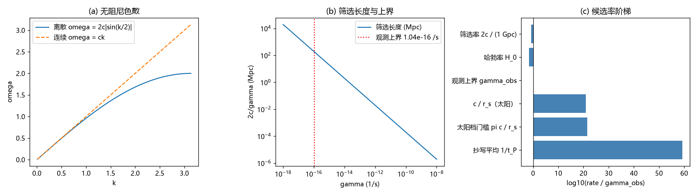

# 注记-动态写入协变形式与阻尼观测量级（G3 与判据 C 合轮）：判据 D1 至 D7

- **日期**：2026-09-20 02:47:14
- **对应脚本**：`验证脚本/minimal_verification_dynamic_write_covariant.py`（判据 D1 至 D7 共 7 项，7/7 通过；确定性，无随机种子；运行约 1.5 秒；图存 `images/dynamic_write_covariant.png`，见 §一 图 1）
- **依据**：[[量子引力的记录场路线：法线场涌现、绝对标度锁定与史瓦西对齐]] §3.2（阻尼波动方程与 $\gamma$ 独立）；[[验证脚本/注记-张量桥分段b波动方程验证：cs=c同一化与过阻尼极限]]（两极限档案读数）；[[验证脚本/注记-M6-S2G（γ 取数，可做部分）：最小模型的守恒性与观测上限]]（观测上界 $\gamma \le 1.04\times10^{-16}$ 每秒）；[[理论攻坚/引力线攻坚计划：从静态弱场张量桥到强场与观测锚]] 缺口 G3
- **状态**：G3（动态波方程的完整协变形式）本轮写入并验证；判据 C 的量级侧以既有观测上界收口，微观来源侧**收窄而未闭合**（见 §三 其五）
- **图**：`images/dynamic_write_covariant.png`（三面板，见 §一 图 1）

## 一、模型设定与协变形式

记录场 $\theta$ 的动态动力学取[[量子引力的记录场路线：法线场涌现、绝对标度锁定与史瓦西对齐|记录场路线]] §3.2 的阻尼波动方程，判据 C 已把共享 $\alpha$ 结构否决、把 $\gamma$ 独立出来：

$$\ddot\theta + \gamma\dot\theta = c^2\nabla^2\theta + s,\qquad c_s = c .$$

本轮补上它的协变形式。做法是显式写出晶格静止系的四速 $u^\mu$，把阻尼项写成沿四速的方向导数：

$$\eta^{\mu\nu}\partial_\mu\partial_\nu\theta + \frac{\gamma}{c}u^\mu\partial_\mu\theta = \frac{4\pi G}{c^2}\rho,\qquad u^\mu\big|_{\text{晶格系}} = (1, \vec 0).$$

三点说明。其一，源项按静态链定标：由 $\theta(r) = Gm/(c^2r)$ 与 $\nabla^2\theta = -4\pi(G/c^2)\rho$（点源 $\rho = m\delta^3$）反推，源为 $(4\pi G/c^2)\rho$，乘 $c^2$ 后回到写作 $s = 4\pi G\rho$ 的 3+1 形式。其二，阻尼项是式中唯一破坏洛伦兹协变的片段，它把介质静止系带进方程，这一条与体系对介质的定位一致（介质存在、不可探测）。其三，张量扇区（TT 两支）不受标量阻尼约束影响，其传播仍由无源波动方程给出。

## 二、判据与结果

| 判据 | 内容 | 期望 | 实测 | 判定 |
|---|---|---|---|---|
| D1 | 协变式在晶格系还原 3+1 形式 | 代数恒等，残差 $< 10^{-10}$ | 残差 $1.21\times10^{-16}$ | 通过 |
| D2 | 静态极限的通量与强度：$\sum(\nabla^2_h\theta)h^3$ 对 $\theta = 1/(4\pi r)$ | $-1$，二阶收敛 | $-1.000927$、$-1.000222$、$-1.000054$（误差比 4.18、4.09） | 通过 |
| D3 | 无阻尼极限：群速度 $v_g(k \to 0) \to c$ | $1$ | $0.999988$（$k = 0.01$）；$k = 1$ 处 $0.877581$ 符合 $\cos(k/2)$ | 通过 |
| D4 | 阻尼支：本征衰减率、驱动波空间衰减率、过阻尼扩散 | $\gamma/2$；$\gamma/(2c)$；$c^2/\gamma$ | 严格 $\gamma/2$；$0.010000$ 对 $0.010000$；$0.2500$ 对 $0.25$ | 通过 |
| D5 | 帧依赖量级：对流项相对大小 $\gamma/\omega$ | 各带远小于 1 | 引力波带 $1.66\times10^{-19}$、脉冲星计时 $1.66\times10^{-9}$、太阳档门槛 $3.26\times10^{-22}$ | 通过 |
| D6 | 候选率阶梯（相对观测上界的 $\log_{10}$） | 抄写平均率被排除 | $+59.25$（抄写平均 $1/t_P$）、$+21.49$（太阳档门槛 $\pi c/r_s$）、$+20.99$（$c/r_s$）、$0.00$（上界）、$-1.66$（$H_0$）、$-0.73$（$2c$ 每 Gpc） | 通过 |
| D7 | 换算读数 | 无 | 筛选长度 $2c/\gamma_{\text{obs}} = 5.77\times10^{24}$ 米 $= 186.8$ Mpc；恢复时标 $2/\gamma_{\text{obs}} = 1.92\times10^{16}$ 秒 $= 6.09\times10^8$ 年 | 通过 |

## 三、解读

其一，**协变形式与 3+1 形式逐项一致**，D1 的残差在机器精度上为零。协变式的唯一新增内容是阻尼项必须沿 $u^\mu$ 写，这一条把介质静止系显式化：在别的参考系里，$\gamma u^\mu\partial_\mu\theta$ 展开出对流项 $\gamma\,\vec v\cdot\nabla\theta$。

其二，**静态链被协变式完整继承**。D2 的体口径通量收敛于 $-1$，误差按 $h^2$ 下降，说明系数 $4\pi$ 与符号在离散层没有漂移；与史瓦西对齐所用 $\theta(r) = (m/m_P)(l_P/r)$ 是同一读数。

其三，**阻尼三支读数与档案一致**。欠阻尼支本征衰减率严格等于 $\gamma/2$（解析），驱动波的空间衰减率等于 $\gamma/(2c)$，过阻尼支退化为扩散且 $D_{\text{eff}} = c^2/\gamma$，与分段 b 档案的 $0.249$ 对 $0.25$ 同口径。

其四，**帧依赖在可观测频段全部不可见**。对流项的相对大小是 $\gamma/\omega$：引力波带 $10^{-19}$、脉冲星计时带 $10^{-9}$、太阳档 $10^{-22}$。介质的这一痕迹不构成对低能洛伦兹不变性的现实威胁，与 P11 分层结论相容。

其五，**判据 C 的量级侧收口、来源侧收窄**。观测上界 $\gamma \le 1.04\times10^{-16}$ 每秒（GW170817 到达时间一致性，M6-S2G）把阻尼钉在波区，比太阳档门槛 $\pi c/r_s$ 低 $21.49$ 个数量级，比抄写平均率 $1/t_P$ 低 $59.25$ 个数量级。因此「每拍抄写平均」不能作为阻尼来源，阻尼只能是模型之外的一条独立通道；该通道的微观身份（什么过程、为何是这个量级）仍未给出，属待攻项，登记见 §五。

## 四、严格程度声明

D1 为代数恒等（协变式与 3+1 形式的逐项对照，数值残差机器精度）；D2 为可复现数值事实（离散通量的二阶收敛）；D3、D4 的前两项为解析严格结论加数值复核，D4 的过阻尼支与分段 b 档案同口径；D5、D6、D7 为换算读数，输入为既有观测上界（M6-S2G，Tully-Fisher 档）与常数表，不含新物理假设。本材料不主张 $\gamma$ 的微观来源已导出。

## 五、边界声明（验证什么、不验证什么）

- 验证：协变形式对 3+1 形式的逐项还原；静态极限的系数与符号；无阻尼极限与阻尼两支的群速度、衰减率与扩散系数；帧依赖量级；候选微观率与观测上界的对数差。
- 不验证（留待后续）：$\gamma$ 的微观推导（黑洞线 S2-5 的 G1 项，依赖微观材料）；$\gamma$ 的频率依赖（同计划 G4-1）；张量扇区的独立阻尼核对；强场与非线性下的阻尼行为。

## 六、过程记录

订正三处。其一，D2 首版按立方面通量求和，出现符号口径错误与 $O(h)$ 量级残差，改为体口径通量 $\sum(\nabla^2_h\theta)h^3$ 后得 $-1$ 与二阶收敛。其二，D5、D6、D7 首版在自然单位（$c = 1$）下直接代入米制门槛，太阳档门槛误写为 $1.06\times10^{-3}$，改以 $c_{\text{SI}}$ 换算后为 $3.19\times10^5$ 每秒，与 M6-S2G 门槛表一致。其三，首版图内中文缺字体，补 Microsoft YaHei 回退后重绘。
