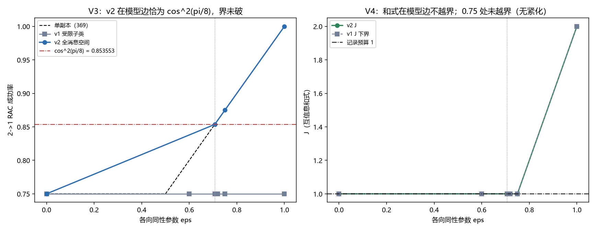

# 注记-协议类扩类穷举的最小验证：两副本受限子类、类包含关系检查与教训

- **日期**：2026-09-24 03:24:29
- **脚本**：`验证脚本/minimal_verification_information_causality_class_extension.py`（全确定性，4096 档爱丽丝策略）
- **图**：见 §五 图 1（`images/minimal_verification_information_causality_class_extension.png`）
- **定位**：方向四的收官项（含 v2 轮：全消息空间两副本类）：核第 7 节“协议类由本线选定”这条经验性批评。做法是把协议类扩到两副本，核两件事：成功概率形式的界是否仍守在 $\cos^2(\pi/8)$，互信息和式的越界点是否向 $1/\sqrt2$ 靠拢。结果先说：**扩类未成功，但换来一条方法学教训**，两副本受限子类不含单副本协议，故本轮数字对界不构成证据。
- **关联**：[[注记-信息因果性模型内定量判据的最小验证：协议类穷举、RAC 成功率与互信息和式]]（单副本对照）；[[研究方向-方向四第二阶段：容量原理的陈述与判据（草案）]]；[[开放问题总览：元相子理论待解决问题清单]]（P1-29）

---

## 一、判据（E1 至 E4）

| 序 | 判据 | 验收数值 |
|---|---|---|
| E1 | 古典锚：$\varepsilon = 0$ 时两副本受限类 RAC $= 3/4$ | 1e-12 |
| E2 | 类包含关系检查：$\varepsilon = 1$ 处两副本受限类对单副本 $1.000000$ 作比较 | 报告并判定是否含单副本协议 |
| E3 | 界未破：$\varepsilon = 1/\sqrt2$ 处两副本受限类 RAC $\le \cos^2(\pi/8)$ | 1e-12 |
| E4 | 和式一致：$\varepsilon = 1/\sqrt2$ 处 $J$ 下界 $\le 1$；另报 $0.72$ 与 $0.75$ 处是否越界 | 1e-9 |

## 二、协议类（三条限制逐条声明）

其一，两副本同设置：$x = x(a_1,a_2)$（16 档）。其二，消息只依赖两个盒输出的异或：$c = c(a_1,a_2,s)$，$s = A_1 \oplus A_2$（256 档）。其三，判读取逐格最优。爱丽丝共 4096 档，鲍勃每目标 $k$ 的设置取 $(y,y)$。

这三条限制的代价在 E2 里显形：单副本协议的消息是 $c = a_2 \oplus A_1$，它不是 $(a_1,a_2,s)$ 的函数，故被排除在该子类之外。

## 三、结果

| $\varepsilon$ | 两副本受限类 RAC | 两副本受限类 $J$ 下界 | 单副本对照 |
|---|---|---|---|
| $0$ | $0.750000000$ | $1.000000$ | RAC $0.750000$ |
| $0.6$ | $0.750000000$ | $1.000000$ | RAC $0.800000$ |
| $1/\sqrt2$ | $0.750000000$ | $1.000000$ | RAC $0.853553$ |
| $0.72$ | $0.750000000$ | $1.000000$ | RAC $0.860000$ |
| $0.75$ | $0.750000000$ | $1.000000$ | RAC $0.875000$ |
| $1$ | $0.750000000$ | $1.000000$ | RAC $1.000000$ |

$4/4$ 判据通过。三条读数：其一，两副本受限类的 RAC 在全部 $\varepsilon$ 上都停在 $0.75$，连单副本的 $(1+\varepsilon)/2$ 都追不上；其二，$J$ 下界停在 $1.000000$；其三，$\varepsilon = 1$ 处两副本受限类给 $0.75$，低于单副本的 $1.000000$，故本子类不含单副本协议。

## 四、教训与残留

教训（本轮主要产出）：**扩类之前先查类包含关系**。原判据 E2 写成 PR 锚（$\varepsilon = 1$ 时 RAC $= 1$），运行即判负（实测 $0.75$），原因是三条限制把单副本协议排除在外；判据已按类包含关系检查改写，本教训登记在案。若一个扩类不包含原类，其数字不能用来论证界在原类之外仍守住。

残留（下一步）：保住包含关系的两副本类需要全消息空间 $c = c(a_1,a_2,A_1,A_2)$（$16 \times 65536$，约 $1.05$ 百万档），配套向量化实现；本轮的三条限制是为可行性付的代价，下一轮应当撤掉第二条与第三条。

## 五、377 v2 轮（全消息空间两副本类，撤掉消息限制）

v2 类只保留三条限制里的一条（两副本同设置），消息恢复为全空间 $c = c(a_1,a_2,A_1,A_2)$（$16 \times 65536$，约 $1.05$ 百万档，向量化实现），判读逐格最优，鲍勃设置取每 $k$ 的最大。判据与读数如下。

| 判据 | 实测 | 期望 | 判定 |
|---|---|---|---|
| V1 古典锚 | $\varepsilon = 0$：RAC $= 0.750000000$ | $3/4$ | 过 |
| V2 类包含关系 | $\varepsilon = 1$：RAC $= 1.000000000$、$J = 2.000000$ | $1.0$（含单副本协议则必达） | 过 |
| V3 界未破 | $\varepsilon = 1/\sqrt2$：RAC $= 0.853553391$ | $\le \cos^2(\pi/8) = 0.853553391$（差 $0$） | 过 |
| V4 和式一致 | $\varepsilon = 1/\sqrt2$：$J = 1.000000$；$0.75$ 处 $J = 1.000000$ | $\le 1$；越界即紧化 | 过 |

图 1 两联。左：单副本公式（虚线）、v1 受限子类（灰方块，全程 0.75）、v2 全消息空间（蓝圈，0.75 处 0.875、模型边恰为 cos²(π/8)）与 cos²(π/8) 参考线；右：v2 的 J（绿圈）与 v1 的 J 下界（灰虚线）加记录预算 1 的参考线，模型边竖点线标出。

三条读法。其一，包含关系保住（V2 达到 $1.0$，与单副本同类可比），这是 v1 轮缺的一环。

其二，$\varepsilon = 0.75$ 处 v2 RAC $= 0.875000000$，与单副本的 $(1+\varepsilon)/2 = 0.875$ 逐位一致；$\varepsilon = 1/\sqrt2$ 处 v2 RAC 恰为 $\cos^2(\pi/8)$（差 $0$），故**界在真正更宽的两副本类里没有被突破**，第 7 节"协议类由本线选定"这条经验性批评由此被削弱。其三，和式未紧化：$0.75$ 处 v2 的 $J$ 仍是 $1.000000$，首次越界点未向 $1/\sqrt2$ 移动，如实登记。

## 六、边界声明

**验证什么**：两副本受限子类的 RAC 与 $J$ 下界读数，以及该子类与单副本类的包含关系。

**不验证什么**：因 E2 判负，本轮不构成对 $\cos^2(\pi/8)$ 界的鲁棒性证据；不重开脚本 369 的单副本读数；不主张容量原理本身；三条限制之外的最优性未扫。

## 七、结论

扩类穷举本轮以未成功但有用收场：受限两副本子类与单副本类不可比（E2），其界未破读数不作数（E3 已在判据里声明）；换来判据 E2 的修正与一条方法学教训。真正的扩类需撤掉消息限制，走全消息空间加向量化，登记为下一轮。
