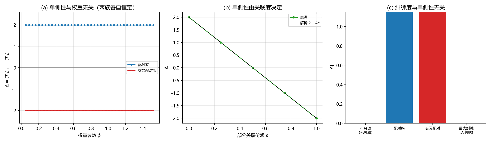

# 注记-单侧性与纠缠结构的分离：第664号「单调上升」的更正与配对关联度判据（判据第675号）

## 元数据

- **日期**：2026-10-17 23:52:11
- **类型**：验证注记（判据驱动，含上游读数更正）
- **脚本**：`验证脚本/single_sidedness_entanglement.py`
- **图**：见 §四 图 1
- **可逆性等级**：判据稳健（解析恒等式与直接求和，无采样）
- **关联**：[[验证脚本/注记-跨侧桥的判据化：张量积下的单侧不可能性与纠缠出路（判据第664号）|第 664 号]]（本轮更正其读数解读）；[[验证脚本/注记-同侧判据：侧标签与分支行为的二维分类（判据第674号）|第 674 号]]（算符层的尺，本轮的态层对应物）；[[wiki/先验纠缠]]（体系对物侧态不可分离的主张）

## 摘要

第 664 号判定「张量积态配纯模态侧算符，单侧加载不可能，出路在态层纠缠」，并给出纠缠族 $\cos\theta|0\rangle_m|+\rangle_s+\sin\theta|1\rangle_m|-\rangle_s$ 上两侧期望差达上界 $2.000000$、**随 $\theta$ 单调上升**。本轮重算发现后半句是误读：该族上两侧期望差**恒为 2**，与 $\theta$ 无关；扫描里的「上升」实为 $\theta$ 取端点时某支权重为零、读数不可定义所造成的可读性变化。

这一更正把一个更基本的问题逼了出来：单侧性到底由什么决定。本轮把单侧性与纠缠度分开测，结论是两者**互不决定**。配对族上模态纯度从 $0.500711$ 变到 $0.995017$（极差 $0.494$），$\Delta$ 恒为 $2$；反过来，在两个正交的完全关联对上叠加，纯度恒为 $0.5$（始终最大纠缠），$\Delta$ 由 $2.000000$ 连续降到 $0$。

真正的决定量是**配对关联度**：模态标签与手征标签是否一一对应。完全关联给满值，无关联给零，中间份额给线性中间值（实测 $[2,1,0,-1,-2]$ 对解析 $[2,1,0,-1,-2]$，偏差 $2.2\times10^{-16}$）。

## 一、背景与为什么是这一轮

第 674 号造了算符层的尺（侧标签加分支行为），把支路一的缺口收窄为「缺锁定构型」。但 664 号已经证明算符层的单侧加载不可能，唯一的出路在态层。所以 674 号的尺对态层是盲的，它测的是「算符住哪一边」，测不了「态把哪一支配给哪一支」。

本轮就是补这一块。入手时先复核 664 号的读数，随即发现该族的 $\Delta$ 其实是常数。这个发现改变了问题的形状：如果 $\Delta$ 与纠缠参数无关，那么 664 号「纠缠是出路」的说法就需要重新表述，纠缠本身不产生单侧性。

## 二、模型设定

载体为 8 维张量积 $\mathbb{C}^2_m\otimes\mathbb{C}^4_s$，索引约定 $4m+s$。模态侧弱荷 $T_3=\sigma_z\otimes I_4$（本征值 $\pm1$，故 $\Delta$ 的上界为 $2$，与第 664 号一致）；时空侧手征 $\Gamma_5=I_2\otimes\operatorname{diag}(1,1,-1,-1)$，$+$ 支取 $s=0,1$、$-$ 支取 $s=2,3$。

三个测量量。扇区内条件期望 $\langle T_3\rangle_\pm=\langle\psi|P_\pm T_3P_\pm|\psi\rangle/\langle\psi|P_\pm|\psi\rangle$，单侧性 $\Delta=\langle T_3\rangle_+-\langle T_3\rangle_-$；模态约化密度矩阵的纯度 $\operatorname{tr}\rho_m^2$ 作为纠缠度（$1$ 为可分离，$1/2$ 为最大纠缠）；配对关联度由构造直接控制。

## 三、判据与结果

| 判据 | 内容 | 期望 | 实测 | 判定 |
| --- | --- | --- | --- | --- |
| M1 | $[T_3,\Gamma_5]$ 范数与两扇区维数 | $0$ 与 $[4,4]$ | $0.0$ 与 $[4,4]$ | 通过 |
| M2 | 基矢标签核对（$+$ 支 $s=0,1$、$-$ 支 $s=2,3$） | 权重全为 $1$；$T_3$ 取 $[1,-1]$ | 全通过；$[1,-1]$ | 通过 |
| U1 | 配对族 40 档权重下 $\Delta$ | 恒 $2$，极差 $0$ | $2.000000$，极差 $0.00$ | 通过 |
| U2 | 同族模态纯度与 $\Delta$ 的关系 | 纯度变、$\Delta$ 不变 | 纯度 $0.500711$ 至 $0.995017$，$\Delta$ 极差 $0$ | 通过 |
| U3 | 交叉配对族 $\Delta$ | 恒 $-2$ | $-2.000000$ | 通过 |
| U4 | 部分关联扫描 $s=0,\ 0.25,\ 0.5,\ 0.75,\ 1$ | $2-4s$ | $[2,1,0,-1,-2]$，偏差 $2.2\times10^{-16}$ | 通过 |
| R1 | 乘积态 $|0\rangle_m|+\rangle_s$ | $\Delta$ 无定义 | 无定义（$- $ 支权重为零） | 通过 |
| R1 | 可分离态 $|0\rangle_m(+,+,-,-)/2$ | $0$ | $0.00\times10^{0}$ | 通过 |
| R2 | 最大纠缠族（纯度恒 $1/2$）扫描配对 | $\Delta$ 由 $2$ 降到 $0$ | $2.000000\to 0.00$，纯度极差 $4.4\times10^{-16}$ | 通过 |

## 四、结果解读

**第 664 号那处读数的更正。** 面板 (a) 两条水平线是本轮的核心读数：配对族的 $\Delta$ 恒在 $+2$，交叉配对族恒在 $-2$，权重参数 $\phi$ 从 $0.05$ 扫到 $\pi/2-0.05$ 毫无变化。解析上也直接可见：$+$ 支内态为 $\cos\phi|0\rangle$，$\langle T_3\rangle_+=+1$；$-$ 支内态为 $\sin\phi|1\rangle$，$\langle T_3\rangle_-=-1$；两者各自归一化后与 $\phi$ 无关，故 $\Delta=2$。

第 664 号 B4 读出「由近 $0$ 升到 $2.000000$、单调性成立」，是因为它在 $\theta=0$ 与 $\theta=\pi/2$ 两个端点处某支权重为零、`side_expect` 返回 `None`，被 `np.nan` 填充后过滤，剩下的 $39$ 个可读档**全部是 $2$**。所谓「由近 0 升到 2」实为「从不可读变为可读」，`np.diff` 在常数序列上全为零，故「单调」也成立。这两项判定都是恒真的，不含物理信息。

**纠缠度与单侧性互不决定。** 面板 (c) 给出四个构造：可分离态 $\Delta=0$，配对族 $\Delta=\pm2$，最大纠缠且无关联的态 $\Delta=0$。配对族本身也是纠缠的（$\phi=\pi/4$ 处纯度 $0.5$），而可分离态的单侧性为零，所以「纠缠产生单侧」不成立。反过来 R2 更硬：在两个正交的完全关联对上按权重叠加，纯度严格恒为 $0.5$，$\Delta$ 却从 $2.000000$ 连续降到 $0$。纠缠度取满值而单侧性取零，两者完全退耦。

**决定量是配对关联度。** 面板 (b) 的直线是全部结论的浓缩。把模态标签与手征标签的对应关系按份额 $s$ 打乱，$\Delta$ 就按 $2-4s$ 线性下降：$s=0$ 完全关联给 $+2$，$s=0.5$ 完全打乱给 $0$，$s=1$ 反向完全关联给 $-2$。实测与解析的最大偏差 $2.2\times10^{-16}$，是机器零级。

**R1 的前半段是一条前提检查。** 乘积态 $|0\rangle_m|+\rangle_s$ 上 $-$ 支权重严格为零，条件期望无定义，脚本返回 `None`，不给数。这类态在判据里必须显式排除，否则除以近零权重会给出无意义的巨大读数。第 664 号在 B4 的端点处遇到的正是这一情形，当时没有把它识别为前提失效。

## 五、结论

其一，第 664 号的读数解读须更正：纠缠族上两侧期望差恒为 $2$，与纠缠参数无关；「随 $\theta$ 单调上升」与「由近 $0$ 升到 $2$」是端点不可读造成的假象，两项判定均为恒真。该注记的结论一（张量积态单侧不可能）与结论三（耦合算符是另一条路）不受影响，结论二的表述须改：出路在态层这一点成立，但**起作用的是态里的配对关联，纠缠度本身不起作用**。

其二，单侧性的决定量是配对关联度，判据形式为 $\Delta=2-4s$（$s$ 为配对打乱份额），实测与解析在机器零级吻合。

其三，纠缠度与单侧性完全退耦，双向都验过：纠缠度变而单侧性不变（U2），纠缠度不变而单侧性变（R2）。故「先验纠缠是弱作用单侧的来源」这一体系主张若要在本模型内落地，须补一层：纠缠须以特定配对结构出现，纯纠缠度不够。这是对 P1-1 论纲的一处实质收紧，不是否定。

## 六、严格程度声明与边界声明

**严格程度**：判据稳健。全部读数为解析恒等式与直接求和，无随机采样，容差 $10^{-12}$ 相对实测偏差（最大 $2.2\times10^{-16}$）留了四个量级余量。三项反例均给出「改掉它就 FAIL」的对照：若配对族 $\Delta$ 随 $\phi$ 变化，U1 失败；若纯度与 $\Delta$ 同向变化，U2 失败；若 R2 的纯度不恒为 $0.5$，则「纠缠度不变」这一半不成立。

**验证什么**：纠缠族上 $\Delta$ 是否真与参数无关；纠缠度与单侧性能否互相决定；单侧性的决定量是什么。

**不验证什么**：不验证体系主张的先验纠缠在物理上是否存在（那是本体论主张，判据不触及）；不验证弱作用的手征选择是否真由配对关联实现（本模型只有 2 维模态与 4 维时空两个因子，未含代结构与色）；不判 $T_3$ 的归一化（取 $\sigma_z$ 使上界为 $2$，与第 664 号一致；若取 $\sigma_z/2$ 则全部读数减半，结论不变）。

**协议伪影**：无采样伪影。R1 的 `None` 是前提失效的显式报告，属设计意图。

## 七、登记衔接

- [[验证脚本/README]] 第 675 号正式行
- [[内部草稿/开放问题档案/开放问题-P1-1-手征性]] 追加本轮登记
- [[内部草稿/开放问题总览：元相子理论待解决问题清单]] P1-1 卡状态行更新
- [[验证脚本/注记-跨侧桥的判据化：张量积下的单侧不可能性与纠缠出路（判据第664号）]] 结论二补更正注

## 八、过程记录

**第一处自我更正：基矢索引写反。** 初版取 `E(m,s) = eye(8)[2*s+m]`，把模态与时空的因子顺序弄反，导致 $T_3$ 在两个模态基矢上读出 $[1,1]$。改为 `4*m+s`（`kron(模态,时空)` 的自然索引）后恢复正常。教训：张量积的索引约定必须在脚本顶部写明并用冒烟检查核对，不能凭记忆。

**第二处自我更正：U2 的期望写反。** 初版断言「配对族全部是可分离态、纯度恒为 1」，实测算出纯度在 $0.5$ 到 $0.995$ 之间变化。配对族 $\cos\phi|0,+\rangle+\sin\phi|1,-\rangle$ 本身就是纠缠态，$\phi=\pi/4$ 处为最大纠缠。改正后 U2 的结论反而更强：纯度在变、$\Delta$ 不变，这正是退耦的直接证据。

**第三处自我更正：R2 首版取非正交对叠加。** 初版用两个不严格正交的完全关联对按权重叠加，结果纯度随权重漂移（$0.5$ 到 $0.85$），「纠缠度不变」这一半不成立。改用正交对 $|0,+\rangle+|1,-\rangle$ 与 $|0,-\rangle-|1,+\rangle$ 后纯度严格恒为 $0.5$。这与第 674 号 T2 的教训同型：构造对照态之前先核对它的正交性与归一化。

**第四处：图的两处读数修正。** 面板 (a) 初版 `ylim` 设为 $\pm1.4$，把 $\pm2$ 的线裁到画外，图上是空的；面板 (b) 图例写解析式 $1-2s$，实际为 $2-4s$。两处都属绘图层错误，判据读数未受影响。

**方法论收获一条。** 本轮最有价值的产出来自「复核上游读数」，构造新对象并未带来同等收益。第 664 号的两项判定（单调性、由近 $0$ 升到 $2$）在形式上通过，但都是恒真的：在常数序列上 `np.diff >= 0` 恒成立，在过滤掉 `None` 之后「最大值大于 $1.9$」也恒成立。这提示一条与 EP5 并列的检查：**凡在可变参数上扫描的读数，须先报告该读数对参数的极差；极差为零而判据仍判「随参数变化」，即为恒真。** 本轮 U1 显式报告极差 $0.00$，正是这条检查的正面形态。

## 九、来源

- [[验证脚本/注记-跨侧桥的判据化：张量积下的单侧不可能性与纠缠出路（判据第664号）]]（被更正的读数）
- [[验证脚本/注记-同侧判据：侧标签与分支行为的二维分类（判据第674号）]]（算符层的对应判据）
- [[wiki/先验纠缠]]（体系对物侧态不可分离的主张）
- 第 506 号确立的 EP5 恒真检验纪律

## 修订记录

- **2026-10-18 补限定（第 677 号）**
    - $\Delta=2-4s$ 对应 $\sigma_z$ 型弱荷（右手侧也有满值谱）。标准表述要求右手单态（耦合恒零），该条件下同一配对结构给 $\Delta=1-2s$：形式不变（线性、过零点 $s=1/2$），斜率减半。
    - 本轮结论的定性部分（单侧性由配对关联度决定、与纠缠度双向退耦）不受影响，数值标度依赖算符归一化选择。见 [[验证脚本/注记-单态条件：右手不耦合与两侧不对称是两个条件（判据第677号）]]。

- **2026-10-17 建档**（复核第 664 号读数时发现误读）
    - 判据 9/9 通过，脚本与图落盘
    - 更正第 664 号 B4 的「单调上升」与「由近 0 升到 2」两项恒真判定
    - 三项结论：决定量是配对关联度、纠缠度与单侧性双向退耦、先验纠缠主张须补配对结构一层
