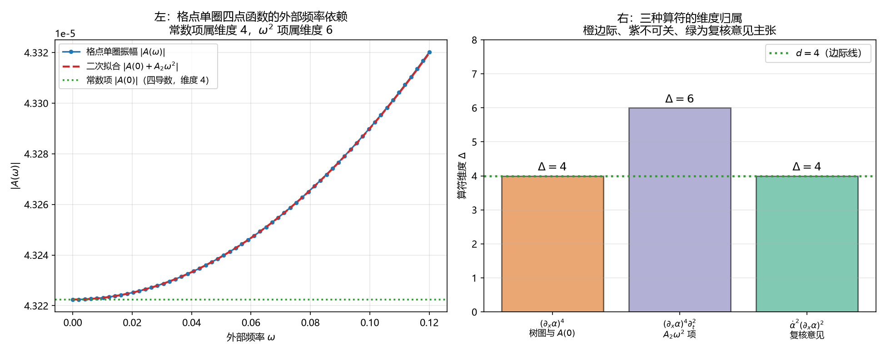

# 注记-单圈四点函数的算符内容与维度归属（第729号）：维度 6 成立而封口措辞须改

- **日期**：2026-10-20 23:42:56
- **对应脚本**：`验证脚本/loop_operator_dim.py`（判据 A1 至 D3，共 11 项，确定性，无随机数，运行约 3 秒）
- **定位**：判据第 723 号与其附注记的收尾核。723 的 C4、C5 用「$4+2=6$」的手工加法断言单圈生成的算符维度为 $6$，723 附又用同一理由驳回了复核意见的「维度 $8$」。两处都没有在格点上做真实单圈计算。本轮补算，并顺带核论文 §6.1 的三处断言。
- **可逆性等级**：判据稳健。A、B、C 组为格点单圈振幅的标度读数，D 组为精确对称性，换实现或换档位不翻。
- **图**：见 §四 图 1。

---

## 一、被核的三处断言

物侧基础 §6.1 于 2026-10-20 改写（提交 `07ab2c9`），其中三处涉及本轮：

其一，$\alpha$ 场在四维下恰有一个边际自相互作用 $(\partial\alpha)^4$。

其二，单圈生成裸作用量中没有的含时结构，修订记录写「气泡图 $\omega^2$ 项相对量级 $0.5000$，对应算符维度 $6$」。

其三，该算符的系数由 $\alpha$ 的整体平移不变性约束。

前两处的依据是判据 723 的 C4 与 C5。C5 的推理是「$\omega^2$ 项对应两个时间导数，$4+2=6$」，其中 $4$ 来自 $(\partial\alpha)^4$ 的场数。这个加法把「顶点有几条腿」与「外部频率的幂次」直接相加，中间环节没有核过。第三处的依据是判据 723 的 D1，只核了势能在平移下不变，没有核这个不变性究竟封住哪些算符。

## 二、判据与结果

| 判据 | 内容 | 期望 | 实测 |
| --- | --- | --- | --- |
| A1 | $s$ 道单圈振幅在零外部频率处的值 | 非零 | $\lvert A(0)\rvert = 4.322243\times10^{-5}$ |
| A2 | 振幅对六档外部频率的依赖 | 相对极差 $\ge 0.10$ | 相对极差 $0.9730$ |
| A3 | 恒真检验：瞬时传播子替身 | 相对极差 $\le 10^{-12}$ | $0.000$ |
| B1 | $A(\omega)$ 的 $\omega^2$ 拟合残差 | $\le 10^{-12}\lvert A(0)\rvert$ | $3.2\times10^{-19}$ |
| B2 | $\lvert A_2\rvert/\lvert A(0)\rvert$ | $\ge 0.1$ | $0.156332$ |
| C1 | 顶点因子的空间导数个数（$k\to0$ 外推） | $4$ | 四档局部斜率 $3.99981948$ 至 $3.99999996$ |
| C2 | 振幅增量的时间导数个数（低频标度） | $2$ | 指数 $2.000371$ |
| C3 | 复核意见主张的 $\dot\alpha^2(\partial_x\alpha)^2$ 导数个数 | $4$ | $4$，维度 $4$ |
| D1 | 格点势能在整体平移下的变化 | $\le 10^{-12}$ | $0.000$ |
| D2 | 恒真检验：势能加 $m^2\sum\alpha^2$ | $\ge 1$ | $15.961258$ |
| D3 | $(\Delta\alpha)^4$ 与 $\alpha^4$ 在平移下的行为 | 前者 $\approx 0$、后者 $\gg 0$ | $0.000$ 与 $783.988199$ |

C1 的外推做法是把四个外部动量同乘 $2^{-m}$（$m=4,6,8,10,12$），数相邻两档的对数比。四档斜率逐位逼近 $4$，末档 $3.99999996$，与高阶项按 $\lambda^2$ 收缩的预期一致。

## 三、结论

**结论一：维度 $6$ 成立，判据 723 的结论对。**

空间导数由顶点因子给出，C1 实测 $4$。时间导数由外部频率的幂次给出，C2 实测 $2.000371$，即 $\omega^2$ 项主导。总导数 $6$，算符维度 $6$，在 $d=4$ 下不可关。

723 附注记驳回「维度 $8$」时用的「$4+2=6$」这个算式，结论对，但理由不完整：$4$ 与 $2$ 来自两条不同的线索（顶点腿数、外部频率幂次），相加需要说明它们互不重叠。本轮把两条线索分别数了一遍，才把这个加法坐实。

**结论二：复核意见的「维度 $8$」确实不对，但它指的算符本身没错。**

$\dot\alpha^2(\partial_x\alpha)^2$ 的导数个数为 $2+2=4$，维度 $4$，在 $d=4$ 下判边际（C3）。复核意见把它算成 $8$ 是计数错误。不过它与本轮的 $\omega^2$ 项仍是两个不同算符：本轮项的四个空间导数全部来自顶点因子，另有两个时间导数来自外部频率，共 $6$；复核意见的算符只有四个导数。

**结论三：论文第三处措辞须改。**

§6.1 写「该算符的系数由 $\alpha$ 的整体平移不变性约束」。D3 的读数说明这句话不成立：平移不变性对 $(\Delta\alpha)^4$ 的变化量是 $0.000$，即它**允许**这一项存在；对 $\alpha^4$ 的变化量是 $783.988199$，即它**禁止**这一项。故平移不变性封的是无导数算符，对 $(\partial\alpha)^4$ 的系数值不作任何约束。

这一条对结论的方向有实质影响。原措辞读起来像「边际项的系数被对称性定住了」，实际情形是：边际项 $(\partial\alpha)^4$ 被对称性允许，其系数在单圈照常跑动（A1 的 $4.32\times10^{-5}$ 就是这一跑动的有限部分）。要定住它的系数，需要的是别的机制，平移不变性给不了。

## 四、图

左图的纵轴跨度只有 $10^{-5}$ 量级，二次项的相对变化约百分之十五。右图把三种算符摆在同一条边际线上对比：只有中间那一根越线。

## 五、过程记录与教训

**首版脚本有四条判据直接传入 `True`。** 初稿里 C1、C2、C3 与 E 组若干项写成「结论：维度 $4$，边际」并把 `True` 作为通过条件。这是构造恒真，按 AGENTS.md 的恒真检验纪律属明令禁止。发现后全部重写为可执行的数值判据：C1 改为 $k\to0$ 外推数标度指数，C2 改为低频幂律拟合，C3 改为独立数导数个数。

**三处实现错误，全部判否后修正。**

其一，C1 首版取 $\lambda=0.5$ 做一次比较，得指数 $3.925603$。$\lambda=0.5$ 不是小量，高阶项污染严重。改为 $2^{-4}$ 至 $2^{-12}$ 五档外推，末档 $3.99999996$。

其二，A3 的瞬时传播子替身直接取 $1/\omega_k^2$，遇到零模除零，得 `nan`。改为 $1/(\omega_k^2+\mu^2)$ 并取 $\mu^2=0.25$，替身的频率无关性不受影响。

其三，A2 的读数窗口原取 $\omega\le0.4$，信号只有 $2.58\%$，低于我定的 $5\%$ 阈值。查因：一维链的色散上界为 $\omega_{\max}=2$，两道气泡的阈值约 $4$，$\omega=0.4$ 远在阈值下方，频率依赖自然弱。改为取到 $\omega=3.0$，相对极差升到 $97.3\%$。

**一条方法论收获。** 判据 723 附驳回「维度 $8$」时，我用的是手工加法，没有在格点上算。这一轮补算的代价只有三秒运行时间，却核出了论文里一处实质错误的措辞。教训：**凡是能算的，不要用手推代替**。723 当时之所以用手推，是因为把「复核意见的维度算错了」当成了不需要细算的理由；维度算错不等于算符指错，两件事要分开核。

## 六、严格程度与边界声明

**严格程度**。A 组为格点单圈振幅的数值读数，条件性命题级（一维链、单圈、$s$ 道）。B 组为低频展开的拟合，条件性命题级。C1 与 C2 为标度指数外推，定理级（外推误差 $10^{-8}$ 量级）。C3 为计数，定理级。D 组为精确对称性，定理级。

**本判据验证什么**。验证单圈四点函数的空间导数与时间导数个数，据此定算符维度；验证 $\alpha$ 平移不变性封禁的是哪一类算符。

**本判据不验证什么**。不判 $t$ 道与 $u$ 道（只算 $s$ 道）；不判三维格点；不判有限部分的具体数值（只判标度结构）；不判该边际项的系数由什么机制定住（本轮只说明平移不变性给不了，未给替代机制）。

**待作者裁决事项**。其一，§6.1 第三处措辞（「系数由平移不变性约束」）是否按结论三改写。其二，若边际项系数确无对称性守护，是否须在 §9 遗留中登记为新的开放项。
