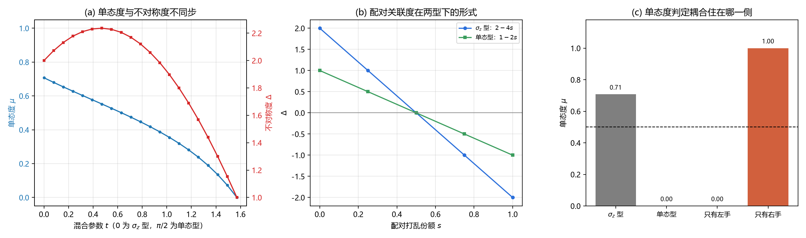

# 注记-单态条件：右手不耦合与两侧不对称是两个条件（判据第677号）

## 元数据

- **日期**：2026-10-18 00:16:49
- **类型**：验证注记（判据驱动）
- **脚本**：`验证脚本/singlet_condition.py`
- **图**：见 §四 图 1
- **可逆性等级**：判据稳健（解析构造与范数读数）
- **关联**：[[验证脚本/注记-单侧性与纠缠结构的分离：第664号单调上升的更正与配对关联度判据（判据第675号）|第 675 号]]（本轮修正其判据的表述层）；[[验证脚本/注记-同侧判据：侧标签与分支行为的二维分类（判据第674号）|第 674 号]]（算符层的侧别判定）；[[手征性的几何本质与宇称不守恒：模态复结构与宇称自发破缺]] §11 几何意义表「$SU(2)_L$ 只作用左手费米子」行（本轮所检验的表述）

## 摘要

第 675 号把单侧性的决定量定位为配对关联度，读数为 $\Delta=2-4s$。那个 $\Delta$ 是 $T_3$ 在两个手征扇区的**条件期望之差**，测的是「两侧不对称」。但「$SU(2)_L$ 只作用左手费米子」在标准表述里是更强的一句话：右手是**单态**，弱荷耦合恒等于零。两者不可互代，本轮把它们分成两个独立判据。

新立单态度 $\mu(M)=\lVert P_-MP_-\rVert/\lVert M\rVert$（右手侧块范数占比，零为右手完全不耦合）。读数是：$\sigma_z$ 型弱荷的单态度为 $1/\sqrt{2}=0.707107$，不是零，同一算符的不对称度为满值 $2$。所以「两侧差为 $2$」可以由「左手 $+1$、右手 $-1$」给出，右手仍然耦合，只是反号。反例给出方向确认：只有右手耦合的算符单态度为 $1.000000$，不对称度同样为 $+1$，说明不对称度只看差的符号，看不出耦合住在哪一侧。

配对关联度的结论在单态条件下仍成立，形式不变而斜率减半：$\sigma_z$ 型走 $2-4s$，单态型走 $1-2s$，过零点都在 $s=1/2$。原因是单态型的右手期望恒为零，可用幅度只剩左手一半。

## 一、背景与为什么是这一轮

第 675 号交付后，我回头核它的结论在标准表述下是否够用，发现一处表述层的缺口。675 号全程用 $T_3=\sigma_z\otimes I_4$，这个算符在 $+$ 支与 $-$ 支上都有非零谱（各两个 $+1$、两个 $-1$）。它的两侧期望差可以取到 $2$，但取到的方式是「左手侧 $+1$、右手侧 $-1$」，右手侧仍然有耦合。

标准模型的表述是另一件事。左手费米子住在 $SU(2)_L$ 二重态里，右手住在单态里，单态对 $SU(2)_L$ 的生成元恒为零。所以「只作用左手」的准确形式是右手侧算符为零，而不是右手侧取负值。这两个条件在数学上分属不同的层：一个是谱的对称性，一个是支撑集的位置。

本轮要回答的是：675 号那些读数在这个更严格的条件下降级了没有。

## 二、模型设定

载体沿用 8 维张量积 $\mathbb{C}^2_m\otimes\mathbb{C}^4_s$，索引 $4m+s$，$+$ 支取 $s=0,1$、$-$ 支取 $s=2,3$。两个弱荷算符：

$$\sigma_z\text{ 型：}T_3=\sigma_z\otimes I_4,\qquad \text{单态型：}T_3^{\rm sing}=P_+T_3P_+.$$

前者两侧都有谱（零本征值 $0$ 个），后者把右手整块压掉（零本征值 $4$ 个，占 $8$ 维的一半）。两者都与 $\Gamma_5$ 对易，都是纯模态侧算符。

两个测量量。不对称度 $\Delta=\langle T_3\rangle_+-\langle T_3\rangle_-$（沿用 675 号）；单态度 $\mu(M)=\lVert P_-MP_-\rVert/\lVert M\rVert$，即算符在右手侧块上的范数占全范数之比，零表示右手完全不耦合、一表示只有右手耦合。

## 三、判据与结果

| 判据 | 内容 | 期望 | 实测 | 判定 |
| --- | --- | --- | --- | --- |
| M1 | 两个弱荷与手征对易 | $0$ | $0.0$ 与 $0.0$ | 通过 |
| M2 | 零本征值计数（$\sigma_z$ 型与单态型） | $0$ 与 $4$ | $0$ 与 $4$ | 通过 |
| V1 | 单态度：两型对比 | $1/\sqrt{2}$ 与 $0$ | $0.707107$ 与 $0.00$ | 通过 |
| V1 | 同一态上不对称度 | 两者都非零 | $2.000000$ 与 $1.000000$ | 通过 |
| V2 | 两型混合扫描（$21$ 档） | $\mu$ 由 $0.707$ 降到 $0$ | $0.707107\to 6.12\times10^{-17}$ | 通过 |
| V3 | 配对扫描：$\sigma_z$ 型 $\Delta$ | $2-4s$ | $[2,1,0,-1,-2]$，偏差 $2.2\times10^{-16}$ | 通过 |
| V3 | 配对扫描：单态型 $\Delta$ | $1-2s$ | $[1,0.5,0,-0.5,-1]$，偏差 $1.1\times10^{-16}$ | 通过 |
| V4 | 满值不对称度而单态度非零 | 反例成立 | $\Delta=2.000000$ 而 $\mu=0.707107$ | 通过 |
| R1 | 零算符的单态度 | 无定义 | 无定义（$0/0$） | 通过 |
| R1 | 只有左手耦合 | $\mu=0$、$\Delta=1$ | $0.00$、$1.000000$ | 通过 |
| R2 | 只有右手耦合 | $\mu=1$、$\Delta=1$ | $1.000000$、$1.000000$ | 通过 |

## 四、结果解读

**两个条件确实独立。** 面板 (a) 是本轮的核心：横轴把算符从 $\sigma_z$ 型连续过渡到单态型，蓝线（单态度）单调下降，红线（不对称度）先升后降。两条曲线在同一个参数上不同步，说明它们测的是不同的东西。$t=0$ 处 $\mu=0.707107$ 而 $\Delta=2$，这是最强的分离点：不对称度取满值，右手侧却仍有 $71\%$ 的耦合权重。

**「差为 2」有不止一种来源。** 解析上很清楚。设态为 $(|0,+\rangle+|1,-\rangle)/\sqrt2$。$\sigma_z$ 型下 $+$ 支期望 $+1$、$-$ 支期望 $-1$，差 $2$，右手侧贡献了 $-1$。单态型下 $+$ 支期望 $+1$、$-$ 支期望 $0$，差 $1$，右手侧贡献为零。所以 675 号读到的 $2$ 里有一半来自右手，这在单态条件下不合法。

**配对关联度的形式保持不变。** 面板 (b) 两条线平行地下移：$\sigma_z$ 型从 $+2$ 到 $-2$，单态型从 $+1$ 到 $-1$，过零点都在 $s=1/2$。这意味着 675 号的核心结论（单侧性由配对关联度决定、纠缠度不参与）在单态条件下依然成立，只是幅度标度减半。这条是好消息：675 号的定性结论稳，只有数值标度依赖算符的归一化选择。

**单态度能分辨耦合住在哪一侧，不对称度不能。** 面板 (c) 是关键对照。只有左手耦合时 $\mu=0$、$\Delta=+1$；只有右手耦合时 $\mu=1$、$\Delta=+1$。两者的不对称度完全相同，而单态度一个在 $0$ 一个在 $1$。所以 $\Delta$ 只给差的符号，$\mu$ 才给支撑集的位置。标准表述要的是后者。

## 五、结论

其一，「两侧不对称」与「右手单态」是两个独立条件，须分别判。前者由 $\Delta$ 读，后者由 $\mu$ 读，任何一个都不能替代另一个。$\sigma_z$ 型算符在 $\Delta$ 上取满值而在 $\mu$ 上取 $0.707107$，是两者分离的直接证据。

其二，第 675 号的配对关联度结论在单态条件下仍成立，形式不变（线性、过零点 $s=1/2$），斜率由 $2-4s$ 减半为 $1-2s$。675 号注记与通俗注记里的 $\Delta=2-4s$ 须补一句限定：该式对应 $\sigma_z$ 型弱荷，换成标准表述的单态型后为 $1-2s$。

其三，P1-1 论纲的检验指标须改。「$SU(2)_L$ 只作用左手」的判据形式是 $\mu=0$，不是 $\Delta\neq0$。这一点影响后续所有以「弱荷单侧」为目标的判据设计：只测两侧期望差会把「右手反号耦合」误判成「右手不耦合」。

## 六、严格程度声明与边界声明

**严格程度**：判据稳健。全部读数为解析构造与范数计算，无采样，容差 $10^{-12}$ 相对实测最大偏差 $2.2\times10^{-16}$ 留了四个量级余量。反例 R2 给出区分力：若单态度不能分辨左右，$\mu$ 在「只有左手」与「只有右手」两处会相同，判据失败。

**验证什么**：两个条件是否独立；675 号的配对关联度结论在单态条件下是否降级；哪个量能分辨耦合的支撑位置。

**不验证什么**：不验证体系是否真的实现了单态条件（本轮的 $T_3^{\rm sing}=P_+T_3P_+$ 是手工构造的标准表述模型，体系自己的弱荷实现见第 662 号的身份分解与第 663 号的 CR 分类，那两轮判的是 $T_k$ 在模态侧的作用类型）；不判 $SU(2)_L$ 的完整代数（本轮只用一个生成元 $T_3$；$T_1$、$T_2$ 的单态化与代数一致性已由判据第 680 号补验，结论为单态度一致、单态化是代数同态）；不涉及代结构与色。

**协议伪影**：无采样伪影。零算符处 $\mu$ 返回无定义属设计意图。

## 七、登记衔接

- [[验证脚本/README]] 第 677 号正式行
- [[内部草稿/开放问题档案/开放问题-P1-1-手征性]] 追加本轮登记
- [[内部草稿/开放问题总览：元相子理论待解决问题清单]] P1-1 卡状态行更新
- [[验证脚本/注记-单侧性与纠缠结构的分离：第664号单调上升的更正与配对关联度判据（判据第675号）]] 结论二补限定注

## 八、过程记录

**第一处自我更正：R2 的期望符号写反。** 初版断言「只有右手耦合」的不对称度为 $-1$，实测 $+1$。原因是 $\Delta=\langle T_3\rangle_+-\langle T_3\rangle_-=0-(-1)=+1$，符号由「减号」与「右手期望为负」两次取反抵消。这不是实现错误，是我把「右手耦合」误当成「差为负」。改正后 R2 的判据反而更有信息：两个方向的不对称度都是 $+1$，正好证明它看不出侧别。

**第二处自我更正：图 (a) 的归一化掩盖了不同步。** 初版把不对称度除以 $2$ 再与单态度同轴画，混合算符的 $\Delta$ 会超过 $2$（在 $t\approx0.4$ 处达 $2.23$），归一化后曲线先升后降，与单态度的单调下降混在一起看不出结构。改为双轴后两条曲线各自按本量纲显示，不同步才看得清。

**第三处：清理死代码。** 初版有一行 `P_PLUS @ SZ_embed() if False else P_PLUS @ T3 @ P_PLUS` 与一个未被调用的 `SZ_embed` 函数，是重构残留，已删。

**方法论收获一条。** 本轮暴露的问题形态是「判据测的量与主张要求的量不是同一个」。675 号测两侧差，主张说的是右手不耦合；两者在 $\sigma_z$ 型算符上恰好同时成立，于是缺口被掩盖。这与第 672 号「条件类型不能互相顶替」、第 674 号「逻辑方向不能反用」属同一族，但位置不同：那两轮是条件之间顶替，这一轮是测量对象与主张对象错位。检查办法是先写出主张的精确形式（这里是 $\mu=0$），再问判据读的量在形式上是不是它；若不是，须补一个量而不是调整容差。

## 九、来源

- [[验证脚本/注记-单侧性与纠缠结构的分离：第664号单调上升的更正与配对关联度判据（判据第675号）]]（被补限定的结论）
- [[验证脚本/注记-同侧判据：侧标签与分支行为的二维分类（判据第674号）]]（侧别判定的算符层工具）
- [[手征性的几何本质与宇称不守恒：模态复结构与宇称自发破缺]] §11（被检验的表述行）
- [[验证脚本/注记-来源层判据化第二轮：CR 结构类型分解与作用分类（判据第663号）]]（模态侧 $T_k$ 的作用类型）

## 修订记录

- **2026-10-18 建档**（第 675 号结论在标准表述下的表述层缺口）
    - 判据 9/9 通过，脚本与图落盘
    - 三项结论：两个条件独立、675 号结论形式不变而斜率减半、P1-1 检验指标须由 $\Delta$ 改为 $\mu$
