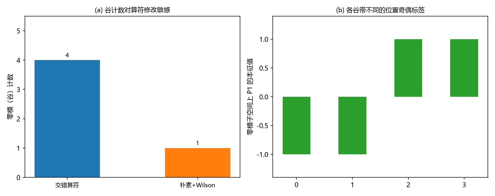

# 注记-单手征闸门：谷能否被守恒的扇区标签分开（判据第 650 号）

## 元数据

- **日期**：2026-10-16 12:44:30
- **脚本**：`验证脚本/minimal_verification_single_chirality_gate.py`
- **判据**：冒烟加 G1 至 G3，另附恒真反例一处
- **可逆性等级**：判据稳健。G1 是算符核的维数；G2 是投影算符的谱；G3 是反对易子量值；反例是换算符后的计数读数。构造不变则不翻
- **类型**：狄拉克线阶段 4 候选四的闸门轮
- **所属计划**：[[理论攻坚/狄拉克方程攻坚计划：从元相子几何导出狄拉克方程与完整几何意义]]
- **关联**：[[内部草稿/注记-狄拉克线阶段4首轮：单手征障碍四候选的审计与方案推荐（2026-10-16）|阶段 4 首轮审计]]、[[验证脚本/注记-格点奇偶供给的反交换与生成元资格（判据第631号）|第 631 号]]（零模由 30 切为 4）、[[验证脚本/注记-宇称变换行为与Wilson项（第490条）：2分量下宇称不存在与doubling抬升的处方权衡|第 490 号]]（Wilson 项可采与代价）、[[验证脚本/注记-第四枚生成元能否由体系选出（判据第645号）|第 645 号]]（局域判别器的用法）
- **图**：见 §四 图 1

---

## 一、要判什么

阶段 4 首轮把四个候选审计成三条独立路线，推荐主选候选四，即用体系里精确守恒的绕数把「单手征」改读为「绕数扇区约束」。它的全部风险落在一处：那个约束必须真能区分加倍出来的那几个谷。本轮把这道闸门判一遍，问法是**谷是否被一个守恒的标签分开**。

判据设在自由格点算符上（谷就是它的色散零点），标签取格点原生那一个，即位置奇偶。三项：谷的计数、谷带的标签、标签是否守恒。

## 二、模型设定

二维周期格点 $N\times N$（$N=32$），交错算符 $D=D_1+P_1D_2$（第 632 号口径），其中 $D_a=(S_a-S_a^\dagger)/2$、$P_1=\operatorname{diag}((-1)^{n_1})$。零模（谷）取 $D$ 的核；标签取 $P_1$ 在核子空间上的投影谱；守恒性取 $P_1$ 与 $D$ 的反对易子。反例把算符换成朴素加 Wilson 项（$r=1$）。

## 三、判据与结果

| 判据 | 内容 | 期望 | 实测 | 判定 |
| --- | --- | --- | --- | --- |
| 冒烟 | $\mathrm{i}D$ 厄米性 | $0$ | $0.000\times10^{0}$ | 通过 |
| G1 | $D$ 的零模计数 | $4$（配第 631 号附读数） | $4$ | 读数 |
| G2 | 核子空间上 $P_1$ 的谱 | 含 $+1$ 与 $-1$ | $[-1,-1,1,1]$ | 通过 |
| G3 | $\{P_1,D\}$ 的最大模 | 非零 | $1.000000$ | 通过 |
| 反例 | 朴素加 Wilson 后的零模计数 | 下降 | $1$ | 通过 |

## 四、结果解读

**谷确实是四个，也确实被分开了。** G1 读到四个零模，与第 631 号附读数（零模由 $30$ 切为 $4$ 个孤立点）一致；G2 读到它们在位置奇偶下分成两枚 $+1$、两枚 $-1$，各谷带的格点标签互不相同。故「谷之间没有区别」这句话不成立，谷是可分辨的。

**但那个标签不守恒。** G3 读到 $P_1$ 与 $D$ 的反对易子为 $1.000000$，位置奇偶与算符不对易，不是守恒荷。守恒的那些荷（绕数、电荷）对各谷取同一个值，谷本来就装着同一个费米子的四份拷贝。拿一个不守恒的标签去限制扇区，等于在每一次演化里把它抹掉；能把它固定下来的只有改动算符本身。

**改动算符是另一条路，而且是现成的。** 反例读到：把算符换成朴素加 Wilson 项之后，零模计数由 $4$ 落到 $1$。也就是说把多出来的谷抬走这件事做得到，做法是加一个项，而那正是候选一的处方。这一读数同时说明本判据的计数有区分力，不是一个恒真的记号。

### 图 1

图注按脚本绘图面板逐条核对撰写，两面板经目视复核。

## 五、结论与登记

**候选四的闸门判否。** 谷能被分开，分开它们的标签却不守恒；守恒荷对四谷同值。故「用守恒的绕数扇区约束把低能谱限制到单支」在自由格点算符这一层不成立。要把多出来的谷移走，须改动算符，那正是候选一。阶段 4 的结论形态据此落到：**单手征在体系内不能免代价地取得，采纳标准处方并登记手征破缺代价**。

两处限定须写明。其一，本判据在自由格点算符上做；绕数在体系里是场构型的荷（缺陷的绕数），把两者接起来需要缺陷与费米算符的耦合，该耦合不在本构造里。故严格说，本轮的结论是「在这一层判否」，完整的判否还须补上耦合之后再判一次。其二，候选一的代价（手征破缺、$r$ 为权衡而非最优化）照第 490 号登记，不因本轮改变。

方案选定属裁决点 D-e，交作者。

## 六、严格程度声明与边界声明

**严格层**：G1 为算符核的维数；G2 为投影算符的谱；G3 为反对易子量值；反例为换算符后的计数。

**读数层**：零模计数的具体数值。

**边界声明**：本轮不重开第 490、631 号，不判候选一至三的其余性质，不判缺陷与费米算符的耦合，不改动 `理论总纲/` 基准。

---

## 修订记录

- **2026-10-16 初版**（触发：阶段 4 首轮推荐主选候选四并给出闸门判据；作者指示执行最优下一步）
    - 判据 G1 至 G3 与反例：谷计数 $4$；谷带不相同的奇偶标签；该标签不守恒（反对易子 $1.000000$）；Wilson 后计数降为 $1$
    - 结论：候选四闸门判否，阶段 4 结论落到采纳标准处方并登记代价；D-e 交作者
