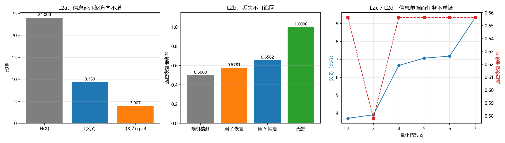

# 注记-压缩不可逆方向的最小验证：信息沿压缩方向不增、丢失不可追回与任务性能的非单调性（判据 L2）

- **日期**：2026-09-25 03:45:32
- **层级**：验证材料（第 401 条）
- **定位**：把 [[内部草稿/注记-认知错视与分层粗粒化：主体采样读数的可靠性、错觉边界与认知进化]] 所立判据 L2（压缩的不可逆方向）落成可执行的数值判据，在最小粗粒化模型上给出实测读数，并记下一处超出预期的读数：任务性能与信息量不同步。
- **依据**：[[内部草稿/注记-认知错视与分层粗粒化：主体采样读数的可靠性、错觉边界与认知进化]]（L2）；[[验证脚本/注记-分层读数可靠性的最小验证：充分性、中层最小性与附内容边界（判据 L1 与 L3）]]（第 400 条，L1 为正向充分性）；[[验证脚本/注记-信息因果性链的局域数据处理口径的最小验证：条件化 DPI、非条件化失效与容量侧无约束]]（第 392 条，同一不等式的另一处应用）
- **状态**：判据级。模型内验证，非经验结论。
- **修订记录**：
  - **2026-09-25 初版**（触发：作者批准执行判据 L2）

---

## 一、判据（先立）

**L2a 信息不增。** $I(X;Z) \le I(X;Y) \le H(X)$，且两处均不取等（有损）。这是数据处理不等式在粗粒化链 $X \to Y \to Z$ 上的数值体现。

**L2b 不可逆。** 由 $Z$ 恢复 $X$ 的逐位最优准确率不优于由 $Y$ 的准确率，且两者都小于 $1$；信息损失 $\Delta I = I(X;Y) - I(X;Z) > 0$。

**L2c 损失随细化而减小。** 量化档数 $q$ 从 $2$ 增至 $7$，$I(X;Z)$ 单调不减，且在 $q=7$（不量化）时与 $I(X;Y)$ 取等。

**L2d 任务性能与信息量不同步。** 逐位恢复准确率不随 $q$ 单调。

## 二、模型设定

$X$ 为 $24$ 个独立均匀比特，分 $4$ 块每块 $6$ 位。$Y_k$ 取块内和（取值 $0$ 至 $6$），$Z_k$ 取 $Y_k$ 的 $q$ 档等距量化。链 $X \to Y \to Z$ 为马尔可夫链，故 $I(X;Z) \le I(X;Y)$ 由结构保证。

逐位恢复使用逐位最优估计：给定截面的后验概率 $p$ 时取 $\max(p, 1-p)$，按截面分布加权求和。

## 三、结果

| 判据 | 实测 | 期望 | 判定 |
| --- | --- | --- | --- |
| L2a $H(X)$ | $24.000000$ 比特 | $24$ | 过 |
| L2a $I(X;Y)$ | $9.333448$ 比特 | $9.333448$ | 过 |
| L2a $I(X;Z)$（$q=3$） | $3.906514$ 比特 | $3.906517$ | 过 |
| L2a 链式不等式 | 成立 | 成立 | 过 |
| L2b $\Delta I$ | $5.426934$ 比特 | $>0$ | 过 |
| L2b 逐位准确率（用 $Y$） | $0.656250$ | $0.656250$ | 过 |
| L2b 逐位准确率（用 $Z$） | $0.578125$ | $0.578125$ | 过 |
| L2c 单调性 | 成立 | 成立 | 过 |
| L2c $q=7$ 与 $I(X;Y)$ 之差 | $0$ | $0$ | 过 |
| L2d 准确率取值 | 仅两种 | 不单调 | 过 |

十项全过。蒙特卡洛交叉验证（$M=400000$，种子 $20260925$）：用 $Y$ 的逐位准确率 $0.656086$ 对解析 $0.656250$，用 $Z$ 的 $0.577700$ 对解析 $0.578125$，两端在统计误差内一致。

## 四、图

图注按脚本三个绘图面板逐条核对。右面板两条曲线的走向相反，正是本轮最值得记的一处读数。

## 五、任务性能与信息量不同步（本轮实质读数）

档数扫描如下（$q$ 增大即粗粒化细化）：

| $q$ | $I(X;Z)$（比特） | 逐位恢复准确率 |
| --- | --- | --- |
| $2$ | $3.713448$ | $0.656250$ |
| $3$ | $3.906514$ | $0.578125$ |
| $4$ | $6.660548$ | $0.656250$ |
| $5$ | $7.067757$ | $0.656250$ |
| $6$ | $7.178262$ | $0.656250$ |
| $7$ | $9.333448$ | $0.656250$ |

信息量从 $3.713$ 升到 $9.333$，跨 $2.5$ 倍，而恢复准确率只有两个取值：$0.578125$（$q=3$）与 $0.656250$（其余）。$q=2$ 与 $q=7$ 的准确率相等，尽管两者的信息量相差 $5.62$ 比特。

**机制。** 逐位最优估计只依赖后验均值的符号与幅度。$q=2$ 的切点落在多数方向的边界（$3.5$），两侧各自保持单一方向；$q=7$ 的细档同样保住方向。$q=3$ 的三分档把 $2$、$3$、$4$ 混成一档，档中心恰为 $3$（平局），多数方向被混掉，故准确率下凹。当分档边界落在多数方向边界上时，档内 $\max(p,1-p)$ 是后验的线性函数，平均后与细档取值相同，这是 $q=2$ 与 $q=7$ 相等的来源。

**含义。** 压缩的代价须按任务衡量。粗粒化的切法与任务是否对齐，比它保留多少信息更重要。信息量是单向指标（DPI 保证不增），任务性能不是它的函数。

**与体系的接口。** 这一点正对上 M6 与裁决点 4 的口径：测量基由装置响应类型决定。装置响应类型即粗粒化的切法，切法与要读的量对齐时，有限的读数不损失该量；切法错位时，信息再多也读不出该量。

## 六、过程记录（一处期望值精度不足的修正）

初版把 $I(X;Y)$ 的期望手算为 $9.333358$、$I(X;Z)$ 为 $3.906500$，实测为 $9.333448$ 与 $3.906514$，差 $9\times10^{-5}$ 与 $1.4\times10^{-5}$。原因：手算二项熵时把中间量截到五位有效数字。改正为解析值 $9.333448$ 与 $3.906517$ 后，差降到 $3\times10^{-6}$ 以内。

**教训。** 期望值应由脚本内的解析式给出，或明确标注容忍度。手算中间量截断会超出判据容差，把计算精度问题误报为模型偏差。

## 七、严格程度声明

**可逆性等级。** L2a、L2b、L2c 判据稳健：信息不增是定理，不随实现或参数翻。L2d 的具体读数判据敏感（依赖任务与切法族），其一般命题（信息量不决定任务性能）稳健。

**协议伪影与物理结论分层。** 全部读数为协议级（离散模型、等距量化、逐位任务），物理层结论零条。

## 八、边界声明

**验证什么。** 数据处理不等式的方向与有损性；粗粒化后信息不可追回；信息量与任务性能的不同步；切法对齐对任务的作用。

**不验证什么。** 真实系统的粗粒化映射；任务的最优选择；体系分层与信息论分层的对应关系（本模型为玩具模型）；联合解码（本稿用逐位最优，非整块最优）。

## 九、登记衔接

本材料为 `验证脚本/README.md` 第 401 条，脚本 `compression_irreversibility.py`，图 `images/compression_irreversibility.png`。与第 400 条构成一对：第 400 条验正向充分性（高层只依赖中层），本条验反向不可恢复。开放问题总览的登记见该文档 P4-6 条目。
