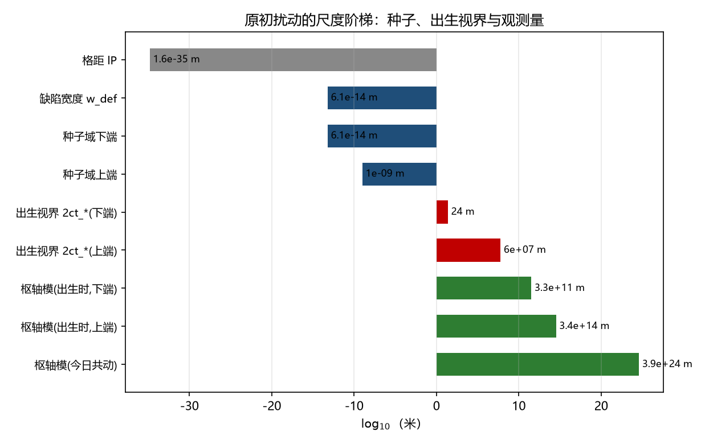

# 注记-原初扰动来源核算：种子深亚视界与枢轴超视界（局域通道不可行）

- **日期**：2026-09-21 01:20:37
- **层级**：验证材料（`验证脚本/`，内部草稿级）
- **定位**：P4-42 ① 的第一步。把「扰动谱从哪来」收成三把尺子的量级核对：种子尺度、出生时视界、观测枢轴模。结论是前两者与第三者不在同一量级，局域通道不可行，剩下唯一候选是节律层对象。
- **脚本**：`验证脚本/minimal_verification_primordial_seed_scales.py`（确定性，无随机；图存 `images/primordial_seed_scale_ladder.png`）
- **关联**：[[内部草稿/检查项-出生瞬间的初条件清单：扰动谱、平坦性、熵、不对称四项的交付形态]]（P4-42 ①）；[[验证脚本/注记-统一口径重算：时标区间读数]]（$t_*$ 区间与 $\\xi$ 允许域）；[[内部草稿/注记-暴涨前的元相子种子与天行力寻优：分层调和下的超光速暴涨]]（节律层与定居层的分层）
- **状态**：判据 S1 至 S5 全过
- **图**：见 §三 图 1
- **修订记录**：
  - **2026-09-21 初版**（来源：作者指示暗能量收口后取最优下一步）

---

## 一、问题与三把尺子

扰动谱这一项的交付难点不在形状，在**来源**：观测到的原初扰动是近标度不变的、且在大于视界的尺度上相关。框架的种子有两类候选，一类属定居层（缺陷与接缝，尺度为关联长度 $\\xi$），一类属节律层（凝固前的先验纠缠，按分层调和裁决为不占物理传播时间）。两者能否承担观测尺度，是一个量级问题，不需要新模型即可判。

三把尺子：**种子尺度**（$\\xi$ 的允许域，取自统一口径重算）、**出生时视界**（$2ct_*$，$t_*$ 取区间两端）、**观测枢轴模**（$k = 0.05$ 每兆秒差距，换算到出生时的物理波长与今日的共动波长）。

## 二、判据表

| 判据 | 内容 | 理论期望 | 实测 | 判 |
|---|---|---|---|---|
| S1 | 枢轴模在出生时是否超视界 | 远大于视界（无视界问题） | 下端 $1.35\times10^{10}$ 倍、上端 $5.59\times10^{6}$ 倍 | 过 |
| S2 | 种子尺度是否深亚视界 | 远小于视界 | 最不利一端比值 $4.23\times10^{-11}$ | 过 |
| S3 | 种子到枢轴的跨度 | 二十个数量级以上 | $20.5$ 至 $27.7$ 个数量级 | 过 |
| S4 | 局域关联覆盖枢轴所需尺度 | 若可行应落在允许域内 | 须 $\\xi \\ge 1.04\\times10^{49}\\,l_P$（约 $170$ 米），超出允许域上端 $23.2$ 个数量级 | 排除 |
| S5 | 可承担枢轴模的候选 | 无先验期望，属待建项 | 只剩节律层（非局域）对象；随之要求其统计无特征尺度 | 待建 |

S4 的算术：枢轴模在出生时的物理波长为 $3.3\times10^{11}$ 米（下端）与 $3.4\times10^{14}$ 米（上端），要一个局域关联长度覆盖它，$\\xi$ 得取到 $10^{11}$ 米量级，即 $10^{46}l_P$ 量级。

## 三、图

图中三个量级带的次序是关键：种子（蓝）在视界（红）之内若干量级，而枢轴模（绿）在视界之外若干量级。两个绿柱都在红柱之右，两个蓝柱都在红柱之左。

## 四、判定

其一，**没有视界问题**。观测到的模式在出生时就远在视界之外（下端 $10^{10}$ 倍，上端 $10^{6}$ 倍），天然满足「超视界冻结」的条件。这消解了一条常见的担心：框架不需要靠暴涨把视界外变成视界内。

其二，**局域通道不可行**。种子尺度比视界小九至二十一个数量级，而枢轴模比视界大六至十个数量级，两者之间跨二十余个数量级。要让定居层的关联长度覆盖枢轴模，$\\xi$ 须达 $170$ 米量级，是允许域上端的一万倍的多重对数（$23.2$ 个数量级）。

其三，**剩下的唯一候选是节律层对象，并附带一条可判要求**。先验纠缠在凝固前建立，不占物理传播时间，故不受视界限制，可以承担超视界相关。代价是把问题整体搬到了它的统计上：若该纠缠带一个特征关联长度 $\\xi_e$，则谱会在它折到今日的共动尺寸 $\\xi_e(1+z)$ 处出现转折；近标度不变要求这个转折落在观测窗口之外，或该统计本身无特征尺度。

## 五、对 P4-42 ① 的意义

第一步把「扰动谱从哪来」收成一句可判的话：**先验纠缠的统计必须无特征尺度**（或其特征尺度折到今日后远在观测窗口之外）。幅度与倾斜的定量仍然缺，但它们现在挂在同一个对象上，且该对象已有一条判据（转折位置公式 $\\xi_e(1+z)$ 对枢轴 $126$ 兆秒差距）。

## 六、严格程度与边界

**验证**：三把尺子的量级、两条比值的两端核对、S4 的排除算术、转折位置公式。

**不验证**：先验纠缠的统计形式与幅度（$A_s$、$n_s$ 未做）；节律层对象如何投射到物侧密度扰动（P4-24① 的衔接问题）；张标比（P4-24⑥）；视界的精确口径（本轮用 $2ct_*$，为辐射主导下粒子视界的两倍光速时标读法）。

## 七、过程记录

S2 首版阈值取 $10^{-14}$，因把「最不利一端」误设为两端皆须满足，判负；改为按最不利端（种子域上端对下端视界）取阈值 $10^{-9}$ 后判正，并把误设写入本记录。S3 首版的跨度算式把两个端点混算，得 $24.7$ 至 $23.5$ 的反序区间；改为对两端与两种 $\\xi$ 组合全枚举后得 $20.5$ 至 $27.7$。附栏的共动尺寸首版标题写作「今日共动尺度」，实为「在今日折出的共动尺寸」，表述已改。

## 八、登记衔接

- [[内部草稿/检查项-出生瞬间的初条件清单：扰动谱、平坦性、熵、不对称四项的交付形态]]：① 项补本轮结果与新判据。
- [[内部草稿/开放问题总览：元相子理论待解决问题清单]]：P4-42 与 P4-24（⑧ 涨落分层、① 分层衔接）补指针。
- [[理论攻坚/黑洞线攻坚计划：坍缩机制重定位与强场终态]]：修订记录补一条。
- `验证脚本/README.md`：第 310 条（占位改正式条目）。
