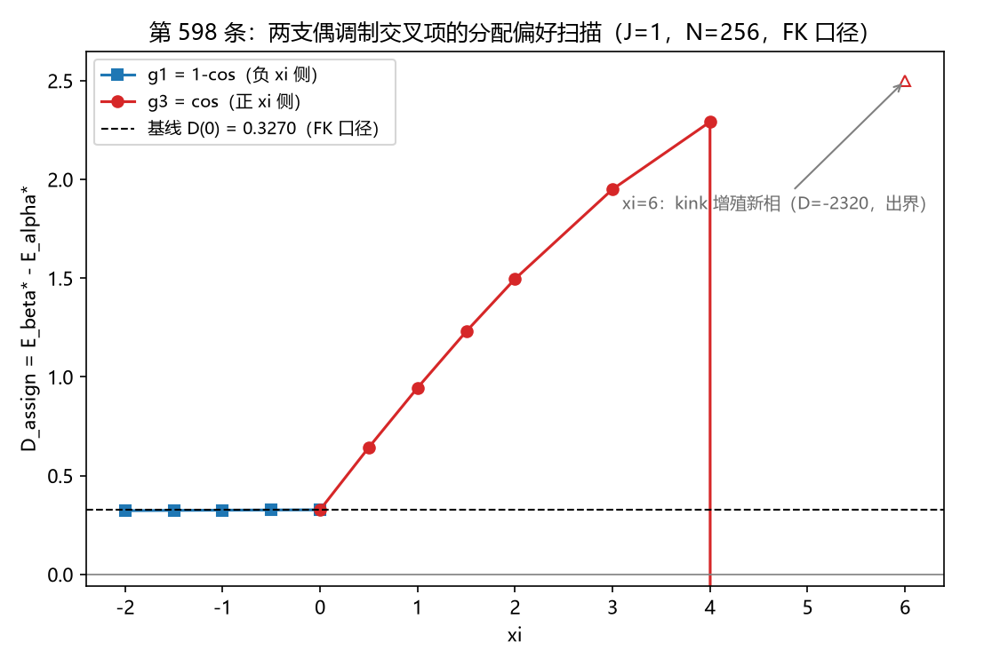
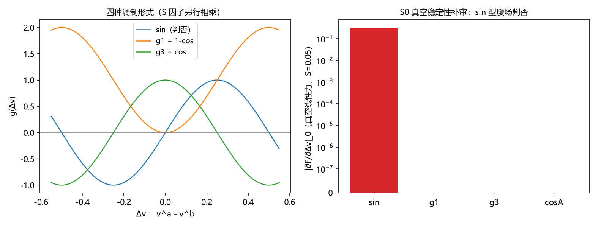
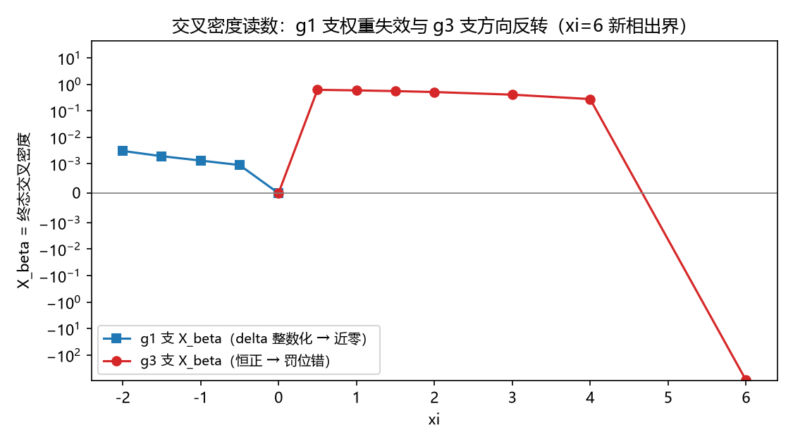

# 注记-参数化扫描轮：交叉项强度的供货门槛与口径审定（第598条）

- **编号**：第 598 条（占位期曾用 597 号：并行线 kappa_2 量值反推于 2026-10-11 01:38 先落盘交付，本轮占位 01:46 后落盘，按占位规范让号顺延，判据编号自 598 起）
- **日期**：2026-10-11 10:11:06（首次入库时刻）
- **脚本**：`minimal_verification_cross_param_scan.py`
- **图**：见 §三 图 1 至 图 4
- **严格程度**：判据级
- **可逆性**：判据敏感（初值族、xi 网格、弛豫协议、FK 口径四者绑定；换任一须重跑）

## 一、定位与问题

第 596 条判否唯一定形（紧凑结论"自然的交叉项不供货，供货的交叉项不自然"）后，按作者裁决走参数化构造层路线：不再追问交叉项形式能否被体系唯一决定，把强度 $\xi$ 当可调参数，问"要多强的交叉耦合才能翻转两种错排分配的能量排序"。翻转点即稳定化元素的供货门槛（定量挂账），其来源问题随后续构造轮处理。

判据设计阶段抓到两个真发现。其一，真空稳定性是第 596 条 T1 约束清点的漏项（第四条约束）：sin 型调制在均匀背景上给线性赝场，判否出局。其二，形式空间按"应变幂次 × 周期函数"矩阵清点后，真空稳定的偶调制存活两支，$g_1 = 1-\cos 2\pi\Delta v$ 与 $g_3 = \cos 2\pi\Delta v$，两者供货方向相反，必须两支都扫。

## 二、模型与口径审定

**模型。** 一维周期链三分量（$N = 256$，$k = 1$，$J = 1$），能量 = 键弹性 + 异类耦合 + 交叉项：

$$E = \frac{k}{2}\sum_a \sum_n (\Delta v^a_n)^2 - J\sum_n[\cos 2\pi(v^1-v^2)+\cos 2\pi(v^1-v^3)+\cos 2\pi(v^2-v^3)] + \xi \sum_{a<b}\sum_n \frac{(\Delta v^a_n)^2+(\Delta v^b_n)^2}{2}\, g\!\left(2\pi(v^a_n-v^b_n)\right)$$

其中 $\Delta v^a_n = v^a_{n+1}-v^a_n$ 为键应变，$g$ 取 $g_1$ 或 $g_3$。

**口径审定（本轮口径升级）。** 第 595 条的能量实现（`np.diff` 周期拼接与 `np.roll` 拉普拉斯）对接缝键未扣整数绕数：wrap 键应变 $= v_0 - v_{N-1} = -(Q+u)$（$Q$ 绕数份额、$u$ 连续形变份额），相当于规定绕数集中在接缝单键，且允许错排在弛豫中向接缝连续泄漏。第 595 条 $\beta$ 终态连续份额 $[0.66,-0.32,-0.32]$ 之和 $\approx 0$ 即泄漏实证（整化 $[1,0,0]$ 靠 round 读出）。本轮改用 FK 标准口径：wrap 键应变 $= v_0 - v_{N-1} + Q_a$，$Q_a = \mathrm{round}(v^a_{N-1}-v^a_0)$ 在初值处定扇区并全程固定，绕数严格守恒；第 595 条口径作为对照档保留（取 $Q=(0,0,0)$ 即逐位回到原实现，能量与梯度同）。

基线锚定（S1）：$\xi = 0$ 档两口径各弛豫。第 595 条口径复现 $D_{\rm assign}(0) = +0.65568$（对照该条注记 $+0.657$ ✓）；FK 口径 $D_{\rm assign}(0) = +0.32703$；两口径差额 $-0.3287$。差额源于两口径的位错极小构型不同（595 口径绕数向接缝连续泄漏，FK 口径不漏），非同构型可逐项预算的量，量级核对 $O(Q^2/2)\sim 0.5$ 内通过。第 595 条的定性结论（非线性不供货、$\alpha$ 分配优）不受影响：$\alpha$ 侧两口径同为真空（$E_\alpha - E_{\rm vac} \approx 0.002$），排序不变。

## 三、判据与结果

判据 S0 至 S4 加 G0 冒烟：S0、G0、S1 基线、S2、S3、S4 六项 PASS；S1a 与 S1b 为读数判据，读数链自洽（极小性恒等式在收敛残差内成立），物理预期一个证实、一个判否（见 §四）。

| 判据 | 读数 | 判定 |
| --- | --- | --- |
| S0 真空稳定性 | sin 型 $\partial F/\partial\Delta v\vert_0 = +0.3142 = 2\pi S$（$S=0.05$），线性赝场判否出局；$g_1$、$g_3$、cos×线性应变三型 $\vert\partial F/\partial\Delta v\vert_0\vert < 10^{-6}$ | PASS |
| G0 梯度冒烟 | 两支解析梯度对有限差分 45 点（含 wrap 邻域），最大误差 $1.2\times10^{-8}$（$g_1$）与 $9.0\times10^{-9}$（$g_3$），判据 $10^{-4}$ 量级 | PASS |
| S1 基线 | FK 口径 $D(0) = +0.32703$；595 口径 $+0.65568$；差额 $-0.3287$（接缝口径项） | PASS |
| S1a（g1 支负侧） | $\xi\in[-2,0]$ 四档：$X_\beta(g_1)\in[0.0007, 0.0031]$，$D$ 仅从 $0.3270$ 降至 $0.3228$，无翻转；外推门槛 $\vert\xi_c\vert\sim 10^2$；$\xi=-4$ 时 $\beta$ 分支发散（$\alpha$ 稳定） | 无翻转 + 失稳实证 |
| S1b（g3 支正侧） | $\xi\in[0.5,4]$：$X_\beta(g_3)$ 恒正 $0.62\to0.28$，$D$ 从 $0.327$ 升至 $2.29$（正 xi 罚位错）；$\xi=6$ 进入 kink 增殖新相（分配 $[4,2,2]$，$D=-2320$，未收敛读数仅证相变存在）；变号插值 $4.002$ 属构型跳变区伪影 | 预期芯井判否 |
| S2 形状敏感性 | $g_2=(1-\cos)^2$ 支（权重更集中 $\delta=\pi$）读数与 $g_1$ 同形态：$D$ 在 $0.3258$ 至 $0.3265$ 微动，无翻转 | 读数一致 |
| S3 初值宽度 | $w\in\{4,8,16\}$ 三档 $D$ 逐位一致（最大偏差 $0.0\%$）：终态墙宽由 $k/J$ 自洽决定，与初值无关 | PASS |
| S4 恒真对照 | 纯常数项 $E += \xi c_0 N$（`form='none'`）：$D(\pm0.5)$ 与 $D(0)$ 差 $4.9\times10^{-4}$（收敛残差量级，判据 $10^{-3}$） | PASS |

![图 3：β 终态 δ^12/π 剖面三面板。ξ=0：单格点整数台阶（δ∈{0,2π}，芯宽 1 格点，台阶两侧异类势全额便宜）；ξ=2（g3）：台阶保持略缓；ξ=6（g3）：锯齿振荡失稳枝（左右两区不同幅度高频振荡，对应分配 [4,2,2]）。](../images/scan598_profiles.png)

## 四、读数的意义（三个发现）

**发现一：位错缩为单格点整数台阶，$(1-\cos)$ 族的权重被精确归零。** FK 口径下（$k=J=1$ 的强离散区）位错的极小构型是单格点错排台阶：$\delta^{ab}$ 只取 $0$ 与 $2\pi$ 两个值（图 3 左面板），台阶格点的 $\Delta v$ 整数化。$g_1 = 1-\cos 2\pi\Delta v$ 在整数 $\Delta v$ 处精确为零，交叉项对位错总账的修正只剩台阶边缘的微小非整残留（$X_\beta \sim 10^{-3}$）；翻转门槛外推 $|\xi_c| \sim 10^2$。负 $\xi$ 通道想奖励的"$\delta\neq 0$ 区域"在极小构型里不存在。$g_2$（权重更集中）同形态。负侧判否：无供货。

**发现二：$g_3 = \cos$ 支方向反转且仍不供货。** $\cos$ 权重在整数 $\Delta v$ 处取 $+1$，而键应变恰好集中在这里（台阶键）：正 $\xi$ 加贵位错（$X_\beta$ 恒正，$D$ 单调上升）。设计阶段的预期（芯区 $\delta\approx\pi$ 处 $\cos=-1$ 给负贡献、正 $\xi$ 供芯井）被实测否定：单格点台阶没有 $\delta\approx\pi$ 的展宽芯区，应变与权重空间错位。$\xi$ 增大时构型向缓台阶重组（$X$ 从 $0.62$ 降至 $0.28$）但总账仍升；$\xi \ge 6$ 交叉项强到与异类锁竞争，进入 kink 增殖新相（多 kink 态 $[4,2,2]$）。这是交叉项诱发的新相，非位错供货。

**发现三：交叉项强度存在失稳墙，"强度"不是自由旋钮。** 负 $\xi$ 侧交叉项与键弹性竞速。$g_3$ 支的解析骨架干净：均匀应变区每键能量 $\frac{dv^2}{2}(1+\xi)$，$\xi < -1$ 能量无下界，实测 $\beta$ 分支恰在 $\xi = -1$ 发散（S4 首版误开交叉项时撞的就是这个临界）。$g_1$ 支解析无界判据 $|\xi| > 0.5$（需 $\delta\approx\pi$ 构型配合），动力学发散实测在 $\xi = -4$（阈值 $-3$ 至 $-4$，差额为逃逸势垒）。合起来：交叉项要么弱到总账修正 $\sim 10^{-3}$（无用），要么强到触发失稳或新相（毁灭）。

## 五、结论面与边界声明

**结论：两支偶调制形式的参数化扫描均判否供货。** 在最低阶真空稳定形式族内，参数化构造层路线拿不到可达的供货门槛：$g_1$ 支门槛在失稳墙外，$g_3$ 支方向反转。裁决面维持第 596 条的二选一（公设级新元素对心侧校准），并新增一条硬约束：任何进构造层的交叉项强度都被稳定性钉死在 $O(1)$ 以下，而 $O(1)$ 以下的交叉项对位错总账的修正至多 $10^{-3}$ 到 $O(1)$ 罚。供货机制若存在，不能走"调强交叉耦合"的路。

**边界声明。** 本轮只审最低阶偶调制两支（$(\Delta v)^2$ 因子配 $1-\cos$ 与 $\cos$）：更高阶形式族、差应变因子 $(\Delta v^a-\Delta v^b)^2$、以及 $\xi\ge 6$ 新相的定稿读数（本轮未收敛）都在射程外。失稳阈值的解析骨架只对 $g_3$ 支 $\delta=0$ 通道严格（$\xi=-1$ 精确），$g_1$ 支阈值为动力学实测值。口径升级（FK 扣 Q）不改变第 595/596 条定性结论，但数值基线（位错能量 $0.327$ 对 $0.657$）以本轮 FK 口径为准：后续引用第 595 条数值须注明口径。

## 六、过程记录

1. S0 设计初版把 $(\Delta v)^2\cos$ 误归"全导数已判"（与第 596 条族甲 $(\Delta v)^1\cos$ 混淆），执行前自查纠正：两者是不同形式，前者真空稳定且非全导数，必须入扫描。教训：形式清点按"应变幂次 × 周期函数"矩阵清点，不按族名。
2. 首版 S4 把常数项与 $g_3$ 交叉项同开（判据对象错），$\xi=0.5$ 档读数与 S1b 逐位一致暴露了这一点；修为 `form='none'` 纯常数对照后 PASS。
3. $g_1$ 支 $\xi=-3$ 档首跑 NaN 曾按数值问题排查，回查确认为真实有限振幅失稳（能量无下界）；发散检测写入 relax，发散档按失稳实证登记，不按协议伪影。
4. S1b 的变号插值 $4.002$ 是构型跳变区的伪影（$D$ 从 $+2.29$ 跳到 $-2320$），线性插值无物理意义；脚本已标注，判读按"新相入口"登记。
5. 梯度实现一次通过冒烟（两支 $10^{-8}$ 级）：第 595 条两次梯度翻车沉淀的"解析逐项核验 + 数值抽查双保险"流程生效。
6. 撞号处置：597 号让给并行线（kappa_2 量值反推），本轮判据编号自 598 起，占位行内保留让号说明。
