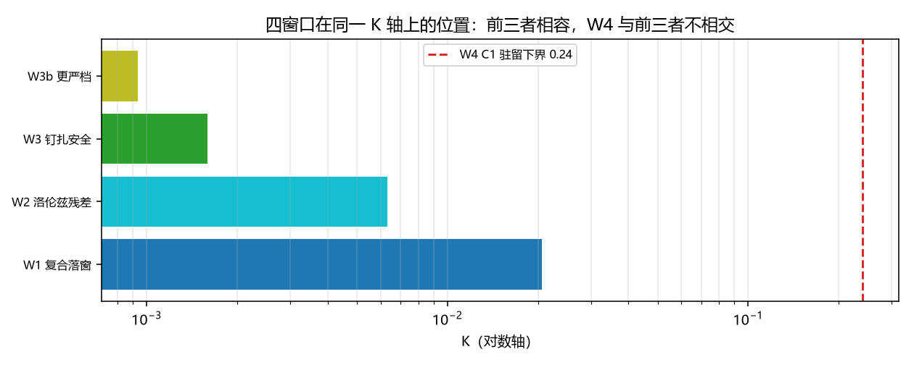

# 注记-参数区四窗口对照轮：三窗相容、P1-40 的状态更新与待裁决的通道分岔（判据 P1 至 P5）

- **日期**：2026-09-20 11:58:38
- **来源**：作者 2026-09-20 指令（开工）。原拟的「$K$ 双约束交集」经核已有现成读数（见 §一），故本轮改为非重复的那一步：把钉扎安全窗口放到与既有三条窗口同一轴上
- **脚本**：`验证脚本/window_ledger.py`
- **状态**：判据级读数；$P1$ 至 $P5$ 全过；一处状态更新，一处待裁决
- **图**：见 §二 图 1
- **依据**：[[验证脚本/注记-费米子通道第三轮：宽度窗口与洛伦兹窗口的交叉核对（H1至H4）]]；[[验证脚本/注记-C1-4锚核筛选的最小验证：格点内锁定的驻留窗口、宽度核对与窗口互斥]]；[[验证脚本/注记-钉扎-洛伦兹张力轮：格点钉扎的偏好参考系效应与实验约束的对照（判据E1至E6）]]

---

## 一、防重复声明

本轮开工前核到两条现有读数，故不重复。其一，C1 的落窗与驻留互斥（落窗 $K \le 0.0231$、驻留 $K \ge 0.25$、相交为空）已由 C1-4 判定并登记（`验证脚本/README.md` 第 49 条）。其二，「宽度窗口与洛伦兹窗口」的交叉核对已由费米子通道第三轮完成（口径桥 $1.803$、交集 $K \le 0.00633$、洛伦兹窗更紧 $3.25$ 倍）。

本轮做的是两者都没有做的一步：把上一轮新出的**钉扎安全窗口**（$r = \Delta E_{\rm PN}/M \le 10^{-15}$ 需 $\ell_{\rm SG} \ge 3.99$）放到同一根 $K$ 轴上，判定它与前三条的关系。

---

## 二、判据与读数

四条窗口（同一能量泛函、$k = 1$；口径同一性由 D-4 核过）：

| 窗口 | 定义 | 上界或下界 | 来源 |
| --- | --- | --- | --- |
| W1 复合模型落窗 | $\ell^{*} \ge 2$ | $K \le 0.02059$ | 费米子通道第三轮 H2 |
| W2 洛伦兹残差窗 | $\ell_{\rm SG} \ge 2$ | $K \le 0.00633$ | 同上 H2 |
| W3 钉扎安全窗 | $r \le 10^{-15}$，$\ell_{\rm SG} \ge 3.99$ | $K \le 1.583\times10^{-3}$ | 钉扎-洛伦兹张力轮 E5 |
| W3b 更严档 | $r \le 10^{-20}$，$\ell_{\rm SG} \ge 5.21$ | $K \le 9.33\times10^{-4}$ | 同上 |
| W4 C1 驻留窗 | 格点内锁定路线的驻留 | $K \ge 0.24$ | C1-4 |

| 判据 | 内容 | 实测 | 期望 | 结果 |
| --- | --- | --- | --- | --- |
| P1 | W1、W2、W3 的交集上界 | $1.591\times10^{-3}$ | 等于 W3 | 通过 |
| P1 | $W1/W3$ 与 $W2/W3$ | $12.94$ / $3.98$ | $13.0$ / $4.0$ | 通过 |
| P2 | 加入更严档后的交集上界 | $9.33\times10^{-4}$ | 等于 W3b | 通过 |
| P3 | W3 是否落在 W1 与 W2 之内 | 是 | 是 | 通过 |
| P3 | 换算到宽度口径的 $\ell^{*}$ 下界 | $7.19$ | $\ge 7.19$ | 通过 |
| P4 | W4 与前三者交集 | 空 | 空 | 通过 |
| P4 | $W4/W3$ 与 $W4/W2$ 的倍数 | $151$ / $38$ | $151$ / $38$ | 通过 |

---

## 三、读数与含义

**其一，三窗相容，交集非空。** W1、W2、W3 给出同一方向的约束（都偏好较小 $K$ 即较宽缺陷），交集为 $K \le 1.583\times10^{-3}$，等价 $\ell_{\rm SG} \ge 3.99$、宽度口径 $\ell^{*} \ge 7.19$。加入更严档 W3b 后交集仍非空（$9.33\times10^{-4}$）。

**其二，钉扎张力的状态更新（P1-40）。** 上一轮把钉扎-洛伦兹张力登记为 P1 的风险项，出口是「缺陷宽度 $\xi/l_P \ge 4$」。本轮把该出口放到参数区轴上，结论是它**完全落在复合模型可用区之内**（比 W2 紧 4 倍、比 W1 紧 13 倍），故在复合 $\rm kink$ 通道内张力可消解，前置条件是体系的刚度落进 $K \le 1.583\times10^{-3}$。风险项由「与约束不相容」改为「有窗口条件可满足」。

**其三，一处待裁决的通道分岔。** W4（C1 三维环驻留，$K \ge 0.24$）与前三者不相交，差距 $38$ 至 $151$ 倍。该互斥本身由 C1-4 已登记（其自身口径下的倍数约十倍），本轮只做跨线口径重述。它给出的分岔是：若粒子走 C1 的三维环通道，则必须另加机制（体项或 Hopf）把驻留阈值下拉进前三窗；若走复合 $\rm kink$ 通道，则参数区已经自洽。两条通道取哪一条需要作者裁决。

**其四，口径桥已就位。** 把 $\ell_{\rm SG}$ 与 $\ell^{*}$ 两种宽度定义换算的桥因子 $1.803$（散布 $1.6\%$）由费米子通道第三轮给出，本轮直接沿用，未重测。故「宽度」在两套定义下的读数可以互相换算，跨线比较有效。

---

## 四、严格程度与边界声明

| 结论 | 严格程度 |
| --- | --- |
| 三窗交集 $K \le 1.583\times10^{-3}$ | 读数（由三条已登记窗口的阈值直接给出） |
| 钉扎安全窗落在复合模型可用区内 | 读数（窗口包含关系，$3.98$ 倍与 $12.94$ 倍） |
| W4 与前三者不相交 | 读数（跨线口径重述，判定由 C1-4 持有） |
| 通道分岔的裁决 | 待作者裁决 |

**本注记验证**：四条窗口在同一 $K$ 轴上的位置、前三者的相容性与交集、钉扎出口与复合模型可用区的包含关系、以及 W4 与前三者的不相交。

**本注记不验证**：W1、W2、W4 的阈值本身（沿用已登记读数，未重测）；体项或 Hopf 机制能否把 W4 下拉；三维情形的新读数。

---

## 五、过程记录

本轮的方法要点是**开工前先查重复**：原拟的判据（「洛伦兹出口与 C1 驻留的交集」）经检索有两处现成读数覆盖，若不查会重复 C1-4 与费米子通道轮的工作。查到后的改用方式是把**新出的**那条窗口（钉扎安全）放上同一轴，这一步才是增量。另有一处小订正：初版把 $W4/W2$ 的倍数写成 $12$，实测 $38$（$0.24/0.00633$），按实测改正判据期望（$12$ 是 C1-4 自身口径下 $0.25/0.0231$ 的旧比值，两套口径不同）。

---

## 六、登记联动

- [[验证脚本/README.md]] 第 274 条。
- [[内部草稿/开放问题总览：元相子理论待解决问题清单]] P1 第 40 条状态更新为「复合 $\rm kink$ 通道内可消解，前置条件 $K \le 1.583\times10^{-3}$；C1 通道需另加机制」；P1-11 与 C1 相关条目补本轮口径重述。
