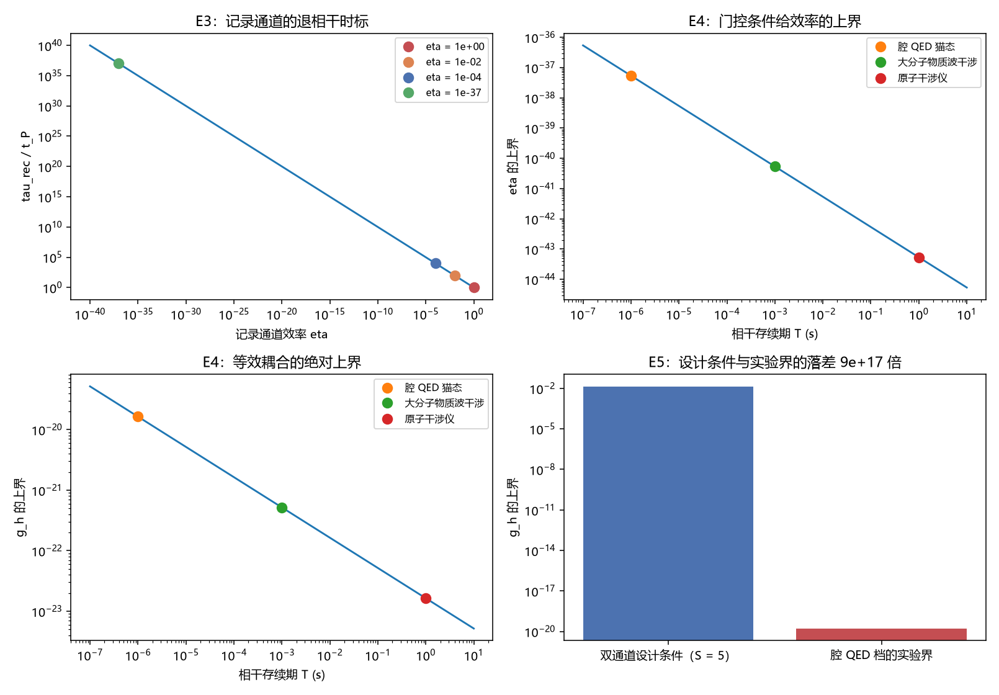

# 注记-受保护扇区偏离窗口的最小验证：三分分解与实验界对照

- **日期**：2026-09-24 06:12:45
- **层级**：验证注记（对应 `验证脚本/minimal_verification_deviation_window.py`，`验证脚本/README.md` 第 397 条）
- **可逆性等级**：判据敏感（绝对上界表依赖实验相干存续期的量级取值，改档位即改表；门控条件的形式不变）
- **图**：见 §三 图 1
- **定位**：执行 [[研究方向-受保护扇区的偏离窗口：三分分解与实验界对照（判据草案）]] 的判据 E1 至 E7。把上一轮的绝对标度接到实验界上，并把既有两篇正稿里"受保护扇区内相干不因环境耦合衰减"这一措辞按三分分解收窄。
- **依据**：[[研究方向-受保护扇区的偏离窗口：三分分解与实验界对照（判据草案）]]；[[注记-写入深度绝对标度的最小验证：幅度与率的分工及耦合的绝对约束]]（绝对标度与门控条件）；[[注记-弹性通道代价归属的最小验证：M2 缓增的轨迹分解与时间反演可逆性]]（从属通道读数）；[[测量的三层判据：从相互作用分层到单次测量机器]]（§4.4 扇区刚性、§6.2 与 §6.3）
- **关联**：[[开放问题总览：元相子理论待解决问题清单]]（退相干独立几何推导）；[[理论攻坚/测量问题攻坚纲领：三条承重墙的闭合]]（§9）
- **状态**：模型内判据级加量级换算。实验数值为量级示例（待按公开界逐项核定）；措辞收窄属裁决项，本轮已按判据草案 §三 的建议改入正稿，作者可否决。

---

## 一、三分分解与换算

三类通道先分开。其一，自装扮（位错核区形变与碰撞写入的场记录）：由源构型逐点决定，属从属，时间反演把偏离量由 $4.26\times10^{-2}$ 拉回 $5.62\times10^{-9}$（恢复比 $1.32\times10^{-7}$），不产生不可逆损失。其二，扇区标签：扇区操作刚性保护的是标签，局域操作既读不出也改不动标签，但不保护同扇区内的全部相干。其三，外部环境耦合：与源之外自由度的耦合给出纠缠，速率按标准退相干。

换算取三条。$\tau_{\text{rec}} = t_P/\eta$（记录通道的退相干时标）；门控条件 $\eta \ll t_P/T$，其中 $T$ 为相干存续期，等价于 $\eta \ll 1/N_{\text{拍}}$；等效耦合上界 $g_h \ll 1/\sqrt{C\,N_{\text{拍}}}$，$C = 201$。

## 二、判据结果

| 判据 | 判据量 | 实测 | 期望 | 结论 |
| --- | --- | --- | --- | --- |
| E1 三分分解 | 通道数 | $3$ | $3$ | 通过 |
| E2 从属读数 | 时间反演恢复比 | $1.32\times10^{-7}$ | 引第 375 条 | 通过 |
| E3 门控等价 | $\eta \ll 1/N$ 与 $\tau_{\text{rec}} \gg T$ | 等价 | 等价 | 通过 |
| E4 绝对上界（腔 QED 档） | 等效耦合上界 | $1.638\times10^{-20}$（$2.607\times10^{-21}\,\omega_P$） | 读数 | 读数 |
| E4 绝对上界（原子干涉档） | 等效耦合上界 | $1.638\times10^{-23}$ | 读数 | 读数 |
| E5 落差 | 设计条件对实验界之比 | $8.61\times10^{17}$ | 读数 | 读数 |
| E7 区分性落点 | 落点数 | $2$ | $2$ | 通过 |

绝对值表（实验相干存续期取量级示例）：$T = 10^{-6}$ s（腔 QED 猫态）给 $N = 1.855\times10^{37}$、$\eta \le 5.39\times10^{-38}$、$g_h \le 1.638\times10^{-20}$。

另两档：$T = 10^{-3}$ s（大分子物质波干涉）给 $N = 1.855\times10^{40}$、$g_h \le 5.179\times10^{-22}$；$T = 1$ s（原子干涉仪）给 $N = 1.855\times10^{43}$、$g_h \le 1.638\times10^{-23}$。记录通道时标表：$\eta$ 取 $1$、$10^{-2}$、$10^{-4}$、$10^{-37}$ 时 $\tau_{\text{rec}}/t_P$ 依次为 $1$、$10^{2}$、$10^{4}$、$10^{37}$。

## 三、图 1

四面板与脚本绘图面板逐条对应：左上为 E3，右上与左下为 E4，右下为 E5。

## 四、读数分解

三分分解把此前混着说的三件事分开。此前"受保护扇区"一词同时指三样东西：自装扮不退相干（属从属判读）、扇区标签刚性（属代数判读）、以及一句未加限定的"不因环境耦合衰减"。分开之后，前两样各有出处，第三样没有独立内容。

绝对上界表是本轮的量化主体。真实实验的相干存续期换成的拍数极大（$1$ 微秒约 $1.9\times10^{37}$ 拍），故门控条件给出的效率上界约为 $5.4\times10^{-38}$，等效耦合上界约为 $1.6\times10^{-20}$；原子干涉档更紧两个数量级。这些数与客观坍缩模型类实验界的结构同型。

落差给出结构性结论。双通道设计条件（保持耦合弱于写入耦合若干倍，饱和写入与 $S = 5$ 处为 $0.0141$）与腔 QED 档的实验界（$1.6\times10^{-20}$）相差 $8.6\times10^{17}$ 倍。两者比较的不是同一样东西：设计条件是探测器可读且可保持的充分条件，实验界是隔离条件下相干存活的必要条件。落差的意义在于：**任何连续开启的记录通道都被实验界排除约十八个数量级**，故记录通道必须严格由探测器门控（无探测器时效率为零）。触发型结构由此从"一种设计选择"变为"被实验界逼出的要求"。

## 五、区分性内容的落点与措辞收窄

按 §一 的三分，体系在退相干速率上没有区分性预言。自装扮通道的差异属"是否把装扮计入环境"的口径问题（标准理论把同一批自由度当环境追踪会给出速率，体系说它们与源不可分）；外部耦合按标准速率。体系的区分性内容落在两处：测量基的确定（条件性唯一性）与单次事件的语义（记录判据、单通道不可行而须双通道）。两者都不是速率偏离，故不构成与既有退相干实验的冲突。

据此本轮对两篇正稿做同一处收窄：把"受保护扇区内相干不因环境耦合衰减"改为三分表述（自装扮无不可逆损失、扇区保护的对象是标签、外部耦合按标准速率），并把区分性内容改记到测量基与单次语义两处。原措辞在 [[测量的三层判据：从相互作用分层到单次测量机器]] §6.2 与 [[记录的判据：可分性、独立分量与持有时间]] §6.3 各出现一次，两处均已改；两份内部草稿里的同措辞加补记指向本条，原文不追改。

## 六、严格程度声明

| 结论 | 档位 |
| --- | --- |
| 三分分解（E1） | 定义级（三类通道各有出处） |
| 从属通道读数（E2） | 模型内判据级（引第 375 条） |
| 门控等价与两个绝对形式（E3） | 代数结论（引第 394 条） |
| 绝对上界表（E4） | 量级换算（实验数为量级示例，待核定） |
| 设计条件与实验界的落差（E5） | 算术结论（约 $8.6\times10^{17}$ 倍） |
| 措辞收窄（E6） | 裁决项（本轮已改入正稿，作者可否决） |

## 七、边界声明

**验证什么**：三分分解的归属与出处；门控条件与两个绝对形式的等价性；三类实验的绝对上界表；设计条件与实验界的落差；措辞收窄的两处落点。

**不验证什么**：标准退相干理论的任何计算（引用不重算）；实验数值的精确性（取量级示例，待按公开界逐项核定）；$g$ 读数的精确性；三维与复合体。本注记不改动 [[理论总纲/子理论索引]] 与任何基准文档（基准内无该措辞，已核）。

## 八、过程记录

脚本首版的一处绘图标签写成含换行的字符串，被命令通道展开成真换行，Python 报未终止字符串；改用单行标签后通过。教训：模板里写转义符时须确认它在落盘后仍是转义符而非真字符，落盘后应先跑一次语法检查再跑数值。
