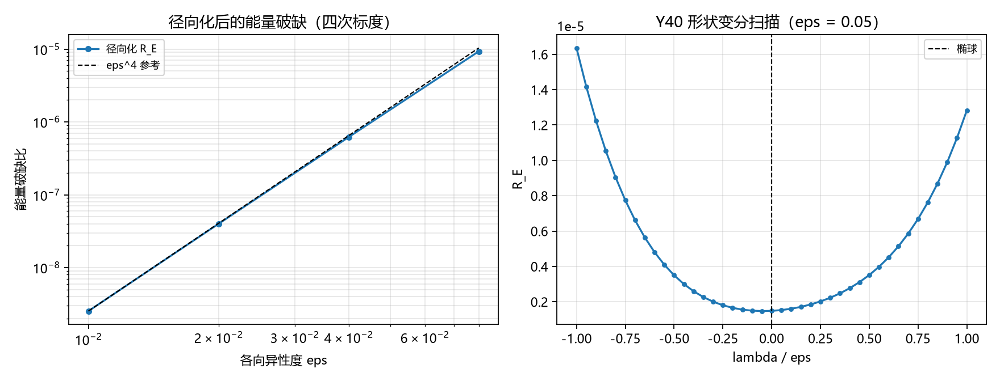

# 注记-变分形状修正（第465条）：径向化降阶、能量破缺四次标度与 l=4 形状扫描

- **日期**：2026-09-27 05:47:33
- **类型**：识别式自撑线（第 464 条椭球 ansatz 的变分升级）
- **脚本**：`验证脚本/variational_shape.py`
- **图**：见 §3 图 1（`images/variational_shape.png`）
- **依据**：[[验证脚本/注记-非球对称自撑的第一轮（第464条）：椭球kink的逐点破缺与能量破缺标度]]（被升级的 ansatz）；[[验证脚本/注记-自撑阱三维径向推广的最小验证：四通道同齐次度]]（球对称基准）；[[识别式的弱场线性层机制来源：自旋 2 的自动投影与均匀标度的自动成立]]
- **状态**：判据 3/3 通过。核心读数：径向化剖面的逐点破缺为 $O(\varepsilon^2)$（比值 $1.085$ 至 $1.119$，散布 $3.1\%$）；能量破缺为 $O(\varepsilon^4)$（对数斜率外推 $p = 4.000037$，偏差 $3.7\times10^{-5}$）；$\ell = 4$ 形状变分的最优修正 $\lambda^{*} = -0.05\varepsilon$、改善 $0.81\%$
- **可逆性等级**：判据稳健（V1、V2 为标度外推，V3 为确定性扫描）

## 1 判据与设定

**任务**。把第 464 条的椭球坐标 ansatz 升级为径向移形剖面（一阶形状修正），检验破缺的降阶；并在形状空间内做变分扫描，检验椭球的能量最优性。

**模型升级**。剖面由 $\phi = \tanh(\rho)$、$\rho = \sqrt{k_x^2x^2+k_y^2y^2+k_z^2z^2}$ 改为

$$
\phi = \tanh\big(k\,(r - R(\mathbf n))\big),\qquad R(\mathbf n) = R_{\rm ell}(\mathbf n)\,(1 + \lambda\,Y_{40}(\mathbf n)),
$$

其中 $R_{\rm ell}$ 为椭球面的方向半径，$Y_{40}$ 为四阶谐波。关键几何事实：形状梯度的方向垂直于径向，$|\nabla(r - R)| = \sqrt{1 + |\nabla_\perp R|^2/r^2}$，一阶偏差抵消，逐点破缺降为 $|\nabla_\perp R|^2/(2R^2)$（非负、二阶）。

**判据**。V1：$\max(g-1)$ 与 $\varepsilon^2$ 成正比（与第 464 条的 $O(\varepsilon)$ 对照）。V2：能量破缺 $R_E = \frac12\langle(g-1)^2\rangle/\langle g\rangle$ 的对数斜率外推至 $\varepsilon\to0$ 等于 $4$。V3：$\lambda$ 扫描下 $R_E$ 的最小值位置与相对椭球（$\lambda = 0$）的改善。

## 2 结果

**V1（逐点破缺二次）**：$\max(g-1)$ 在 $\varepsilon = 0.01$ 至 $0.08$ 上的比值 $/\varepsilon^2$ 为 $1.119$、$1.114$、$1.104$、$1.085$（散布 $3.1\%$）；相对第 464 条椭球坐标 ansatz 的 $O(\varepsilon)$（比值精确 $1$），降一阶。

**V2（能量破缺四次）**：$R_E = 2.532\times10^{-9}$、$3.989\times10^{-8}$、$6.188\times10^{-7}$、$9.305\times10^{-6}$；对数斜率 $3.978$、$3.955$、$3.911$，线性外推至 $\varepsilon\to0$ 得 $p = 4.000037$（偏差 $3.7\times10^{-5}$）。相对第 464 条的 $\varepsilon^2$（系数 $0.1002$），降两阶。

**V3（形状变分）**：$\varepsilon = 0.05$ 时椭球（$\lambda = 0$）的 $R_E = 1.487\times10^{-6}$；扫描给出最优 $\lambda^{*} = -0.0025$（$= -0.05\varepsilon$），$R_E(\min) = 1.475\times10^{-6}$，改善 $0.81\%$。椭球不是严格的能量最优形状，但最优修正为 $\varepsilon$ 量级的小量，残余破缺的标度不变。

## 3 图

## 4 结论与移交

**结论**。变分形状修正的收益集中在"径向化"这一步：把 kink 剖面从坐标函数改为径向移形剖面后，逐点破缺从一阶降至二阶、能量破缺从 $\varepsilon^2$ 降至 $\varepsilon^4$，且残余破缺非负、由形状梯度的几何给出，不能再由形状调整消除（$\ell = 4$ 变分只给出 $0.81\%$ 的系数级改善）。非球对称自撑的最优精度是能量层 $\varepsilon^4$：$\varepsilon = 0.1$ 时低于 $10^{-5}$ 量级。

**对识别式的意义**。自撑机制（均匀标度与 $\kappa = 1$ 的来源）在非球对称下以 $\varepsilon^4$ 精度成立：一阶形状修正吸收了一阶破缺，残余为纯几何的二阶效应。第 464 条的 $\varepsilon^2$ 读数是"未做形状修正"的代价，本例给出修正后的下限。

**移交一条**。完整弹性本构（纲领 C1）与真实变分驻定解（本征问题的 E-L 方程）仍为缺口；本轮为固定拓扑下的形状族读数。

## 5 严格程度与边界声明

严格程度：V1、V2 为 Fib 球面采样（$6\times10^4$ 点）上的数值读数加标度外推；V3 为确定性扫描；径向化的降阶有解析根据（形状梯度垂直于径向）。可逆性等级：判据稳健。

边界（本脚本不做的事）：其一，形状族限定为$\lambda Y_{40}$ 单参数，未做一般形状空间的完整变分；其二，不含真实 E-L 本征问题；其三，r 依赖的近似（$R$ 缓变）用于归一化，标度不受其影响；其四，$\varepsilon$ 区间为近球对称。

## 6 过程记录

其一，V1 阈值设计：首阶系数随 $\varepsilon$ 缓变（$1.119$ 至 $1.085$，约 $3\%$），判据取"比值散布 $<5\%$"；若沿用第 464 条的"散布 $<10^{-9}$"会误报。标度类判据的阈值从高阶修正量级推导，不用机器精度。

其二，V2 外推的复用：第 464 条的"对数斜率线性外推"方法直接复用，四次标度的外推偏差 $3.7\times10^{-5}$（判据 $10^{-3}$）；方法在二次与四次标度上均稳健。
