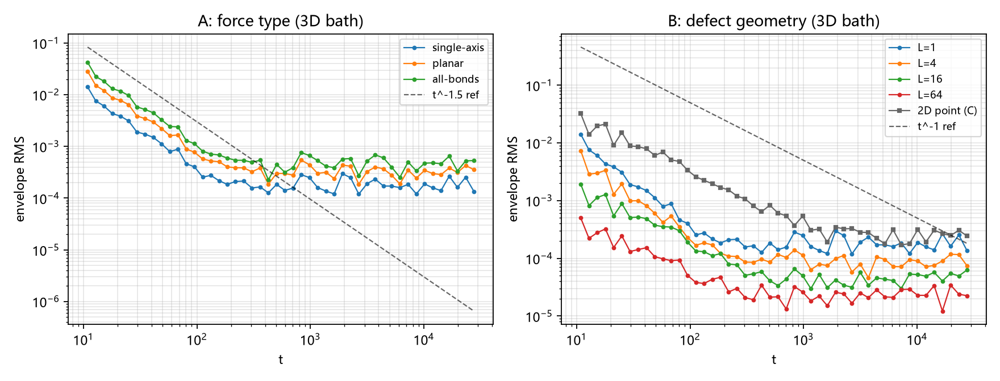

# 注记-口径链判定与缺陷几何的浴维数（第432条）：驻点结构、图像维数的错位与段三判负

- **日期**：2026-09-26 08:47:09
- **类型**：判定轮（候选丁段三收口）
- **脚本**：`验证脚本/minimal_verification_defect_geometry_tail.py`（第 432 条）
- **图**：见 §3 图 1（`images/defect_geometry_tail.png`）
- **依据**：[[注记-γF 等于 d 半的解析化（第427条）：BZ 角点半稳相求和、1D 闭式与噪声地板下的 2D-3D]]（d 的身份与驻相骨架）；[[注记-传递链首轮（第425条）：力关联尾的二分之 d 律与速度尾反推]]（三档浴读数）；[[注记-候选几何维数清点与 KPZ 粗糙面核验（第431条）：2.4 的最佳匹配与其核验限制]]（被判定项）；[[注记-有效维数 2.4 的几何实现（第428条）：候选几何清点与有限分形图的测量限制]]（d_f/2 猜想）；[[内部草稿/总结报告-格点尾链条：从意外读数到解析化（2026-09-26）]]
- **状态**：判定完成。段三在「格点声子浴加驻相机制」口径下判负：靶需要 $\gamma_F \in [1.12, 1.20]$，而该口径只出 $\{1/2, 1, 3/2\}$；431 的 KPZ 匹配为图像维数错位，降级为数字对照；线缺陷的浴降维为窗依赖行为、不构成稳定指数；三条出口登记
- **可逆性等级**：判据稳健（A 组三力型与 C 组对照跨窗稳定；整数性限制为结构论证；B 族读数按纪律登记为不可用）

## 1 判据与设定

段三的问题为「$d_{\rm eff} = 2.4$ 的几何从何而来」。本轮把问题拆成三问并逐一定判。

Q1：第 427 条的 $\gamma_F = d/2$ 中，$d$ 的精确身份是什么（哪些量可以替换它）。Q2：什么机制能把 $\gamma_F$ 从格点值（3D 为 $3/2$）移到靶区间 $[1.12, 1.20]$。Q3：第 431 条登记的 KPZ 面维数（$2.386$）在此口径下有没有资格充当 $d$。

判据四组。A 组：3D 浴固定，力取三种几何（单方向梯度、平面梯度、全键均匀），期望尾指数均为 $3/2$（检验「力的图像维数不占指数位」）。C 组：2D 浴、单方向梯度，期望 $1$。B 组：3D 浴、线缺陷几何（沿 $z$ 的相干因子 $\operatorname{sinc}^2(L k_z/2)$，精确式含 $\sin(k_z/2)$ 分母），$L = 1, 4, 16, 64$，观测「浴有效维数随缺陷几何」的形态。S4：对 $k_z$ 窗的闭式结构核（高斯窗替代，解析）。

## 2 结果

**R1（结构分析，Q1）**：427 的 $d$ 在三处出现，均为模式空间（BZ）的整数维数：测度 $(2\pi)^d$、驻相因子 $(2\pi/t)^{d/2}$、Hessian 行列式 $(2\sqrt{m_c})^{d/2}$。角点主导依赖 BZ 的闭合性（环面无边界，故无 $t^{-1}$ 边界项；连续介质的开放积分给 $t^{-d}$，衰减更快）。一般形式可写成：尾指数 = 参与振荡积分的维数 / 驻点阶数；格点色散在角点处二阶（$\sin^2$ 展开），故每维贡献 $t^{-1/2}$，合起来 $\gamma_F = d/2$。

**R2（A 组，数值）**：单方向 $1.485$、平面 $1.498$、全键 $1.510$（窗 $[10.9, 68.1]$，12 段，跨窗稳定）。力的图像维数从线到体三档变化，指数纹丝不动。**图像的维数不占位**。

**R3（C 组，数值）**：2D 浴给 $0.945$（子窗 $1.028$），与第 425 条的 2D 档（$1.04$）一致。浴的模式空间维数占位。

**R4（B 组与 S4，Q2 的排除项）**：线缺陷族读数 $0.74$ 至 $0.87$（$L = 64$ 跨窗漂移 $0.743$ 对 $0.637$），按平台纪律登记为不可用。

闭式结构（$|\mathrm{Int}| = \sqrt{\pi}\,(a^2 + (\alpha_0 t)^2)^{-1/4}$，$a = L^2/8$、$\alpha_0 = \sqrt{2}/8$）给出两段结构：$t \ll L^2$ 段常数（总尾 $1.0$），$t \gg L^2$ 段 $t^{-1/2}$（总尾 $1.5$），过渡中心 $t^* = L^2/\sqrt{2}$，**无中间平台**。

$L = 16$ 的 $0.85$ 与过渡区表观斜率相符（窗内相位变化至 $0.7$），$L = 64$ 的 $0.74$ 受窄窗与弱信号限制。

**R4 的判读**：线缺陷的「浴降维」是窗依赖行为；有限长线的渐近尾回到 $3/2$，无限长线（$\delta(k_z)$ 极限）才给 $2/2 = 1$。任何固定的观察时刻都落在前一情形，故缺陷几何不能提供稳定的非整数指数。

**R5（判定）**：靶区间换算为 $\gamma_F \in [1.12, 1.20]$（来源为 $\alpha$ 带 $[0.5598, 0.6015]$ 经 $\gamma_v = 2-\gamma_F$）。格点声子浴加二阶驻点的口径只出 $\{1/2, 1, 3/2\}$，与该区间不交。$gamma_F$ 要取 $6/5$，需要「非二阶平坦的驻点」（$d/\nu$ 型，$\nu = 5/2$）或「非整数的模式空间维数」，两者在框架内均无来源。**段三判负**：$d_{\rm eff} = 2.4$ 的几何实现，在框架现有机制下不可达。

**R6（Q3 的判定与出口）**：KPZ 面维数（$2.386$）与分形维数 $d_f$ 均属图像维数，按 R2 不占 $d$ 的位置；431 的匹配降级为数字对照。三条出口登记：其一，非二阶驻点色散（公理色散固定二阶，需浴不属格点声子）；其二，非格点浴（连续或分形介质，尾机制换为端点与截断主导，格点尾链条的语境不再适用）；其三，换算关系与靶的重审（$\gamma_v = 2-\gamma_F$ 的假设链、$\alpha$ 带的硬度）。

## 3 图

## 4 结论与移交

结论三件。其一，$\gamma_F$ 的指数位属浴的模式空间维数，图像维数（力的形状、缺陷的形状、KPZ 面）不占位。其二，靶区间 $[1.12, 1.20]$ 在格点声子浴口径下无实现，段三判负；链条的段一（$\gamma_F = d/2$，解析）与段二（$\gamma_v = 2-\gamma_F$，推导）不受影响。

**交叉核**：第 433 条独立判定，即使把无限长线的 2D 极限当作稳定读数，$\alpha = 1/2$、$\gamma_F = 1$ 亦被年龄约束排除。其三，431 的 KPZ 匹配降级为数字对照，第 428 条的 $d_f/2$ 猜想修正为「需要先确认分形浴的尾机制，$d_f$ 不直接占位」。

移交三条，即 R6 的三出口。另移交一项方法学条目：**幂律指数须在「已越过过渡」的窗内测量；过渡区的表观斜率不是指数**（本轮 B 族与 S4 的直接教训，与平台纪律同族）。

## 5 严格程度与边界声明

严格程度：R1 为结构论证（427 的推导清点加 BZ 闭合性对照）；R2、R3 为判据级数值（跨窗稳定）；R4 的闭式为高斯窗替代模型（解析，假设已声明）；R5 为区间不相交的直接判定。B 族的 $L = 4$ 至 $64$ 读数按纪律判为不可用。

边界（本脚本不验证的内容）：其一，分形浴的尾指数未测（第 428 条的回归限制未解）；其二，非二阶驻点的色散未构造；其三，$\alpha$ 带自身的硬度未重审（属 f 线）；其四，R4 的闭式取高斯窗替代 $\operatorname{sinc}^2$，两者宽度同量级但非同一函数，过渡中心的数值属近似。

## 6 过程记录

其一，B 族的实现细节：$L$ 取偶数时因子 $\operatorname{sinc}^2(L k_z/2)$ 把 $k_z = \pi$ 的两个驻点精确清零（$\sin(L\pi/2) = 0$），存活驻点为 $k_z = 0$ 的两个；此设定改变系数、不改变指数结构。

其二，S4 的方法修正：首版用梯形法数值积分 $k_z$ 窗，在 $t > 10^3$ 后振荡周期短于网格间距、读数属欠采样伪影；改为高斯窗替代的闭式后消除。登记为第八类数值陷阱的实例：**振荡积分的网格间距须与最小周期挂钩，越界读数不可用**。

其三，B 族读数（$0.74$ 至 $0.87$）的归因：两驻点的拍频、窄窗与弱信号、过渡区三者叠加；按平台纪律不登记为指数，只作为过渡存在的旁证。
