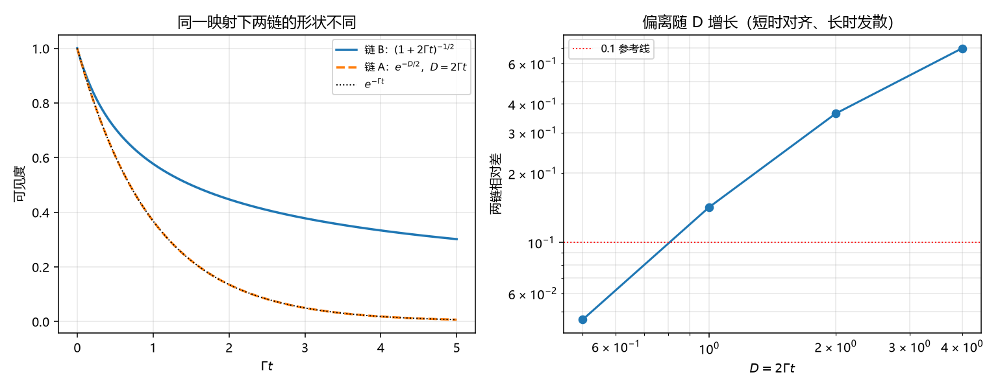

# 注记-可见度口径的两条链对齐：一阶相容、形状分岔（判据第686号）

- **日期**：2026-10-18 23:51:04
- **对应脚本**：`验证脚本/minimal_verification_p686_visibility_chains.py`（判据 6/6；纯代数，无随机数，确定性）
- **定位**：第 684 号的直接下游。第 684 号把退相干形状归因到可见度定义，并登记「第 520 条与 B10 未明写对应哪种可见度」的口径缺口。本轮把库内另一条独立的可见度链（第 391 条）调出来对口径，回答「两条链是不是同一个东西」。
- **可逆性等级**：C1、C2、C4、C5 判据稳健（代数恒等）；C3 判据敏感（小量档阈值定容差）；C6 恒真对照；C7 读数。
- **图**：见 §四 图 1。

---

## 一、两条链的出处

库内存在两条互不相干的可见度公式，此前没有对过口径。

**链 A（记录机制侧，第 391 条）**。$\mathcal{V} = \exp(-\Delta^2/4) = e^{-D/2}$，其中 $D = n_{\rm diff}G^2/2$ 是相空间距离。出身是相干态重叠，逐键因子化成立，指数里的 $1/4$ 拆成 $(1/2)\cdot(1/2)$ 两半各有出处：一半来自相干态重叠的高斯形式，一半来自振幅与读出量的换算。第 391 条已把这条链钉在读数上（逐键重叠对 $e^{-G^2/4}$ 的偏差 $7.5\times10^{-16}$）。它回答的是「寄存器偏离多少，可见度掉到多少」。

**链 B（退相干侧，第 520 条 / 满周升格 §4.1）**。$\mathcal{V}(t) = (1+2\Gamma_{\rm coh}t)^{-1/2}$，出身是高斯相位扩散的系综平均。它回答的是「相干性随时间怎样流失」。

两条链都叫「可见度」，量纲都无量纲，都从 1 衰减到 0。第 684 号之后必须问一句：它们是不是同一个对象？如果是，两者应当能互表；如果不是，须写明各自边界。

## 二、判据与结果

| 判据 | 内容 | 期望 | 实测 |
| --- | --- | --- | --- |
| C1 | 两链不是同一函数 | 在 $D=2\Gamma t$ 映射下最大相对差 $\ge 0.1$ | $0.978$ |
| C2 | 一阶系数相同（均为 $-1$） | 差/$\epsilon \le 10^{-3}$ | $2.50\times10^{-5}$（$\epsilon = 10^{-4}$） |
| C3 | 小量档对齐成立 | $D \le 10^{-2}$ 时相对差 $\le 10^{-2}$ | $2.48\times10^{-5}$ |
| C4 | 偏离随 $D$ 单调增长，$D=2$ 档 $\ge 0.1$ | 单调且达标 | $D=0.5$ 差 $0.046$、$D=1$ 差 $0.142$、$D=2$ 差 $0.363$、$D=4$ 差 $0.697$ |
| C5 | 链 A 逐键因子化 | 偏差 $\le 10^{-12}$ | 四档 $0$ 至 $1.2\times10^{-16}$ |
| C6 | 恒真反例（exp 替身须混同） | 替身对链 A 的差 $<0.1$ | $0.00$ |

C2 与 C3 合起来给出对齐条件：两链在小量极限的一阶系数都是 $-1$，故对齐式是 $D = 2\Gamma_{\rm coh}t$；在该映射下，$D \le 10^{-2}$ 时两式相对差只有 $2.5\times10^{-5}$，远小于二阶项的预算量级。

C1 与 C4 给出另一侧：一旦离开小量档，两链就分岔。$D = 1$ 处差 $14\%$，$D = 2$ 处差 $36\%$，$D = 4$ 处差 $70\%$。分岔的方向是链 A 衰减更快（指数对代数）。

## 三、结论

**结论一：两条链不是同一个对象，但在一阶上相容。** 对齐式 $D = 2\Gamma_{\rm coh}t$ 把小量档的两条链接上，说明体系内两条独立通道（空间侧的历史残差、时间侧的相位扩散）在短时极限给同一个可见度。这是一条实质的相容性结论，此前没有。

**结论二：相容只到一阶，长时发散且量级不小。** $D=2$ 处差 $36\%$，这不是可以忽略的口径差异。若某处引用把两条链混用，在中等衰减档（可见度降到 0.3 附近，正是多数实验的工作区）会引入三分之一量级的误差。第 684 号登记的「可见度口径缺口」由此获得具体内容：缺的不只是「实验测哪种」，还包括「体系内两条链在哪一档可以互代」。

**结论三：两链的物理对象不同，互代须写明条件。** 链 A 量的是寄存器一次读数的空间位移（$D$ 是相空间距离），链 B 量的是相对相位随时间的累积扩散。二者在短时极限重合是因为一阶效应同源（都线性于「偏离量」），二阶之后各自的机制结构分开。这与第 684 号的结论方向一致：形状由定义与机制共同定，不能只看名字。

**结论四：给出一条可操作的使用规则。** 当 $D = 2\Gamma_{\rm coh}t \le 0.01$ 时，两链可互代（相对差 $10^{-5}$ 量级）；当 $D \ge 0.5$ 时不可互代（差 $5\%$ 以上）；中间档须按所用机制选式，不得默认。这条规则可直接写进后续引用。

## 四、图

图 1 左图显示两链在 $\Gamma t = 1$ 处已可分辨（差 $14\%$），在 $\Gamma t = 5$ 处链 B 仍有 $0.30$ 而链 A 已降到 $0.005$，相差近两个数量级。右图给出相对差随 $D$ 的增长，参考线 $0.1$ 在 $D \approx 0.75$ 处被越过。

## 五、过程记录与教训

**一处预估偏差（已按实测更正）。** 本轮立期望时按 $D=2$ 处差约 $12\%$ 写入，实测 $36\%$。原因是心算时把二阶展开的系数估小了：链 A 的 $e^{-D/2}$ 与链 B 的 $(1+2\Gamma t)^{-1/2} = (1+D)^{-1/2}$ 在 $D=2$ 处分别为 $0.368$ 与 $0.577$，比值 $1.57$，即差 $57\%$ 于链 B、$36\%$ 于自身。注记以实测为准，期望段的估数不写入结论。

**判据设计说明。** C6 的恒真反例设计成「替身须与链 A 混同」，与第 684 号 B6 的方向相反（那里是替身须 FAIL）。两轮合起来覆盖两个方向：一个证明判据能分辨不同函数，一个证明判据不会把相同函数误判为不同。单方向的反例不足以排除恒真。

## 六、严格程度与边界声明

**判据级**：两链函数形式不同（C1、C4，代数结论）；一阶对齐（C2、C3）；链 A 逐键因子化（C5，沿用第 391 条）。

**未验证**：真实实验读数对应哪一条链，本轮只给互代条件，不裁决；链 B 的 $\Gamma_{\rm coh}$ 在真空侧如何取（路线乙），不在本轮射程；两链在高阶的机制结构差异（为何二阶分开）未追。

**边界**：本轮不改第 391 条与第 520 条的数值与结论，不改 B10 的评级，不改满周升格论文。本轮新增的是两链之间的换算关系与互代条件，属此前缺失的口径层。

## 七、登记衔接

- `验证脚本/README.md` 第 686 条由占位改写为正式行。
- P4-45 档案页与总览卡登记本轮（可见度口径缺口的具体内容与互代规则）。
- 通俗注记见 [[内部草稿/注记-两个都叫可见度，短时能对上，长时差三成（判据第686号通俗版）|第 686 号通俗版]]。
