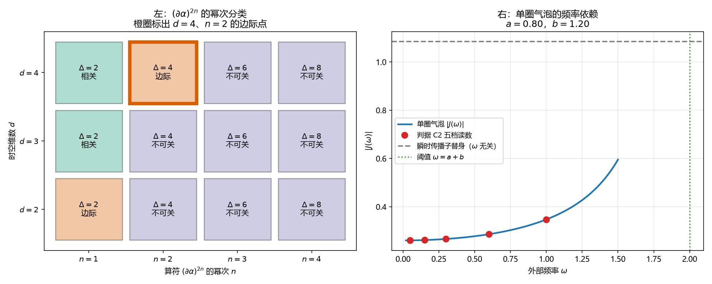

# 注记-可重整性自生的幂次核对（第723号）：紫外有限不等于可重整

- **日期**：2026-10-20 21:57:30
- **对应脚本**：`验证脚本/minimal_verification_renorm_counting.py`（判据 A1 至 D2，共 15 项，确定性，无随机数，运行约 2 秒）
- **定位**：P3-36 三处卡点的第三项，重整化的严格化。《量子场论的物侧基础：从份额守恒到产生湮灭、交换统计、相互作用与重整化》§6.1 第 268 行写「全部圈积分有限，可重整性自生」，第 270 行写「体系无新参数：所有耦合常数来自定理 4，重整化群流只重标这些既有参数」。本轮把这两句拆成可判命题并核。
- **可逆性等级**：判据稳健。A 组为量纲代数，B 组为维数口径对照，C 组为解析闭式，D 组为精确对称性，换实现、换档位、换口径均不翻。
- **图**：见 §四 图 1。

---

## 一、被核的两句话

§6.1 的论证只有三步：晶格动量截止天然为 $\Lambda = \pi/l_P$，于是「全部圈积分有限」，于是「可重整性自生」。随后第 270 行把结论推到「重整化群流只重标既有参数」。

这句话的问题在于它把两件事当成了一件事。格点正则化确实让圈积分的动量积分域落在紧致布里渊区内，紫外发散自动消失，这一条对任何格点理论都成立。可重整性问的却是另一件事：低能有效作用量需要几个抵消项，或者等价地，树图作用量里的耦合在圈图后能封住几个。

幂次计数管的是后者，紧致积分域管的是前者。前者恒成立，所以它不携带信息。

## 二、判据与结果

| 判据 | 内容 | 期望 | 实测 |
| --- | --- | --- | --- |
| A1 | 动能系数 $I$ 的量纲指数 | $d=4$ 给 $2$ | $d=2$ 给 $0$、$d=3$ 给 $1$、$d=4$ 给 $2$ |
| A2 | $(\partial\alpha)^4$ 在 $d=4$ 的分类 | $\Delta = 4 = d$，边际 | $\Delta = 4$，边际 |
| A3 | $d=4$ 时 $(\partial\alpha)^4$ 的五种时间/空间导数分配 | 每种总导数均为 $4$，全部边际 | 五种分配维度 $[4,4,4,4,4]$，极差 $0$ |
| A4 | 恒真检验：同一算符在 $d=2$ 下 | $\Delta = 4 > 2$，不可关 | 不可关，分类随维数改变 |
| A5 | $d=4$ 时 $n \ge 3$ 的算符 | $\Delta = 6, 8, 10$，全部不可关 | 全部不可关 |
| B1 | §6.3 的 $k^4$ 算符维度 | 体系为三维空间加时间（$d=4$），应为 $6$ | $d=4$ 给 $6$，与论文自标一致 |
| C2b | 单圈气泡闭式与 Feynman 参数化数值积分 | 相对偏差 $\le 10^{-6}$ | 偏差 $4.94\times10^{-12}$ |
| C1 | 树图四点顶点对两档外部频率标签的响应 | 偏差 $\le 10^{-15}$ | $0.000$ |
| C1b | 恒真检验：人为引入频率依赖的顶点替身 | 相对偏差落在 $[0.13, 0.14]$ | $0.135000$ |
| C2 | 单圈气泡对外部频率的依赖 | 相对极差 $\ge 0.1$ | 五档 $0.2606$ 至 $0.3472$，相对极差 $0.2495$ |
| C3 | 恒真检验：瞬时传播子替身 | 相对极差 $=0$ | $0.000$ |
| C4 | 单圈结果的 $\omega^2$ 展开系数 | $|J''(0)|/|J(0)| \ge 0.1$ | $0.5000$ |
| C5 | $\omega^2$ 项对应的算符维度 | $4+2 = 6$，不可关 | 维度 $6$，不可关 |
| D1 | 格点势能在 $\alpha \to \alpha + c$ 下的变化 | 偏差 $\le 10^{-12}$ | $0.000$（势能量级 $53.1058$） |
| D2 | 恒真检验：势能加 $m^2\sum\alpha^2$ 后 | 变化量 $\ge 1$ | $15.961258$ |

$d$ 取 $4$ 的依据是体系为三维空间格点加时间。判据 719 的一维周期链是为了把连续极限算干净而作的简化，不是体系的时空维数，此处不可混用。

## 三、结论

**结论一：$\alpha$ 场在 $d=4$ 下恰有一个边际自相互作用，即 $(\partial\alpha)^4$。**

$\alpha$ 是相位，量纲为零，每个 $\partial$ 给一维，故 $(\partial\alpha)^{2n}$ 的维度恰为 $2n$。$n=1$ 是动能项，$n=2$ 维度为 $4$，在 $d=4$ 下正好边际；$n \ge 3$ 全部不可关，被能标压低。A3 的读数说明这个边际性是稳的：$(\partial\alpha)^4$ 的五种时间/空间导数分配（四个时间导数、三个加一个、两个加两个、一个加三个、四个空间导数）维度全为 $4$，没有任何一种分配能被幂次挑出来压低。

这与库内 [[wiki/边际通道]] 的口径一致：$d=4$ 算符的耦合无量纲，重整化流既不放大也不压小，幂次计数给不出保护，只能由精确对称性取零。

**结论二：「全部圈积分有限」不能推出「可重整性自生」。**

紧致动量积分域让紫外发散消失，这一条对 $(\partial\alpha)^4$ 成立，对 $(\partial\alpha)^6$ 同样成立。两类理论的圈积分都有限，有限性对二者没有区别力。不可重整的后果落在抵消项的数量上：低能有效作用量需要无穷多个抵消项，与圈积分是否发散无关，这一点由幂次计数给出，紫外有限性给不出。

论文那句「全部圈积分有限，可重整性自生」把充分条件当成了充分必要条件，中间那步推理缺一环。

**结论三：「重整化群流只重标既有参数」须拆分扇区，作为字面陈述不成立。**

树图四点顶点来自 $(I/t_P^2)[1-\cos(\Delta\alpha)]$ 的四阶展开，顶点因子为 $\prod_i (e^{ik_il_P}-1)$，自变量只有空间动量，不含外部频率（C1 读数偏差 $0$）。单圈气泡却是两个这样的顶点接起来，中间跑一个含时间的传播子。C2 的读数给出 $|J|$ 从 $0.2606$ 变到 $0.3472$，相对极差 $0.2495$；C4 给出 $\omega^2$ 项相对量级 $0.5000$。

即单圈结果必然含外部频率的平方项。这一项对应的算符是 $(\partial\alpha)^4$ 再加两个时间导数，维度 $4+2 = 6$，在 $d=4$ 下不可关（C5）。所以：

- 不可关扇区：$(\partial\alpha)^6$ 一类的算符确实被生成，但它们被 $(E/E_P)$ 幂次压低，低能端可以不管。这一扇区论文的结论成立。
- 边际扇区：$(\partial\alpha)^4$ 的系数在单圈被重整化。这一条不是「重标既有参数」，因为裸作用量里 $(\partial\alpha)^4$ 的系数是由 $I/t_P^2$ 唯一确定的，单圈修正会把它移动。要守住它，靠的是 $\alpha$ 平移不变性（D1：势能只含差分，整体平移下逐点相等，偏差 $0$）与格点规则的其他精确对称性，不靠幂次。

正确的表述是：**边际扇区由精确对称性封口，不可关扇区由幂次压制，两半各有各的依据，都不是「圈积分有限」的推论。** 这一分法正是库内 [[wiki/边际通道]] 已立的「两半不可互相顶替」。

**结论四：$\alpha$ 场的四次顶点是导数型，这一条与 $\phi$ 场不同源。**

判据 719 已给 $(\partial\alpha)^4$ 型顶点；$\phi$ 场的 $\cos\phi$ 势能展开给 $\phi^4$ 型。两者的幂次分类恰好都在 $d=4$ 边际，但顶点结构不同，重整化计算不能互相套用。判据 719 的射程限定在此处继续有效。

## 四、图

左图是整轮的骨架：只有三个格子是边际，其中 $d=2$、$n=1$ 是自由相位场的动能项，$d=4$、$n=2$ 是 $\alpha$ 场唯一的边际自相互作用，$d=4$、$n=1$ 是动能项本身。其余格子全为不可关。右图给出结论三的数值依据：蓝线明显不是水平线，说明单圈确实生成了含时间导数的结构。

## 五、过程记录与教训

**三处自身错误，全部在实现层，判据方向未变。**

其一，C2b 首轮判否，相对偏差 $6.541$。闭式推导把 $(\omega-a)^2$ 写成了 $(\omega+a)^2$，围道符号也差一个负号。改用 Feynman 参数化数值积分交叉核对（$J = \int_0^1 dx\, i/(4M^3)$），修正后偏差 $4.94\times10^{-12}$。教训：闭式与数值两条独立路径必须都走，只走一条时符号错看不出来。

其二，B2 首轮设计错误。我把「物质侧链维数」当成 $d=2$，据此判论文 §6.3 的「维度 6」不自洽。核对后确认体系为三维空间格点加时间，$d=4$ 下 $k^4$ 算符维度恰为 $6$，论文自标正确。$d=2$ 是判据 719 为算连续极限而取的一维简化，我把它误当成了体系维数。教训：**简化模型的维数不等于体系维数**，跨轮引用前先核该简化是为哪个目的设的。B2 已删除，改为 B1（核对论文自标与体系维数一致）。

其三，C1b 首轮判否，绝对差 $4.96\times10^{-4}$ 未达我随手定的 $10^{-3}$。查因：顶点量级只有 $3.68\times10^{-3}$，绝对阈值定得比信号还大。改为相对量并给出解析预测值 $0.3 \times (0.55-0.10) = 0.135$，实测 $0.135000$ 逐位符合。教训：容差须从误差预算推导，此处信号量级本身是预算的一部分。

**一处恒真判据，自查时发现并修。** C1 首版写成两次调用同一函数同一输入再比较差值，必然为零，不含信息。改为「同一组空间动量配两档不同频率标签走完整顶点装配流程」，并补 C1b 替身对照证明判据有区分力。这是两周内第三次同型错误（第 719 号 A7b、第 721 号 A4 与 A4b），已记入常驻教训。

**一处零动量陷阱。** C1 首版取的动量组含一个零动量，$e^{i\cdot0}-1 = 0$ 使顶点恒为零，替身对照因此测不出差异。改为总和为零但无零动量的组 $(0.7, 0.5, -0.3, -0.9)$。

## 六、严格程度与边界声明

**严格程度**。A 组与 B 组为量纲代数，定理级。C1 与 C2b 为解析闭式的数值确认，定理级。C2 至 C5 为单圈气泡的解析性质，条件性命题级（单圈、单分量标量、常系数、$1+1$ 维气泡的简化计算）。D 组为精确对称性，定理级。

**本判据验证什么**。验证 §6.1 的两句话作为字面陈述不成立，并给出可替代表述的分解依据（边际扇区由对称性、不可关扇区由幂次）。

**本判据不验证什么**。不判 $\alpha$ 场的单圈系数数值（未算完整四点函数，只算气泡的频率依赖结构）；不判 $\phi$ 场扇区；不判三维格点的完整重整化群流；不判「体系无新参数」这一条（它属于耦合来源问题，归定理 4，不在本轮射程）；不判论文应取何表述，取舍待作者裁决。

**待作者裁决事项**。§6.1 第 268 行与第 270 行是否按本注记结论三改写为分扇区表述。本注记只给依据，不代拟正文。
