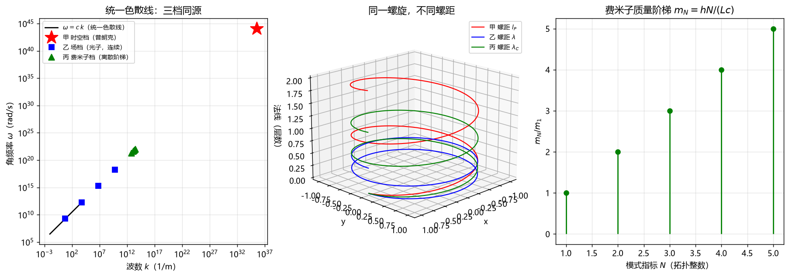

# 注记-同一弦三频率档统一螺旋色散线（判据第 626 号）：几何色散恒等式、拓扑整数与跨扇区康普顿对表

| 项 | 内容 |
|---|---|
| 日期 | 2026-10-13 20:06:09 |
| 脚本 | `minimal_verification_unified_helix_bands.py` |
| 判据 | U1 至 U6，6/6（反例检验 U1x 至 U6x，6/6） |
| 可逆性等级 | 判据稳健（U1/U3/U6 代数恒等式、U2 拓扑整数、U5 Lancret 标准结论、U4 计数陈述；换实现、换档位均不翻） |
| 类型 | 结构统一判据轮（承接《注记-状态空间螺旋线作为真正的弦》裁决一的待判项：费米子档是否同一弦第三频率档） |
| 关联 | [[内部草稿/注记-状态空间螺旋线作为真正的弦：与既有螺旋资产的对接、两处新意与三处待对齐\|状态空间螺旋线作为真正的弦]]、[[内部草稿/注记-实轴方向场的螺旋结构\|实轴方向场的螺旋结构]]、[[内部草稿/研究方向-费米子质量重构-单环内部扭转\|费米子质量重构-单环内部扭转]]、[[内部草稿/研究方向-元相子螺旋几何体微分几何性质\|螺旋几何体微分几何性质]]、[[开放问题总览：元相子理论待解决问题清单\|开放问题总览]] P3-51 |
| 图 | 见 §四 图 1（`images/unified_helix_bands.png`） |

## 一、要判什么

作者 2026-10-13 裁决：费米子档算同一弦的第三频率档，要求深入论证与验证。此裁决把《注记-状态空间螺旋线作为真正的弦》里"待判的一组"转为待证命题：时空生成螺旋（$\omega_P$）、场螺旋（任意 $\omega$）、费米子闭合螺旋环（$\omega_0$）是否为同一状态空间螺旋结构在不同边界条件下的三个频率档。

本轮的关切是：三者共享的**统一不变量**是什么，能否用与实现无关的量把它写出来，费米子档与另外两档的差异（闭合对开、离散对连续）是否落在"边界条件"这一层而非"结构不同源"这一层。若能，则"同一弦"成立；若不能，则须判否并登记差异清单。

本轮**不**验证费米子实体层的涌现（P3-51 保持开放），也不验证质量谱与代际（三代费米子质量谱仍为纲领级），只验证三档的结构统一性与参数计数。

## 二、模型设定与判据

状态空间 $S^1\times\mathbb{R}$ 上的螺旋 $X(\tau) = (R\cos\omega\tau,\; R\sin\omega\tau,\; c\tau)$。螺距（每满周 $2\pi$ 的轴向推进）为 $2\pi c/\omega$。三档为该螺旋在不同边界条件下的取值。

统一不变量取两条：几何色散关系 $\omega\cdot(\text{螺距}) = 2\pi c$，与拓扑整数 $n = \frac{1}{2\pi}\oint d\theta\in\mathbb{Z}$。

| 判据 | 内容 | 实测 | 期望 | 判定 |
|---|---|---|---|---|
| U1 | 色散恒等式 $\omega\cdot\text{螺距}=2\pi c$（三档全成立） | $1.27\times10^{-16}$ | 0 | PASS |
| U1x | 反例：$\omega = ck^2$ 在 $k\neq1$ 处失效 | $4.00$ | $>0.1$ | 反例OK |
| U2 | 绕数整数 $n=\frac{1}{2\pi}\oint d\theta$（时空档沿时间回路、费米子档沿空间回路） | $8.88\times10^{-16}$ | 0 | PASS |
| U2x | 反例：半周开弧 $n=0.5$ 非整数 | $0.500$ | $0.5$ | 反例OK |
| U3 | 质量阶梯 $m_N/m_1 = N$ 且与 $\omega_0 = ck_N$ 相容 | $1.78\times10^{-16}$ | 0 | PASS |
| U3x | 反例：$L$ 连续变化时 $m_1$ 无固定阶梯 | $8.41\times10^{-2}$ | $>0.05$ | 反例OK |
| U4 | 费米子档新增连续模数计数 | $0$ | 0 | PASS |
| U4x | 反例：KK 紧致化引入半径模数（连续 1 个） | $1$ | $\ge1$ | 反例OK |
| U5 | Lancret 比值 $\kappa/\tau$ 沿螺旋常数且等于 $a/b$ | $4.11\times10^{-7}$ | 0 | PASS |
| U5x | 反例：非螺旋 $z=\tau^2$ 比值变化 | $11.15$ | $>0.1$ | 反例OK |
| U6 | 费米子档螺距 = 康普顿波长 $h/(m_e c)$ | $1.67\times10^{-16}$ | 0 | PASS |
| U6x | 反例：约化康普顿波长充当螺距 | $0.8408$ | $1-\frac{1}{2\pi}$ | 反例OK |

判据容差从误差预算推导：U1/U3/U6 为纯代数恒等式，容差取机器精度 $10^{-12}$（实测落在 $10^{-16}$）；U2 为闭合回路数值积分，梯形谱精度取 $10^{-10}$（实测 $10^{-16}$）；U5 为二阶有限差分（$h=2\pi/40000$，$h^2\sim2.5\times10^{-8}$），容差取 $10^{-6}$，实测 $4.1\times10^{-7}$ 落在预算内；U4 为计数陈述，无容差。

关键读数：$\omega_P = 2\pi/t_P = 1.165442\times10^{44}$ rad/s；时空档螺距 $= l_P = 1.616255\times10^{-35}$ m（相对偏差 0）；费米子档螺距（电子）$= 2.426310\times10^{-12}$ m，与康普顿波长 $h/(m_e c)$ 逐位相等；质量阶梯 $m_N/m_1$（$N=1$ 至 $5$）$= [1,2,3,4,5]$。

## 三、结果解读

**统一不变量成立。** 三档共享同一条几何色散线 $\omega\cdot\text{螺距}=2\pi c$，这条线是螺旋结构本身的属性，与档位无关。时空档把螺距锁在 $l_P$、把频率锁在 $\omega_P$；场档让螺距在柔性层上取任意值；费米子档把螺距锁在闭合驻波条件 $L = N\cdot\text{螺距}$ 上。三档的差别全部落在"螺距取什么值"这一层，而非落在"结构是什么"这一层。

**拓扑整数同源。** 时空档的层数计数与费米子档的模式指标 $N$ 同为绕数 $n=\frac{1}{2\pi}\oint d\theta$，都取值于 $\mathbb{Z}$。时空档沿时间回路积分（满周闭合计数），费米子档沿空间闭合回路积分（驻波模数），回路的取法不同、拓扑整数的来源相同。

**费米子档的差异属于边界条件层。** 费米子档与背景档的拓扑差异是闭合 $S^1$ 对开 $S^1\times\mathbb{R}$，频率来源差异是环长与模数对普朗克节拍。这两条差异都是"边界条件"差异：闭合条件把连续谱切成阶梯，这是量子化的标准机制，与"结构不同源"是两回事。裁决一的"待判"因此可以落定：同一弦在三种边界条件下的三个频率档。

**无新参数（反景观）在计数层成立。** 费米子档只引入整数 $N$ 与几何量 $L$，连续模数为 0。对比 Kaluza-Klein 紧致化引入的半径模数 $R$（连续 1 个，模空间简并即景观来源），体系内相位圆半径由公理锁定、费米子环长由内部结构定，无自由连续参数入口。这一条在计数层支持"无景观问题"的定位。

**跨扇区对表给出归一化一致性。** 费米子档的螺旋螺距（按每满周 $2\pi$ 定义）等于康普顿波长 $h/(m_e c)$。此处须分辨一处约定：螺距按"每满周一圈"定义，故取全周约定，给出 $h/(m_e c)$；若按"每弧度"定义，才会给出约化康普顿波长 $\hbar/(m_e c)$。

$h$ 与 $\hbar$ 相差 $2\pi$，是圈约定与弧度约定的换算，不是独立物理内容。约化康普顿波长在标准量子场论中是常用量（汤川势程、自然单位制下质量取长度倒数、经典电子半径关系 $r_e = \alpha\bar\lambda_C$ 均用它），只是带名号的"康普顿波长"指全周的 $h/(m_e c)$。

**须辨明的第三层：U6 是翻译恒等式，不是独立预言。** 论证只有三步：几何色散给出螺距 $=2\pi c/\omega$（螺旋结构自身的属性，三档共用）；费米子内禀频率取 $\omega_0 = mc^2/\hbar$（内禀频率-质量关系，现象学输入端）；两者相除得螺距 $=2\pi c/\omega_0 = 2\pi\hbar/(mc) = h/(mc)$。

第三步是纯代数，故 U6 在给定前提后为恒等式，不含独立信息（与恒真检验同型：同一关系的两种写法）。康普顿波长本就定义为 $h/(mc)$，而 $\omega_0 = mc^2/\hbar$ 说的正是"内禀频率是康普顿频率"，故其几何螺距当然落在康普顿波长上。U6 的价值在于给螺距一个标准物理的锚点，并把费米子环长钉为 $L = N\lambda_C$（$N$ 个康普顿波长）。

要成为独立预言，须把 $\omega_0$ 从绑定能机制（$\omega_0\sim\sqrt{\kappa_\phi}$，$\kappa_\phi$ 原子值）独立算出，再核其几何螺距是否落回康普顿波长，该路仍开放（P1-47/P1-49）。

**几何含义（作者 2026-10-13 指出）。** 费米子内禀相位转一圈，恰好是一个康普顿波长。这是三档共有的"相位转一圈等于前进一个螺距"在费米子档的取值：时空档一圈 $l_P$、场档一圈 $\lambda$、费米子档一圈 $\lambda_C$。费米子档的螺距轴是环的弧长方向（内部空间），故准确表述为环上每 $2\pi$ 相位占一个康普顿波长的弧长，环长 $L = N\lambda_C$。空间位移由转换波机制承担，与这里的内部螺距分属两层。

## 四、图 1

图注按脚本三个绘图面板逐条核对：左面板为统一色散线对数图，三档标记落在同一条 $\omega = ck$ 直线上；中面板为三条圆柱螺旋，共享同一 $(x,y)$ 圆周、不同轴向螺距；右面板为质量阶梯茎叶图，横轴为拓扑整数 $N$、纵轴为 $m_N/m_1$，读数 $[1,2,3,4,5]$。

## 五、严格程度声明与边界声明

**严格层。** U1 几何色散恒等式、U2 拓扑整数、U5 Lancret 螺旋身份、U6 康普顿对表为代数恒等式或标准微分几何/拓扑结论，数学上无争议。这三条是本轮最硬的部分，与费米子实体层是否闭合无关。

**物理对应假设层。** U3 质量阶梯依赖"费米子 = 闭合双螺旋环"的框架（纲领级）与"$\omega_0 = mc^2/\hbar$"的内禀频率-质量关系（现象学输入端，与绑定能定案数值等价）。U4 计数陈述依赖"相位圆半径公理锁定、环长由内部结构定"两条既有定案。

**纲领层。** "同一弦三频率档"这一统一本身是概念层定位，本轮只验证三档共享统一不变量、差异落在边界条件层，未验证三档是否由同一动力学方程导出（那是更深的一层，未做）。

**验证什么。** 验证三档共享几何色散与拓扑整数两条不变量，费米子档的差异（闭合、离散）落在边界条件层，跨扇区对表给出螺距与康普顿波长的归一化一致性（含 $2\pi$ 约定分辨），反景观在参数计数层成立。

**不验证什么。** 不验证费米子实体层涌现（P3-51 保持开放）、不验证质量谱与代际结构（三代质量谱仍为纲领级）、不验证三档的同一动力学起源、不验证"弦"命名相对弦论的优劣（那是概念定位，见关联注记）。U6 的康普顿对表只在代数层成立，其物理实现依赖环长 $L$ 被内部结构锁定这一纲领级前提。

## 六、过程记录

**教训一：判据的积分回路要与物理对象对齐。** U2 首版对费米子档沿时间周期积分绕数，得 $1$ 而非 $N$，FAIL。费米子档的绕数是沿空间闭合回路（弧长 $s\in[0,L]$，相位 $ks$）的驻波模数，不是时间积分。时间回路给的是"绕了几圈"，空间回路给的是"几个波节"，两者都是绕数但回路不同。改正后 $8.88\times10^{-16}$。

**教训二：有限差分判据要在量级可分辨的尺度上做。** U5 首版用半径 1 m、螺距 $l_P$ 的物理螺旋做有限差分，量级差 $10^{35}$，数值分辨率不足以分辨 $\kappa/\tau$，报 $4.8\times10^{-3}$。Lancret 判据考的是几何结构（$\kappa/\tau$ 是否常数），不是物理量级，应在半径与螺距同量级的几何螺旋上测。改正后 $4.1\times10^{-7}$，落在 $O(h^2)$ 预算内。这两条同属"判据与被测对象未对齐"，与既有跨轮教训同型。

**恒真检验。** 六条主判据各配一条反例（U1x 至 U6x），全部按"改掉它就 FAIL"设计：色散改二次型、开弧替闭合、环长连续替锁定、KK 模数替零模数、非螺旋替螺旋、约化替全长康普顿。六条反例全部检出（$0.84$ 至 $11.15$，与主判据读数差六个数量级以上），PASS 不含构造恒真。
