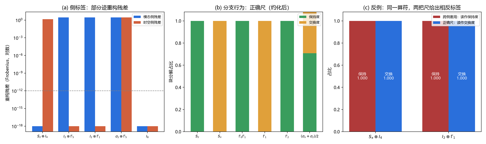

# 注记-同侧判据：侧标签与分支行为的二维分类（判据第674号）

## 元数据

- **日期**：2026-10-17 23:29:46
- **类型**：验证注记（判据驱动）
- **脚本**：`验证脚本/same_side_ruler.py`
- **图**：见 §四 图 1
- **可逆性等级**：判据稳健（解析构造与范数读数，换实现、换口径、换档位均不翻）
- **关联**：[[验证脚本/注记-模态锁定旋转模式的显式形式与663号模板的迁移适用性（判据第671号）|第 671 号]]（本轮补其点出的缺口）；[[验证脚本/注记-来源层判据化第二轮：CR 结构类型分解与作用分类（判据第663号）|第 663 号]]（被检验的模板）；[[验证脚本/注记-4分量手征算符的显式构造与标准Dirac表示的不存在性（判据第667号）|第 667 号]]（时空侧构造来源）；[[内部草稿/注记-P1-58结构层终局评估：三条支路的前置条件与可达边界（2026-10-17）|P1-58 结构层终局评估]]（支路一的缺口定义）

## 摘要

第 671 号判定 P1-58 支路一的真实缺口是「同侧判据」：模态锁定算符住在模态因子上，但库内没有一把尺能分辨它是否加载在模态单支上。本轮造出这把尺，并把它拆成两个独立坐标：**侧标签** $s$ 由部分迹重构残差给出，把任意 8 分量算符分为模态、时空、双侧、退化四类；**分支行为** $b$ 由该侧二分支投影下的块分解给出，读保持度与交换度。

三项结论。其一，二维不可约化：任何只给一个坐标的尺都会在某个方向上失明，反例 R1、R2 显示同一算符在两把尺下给出相反标签。

其二，第 671 号把 $[S_z\otimes I_4,\ I_2\otimes\Gamma_5]=0$ 读作「同侧」的证据，方向反了：异侧且各居纯因子时对易恒成立（C1 四组全零），同侧算符反而可对易可不对易（C2），故对易是同侧的**必要条件而非充分条件**，不对易能推出同侧，对易什么都推不出。

其三，第 671 号把模板失真归因于复维不匹配，主因判断错了：固定手征型尺换复维，复维 1 与复维 2 都给出正确读数（T1）；真正的分界是分支的**类型**，第 663 号的本征矢构造 $h-\mathrm{i}Jh$ 依赖 $J^2=-I$，在 $C^2=+I$ 的手征型上 400 个随机样本全部失败（T2）。

## 一、背景与为什么是这一轮

第 671 号补上了模态锁定模式的显式候选 $S_z=\sigma_z/2$，随即发现模式补上后仍无判据可用：同侧关系的对易层面成立，但对易不能分辨「是否加载单支」。该注记把缺口明确表述为「支路一的真实缺口是同侧判据，显式模式并不缺」。

本轮接这一句。要点在于把「同侧」从一句定性拆成可测量的坐标。算符的侧别在张量积结构 $\mathbb{C}^2_{\text{模态}}\otimes\mathbb{C}^4_{\text{时空}}$ 里本就有精确定义：纯模态算符形如 $A\otimes I_4$，纯时空算符形如 $I_2\otimes B$。部分迹重构正是这两个形式的投影算子，故侧标签可以无歧义地算出来。分支行为则须先约化到该侧因子，再用该侧自己的二分支投影去读，这一步是 671 号缺的。

## 二、模型设定

载体为 8 维张量积 $\mathbb{C}^2\otimes\mathbb{C}^4$。模态侧取 $S_z=\sigma_z/2$、$S_x=\sigma_x/2$、$S_y=\sigma_y/2$；时空侧取第 667 号的 4 分量 Cl(3) 表示 $\Gamma_0=\sigma_z\otimes I_2$、$\Gamma_1=\sigma_x\otimes I_2$、$\Gamma_2=I_2\otimes\sigma_y$，手征算符 $\Gamma_5=\mathrm{i}\Gamma_0\Gamma_1\Gamma_2$。

两侧的二分支生成元类型不同，这是本轮的关键区分。模态侧用复结构 $J_m=\mathrm{i}\sigma_z$，满足 $J_m^2=-I$，投影 $\Pi_\pm=(I\mp\mathrm{i}J_m)/2$，本征值 $\pm\mathrm{i}$，各支复维 1。时空侧用 $\Gamma_5$，满足 $\Gamma_5^2=I$，投影 $P_\pm=(I\pm\Gamma_5)/2$，本征值 $\pm1$，各支复维 2。两类投影都厄米、幂等、互补，故块分解判据对两者通用。

侧标签的算法：对 8 分量算符 $M$ 分别求两个部分迹 $\operatorname{tr}_{\text{时空}}M$（得 $2\times2$）与 $\operatorname{tr}_{\text{模态}}M$（得 $4\times4$），按 $\operatorname{tr}_{\text{时空}}M/4\otimes I_4$ 与 $I_2\otimes\operatorname{tr}_{\text{模态}}M/2$ 重构，取两个 Frobenius 残差。残差为零即该侧标签成立。

## 三、判据与结果

冒烟三项、侧标签五项、分支行为六项、对易关系两项、类型与复维分离两项、跨侧套用反例两项，共 20 项。

| 判据 | 内容 | 期望 | 实测 | 判定 |
| --- | --- | --- | --- | --- |
| M1 | 部分迹与重构恒等式 | $<10^{-12}$ | $3.34\times10^{-15}$ | 通过 |
| M2 | 两类投影厄米幂等互补 | 偏差 $0$；秩 $(1,1)$ 与 $(2,2)$ | $0$；$(1,1)$ 与 $(2,2)$ | 通过 |
| M3 | 块分解范数守恒 | $<10^{-12}$ | $8.88\times10^{-16}$ | 通过 |
| S1 | $S_z\otimes I_4$ | 模态 | 模态侧 $0$，时空侧 $1.414$ | 通过 |
| S2 | $I_2\otimes\Gamma_5$ | 时空 | 模态侧 $2.828$，时空侧 $0$ | 通过 |
| S3 | $I_2\otimes\Gamma_1$ | 时空 | 模态侧 $2.828$，时空侧 $0$ | 通过 |
| S4 | $\sigma_z\otimes\Gamma_5$ | 双侧 | 两侧均 $2.828$ | 通过 |
| S5 | $I_8$ | 退化 | 两侧均 $0$ | 通过 |
| B1 | $S_z$ | 保持 | $1.000000$ 对 $0.000000$ | 通过 |
| B2 | $S_x$ | 交换 | $0.000000$ 对 $1.000000$ | 通过 |
| B3 | $\Gamma_0\Gamma_1$ | 保持 | $1.000000$ 对 $0.000000$ | 通过 |
| B4 | $\Gamma_1$ | 交换 | $0.000000$ 对 $1.000000$ | 通过 |
| B5 | $\Gamma_2$ | 保持 | $1.000000$ 对 $0.000000$ | 通过 |
| B6 | $(\sigma_x+\sigma_z)/2$ | 混合 | $0.707107$ 对 $0.707107$ | 通过 |
| C1 | 四组纯模态乘纯时空算符对易 | $0$ | $0.00\times10^{0}$ | 通过 |
| C2 | 同侧算符的对易与不对易并存 | 两情形都出现 | $2.828427$ 与 $0$ | 通过 |
| T1 | 手征型尺换复维（$1$ 与 $2$） | 都正确 | 保持 $1.000000$、交换 $1.000000$ | 通过 |
| T2 | $h-\mathrm{i}Jh$ 构造在两类型下的失败数 | 复结构 $0$，手征几乎全失败 | $0$ 与 $400$（共 $400$） | 通过 |
| R1 | $S_x\otimes I_4$ 跨侧套用 | 读数翻转 | 误读保持 $1.000000$，正确尺交换 $1.000000$ | 通过 |
| R2 | $I_2\otimes\Gamma_1$ 跨侧套用 | 读数翻转 | 误读保持 $1.000000$，正确尺交换 $1.000000$ | 通过 |

## 四、结果解读

**侧标签是一个干净的二分。** 面板 (a) 里五根算符每根都恰有一侧残差落在机器零：纯模态算符的模态侧残差为 $0$ 而时空侧 $1.414$，纯时空算符反之 $2.828$，乘积算符两侧都不为零，单位算符两侧都为零。这给出四类标签且互不重叠，退化类（两侧都为零）须单列，否则单位算符会被同时判成模态和时空。残差量值 $1.414=\sqrt{2}$ 与 $2.828=2\sqrt{2}$ 是 $S_z=\sigma_z/2$ 归一化与 $\Gamma_5$ 归一化之差，不影响分类。

**分支行为必须在约化后的正确尺上读。** 面板 (b) 前五项给出纯净读数：$S_z$ 保持（$1.000$ 对 $0.000$），$S_x$ 交换，$\Gamma_0\Gamma_1$ 保持，$\Gamma_1$ 交换，$\Gamma_2$ 保持。第六项取 $(\sigma_x+\sigma_z)/2$，得到 $0.707107$ 对 $0.707107$，即 $1/\sqrt{2}$，说明块分解对一般算符给出连续读数，只有纯算符才落在二元标签上，这与第 663 号「一般左乘连续过渡」的结论一致。

**反例说明二维不可约化。** 面板 (c) 两根算符在两把尺下都读满值，但标签相反：跨侧套用读作保持 $1.000$，正确尺读作交换 $1.000$。根因是跨侧套用时投影由错误的生成元定义，算符落在投影的同一块里，读数退化为恒真。第 671 号遇到的正是这一情形，当时把它读成模板「失真」，本轮定位为「尺的坐标系错了」。

**对易是异侧的伴随特征。** C1 的四组纯模态乘纯时空算符对易子严格为零，这是张量积结构的必然结果：$A\otimes I$ 与 $I\otimes B$ 恒对易。故对易子非零**蕴含**两侧不是纯因子分离，即同侧或有混合；但对易子为零不能推出异侧，C2 给出同侧算符 $S_z$ 与 $S_z^2$ 对易的反例。第 671 号以对易为零作为同侧成立的证据，逻辑方向反了。这不改变该注记的其余结论（模式已立、模板不可用），只修正这一条证据的地位：它从「同侧的证明」降为「与同侧相容」。

**模板失真的主因是类型，复维只是次要因素。** T1 固定手征型尺，分别在复维 1（$2\times2$ 的 $C=\sigma_z$）与复维 2（$4\times4$ 的 $\Gamma_5$）上读，两次都给出正确读数。

T2 则给出正面证据：第 663 号的构造 $v=h-\mathrm{i}Jh$ 在复结构型上 $400$ 个随机样本零失败，在手征型上 $400$ 个全部失败。原因是该式要造的是 $J$ 的 $+\mathrm{i}$ 本征矢，而手征型的本征值是 $\pm1$，$h-\mathrm{i}\Gamma_5h$ 既不是 $+1$ 支也不是 $-1$ 支。所以复维不匹配是次要因素，类型错配才是主因。

## 五、结论

其一，同侧判据已立，形式为二维坐标 $(\text{侧标签},\text{分支行为})$：侧标签由部分迹重构残差给出（四类），分支行为由约化后该侧投影的块分解给出（连续读数）。

其二，第 671 号的两处归因须修正。对易不是同侧的证据（异侧纯因子恒对易），它只作相容性检查；模板失真的主因是分支类型错配（$J^2=-I$ 对 $C^2=I$），复维不匹配是次要因素。

其三，这把尺的适用范围限于「算符住在哪个因子」与「在该因子的哪一支上」。它不判模态锁定是否真的发生，那需要锁定构型本身；也不判时空侧的物理手性，那需要态层信息。所以支路一的缺口由「缺同侧判据」进一步收窄为「缺锁定构型的判据」，尺已备好，待测对象仍缺。

## 六、严格程度声明与边界声明

**严格程度**：判据稳健。全部读数为解析构造与范数计算，容差 $10^{-12}$ 相对机器零（实测最大 $3.34\times10^{-15}$）留了三个量级余量。反例 R1、R2、C2、T2 均给出「改掉它就 FAIL」的对照：若跨侧套用与正确尺读数相同，R1 失败；若同侧算符只出现一种对易情形，C2 失败；若构造在两类型下失败数相同，T2 失败。

**验证什么**：部分迹重构能否给出无歧义的侧标签；块分解在正确约化与正确分支类型下能否分辨保持与交换；对易与侧别的逻辑关系；模板失真的主因是类型还是复维。

**不验证什么**：不验证模态锁定构型本身是否物理上发生（缺构型）；不验证时空侧的手性是否对应物理手性（需态层）；不验证 $S_z=\sigma_z/2$ 是否是唯一的锁定候选（第 671 号只给候选）；不涉及 $\Gamma_5$ 与复结构 $J$ 的对应关系（第 637、639 号已另判）。

**协议伪影**：无采样或截断引入的伪影。T2 的 $400$ 个随机样本只用于估计失败率，结论（复结构型恒成功、手征型几乎恒失败）由解析论证保证，样本量不影响判定。

## 七、登记衔接

- [[验证脚本/README]] 第 674 号正式行
- [[内部草稿/开放问题档案/开放问题-P1-1-手征性]] 追加本轮登记
- [[内部草稿/开放问题总览：元相子理论待解决问题清单]] P1-1 卡状态行更新
- [[验证脚本/注记-模态锁定旋转模式的显式形式与663号模板的迁移适用性（判据第671号）]] 结论三补更正注

## 八、过程记录

**第一处自我更正：B3 一度取 $\Gamma_5$ 自身。** 初版把 $\Gamma_5$ 列为「保持」的样例，但投影 $P_\pm$ 正是由 $\Gamma_5$ 定义的，用 $\Gamma_5$ 测自己的分支行为是恒真项，违反第 506 号确立的 EP5 纪律。改取 $\Gamma_0\Gamma_1$：它与 $\Gamma_5$ 对易、与投影定义无关，保持度 $1.000000$。

中途曾误取 $\Gamma_1\Gamma_2$，按本表示的 $\Gamma_5=\mathrm{i}\Gamma_0\Gamma_1\Gamma_2$ 它与 $\Gamma_5$ 反对易，会读成交换，已更正。

**第二处自我更正：T2 首版取 $h=e_1\otimes e_1$ 做反例。** 该矢量恰好是 $\Gamma_5$ 的本征矢，构造仍然合法，反例失效。改为随机采样 $400$ 个 $h$ 并统计失败率，结论才成立。教训与第 672 号同型：反例的选取须先核对该点是否落在结论的例外集里。

**第三处自我更正：C2 初版措辞过强。** 原写「同侧不对易、异侧恒对易」，前半句过强：同侧算符也可以对易（$S_z$ 与 $S_z^2$）。改为两情形并列，并显式写出逻辑定位：异侧纯因子蕴含对易，故不对易蕴含同侧，逆命题不成立。

**方法论收获一条。** 本轮的核心发现（对易不能证明同侧）来自把 671 号的一句断言当作待检命题重新算一遍，而不是当作已知前提沿用。上一轮的第 672 号教训是「条件类型不能互相顶替」，这一轮的同型表述是「逻辑方向不能反用」：一个蕴含关系成立，不意味着逆命题可用。两轮的错误都出在把充分条件当必要条件。

## 九、来源

- [[验证脚本/注记-模态锁定旋转模式的显式形式与663号模板的迁移适用性（判据第671号）]]（缺口定义与两处待修正归因）
- [[验证脚本/注记-来源层判据化第二轮：CR 结构类型分解与作用分类（判据第663号）]]（被检验模板的原始形式）
- [[验证脚本/注记-4分量手征算符的显式构造与标准Dirac表示的不存在性（判据第667号）]]（$\Gamma$ 矩阵约定）
- [[内部草稿/注记-P1-58结构层终局评估：三条支路的前置条件与可达边界（2026-10-17）]]（支路一的前置缺口）
- 第 506 号确立的 EP5 恒真检验纪律（`验证脚本/extraction_protocol.py` 的 `tautology_check`）

## 修订记录

- **2026-10-17 建档**（第 671 号结论三的缺口）
    - 判据 20/20 通过，脚本与图落盘
    - 三项结论：二维坐标已立、671 号两处归因修正、支路一缺口收窄
