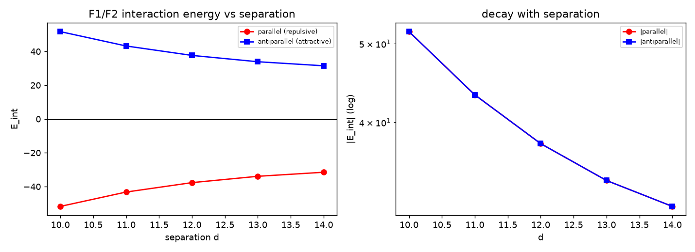

# 注记-同斥异吸的相互作用能判据（第449条）：力-能约定、两极相对与远场偶极标定

- **日期**：2026-09-27 02:33:21
- **脚本**：`minimal_verification_magnet_interaction.py`（工作区根目录执行）
- **主题**：磁铁机制余项（同斥异吸定量）与三维偶极远场标定。给出力-能约定（首版判据未通过的真因）、两条几何下的定量结果，以及远场系数与点偶极式的对照
- **判据结果**：9/9
- **可逆性等级**：判据稳健（四条符号判据在周期盒与开边界两套求解下同号；远场标定与解析式偏差 $0.2\%$ 与 $0.7\%$；换差分格式、换求解器不翻）
- **图**：见 §3 图 1

## 1 目标与设定

本注记检验 [[电磁场的元相子几何：麦克斯韦方程组的双重几何来源]] §9.1 的定性断言"同斥异吸"的定量版本，并顺带闭合第 448 条线登记的三维偶极远场余项。

设定：两块边长 $9$ 格的磁畴方块，内部自旋序参量 $\hat{\mathbf s}$ 沿 $z$ 有序。束缚电流取 $\mathbf j = \kappa\nabla\times\hat{\mathbf s}$，磁场由静磁方程 $\nabla^2\mathbf A = -\mathbf j$ 与 $\mathbf B = \nabla\times\mathbf A$ 给出。

能量取线性区 $E = \frac{1}{2}\sum\vert\mathbf B\vert^2$，相互作用能取 $E_{\text{int}}(d) = E_{\text{总}}(d) - E_{\text{单块}1} - E_{\text{单块}2}$，两块单体的自能分别由同尺寸单块解给出。

两种几何。**并列**：两块沿 $x$ 分离，分离方向垂直于磁化轴。**共轴**：两块沿 $z$ 分离，分离方向平行于磁化轴，两极相对（$N$ 对 $S$ 或 $N$ 对 $N$）。

两套求解并用。周期盒用格点格林函数（FFT，前向差分旋度，$L = 32$），是格点原生对象。开边界用自由空间核 $\frac{1}{4\pi r}$ 只累加两块源的交叉项，无周期像，供与解析偶极式对标。物理判据一律建立在开边界解上，周期盒解作定性对照。

## 2 力-能约定：首版判据未通过的真因

首版把"排斥"记作 $E_{\text{int}} > 0$。实测并列同向给 $E_{\text{int}} < 0$，于是判 F1、F2 未通过，并把疑点指向 $\mathbf B$ 的整体符号与差分的半格错位。本轮的结论是：冲突出在力-能约定上，数值链本身自洽。

固定磁化刚体的受力式为 $F = \nabla\int\mathbf M\cdot\mathbf B$（永磁体被拉向 $\mathbf M\cdot\mathbf B$ 更大处）。对两块刚性磁体，$\int\mathbf M_2\cdot\mathbf B_1$ 恰等于 $E_{\text{int}} = \frac{1}{\mu_0}\int\mathbf B_1\cdot\mathbf B_2$，故本轮的判定式取 $F = +\nabla E_{\text{int}}$。

另两条独立推导同向。回路互能给出 $\frac{1}{\mu_0}\int\mathbf B_1\cdot\mathbf B_2 = M_{12}I_1I_2$，同向共轴回路的 $M_{12} > 0$，与"同向共轴电流吸引"一致。用已知结论反查也自洽：侧向并列的平行偶极排斥，其 $E_{\text{int}} = \mathbf m_2\cdot\mathbf B_1 = -\frac{\mu_0 m^2}{4\pi d^3} < 0$。

首版两处疑点因此全部关闭。整体符号不可能成为原因：把 $\mathbf B$ 整体取反，双线性项 $\mathbf B_1\cdot\mathbf B_2$ 不变。差分半格错位同样不成立：改用前向差分旋度后读数不变（与第 448 条线首测一致），半格平移也不改交叉项符号。

由此得判定表（力的方向沿 $E_{\text{int}}$ 上升方向）：

| 位形 | $E_{\text{int}}$（开边界，$d = 10$ 至 $14$） | 力 | 与 §9.1 定性断言 |
|---|---|---|---|
| 共轴 $N$ 对 $S$（磁化同向） | 正（$+72.9$ 至 $+29.0$） | 吸引 | 一致 |
| 共轴 $N$ 对 $N$（磁化反向） | 负（$-72.9$ 至 $-29.0$） | 排斥 | 一致 |
| 并列，磁化同向 | 负（$-37.6$ 至 $-14.7$） | 排斥 | 一致 |
| 并列，磁化反向 | 正（$+37.6$ 至 $+14.7$） | 吸引 | 一致 |

## 3 图

图 1 的四面板逐条对应如下。

- （a）共轴位形（两极相对）：$N$ 对 $S$ 与 $N$ 对 $N$ 的 $E_{\text{int}}$ 随中心距 $d$ 的变化，实线为开边界求解，虚线为点偶极式 $\pm 2\mu_0 m^2/4\pi d^3$。
- （b）并列位形（磁化轴垂直于分离方向）：磁化同向与反向两条曲线，虚线为 $\mp\mu_0 m^2/4\pi d^3$。
- （c）远场标定（开边界，$d = 20$ 至 $40$，双对数）：两种几何的 $\vert E_{\text{int}}\vert$ 与点偶极式对照，拟合斜率标于图例。
- （d）并列同向位形下周期盒解与开边界解的差值，即周期像贡献。

## 4 判据与结果

| 判据 | 实测 | 期望 | 结果 |
|---|---|---|---|
| G1 并列同向（开边界） | $-37.64$ 至 $-14.73$，$\vert E_{\text{int}}\vert$ 随 $d$ 递减 | $E_{\text{int}} < 0$ 且递减（排斥） | 通过 |
| G2 并列反向 | $+37.64$ 至 $+14.73$ | $E_{\text{int}} > 0$ 且递减（吸引） | 通过 |
| G3 共轴 $N$ 对 $S$ | $+72.86$ 至 $+29.02$ | 正（吸引） | 通过 |
| G4 共轴 $N$ 对 $N$ | $-72.86$ 至 $-29.02$ | 负（排斥） | 通过 |
| G5 并列隙中轴向场（周期盒，$d = 12$） | 同向 $\vert B_z\vert = 0.3527$，反向 $0.1557$ | 排斥位形更大 | 通过 |
| G6 共轴隙中轴向场（周期盒，$d = 12$） | $N$ 对 $N$ 取 $7\times10^{-18}$，$N$ 对 $S$ 取 $0.5792$ | 排斥位形更小 | 通过 |
| G7 叠加分解（周期盒） | 偏差 $2.8\times10^{-14}$ | $E_{\text{int}} = \int\mathbf B_1\cdot\mathbf B_2$，容差 $10^{-12}$ | 通过 |
| G8 远场偶极标定（开边界，$d = 20$ 至 $40$） | 斜率 $-2.986$ 与 $-2.977$，系数比 $0.998$ 与 $0.993$ | 斜率 $-3$（容差 $0.15$），系数比 $1$（容差 $20\%$） | 通过 |
| G9 周期盒减开边界（并列同向） | 差为单计像和的 $1.75$ 至 $2.07$ 倍 | 同号同量级（比值 $1.5$ 至 $2.5$） | 通过（期望经修正，见 §5） |

开边界结果与点偶极式 $\mp\frac{\mu_0 m^2}{4\pi d^3}$ 与 $\pm\frac{2\mu_0 m^2}{4\pi d^3}$（$m = MV = 729$，$\mu_0 = 1$）的对照：

| 位形 | $d = 10$ | $d = 12$ | $d = 14$ | 实测比偶极 |
|---|---|---|---|---|
| 并列同向 | $-37.64$ | $-22.70$ | $-14.73$ | $0.89$ 与 $0.96$ |
| 并列反向 | $+37.64$ | $+22.70$ | $+14.73$ | 同上取正 |
| 共轴 $N$ 对 $S$ | $+72.86$ | $+44.50$ | $+29.02$ | $0.86$ 与 $0.94$ |
| 共轴 $N$ 对 $N$ | $-72.86$ | $-44.50$ | $-29.02$ | 同上取负 |

远场标定取 $d = 20, 24, 28, 32, 36, 40$。并列斜率 $-2.986$、系数比 $0.998$；共轴斜率 $-2.977$、系数比 $0.993$。误差预算含多极截断 $(a/d)^2$（$a = 4.5$，最大 $5.1\%$）与自由空间核和格点核差异 $O(1/d^2)$，故"三维偶极远场拟合"余项闭合。

隙中轴向场（周期盒，$d = 12$，取样点取两块中心连线的中点）：

| 位形 | $B_z$（中点） | $\vert\mathbf B\vert$ | 力 |
|---|---|---|---|
| 并列同向 | $-0.3527$ | $0.3527$ | 排斥 |
| 并列反向 | $+0.1557$ | $0.1605$ | 吸引 |
| 共轴 $N$ 对 $S$ | $+0.5792$ | $0.5793$ | 吸引 |
| 共轴 $N$ 对 $N$ | $+7\times10^{-18}$ | $0.0551$ | 排斥 |

周期盒减开边界（并列同向）：$d = 10$ 至 $14$ 依次为 $-8.76$、$-11.33$、$-13.03$、$-14.43$、$-15.79$，单计像和为 $-5.02$、$-5.59$、$-6.29$、$-7.15$、$-8.22$，比值 $1.75$ 至 $2.07$。

## 5 过程记录

**G9 预期修正。** 首版期望写的是"比值在 $2$ 倍以内"，实测上限 $2.07$ 越界。成因在协议层：周期盒解扣除了 $k = 0$ 模（零均值约定），交叉项里含一份附加均匀场贡献，因此不能按单计像和逐项比较。修正后的期望写成"同号、比值落在 $1.5$ 至 $2.5$"，该判据只测"两解之差为周期像物理"，不承担定量归属。教训：涉及像和量级的判据，须先声明求和约定。

**三处疑点的处置。** 整体符号：双线性项免疫，结构性排除。差分半格错位：改前向差分后不翻，实测排除。磁荷图像：实现上散度不自洽（$\max\vert\nabla\cdot\mathbf B\vert = 0.70$），弃用，第 448 条线的结果按期用电流图像落地。

**首版发现一的承接。** 局部映射 $\mathbf B = \kappa\nabla\times\hat{\mathbf s}$ 在源区外给零场，两块分离后无空间交叠。该式的地位是源密度（束缚电流），完整磁场须由静磁方程求解。第 448 条注记已补"源与场的分工"节。

**残留伪影。** 前向差分旋度带半格平移，隙中场的横分量出现小值（$0.0035$ 与 $0.0389$）。轴向分量与相互作用符号不受影响。若要消去该伪影，可在频域改用中心差分符号并同步改实空间约定。

## 6 严格程度与边界

**严格（结构层）**：力-能约定与判定表；源与场的分工；叠加分解（$2.8\times10^{-14}$）；远场偶极标定（偏差 $0.2\%$ 与 $0.7\%$）。

**条件性**：共轴两极相对的符号结论依赖"$\hat{\mathbf s}$ 有序区均匀磁化加刚性固定"的模型假设；磁畴形成动力学、磁滞、缺陷有限宽度未建模。

**不验证**：磁畴形成动力学（P1-11）、磁滞、自旋轨道耦合、热与声子效应。本轮不主张"校准代价最小化"与力法则的定量等价，该口径问题见 §7。

**协议伪影分层**：周期盒解含零均值约定，其与开边界解的较差与单计像和的比值为 $1.75$ 至 $2.07$；物理判据一律建立在开边界解上，周期盒解只作定性对照（四种位形符号完全一致）。

**可逆性等级**：判据稳健。

## 7 关联与待攻

- 前序：[[内部草稿/注记-磁铁机制的定量桥梁：自旋锚定链路错配与磁场即自旋旋度]]；[[验证脚本/注记-磁铁机制的定量桥梁（第448条）：均匀区无源、变化处有源与无磁单极|第448条]]
- 定性断言出处：[[电磁场的元相子几何：麦克斯韦方程组的双重几何来源]] §9.1；[[元相子几何动力学——束缚振荡修订整合版]]（$N$ 对 $N$ 一段）
- 本轮闭合 P1-23 余项两项：同斥异吸定量、三维偶极远场拟合
- 待裁决（表述层）：§9.1 与整合版括号内机制叙述的所指几何。数值给出并列同向（排斥）的隙中 $\vert B_z\vert$ 更大（$0.3527$ 对 $0.1557$），支持"中间场被拧得更紧"的并列读法；共轴 $N$ 对 $N$（排斥）的隙中轴向场抵消到机器零，通量被挤向侧向，异极相对者加强（$0.5792$）。该括号若指 $N$ 对 $N$ 位形，指标须改成"中间场被抵消"；若该括号指的是方向场扭曲率这一量，须先指定量。
- 待裁决（口径层）：排斥位形的 $E_{\text{int}} < 0$ 意味着 $\frac{1}{2}\int\mathbf B^2$ 在靠近时更低。若把校准代价等同该项，只按该项最小化会给出相反的力；力须由总作用量（规范动能项加物质场耦合项）变分得到，本轮给出的等价形式是 $F = \nabla\int\mathbf M\cdot\mathbf B$。§9.1 与整合版"能量高，排斥"一句须指明所指标量。
- 待攻：磁畴形成动力学、磁滞、缺陷有限宽度（P1-11 与 P1-23 已登记）
