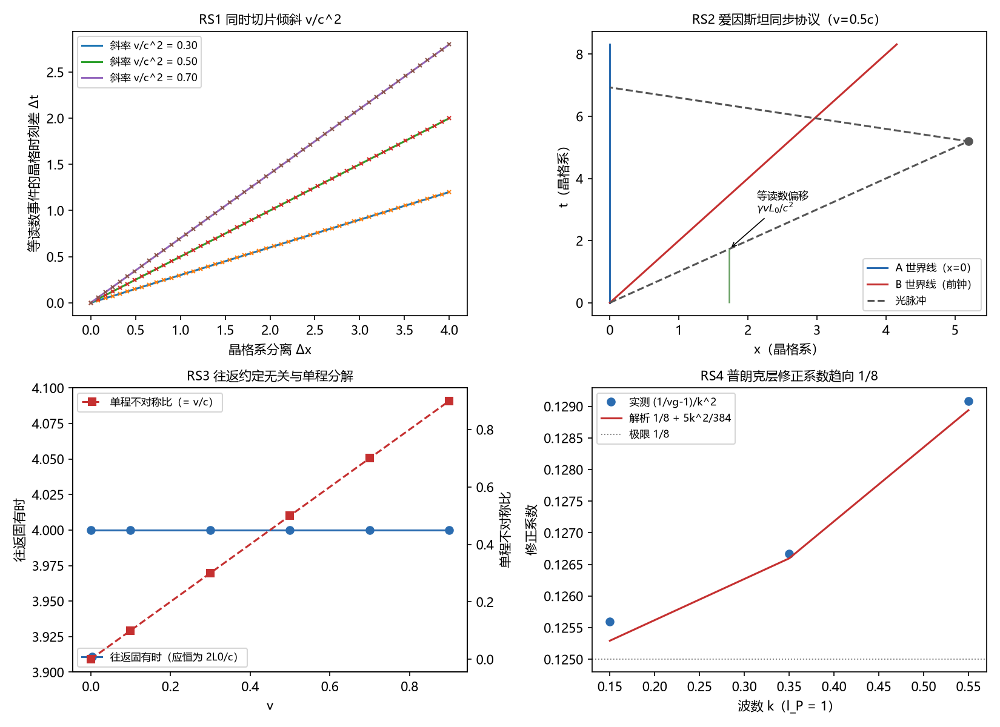

# 注记-同时性相对性的形式化（第 470 条）：等读数切片、爱因斯坦同步与约定自由度

- **日期**：2026-09-27 07:57:32
- **类型**：路线三首项（判据 RS1 至 RS4；解析运动学加晶格谱传播）
- **脚本**：验证脚本/simultaneity.py
- **图**：见 §3 图 1（images/simultaneity_formalization.png）
- **依据**：[[狭义相对论的定理化：从晶格几何到洛伦兹结构]] §5.3 遗留 (a) 与 §2 映射总表（同时性相对性记为半闭合）；[[元相子几何动力学——束缚振荡修订整合版]] 时间涌现段（同时性 = 振荡同步，同相）；[[观测者响应与洛伦兹涌现：束缚态时钟的时间膨胀与长度收缩推导]]（boost 解、$\omega_b/\gamma$ 与残差分离轮）；[[内部草稿/材料-狭义相对论与广义相对论的公设定理化盘点：四公设加惯性的现状、级别与路线]] 三·路线三
- **状态**：判据 RS1 至 RS4 全部通过（13 项分检）。核心读数：同一晶格时刻读数差 $-vL_0/c^2$（偏差 $8.9\times10^{-16}$）；等读数切片斜率与 $v/c^2$ 偏差 $1.1\times10^{-16}$；爱因斯坦协议自洽（B 读数 = A 取中读数）$3.0\times10^{-16}$；往返固有时与 $v$ 无关（$8.9\times10^{-16}$）；单程不对称比 = $v/c$；群速度实测 = $\cos(k/2)$（$6.8\times10^{-6}$），修正系数趋向 $1/8$
- **可逆性等级**：判据稳健（解析恒等式加精确色散谱传播）

## 1 判据与设定

**任务**。路线三首项：为 SR 定理化论文记为「半闭合（定义已立，推导待成）」的同时性相对性补上显式推导与判据。定义基础：同时性 = 振荡同步（同相）（主文档时间涌现段）。

**模型**。观测者 = 低能束缚态时钟（观测者响应论文：boost 解，时钟频率 $\omega_b/\gamma$，宽度 $\xi_0/\gamma$）；同步 = 爱因斯坦光信号协议（A 发射、B 反射、A 取中），低能信使速度各向同性 $c = l_P/t_P$（P11 低能分层定理）；普朗克层用晶格色散 $\omega(k) = (2/t_P)|\sin(k l_P/2)|$ 的谱传播（离散色散精确演化）测群速度与修正。

**判据（RS1 与 RS2）**。RS1a 同一晶格时刻的读数差 = $-vL_0/c^2$（前钟落后）；RS1b 等读数切片斜率 = $v/c^2$；RS1c 速率因子一致性（$\gamma$ 乘读数差 = 等读数偏移）。RS2a 追上时刻两种写法一致；RS2b 协议自洽（反射事件上 B 的读数 = A 的取中读数）；RS2c 往返时刻 $2\gamma L_0/c$ 与 A 读数 $2L_0/c$；RS2d 等读数事件偏移 $\gamma vL_0/c^2$。

**判据（RS3 与 RS4）**。RS3a 往返固有时 $2L_0/c$ 与 $v$ 无关；RS3b 单程不对称比 = $\tanh\phi = v/c$；RS3c 取中偏移 = $\gamma vL_0/c^2$（约定项）。RS4a 群速度实测 = $\cos(k/2)$；RS4b 修正系数 = $1/8 + 5k^2/384$；RS4c 折算 $(1/8)(E/E_P^{(t)})^2$ 落在解析余项预算内。

## 2 结果

**RS1（切片倾斜）**。同一晶格时刻的读数差 $-vL_0/c^2$（15 组最大偏差 $8.88\times10^{-16}$）；等读数切片斜率 $v/c^2$（$1.11\times10^{-16}$）；$\gamma$ 乘读数差 = 等读数偏移（$1.78\times10^{-15}$）。三个量由不同路径算出，互相印证。

**RS2（爱因斯坦协议）**。追上时刻 $L_0e^{\phi}/c = L_0/(\gamma(c-v))$（$3.3\times10^{-16}$）；反射事件上 B 的读数 = A 的取中读数（$3.0\times10^{-16}$，8 组）；往返晶格时刻 $2\gamma L_0/c$、A 读数 $2L_0/c$（精确）；等读数事件偏移 $\gamma vL_0/c^2$（精确）。协议不引入额外假设，偏移是取中约定的输出。

**RS3（约定自由度）**。往返固有时恒为 $2L_0/c$（6 档偏差 $8.9\times10^{-16}$）；单程不对称比 $\tanh\phi = v/c$；取中偏移即约定项 $\gamma vL_0/c^2$。单程分解随约定改变，往返与闭合回路读数约定无关。

**RS4（普朗克层）**。谱传播实测群速度与 $\cos(k/2)$ 最大相对偏差 $6.8\times10^{-6}$；修正系数 $(1/v_g-1)/k^2$ 与 $1/8+5k^2/384$ 偏差 $3.0\times10^{-4}$；折算 $(1/8)(E/E_P^{(t)})^2$ 的实测偏差（$4.2\times10^{-3}$、$2.3\times10^{-2}$、$5.6\times10^{-2}$）落在解析余项预算（$4.6\times10^{-3}$、$2.5\times10^{-2}$、$6.2\times10^{-2}$）内。

## 3 图

## 4 结论与移交

**结论**。在前提「同时性 = 振荡同步」「观测者 = 低能束缚态时钟」「同步 = 爱因斯坦协议加低能各向同性信使速度」下，同时性相对性获得显式推导：两观测者的等读数切片不同一，倾斜 $v/c^2$；同一读数事件在对方记录中偏移 $\gamma vL_0/c^2$（前钟落后）；同步差属约定项，单程分解随约定改变而往返与闭合回路读数不变；低能极限与标准洛伦兹同步一致，普朗克层修正为 $1/\cos(k l_P/2)-1 \approx (1/8)(E/E_P^{(t)})^2$（与色散线签名同源）。SR 定理化论文映射表中该项由「半闭合」升为「条件性定理级候选」，待作者裁决（材料另附）。

**移交**。其一，多观测者非局域比较协议（P11 遗留 c 的后半）仍开；其二，洛伦兹群完备构造（P5b）另项；其三，引力侧同时性（红移与等效原理语境）归引力线。

## 5 严格程度与边界声明

严格程度：RS1 至 RS3 为解析恒等式的数值核对（机器精度）；RS4 为谱传播（离散色散精确演化，无时间步误差；包宽 48 格、谱宽 $1/(2\sigma)$），容差由解析余项推出（$3k^2/16$ 加 10% 放宽）。可逆性等级：判据稳健。

边界：其一，低能分层内工作（P11 低能极限），高能修正只给首阶；其二，不含引力红移与等效原理侧的同时性；其三，多观测者非局域协议未做；其四，约定自由度与时钟层 $U(1)$ 不可观测性的联系为引用性对接（既有裁决），本脚本不重证。

## 6 过程记录

其一，RS1 初版把「两种读法」写成 $\gamma vL_0/c^2$ 与 $vL_{\rm lab}/c^2$（$L_{\rm lab} = L_0/\gamma$）并期望一致，实测偏差 $0.81$ 判负。定位为事件对混用：等读数事件对的晶格分离是 $\gamma L_0$；$L_0/\gamma$ 是同一晶格时刻的收缩分离，两者分属不同事件对。修正为三条独立判据（固定时刻读数差、切片斜率、速率因子一致性）。

其二，RS2 初版结果字典漏 t_return 字段（KeyError），补齐后 RS2c 通过。

其三，RS4c 初版用 $(1/8)(E/E_P)^2$ 直接设 $4\%$ 容差，$k = 0.55$ 处实测 $5.57\%$ 判负；定位为该式为首阶形式、解析余项为 $3k^2/16$；按预算化（$3k^2/16$ 加 10% 放宽）修正后通过。教训：首阶形式的判据容差必须由次阶解析项推导。

其四，RS4 初版用实包（$\cos$ 载波）在时域演化，左右行包质心混淆；改用单侧 $k$ 空间高斯包，质心速度直接等于群速度。

## 7 登记

本轮登记于开放问题总览第 29 条（洛伦兹涌现链的形式化遗留，五子项之三的前半）并建 P4-29 档案页；盘点材料路线三进度更新；SR 定理化论文 §2、§5.3、§7、时空观 §六 表与 wiki 的同步待作者裁决（见材料联动清单）。
