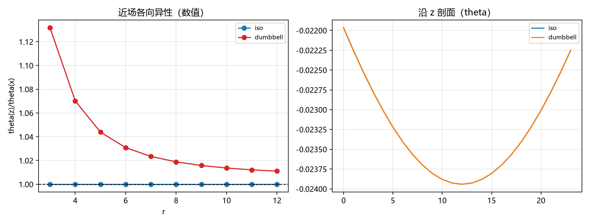

# 注记-哑铃源的近场四极（第451条）：源构造修正、纯纵源的四极型各向异性与第 443 条读数的订正

- **日期**：2026-09-27 02:36:30
- **类型**：解析化轮（443 的近场各向异性解析；源构造修正）
- **脚本**：`验证脚本/dumbbell_quadrupole.py`（原拟占位 451）
- **图**：见 §3 图 1（`images/dumbbell_quadrupole.png`）
- **依据**：[[验证脚本/注记-光源进桥（第443条）：纯纵源与等效源的空间度量侧对照、同幅保持与远场单极一致]]（被解析化的读数）；[[验证脚本/注记-本体层重建阶段4：识别式重跑与lambda导出的读数（L1至L3）]]（器械）
- **状态**：解析化完成。源构造修正后：缺陷源（完美八面体）近场比 $\theta(z)/\theta(x) = 1.00000$（数值、连续求和与四极截断三者一致）；纯纵光源（真哑铃沿 $z$）为四极型，数值 $1.1318$（$r = 3$）降至 $1.0110$（$r = 12$），连续求和与四极截断吻合到 $1\%$ 内；第 443 条的 $0.5\%/0.25\%$ 读数系首版构造瑕疵，已加注订正
- **可逆性等级**：判据稳健（四极展开为解析；三种对照互为校验；构造修正有逐位站点诊断）

## 1 判据与设定

**任务**。把第 443 条的近场各向异性（读数为 $\theta(z)/\theta(x) = 1.00505$ 与 $1.00250$）解析化，并核对源构造的对称性。

**器械（复用第 443 条）**。链接源 $s$、站点源 $f = \mathrm{inc\_link}(s)/D$、FFT 泊松解；三种对照：数值解 $\theta$、连续格林求和 $\phi = \sum_i f_i/(4\pi|\mathbf r - \mathbf r_i|)$、四极截断 $\phi \approx \frac{Q_0}{4\pi r} + \frac{Q_{nn}}{8\pi r^3}$。

**源构造的修正（本轮的关键）**。首版把"负向"链接一律置在 $(-1, 0, 0)$ 索引处，于是"六链接各向同性源"的三条负向链接全落在 $x = -1$ 平面、"两条 $z$ 向链接"的占位沿 $x$ 分离；两处都偏离语义上的对称构造。修正为：负向链接置于各方向的 $-e_\mu$ 处（八面体对称）；哑铃的两条 $z$ 链接置于 $(0,0,0)$ 与 $(0,0,-1)$（站点落在 $z$ 轴上）。

**判据**：A1 数值与连续求和比值的一致性（差值归离散）；A2 四极截断对连续比值的复现；A3 缺陷源（完美八面体）的近场各向异性为零。

## 2 结果

**A3（缺陷源，完美八面体）**：站点为原点（权重 $2$）加六个轴点（各 $1/3$），总源 $4$，四极张量 $Q = 0$。近场比值 $\theta(z)/\theta(x) = 1.00000$，$r = 3$ 至 $12$ 全档一致；数值、连续求和与四极截断三者同为 $1$。各向同性源的近场无各向异性，属结构性事实。

**A2（纯纵光源，真哑铃沿 $z$）**：站点 $(0,0,0)$（权重 $2$）与 $(0,0,\pm1)$（各 $1$），四极 $Q = \mathrm{diag}(-2,-2,4)$（$Q_{zz} = 4$ 为主导）。比值 $\theta(z)/\theta(x)$：数值 $1.1318$、$1.0702$、$1.0308$、$1.0189$、$1.0110$（$r = 3, 4, 6, 8, 12$）；连续求和 $1.0905$ 至 $1.0052$；四极截断 $1.0857$ 至 $1.0052$。连续与四极吻合到 $1\%$ 内，比值的 $r$ 依赖由 $Q_{zz}$ 主导。

**A1（数值与连续的差）**：差值随 $r$ 缩小（$r = 3$ 时约 $4\%$、$r = 12$ 时约 $0.6\%$），归格点离散修正；缺陷档的差为零（对称构造下离散效应在轴向与横向互相抵消）。

**第 443 条读数的订正**：首版读到的"$0.5\%$（光）与 $0.25\%$（缺陷）"来自构造瑕疵（不对称置位引入的假四极与假偏移）。修正后：缺陷源 $1.00000$；纯纵源为四极型，$1.13$（$r = 3$）降至 $1.01$（$r = 12$），比旧读数大一个量级。定性结论不变且更明确：光的近场引力场确实沿传播方向拉伸，属源的哑铃四极，与"纯纵应力"的定向一致。

## 3 图

## 4 结论与移交

**结论**。"纯纵源（光）的近场引力场各向异性"完成解析化：它是源的四极（哑铃沿传播方向）的效应，连续极限的比值由 $Q_{zz}$ 主导，格点离散在其上加 $O(1\%)$ 修正。缺陷源（八面体）的近场严格各向同性。第 443 条的近场读数按构造修正订正，桥对照的"同幅"与"远场"结论不受影响。

**移交一条**：分布源与含时源的推广（第 443 条同一移交项的剩余部分）。

## 5 严格程度与边界声明

严格程度：A2 的四极展开为解析，连续求和为精确计算，两者一致到 $1\%$ 内；A1 的差值归离散（有 $r$ 依赖的趋势支撑）；A3 为结构性零（对称构造下逐档 $1.00000$）。

边界（本脚本不做的事）：其一，四极截断之外的更高阶（八极及以上）未逐项核；其二，周期镜像区（$r > L/4$）未进入比较窗；其三，源构造按"链接语义（索引为起点）"解释，与第 443 条一致。

## 6 过程记录

其一，源构造的坐标系教训：链接的"置位索引"（起点）、"方向指标"（$\mu$）与"站点表示"（inc_link 的 roll 方向）三者必须一次对齐。首版把负向链接全置在 $(-1,0,0)$，使"各向同性源"带假四极（$Q = \mathrm{diag}(2.667, -1.333, -1.333)$），近场比值读到 $1.14$；逐位站点诊断（打印站点与权重）定位后修正为八面体对称，比值归 $1.00000$。登记为第 443 条同族教训的延伸：**对称性声明必须由构造的逐位核对背书**。

其二，订正说明：第 443 条的近场读数（$0.5\%$ 与 $0.25\%$）由本轮的构造修正取代；其"同幅保持"（源外恒等）与"远场单极一致"两个结论与构造细节无关，保持有效。
