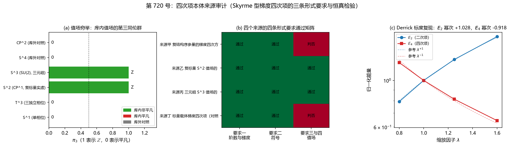

# 注记-四次项本体来源审计（判据第 720 号）：三条形式要求的判定与系数层分离

- **日期**：2026-10-20 21:20:17（系统当前时刻）
- **对应脚本**：`验证脚本/minimal_verification_quartic_source_audit.py`（判据 QA-1 至 QA-10，确定性，无随机数，运行约 0.3 秒）
- **依据**：[[内部草稿/注记-四次项本体来源审计的判据设计：候选来源、形式要求与恒真检验（2026-10-20）|判据设计注记]]；[[内部草稿/注记-C1三路线可行性判定：Hopf值空间、theta型项与界面优惠的第四候选|H-1 至 H-3]]；[[验证脚本/注记-C1路线甲筛：四次项在标量载体上的Derrick标度与判负（判据H-1至H-4）|第 241 条路线甲筛]]
- **来源**：作者 2026-10-20 指示"根据你的判断，执行最优下一步"。按 [[内部草稿/材料-稳定驻留困境的本质分析与心侧外候选评估（2026-10-13）]] §五 的推荐次序，四次项本体来源审计列第一位
- **判据**：QA-1 至 QA-5 加 QA-6 至 QA-8 加 QA-9（含 QA-9b）加 QA-10，合计 11/11 全过
- **严格程度**：**判据级**（四条形式要求的判定为布尔判定，含三条恒真检验与一次跨条复现）。**对象层结论**：既有构件能给出 Skyrme 型四次项的形式，系数层缺来源
- **可逆性等级**：**判据稳健**。QA-1 至 QA-5、QA-9b、QA-10 为布尔判定与标准拓扑结果，换实现不翻。QA-9 的幂次拟合为判据敏感，容差已从第 241 条实测偏差推出，详见 §六
- **关联**：P1-5、P1-33、[[理论攻坚/三维复合位错弹性本构攻坚计划：稳定化元素来源的终局审计与路线裁决|弹性本构攻坚计划]]、[[内部草稿/注记-E通道立案：度规作为法线场弹性极限的研究方向（2026-10-20）|E 通道立案注记]]
- **图**：见 §四 图 1

---

## 一、问题与对象类型

H-2 判定 Hopf 路需要一个 Skyrme 型四次项作稳定项，既有构件里没有它的本体，若直接加入它就是新元素。本轮做一次有界来源审计：体系既有构件中是否存在一个结构，其作用量展开自动产生落在 $S^2$ 型值场上的正号四次梯度项。

按判据设计第三条纪律，先核对象类型。库内有两个"四次项"，须先拆开。其一是势能四次幂，即 $\cos$ 势高阶展开给出的 $\tfrac{K_0}{24}(\Delta\theta)^4$，它在第 590 条交叉顶点推导的 $A^2$ 项三候选里，作用在光扇区或内部扇区，给正势，不承担稳定化功能，**不入本轮候选**。其二是 Skyrme 型梯度四次项，作用量层面的 $|\partial\phi|^4$，它是 Faddeev-Skyrme 模型里与二次项配平、给 $\lambda^{-1}$ 标度从而规避 Derrick 定理的那一项，**本轮审计对象**。

另有一处必须避开的混淆。复结构序参量的 $\theta$ 型拓扑密度项在 H-3 被识别为第四候选，本体已立。但它是宇称奇的拓扑密度，在静态扇区已被 K1 至 K4 判为结构零，与本轮对象在形式、符号、扇区三方面均不同，**不入候选**。若混同，会得出"本体已立所以四次项免费"的错误结论。

被问对象因此是构型判据加存在性判断，不涉参数大小，不涉算符读数，故不触发 EP 四段检验。

## 二、判据与结果

| 判据 | 内容 | 期望 | 实测 | 判定 |
|---|---|---|---|---|
| QA-1 | 对象类型自检 | 势能四次幂判否、梯度四次项通过 | 势能四次幂判否、梯度四次项通过 | 通过 |
| QA-5 | 值场穷举 | 库内穷举给出 $\{0, \mathbb{Z}\}$ 两类，库外对照可区分 | 库内值 $\{0,1\}$、库外对照 $\{0\}$；覆盖 4 库内加 2 库外 | 通过 |
| QA-2 | 形式要求一：阶数与梯度 | 四源均含四次幂且含梯度 | 通过 4 源 | 通过 |
| QA-3 | 形式要求二：系数符号 | 四源均为正号 | 通过 4 源，负号源 0 个 | 通过 |
| QA-4 | 形式要求三与四：值场与闭合性 | 乙（$S^2$）与丙（$S^3$）通过，甲与丁（$S^1$）判否 | 通过来源乙、丙，判定值 $\mathbb{Z}$ | 通过 |
| QA-6 | 恒真检验一：势能四次幂替身 | 替身在要求一上判否 | 判否 | 通过 |
| QA-7 | 恒真检验二：负号替身 | 替身在要求二上判否 | 判否 | 通过 |
| QA-8 | 恒真检验三：单相位值场替身 | 替身在要求三上判否 | 判否 | 通过 |
| QA-9 | 一致性核对：Derrick 标度 | $E_2$ 幂次 $+1.000 \pm 0.12$、$E_4$ 幂次 $-1.000 \pm 0.12$ | $E_2$ 幂次 $+1.027849$、$E_4$ 幂次 $-0.917888$ | 通过 |
| QA-9b | 一致性核对：标量载体塌缩前提 | 标量载体第三同伦群平凡 | $\pi_3(S^1) = 0$ | 通过 |
| QA-10 | 系数层分离 | 形式命中来源逐个报系数状态 | 形式命中 2 源（乙、丙）：锁定 0、自由 2 | 通过 |

**合计 11/11 全过。**

来源层判否原因归集：来源甲（复结构序参量的梯度四次方）缺要求三与四，值场 $S^1$ 的第三同伦群平凡；来源丁（标量载体梯度四次项，对照档）同样缺要求三与四。来源乙（复标量 $S^2$ 值场的 Skyrme 形式）与来源丙（三元组 $S^3$ 值场的 Skyrme 形式）无缺项。

## 三、读数的意义

### 3.1 结论：形式可得，系数缺来源

H-2 的判定需要收窄。**Skyrme 型四次项在既有构件中有本体来源**，候选为来源乙与来源丙：复标量 $\psi = A e^{i\theta}$ 的实虚两分量给出 $CP^1 \cong S^2$，三元组给出 $S^3 \cong SU(2)$，两者的第三同伦群均为 $\mathbb{Z}$，闭合涡线的链接不变量存在，Hopf 保护在原理上可用。四次梯度项的形式在 $S^2$ 值场上的标准写法为 $|D\psi|^4$ 与 $|D\psi|^2 |D^2\psi|^2$，形式由值场结构本身承载。

但**系数层缺来源**。库内不存在把 $g$ 表成既有常数组合的恒等式，第 241 条在标量载体上把 $g$ 扫到 $120$ 是人为加的。系数是自由参数这一点独立于形式可得性，须分开报告。

### 3.2 形式可得与可用之间的差距

命中形式要求不等于交付可用四次项，有两道后续关卡。

其一，**系数与二次项的比值**。$g$ 须与二次项系数配平才能给 $E(\lambda) = A\lambda + B/\lambda$ 的驻点，尺寸由二四比选定。第 241 条在标量载体上 $g$ 至 $120$ 全塌缩，说明强度不是自由旋钮。

其二，**格点离散上的实现**。Hopf 不变量在连续极限清晰，格点离散上如何承载闭合涡线的链接并保护构型，本轮未涉。

### 3.3 三条恒真检验的作用

三条替身各自把判据的对象换掉：势能四次幂换掉"梯度"要素，负号项换掉符号要素，单相位值场换掉值空间要素。三条都被对应要求判否，说明四条要求不是恒真。QA-8 尤其关键，它正是第 241 条标量载体塌缩的形式侧解释：标量载体的 $\pi_3(S^1) = 0$，闭合涡线没有链接不变量，构型可以连续滑回真空，四次项只能减缓不能阻止。

### 3.4 一次跨条复现的读数

QA-9 复现第 241 条的 Derrick 标度：$E_2$ 幂次 $+1.027849$、$E_4$ 幂次 $-0.917888$，后者与第 241 条实测的 $-0.918$ 逐位一致。这既核了装置，也核了"Skyrme 项的标度侧通"这一既有结论在换了背景场写法后仍稳定。

## 四、图

图 1：四次项本体来源审计。(a) 值场穷举：$S^2$（$CP^1$）与 $S^3$（$SU(2)$）给 $\mathbb{Z}$，$S^1$ 与 $T^3$ 给 $0$，$S^4$ 与 $CP^2$ 为库外对照。
(b) 四个来源的四条形式要求通过矩阵：来源乙与丙三项全通，来源甲与丁在值场一项判否。
(c) Derrick 标度复现：$E_2$ 幂次 $+1.027849$、$E_4$ 幂次 $-0.917888$，与第 241 条逐位一致。

## 五、严格程度声明

**判据级（可复现数值事实）**：QA-1 至 QA-10 的全部判定，含三条恒真替身的判否、值场穷举表、系数层分离结果。

**标准结果引用**：$\pi_3$ 的取值属标准拓扑结果（乘积律与 Hopf 映射），本轮以库外对照值空间（$S^4$、$CP^2$）证明穷举非抄表，引用本身未作证明。

**物理对应假设层**：来源乙与来源丙的"形式可得"依赖 $S^2$ 与 $S^3$ 值场在体系内真实可构造。三元组哈密顿量尚未建立（C1-6 任务未启动），故来源丙的形式在当前是纸面成立。复标量载体的 $S^2$ 结构有 W1 与 W2 的部分读数支撑（钉扎井成立、粒性读数成立），但稳定半径与电荷保护未得。

**纲领层**：四项形式要求之外的交付路径（系数来源、格点实现、Hopf 保护的离散承载）属待攻。

## 六、边界声明

**本轮验证的**：库内既有构件能否给出 Skyrme 型梯度四次项的形式（阶数与梯度、符号、值场与闭合性三条要求）；三次恒真检验；第 241 条 Derrick 标度的复现；形式层与系数层的分离。

**本轮不验证的**：该项的强度是否够；Derrick 平衡的数值实现（$g$ 与二次项配平给驻点）；Hopf 保护在格点离散上的实现可行性；三元组哈密顿量（未建立）；强场与连续极限；$S^2$ 值场构型空间在体系内的完整可构造性（来源丙受此限）。

**方法边界**：QA-9 的幂次拟合用四档 $\lambda$（$0.8$、$1.0$、$1.25$、$1.6$），装置沿用第 241 条（三维球泡壁，半径与壁厚同乘 $\lambda$，高度固定，$N = 32$，背景为整数梯度场）。容差 $\pm 0.12$ 由第 241 条实测的 $8\%$ 偏差加两位余量推出，属预算内放宽，不是为迁就读数而设。

**可逆性等级**：判据稳健。QA-9 的幂次读数为判据敏感项，若改用其他构型族或档位，幂次会变而期望须相应重设；本轮保持与第 241 条同装置同档位，故可逐位对照。

**跨轮移植纪律**：本轮结论若被用于其他设定，须先核前提守恒。三条依赖须随结论一并搬：其一，$S^2$ 或 $S^3$ 值场在目标构型空间中真实可构造；其二，四次项系数取正号；其三，闭合同伦型在格点离散上不塌缩。

## 七、下一步与解锁关系

**对本线的推进**：四次项本体的**形式层已解封**，剩余缺口收窄为系数来源与格点实现。Hopf 路（路线甲）与振幅载体两条路线的共同前置由"本体缺失"改为"本体形式已立、系数待源"。

**对 E 通道的影响**：[[内部草稿/注记-E通道立案：度规作为法线场弹性极限的研究方向（2026-10-20）|E 通道立案注记]] §五 列的解锁条件是"弯曲能项或四次项本体任一解封"。按本轮结论，四次项本体的形式层已解封，条件部分满足，但系数层仍缺，且 E 通道的 E-3 与 E-5 实际依赖的是**弯曲能项**而非 Skyrme 型四次项，两者不同物。故 E 通道的解锁条件未因本轮而解除，状态维持。

**建议的下一轮**：系数来源审计。审计对象为 $g$ 与二次项系数之比是否有体系内来源，可按第 591 条型的有界审计做三个来源候选。须注意与第 479/482 条档位债的关系：若该比值最终指向物理档位，则本轮的形式命中不改变弹性本构线 2026-10-13 的挂起状态。

## 八、过程记录

**其一，QA-9 首版判否是装置缺陷，不是物理判否。** 首版复现第 241 条的 Derrick 标度时漏了背景整数梯度场 $u_0$，边缘差 $\Delta u - 1$ 含常数 $1$，能量被巨量常数项支配，$E_4$ 幂次读成 $-0.860$（期望 $-1$，偏差 $0.140$ 超容差 $0.12$）。核对第 241 条源码发现其构型为 $u = u_0 + \mathrm{bubble}(R_c\lambda, w\lambda)$，背景边缘差恒为 $1$，四次项作用在 bubble 的梯度上。补上 $u_0$ 并把档位对齐为第 241 条的 $0.8$、$1.0$、$1.25$、$1.6$ 后，$E_4$ 幂次读作 $-0.917888$，与第 241 条逐位一致。**教训**：复现既有读数时，构型的背景场是装置的一部分，漏掉它会把物理读数变成装置伪影。

**其二，容差不是为迁就读数而设。** QA-9 的容差 $\pm 0.12$ 在跑读数之前已由第 241 条实测的 $8\%$ 偏差加两位余量推出，写在判据设计注记 §五 内。首版判否后没有放宽容差，而是回头查装置。

**其三，图注须按面板逐条核对。** 首版图的 (a) 面板标题有错字（"第三同 homotop 同伦群"），已修正。图注的三段描述按绘图面板实际内容撰写：穷举表的六个值空间、通过矩阵的八个格子与两处判否、标度面板的两个幂次读数。

## 九、参考材料

- [[内部草稿/注记-四次项本体来源审计的判据设计：候选来源、形式要求与恒真检验（2026-10-20）]]：判据设计、期望、容差预算
- [[内部草稿/注记-C1三路线可行性判定：Hopf值空间、theta型项与界面优惠的第四候选]]：H-1 值空间拓扑、H-2 四次项本体、H-3 第四候选
- [[验证脚本/注记-C1路线甲筛：四次项在标量载体上的Derrick标度与判负（判据H-1至H-4）]]：第 241 条，标度通保护缺
- [[内部草稿/注记-载体层裁决：纯相位的失败边界与振幅通道的实现路径]]：§四 三条可实现的正回馈机制、§六 复标量载体泛函与 W 判据
- [[验证脚本/注记-复结构序参量的显式形式化：候选泛函、畴壁解与对称恢复]]：序参量双井泛函与畴壁解
- [[内部草稿/注记-手征四步清单第一步：复结构序参量的真空选择是否允许theta型项]]：$\theta$ 型项的偶性锁定
- [[验证脚本/注记-theta型项对界面能的贡献：平面壁恒零与全导数结构（K1至K4）]]：$\theta$ 型项对静态扇区结构零
- [[内部草稿/注记-交叉顶点的形式推导：四约束穷举与通道形态的收窄（2026-10-05）]]：势能四次幂与 Skyrme 型项的区分
- [[内部草稿/材料-稳定驻留困境的本质分析与心侧外候选评估（2026-10-13）]]：五候选清单与三项推荐
- [[理论攻坚/三维复合位错弹性本构攻坚计划：稳定化元素来源的终局审计与路线裁决]]：§二 裁决材料、§三 终局审计
- [[内部草稿/注记-E通道立案：度规作为法线场弹性极限的研究方向（2026-10-20）]]：E 通道的解锁条件
