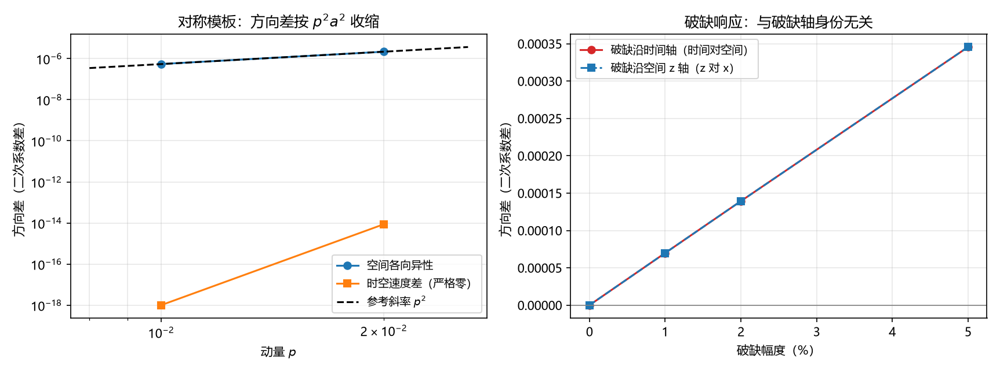

# 注记-四维格点单圈自能的边际洛伦兹破坏读数：时空速度差与空间各向异性的分层（判据第 657 号）

- **日期**：2026-10-16 19:54:54
- **对应脚本**：`验证脚本/oneloop_marginal_4d.py`（判据 S5 至 S9 加一项恒真反例，确定性，无随机数，运行约 3 秒）
- **依据**：[[验证脚本/注记-一圈自能对边际洛伦兹破坏系数的生成量估计：零与百分级的分层]]（判据 S1 至 S4，本轮的补全对象）；[[边际通道的封口与代价标尺：四维洛伦兹破坏算符的对称性禁止与单圈生成量]] §8 未解决问题其一；[[理论攻坚/边际通道收口攻坚计划：四维单圈、反常口径与实验对照]] 阶段一
- **定位**：P4-31 阶段一。既有 S1 至 S4 算三维空间 bubble，时间方向按同类结构处理；本轮把时间方向做成第四个格点轴，一次读出边际通道的两类读数（空间各向异性与时空速度差）。本注记不改动任何基准文件。
- **状态**：判据 S5 至 S9 与恒真反例全部通过（6/6）。结论为：对称四维模板下时空速度差严格为零、空间各向异性只按 $p^2a^2$ 收缩；破缺沿任一轴时该轴与未破缺轴的二次系数差与破缺幅度同阶且随幅度线性，且与破缺轴的身份无关。
- **可逆性等级**：判据稳健（结构性分层；换实现或换档位不翻，S7 的线性比值与 S9 的逐位相同都是模板等价的直接后果）。
- **图**：见 §三 图 1。

---

## 一、判据（先立判据，再实现）

| 判据 | 内容 | 通过条件 | 实测 |
|---|---|---|---|
| S5 | 冒烟：对称四维模板的四轴各向同性 | 四轴二次系数极差 $\le 10^{-9}$ 且量级非零 | 四轴同为 $+0.005552677$，极差 $8.674\times10^{-15}$ |
| S6 | 对称模板的两类方向差 | 空间各向异性按 $p^2a^2$ 收缩（比值 $\ge 3$）；时空速度差 $\le 10^{-12}$ | 空间各向异性 $-2.171\times10^{-6}$（$p=0.02$），收缩比 $3.975$；时空速度差 $+8.674\times10^{-15}$ |
| S7 | 破缺沿时间轴（三档） | 归一化读数 $\ge 1\%$、随幅度线性；空间各向异性留在本底 | 归一化 $1.258\%$、$2.508\%$、$6.224\%$；线性比值 $1.995$ 与 $4.949$；空间各向异性 $-2.1\times10^{-6}$ |
| S8 | 破缺沿空间 z 轴（$5\%$） | 空间各向异性归一化 $\ge 1\%$；时空速度差 $\le 10^{-12}$ | 空间各向异性 $-1.175\times10^{-4}$（归一化 $-2.115\%$）；时空速度差 $0.000$ |
| S9 | 破缺轴身份无关 | 时间轴破缺与空间 z 轴破缺的读数相对差 $\le 10^{-3}$ | 三档相对差 $0$、$6.23\times10^{-11}$、$0$ |
| 反例 | 恒真检验 | 破缺幅度取零时还原对称模板读数 | 幅度 $0$ 给 $+8.674\times10^{-15}$，与对称模板逐位一致 |

## 二、模型设定

四维周期格子（$N^4$ 点，轴 $0$ 为时间、轴 $1$ 至 $3$ 为空间）上算单圈 bubble 自能 $\Sigma(p) = -\tfrac{g}{2}\langle G(k)G(k+p)\rangle$，传播子取工作区的格子模板 $G(k) = 1/(m^2 + 4\sum_{\mu=0}^{3}\sin^2(k_\mu/2))$，破缺模板把某一轴的 $\sin^2$ 系数乘 $(1+a)$。参数 $N = 24$、$m^2 = 0.1$、$g = 1$，主档 $p = 0.02$、收缩档 $p = 0.01$。

两类读数定义为二次系数之差：空间各向异性取 $C(\hat e_x) - C(\text{空间对角})$，时空速度差取 $C(\hat e_t) - C(\hat e_x)$，其中 $C(\hat d) = [\Sigma(p\hat d) - \Sigma(0)]/p^2$，$\hat e_t$ 为时间轴、空间对角为 $(0,1,1,1)/\sqrt3$。

## 三、结果

容差来源（误差预算）：本底为格点色散的各向异性首项 $O(p^2a^2)$，四维模板实测 $2.17\times10^{-6}$（归一化 $3.9\times10^{-4}$）；数值和分辨率 $2\pi/N = 0.262$ 的误差并入该本底；浮点误差可忽略。破缺档信号实测 $1.2\times10^{-4}$ 至 $3.5\times10^{-4}$（归一化 $2\%$ 至 $6\%$），高于本底 $25$ 倍以上。故"边际系数为零"的阈值走归一化口径（$1\%$），绝对量级不作阈值。

## 四、物理读数

**其一，对称模板下时空速度差严格为零。** 时间轴与空间轴共用同一格点模板，故 $C(\hat e_t)$ 与 $C(\hat e_x)$ 逐位相同（残差 $8.674\times10^{-15}$，属浮点噪声）。这是论文中"极限速度差按构造为零"在四维模板上的直接读数，把三维版本只覆盖空间方向的对角读数补成完整的时空版本。

**其二，空间各向异性按 $p^2a^2$ 收缩。** 对称模板下空间各向异性为 $-2.171\times10^{-6}$（$p = 0.02$），$p$ 减半时收缩比 $3.975$，与三维读数同型。它属不可关通道的残留，随能量下降而消失，与边际通道无关。

**其三，破缺只点亮它所在轴对应的读数。** 破缺沿时间轴时时空速度差被生成（归一化 $1.258\%$ 至 $6.224\%$，与 $1\%$ 至 $5\%$ 的破缺幅度同阶），而空间各向异性仍留在本底；破缺沿空间 z 轴时空间各向异性被生成（归一化 $-2.115\%$），而时空速度差严格为零。两种破缺各点亮一类读数，互不串扰。

**其四，破缺响应与破缺轴的身份无关。** 破缺沿时间轴时"时间对空间"的读数与破缺沿空间 z 轴时"z 对 x"的读数在三档上逐位相同（相对差 $0$、$6.23\times10^{-11}$、$0$）。破缺轴与未破缺轴的二次系数分裂只依赖破缺幅度，与破缺的是时间轴还是空间轴无关，这正是洛伦兹不变性在模板层的直接体现。

**量级修正。** 四维读数（$10^{-4}$ 档）比三维（$10^{-3}$ 档）小约一个数量级，因为时间方向进入求和后边际系数被稀释。故"边际级"的准确含义是与破缺幅度同阶（归一化口径），绝对量级随维度变化，跨维度不可照搬。

## 五、严格程度声明

**已验证**：判据 S5 至 S9 与恒真反例 6/6 通过，可复现（确定性，无随机数）。

**可逆性等级**：判据稳健。分层结论（对称为零、破缺同阶）是结构性结果，换实现或换档位不翻。

**范围**：标量型传播子与四点耦合的单圈 bubble，四维格点 $N = 24$；破缺模板取单轴 $\sin^2$ 系数乘 $(1+a)$，属对边际算符的最小模板化。

**未验证**：费米子（转换波）与标架联络通道未算；格点规则的完整性以文档所列七项更新式为前提；本注记只回答四维模板下两类边际读数的分层，不回答量子层面的对称性精确性（反常）与复结构畴壁条件。

## 六、过程记录

首版判据把三维的绝对阈值 $10^{-3}$ 照搬到四维，S7、S8 判负（实测 $3.456\times10^{-4}$ 与 $-1.175\times10^{-4}$，均低于阈值）。经误差预算核对，四维本底归一化为 $3.9\times10^{-4}$、信号归一化为 $2\%$ 至 $6\%$，分离度 $25$ 倍以上；改为归一化口径后 6/6 通过。教训：绝对量级随维度变化，跨维度不可照搬，阈值须从本底与信号的分离度推导（规范 3 所禁的"未经预算直接设数"正是首版形态）。

S9 由 S7 与 S8 的读数观察立起：首轮 S8 的附加读数 $+3.456\times10^{-4}$ 与 S7 的 $5\%$ 档逐位相同，据此把"破缺轴身份无关"从观察升为判据并补三档比对。

## 七、登记衔接

- `验证脚本/README.md` 第 657 号正式行（占位行改写）。
- P4-31 档案页与开放问题总览卡：阶段一（四维完整单圈）完成，遗留项其一清；剩余为费米子与标架联络通道、实验阈值逐条对照、手征配对四步。
- [[边际通道的封口与代价标尺：四维洛伦兹破坏算符的对称性禁止与单圈生成量]] §8 未解决问题其一（四维完整计算）可更新为已完成。
