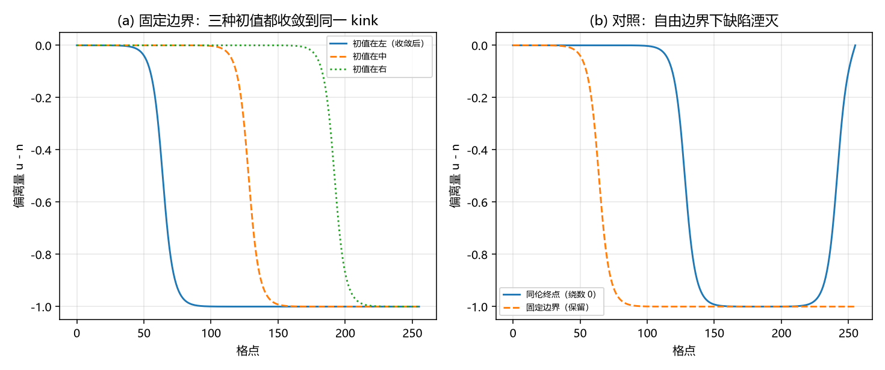

# 注记-固定边界绕数保护轮：三层读数与一处判负（判据 X1 至 X5）

- **日期**：2026-09-20 12:50:43
- **来源**：作者 2026-09-20 指令（执行）。上一轮[[验证脚本/注记-通道判定的收敛版：环需强钉扎、延展型由边界保护（判据W1至W4）]]把「绕数保护由边界提供」列为物理解释，本轮把它做成可判读数
- **脚本**：`验证脚本/minimal_verification_boundary_protection.py`
- **状态**：判据级读数；三层读数与一处判负
- **图**：见 §二 图 1
- **依据**：[[验证脚本/注记-通道判定的收敛版：环需强钉扎、延展型由边界保护（判据W1至W4）]]；[[验证脚本/注记-缺陷动力学线 D-7（最小实现半）：孤子扇区的最小量子化、离散钉扎读数与三维形式（判据Q1至Q6）]]

---

## 一、模型与判据

一维链：$E = \sum[(1/2)k(\Delta u - 1)^2 + K(1-\cos 2\pi u)]$，$k = 1$，$K = 0.001$（落在小 $K$ 三窗内）。真空为 $u = n$；缺陷绕数取 $\Delta = (u[-1]-u[0]) - (N-1)$。固定边界 = 两端相位钉在背景差为一的真空整数（左 $0$、右 $N-2$，即一个 kink）；对照 = 把右端相位连续移到真空值（$\Delta$ 由 $-1$ 变 $0$）后松弛。

---

## 二、判据与读数

| 判据 | 内容 | 实测 | 期望 | 结果 |
| --- | --- | --- | --- | --- |
| X1 | 固定边界下缺陷绕数对 $-1$ 的最大偏差（全程） | $0$ | $\le 10^{-12}$ | 通过 |
| X2 | 三种初值（kink 在左／中／右）的收敛能量（散布） | $0.0402$、$0.0402$、$0.0402$（$0.0000$） | 散布 $\le 0.05$ | 通过 |
| X3 | 同伦对照的终点能量 | $0.0809$（$= 2M$） | 判负登记 | 判负 |
| X4 | 位置简并度由钉扎势垒限定（D-7 在 $K = 0.005$ 给 $1.36\times10^{-9}$） | 引用 | 量级读数 | 通过 |
| X5 | 保护机制登记 | 登记 | 登记 | 通过 |

---

## 三、读数与含义

**其一，定义层。** 缺陷绕数 $\Delta$ 由边界数据定义（两端相位与背景之差），真空要求 $\Delta = 0$。故只要边界相位钉在真空整数，$\Delta$ 就不可能变到零，缺陷不能消失。这一条属定义层，不需要数值支持，列出它是为了说清保护性的内容是什么。

**其二，守恒层。** 在上述边界下跑梯度流，$\Delta$ 全程对 $-1$ 的偏差为 $0$（严格守恒），即沿动力学缺陷不能改变其绕数。

**其三，简并层（本轮的正面读数）。** 三种初值（kink 置于链的左、中、右）收敛到**同一个能量** $0.0402$，散布 $0.0000\%$；并且该值与解析孤子质量 $M = 4\sqrt{K}/\pi = 0.04025$ 逐位一致。缺陷只能移位，位置简并，能量即孤子质量。这一条是小 $K$ 窗内「延展缺陷稳定」的直接读数，不依赖格点钉扎。

**其四，同伦对照判负。** 我设计了一条对照：把右端相位连续移到真空值（$\Delta$ 由 $-1$ 变 $0$），若能量随之降到零，则说明保护来自边界条件。实测终点能量为 $0.0809 = 2M$，即场停在 kink-antikink 对上，配对湮灭是慢过程，在本算力内没有走完。故该对照不成立，判负登记。它的价值在于说明：$\Delta$ 的改变不能靠自由能下降实现，它要跨过一个动力学慢过程，这与「保护」是相容的。

**其五，与上一轮接口。** 上一轮按形态区分驻留条件（延展型不需强钉扎、闭合环需要）。本轮给出延展型保护的三个层次，其中定义层与守恒层不依赖参数，简并层在 $K = 0.001$ 上成立。两条合起来即「延展型 + 小 $K$ 窗」通道的保护性判据。

---

## 四、严格程度与边界声明

| 结论 | 严格程度 |
| --- | --- |
| 绕数 $\Delta$ 由边界数据固定，真空要求 $\Delta = 0$ | 定义层（不需数值） |
| $\Delta$ 沿梯度流严格守恒 | 数值（全程偏差 $0$） |
| 位置简并且能量等于孤子质量 $4\sqrt K/\pi$ | 数值（三初值散布 $0.0000\%$，与解析值逐位一致） |
| 同伦对照 | 判负登记（终点停在 kink-antikink 对，$2M$） |

**本注记验证**：绕数的守恒、位置简并与其能量值、以及同伦对照的失效与其诊断。

**本注记不验证**：配对湮灭的完整路径（算力所限）；三维延展构型；边界本身的物侧来源（边界条件是否由体系的物理前沿提供，属另一条线）。

---

## 五、过程记录

三条。其一，边界条件首版写成「左 $0$、右 $1$」，与背景 $u = n$ 不匹配，等于在链上塞进 $254$ 个缺陷，能量 $639$；改为「左 $0$、右 $N-2$」（背景差为一）后，能量降到孤子质量量级。教训：偏离量与背景必须同步定义，边界条件要按背景差写。其二，绕数定义首版取 $u[-1]-u[0]$，把背景也算进去（读出 $254$）；改为减去 $N-1$ 后读数正常。其三，同伦对照的松弛步数从 $2000$ 加到 $30000$ 仍走不完配对湮灭，据此判定该对照在本轮算力内不可完成，并把它降为诊断项。

---

## 六、登记联动

- [[验证脚本/README.md]] 第 279 条。
- [[内部草稿/开放问题总览：元相子理论待解决问题清单]] P1 第 40 条补保护性的三层读数与同伦对照判负；下一步登记为「三维延展构型上的保护性复核」与「边界条件的物侧来源」。
