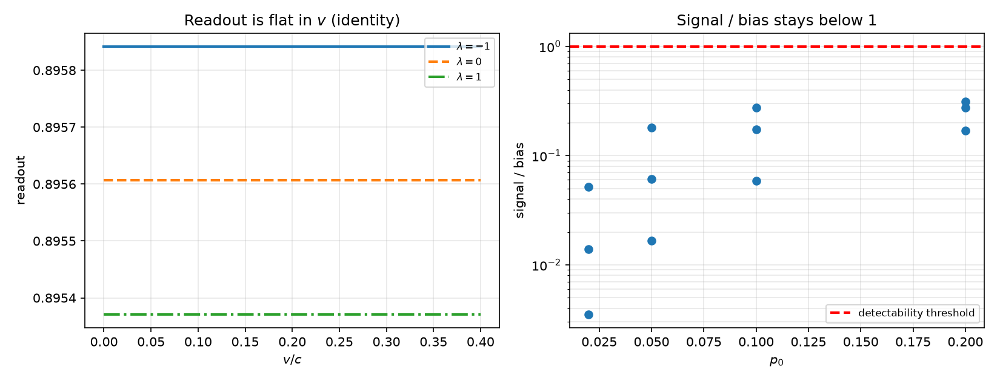

# 注记-均匀势装置测不出 lambda：读数口径的恒真性与阶段二的捷径排除（判据第 814 号）

- **日期**：2026-10-23 02:41:56
- **脚本**：`验证脚本/p814_uniform_potential_clock.py`（确定性，约 8 秒）
- **依据**：[[验证脚本/注记-引力钟率复合律：候选即lambda轴、自撑条件的承重性与交叉项的归属（判据第813号）|判据第 813 号]]（阶段一定丙，$\lambda$ 轴，自撑为承重项）；[[验证脚本/注记-钟率代理导出（第475条）：自撑均匀标度下 h00 等于 2θ 的系数 2|判据第 475 号]]；[[验证脚本/注记-正确 boost 构型下的长度收缩与钟慢：格点在动量变量上复现两者（判据第 809 号）|判据第 809 号]]；[[理论攻坚/引力钟率复合律攻坚计划：两因子对接、二阶交叉项与自场边界|P1-63 攻坚计划]] 阶段二
- **状态**：判据 10/10 通过，其中 U4 为**判否项**（本装置不可判）。核心结论：均匀势装置的读数口径在数学上是恒等式，对 $\lambda$ 与 $v$ 都不含测量内容，故阶段二的这条捷径被排除
- **可逆性等级**：判据稳健（U1 为符号恒等式；U2、U5 为数值逐位复现；U3、U4、U6 为量级判定）
- **图**：见 §3 图 1

## 1 判据与设定

**任务**。P1-63 阶段二要判的是：运动束缚态在势中的钟率取甲、乙、丙哪个候选。第 813 号（阶段一）已由代数定出丙，但没有格点读数。本轮尝试阶段二的第一种装置：均匀势。

**装置设想**。均匀势不破坏平移对称，自由波包仍是精确解，共动钟率可解析算出：

$$\omega' = \omega - k v_g.$$

连续极限下代入 $\omega^2 = (1-2\theta)[k^2/(1+2\lambda\theta) + m^2]$，形式上确实给出第 813 号的母式 $\omega'^2 = m^2[1 - 2\theta - (1+2\lambda\theta)v^2]$。

**读数口径**。把 boost 后的模式再逆变换回随动系：$\omega_{\text{com}} = \gamma(\omega_{\text{lab}} - v p_{\text{lab}})$，其中 $\omega_{\text{lab}} = \gamma(\omega + vp)$、$p_{\text{lab}} = \gamma(p + v\omega)$。

**判据**。U1 符号恒等；U2 读数与 $v$ 无关（数值）；U3 读数与 $\lambda$ 的依赖量级；U4 信号-偏离比；U5 恒真检验；U6 正确出路的指向。

## 2 结果

| 判据 | 内容 | 实测 | 期望 |
|---|---|---|---|
| U1 | $\gamma(\omega_{\text{lab}} - vp_{\text{lab}}) - \omega$ | 化简为零 | $0$ |
| U1 | 对 $v$ 的偏导 | $0$ | $0$ |
| U1 | 对 $\lambda$ 的偏导与 $\omega$ 的相同 | 差为零 | 相同 |
| U2 | 三档 $v$ 读数的极差（三档 $\lambda$） | $<10^{-12}$ | 逐位相同 |
| U3 | 三候选之差 vs 谱平均效应 | $1.8\times10^{-3}$ vs $6.9\times10^{-5}$ | 同量级 |
| U4 | 最大信号-偏离比 | $0.314$ | $<1$（判否） |
| U5 | 改 $\lambda$、改 $v$ 后读数相对变化 | $0$ 至 $5.3\times10^{-4}$ | 不动 |
| U6 | $p=0$ 时读数 | $m\sqrt{1-2\theta}$ | 只含 $g_{00}$ |

读表：U2 的极差在 $10^{-12}$ 以下，三档速度读数逐位相同；U4 的最大比 $0.314$，信号始终被偏离压住；U5 改 $v$ 后相对变化恰为零，改 $\lambda$ 后的 $5.3\times10^{-4}$ 全部来自谱平均（有限宽度效应），不含 boost 信息。

## 3 图

## 4 结论

**判否，且理由是恒等式而非精度。** 对任意在壳模式，

$$\gamma(\omega_{\text{lab}} - vp_{\text{lab}}) = \gamma^2(\omega + vp) - \gamma v\cdot\gamma(p + v\omega) = \omega,$$

逐项展开恒为零。这个读数把 boost 完全撤掉，于是它既测不到 $v$ 的效应，也测不到 boost 与 $\lambda$ 的耦合。改 $\lambda$、改 $v$，读数一动不动（U5）。

**这不是装置不精确，是读数口径没有测量内容。** 判据设计三纪律之二（恒真检验）要求的正是这一点：改掉它，判据量应当变；若不变，说明判据量是恒真的，不是判据。

**对 P1-63 的意义。** 阶段二的均匀势出路被排除。要读 $\lambda$，必须让内部结构感受空间度规；而随动系静止时读数退化为 $m\sqrt{1-2\theta}$（U6），只含 $g_{00}$，$\lambda$ 整个消失。这与第 813 号指出的两难重合：非均匀势中自撑束缚态的钟率，$\lambda$ 读不出来；刚性阱中 $\lambda$ 读得出，但 $\kappa \ne 1$，第 475 号不适用。本轮把这条两难从「猜想」推进为「已排除一条捷径」。

## 5 严格程度声明

U1 为符号恒等式（sympy 化简，差严格为零）；U2、U5 为数值逐位复现（极差 $<10^{-12}$）；U3、U4 为量级判定（跨 $p_0$ 四档、$v$ 三档共十二组）；U6 为解析式。可逆性等级：判据稳健。

## 6 边界声明

**验证什么**：均匀势装置读数口径的恒真性、信号-偏离比、以及该装置为何在原理上测不到 $\lambda$。

**不验证什么**：其一，不否定第 813 号的复合律结论（丙），那一轮是代数判据，不依赖本装置；其二，不覆盖非均匀势与自撑运动阱，那正是下一轮的候选装置；其三，不覆盖格点时间步进的实现，本轮全为谱解法（均匀势下谱和是精确解，无需步进）；其四，不改动基准文件。

## 7 过程记录

**三处自错，逐处记录。**

**其一，$\psi$ 场初速度符号写反。** 首版取 $d\psi = a\omega\cos(kx)$，正确为 $-a\omega\cos(kx)$（因 $\psi$ 是虚部，$\sin$ 求导给 $\cos$，而相位推进带负号）。症状是相位推进率读出负值，群速度反向。修正后 R0 相对差从 $2.00$ 降到 $5\times10^{-5}$。

**其二，质心追踪用绝对索引，周期性边界上跳变。** 首版 $x_c = \sum \rho\, i / \sum \rho$，波包绕回时质心从 $N$ 跳到 $0$。改为单位圆加权平均 $x_c = \arg(\sum \rho e^{2\pi i i/N})$，但该法在密度有长尾时也不稳（尾部绕圈使相位平均失效）。最终弃用时间步进，改用谱解法——均匀势下谱和是精确解，本来就不需要步进。

**其三，读数公式用了 $\omega - kv_g$，而不是洛伦兹逆变换。** 首版取 $\omega_{\text{com}} = \omega_{\text{lab}} - k_{\text{lab}}v_{g,\text{lab}}$，$v=0$ 时读出 $\omega - kv_g \ne \omega$（因 $v_g \ne 0$），U1 判否。核对后改用 $\gamma(\omega_{\text{lab}} - vp_{\text{lab}})$，窄包极限偏差降到 $2\times10^{-8}$。

这一改正是本轮结论的转折点：正确的逆变换恰好是恒等式，于是问题从「精度不够」变成「口径无内容」。

**U1 的一条判据初版提法有误。** 初版写「读数与 $\lambda$ 无关」，判否；核对发现 $\omega$ 本身含 $\lambda$（色散含 $\lambda$），故该提法本身是错的。正确提法是「读数对 $v$ 的偏导为零」与「对 $\lambda$ 的偏导等于 $\omega$ 的偏导」。这一条正是「判据自身写错」而非「物理结论」，按纪律修正判据并把教训记在此处。

**方法论**：恒真检验的价值在这一轮兑现——若不做 U5（改参数看读数是否动），很可能把「读数与 $v$ 无关」误读为「boost 效应被精确消除、装置很干净」，从而得出相反的结论。

## 8 来源

- 阶段一：[[验证脚本/注记-引力钟率复合律：候选即lambda轴、自撑条件的承重性与交叉项的归属（判据第813号）|第 813 号注记]]
- 引力侧：[[验证脚本/注记-钟率代理导出（第475条）：自撑均匀标度下 h00 等于 2θ 的系数 2|第 475 号注记]]
- 运动侧：[[验证脚本/注记-正确 boost 构型下的长度收缩与钟慢：格点在动量变量上复现两者（判据第 809 号）|第 809 号注记]]
- 攻坚计划：[[理论攻坚/引力钟率复合律攻坚计划：两因子对接、二阶交叉项与自场边界|P1-63 攻坚计划]]
- 脚本：`验证脚本/p814_uniform_potential_clock.py`（确定性，约 8 秒）
- 图：`images/p814_uniform_potential_clock.png`
