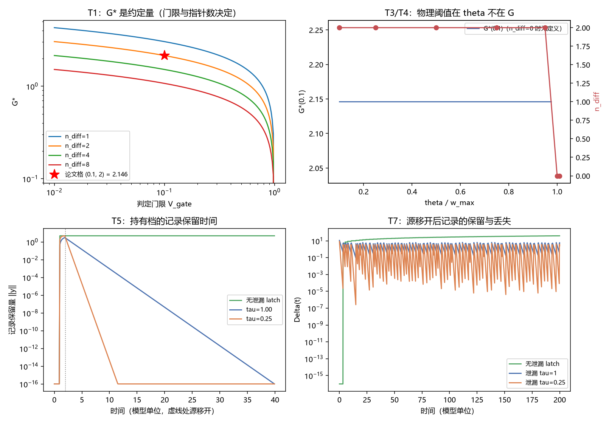

# 注记-增益阈值物理内容的最小验证：读数门限、指针分辨与记录寿命的三分

- **日期**：2026-09-24 03:25:46
- **层级**：验证注记（对应 `验证脚本/gain_threshold_content.py`，`验证脚本/README.md` 第 378 条）
- **图**：见 §三 图 1
- **定位**：执行 [[研究方向-增益阈值的物理内容：读数门限、指针分辨与记录寿命三分（判据草案）]] 的判据 T1 至 T8。[[测量的三层判据：从相互作用分层到单次测量机器]] §2.2 限制一自标"闸门数值判据敏感于增益、放大链是跨层事件构成条件属解释层读法，待墙二"，本注记把该读法拆成三种并逐条判定，收口该限制。
- **依据**：[[研究方向-增益阈值的物理内容：读数门限、指针分辨与记录寿命三分（判据草案）]]；[[验证脚本/注记-相互作用分层判据的最小验证：两协议可见度与生死闸门]]（传感器阵口径、$D_{\text{sensor}} = G^2$、$G^* = 2.15$）；[[测量的三层判据：从相互作用分层到单次测量机器]]（§2.3 记录的技术定义、§3.2 闸门数值）
- **关联**：[[开放问题总览：元相子理论待解决问题清单]]（测量塌缩的元相子机制）；[[理论攻坚/测量问题攻坚纲领：三条承重墙的闭合]]（裁决点 2 限制一）
- **状态**：模型内判据级。限制一在本注记内收口为三条判据，数值部分限于 M2 传感器阵口径。

---

## 一、模型与协议

模型沿用 M2：FK 链 $k=1$、$K=0.005$、$N=1000$、$\Delta t = 0.01$、kink 半宽 $\ell \approx 2.25$ 格距；甲-3 零模踢加阻尼 $\gamma = 0.5$（源锁定，键滑峰值 $w_{\max} = 0.1399$）、甲-2 宽脉冲（源持续遍历 $61$ 层）。

传感器阵沿用 M2 口径 $y \leftarrow \alpha y + G\,\Theta(w - \theta)(1 - \alpha)$、$\alpha = e^{-\Delta t_s/\tau}$，$D_{\text{sensor}} = \frac12\sum_j (y_j^A - y_j^B)^2$，$\mathcal{V} = e^{-D/2}$。

新增两个读数。其一，记录相对"当前构型决定的平衡值" $y^{\text{eq}} = G\,\Theta(w(t) - \theta)$ 的偏离 $\Delta(t) = \lVert y(t) - y^{\text{eq}}(t)\rVert_2$。其二，无泄漏持有档（latch：越阈即置 $G$、不衰减），与泄漏档（弛豫时间 $\tau$）对照。

## 二、判据结果

| 判据 | 判据量 | 实测 | 期望 | 结论 |
| --- | --- | --- | --- | --- |
| T1 读法甲 | $G^*(0.1, 2)$ 对论文值 $2.15$ 的相对偏差 | $1.58\times10^{-5}$ | $< 1\%$ | 通过 |
| T1 约定幅度 | 网格上 $G^*$ 的极差 | $0.230$ 至 $4.292$（$4.06$） | 读数 | 读数 |
| T2 深度律 | $D_{\text{sensor}}/G^2$ 对 $n_{\text{diff}}/2$ 的偏差 | $1.11\times10^{-15}$ | $10^{-9}$ | 通过 |
| T3 指针事实 | $\theta = w_{\max}/2$ 时 $n_{\text{diff}}$ | $2$ | $2$ | 通过 |
| T4 读法乙 | $\theta < w_{\max}$ 档 $n_{\text{diff}}$ / $\theta \ge w_{\max}$ 档 | $2$ / $0$ | $2$ / $0$ | 通过 |
| T5 读法丙 | 保留量衰减率对 $-1/\tau$ 的最大相对偏差 | $2.22\times10^{-15}$ | $< 5\%$ | 通过 |
| T5 保留量对照 | $t = 40$ 时无泄漏 / $\tau = 1$ / $\tau = 4$ | $5.000$ / $9.92\times10^{-17}$ / $8.28\times10^{-5}$ | 读数 | 读数 |
| T7 保留对照 | 无泄漏对泄漏（$\tau = 1$）的偏离中位数比 | $20.4$ | 读数 | 读数 |
| T8 增益解耦 | 无泄漏持有的 $\Delta/G$ 相对散布 | $0$ | $< 5\%$ | 通过 |

## 三、图 1

四面板与脚本绘图面板逐条对应：左上为 T1 的约定依赖，右上为 T3 与 T4 的阈值定位，左下为 T5 的保留时间，右下为 T7 的保留对照。

## 四、读数分解

读法甲成立。$G^*(0.1, 2) = 2.146$ 与论文 $2.15$ 的相对偏差 $1.58\times10^{-5}$，公式为 $G^* = \sqrt{4\ln(1/\mathcal{V}_{\text{gate}})/n_{\text{diff}}}$，来源是 $D_{\text{sensor}} = n_{\text{diff}} G^2/2$ 与 $\mathcal{V} = e^{-D/2}$。在同一模型内扫门限与指针数，$G^*$ 从 $0.230$ 变到 $4.292$，极差 $4.06$，约十九倍。故这个数是协议约定量。

读法乙成立，且阈值落在指针侧。$\theta < w_{\max}$ 时 $n_{\text{diff}}$ 稳定为 $2$（$\theta/w_{\max}$ 从 $0.10$ 到 $0.95$ 逐档相同），$\theta \ge w_{\max}$ 时没有任何键越阈、$n_{\text{diff}} = 0$ 且 $G^*$ 无定义。记录成立的条件是"指针阈值低于源的键滑峰值"，与 $G$ 无关。

读法丙成立，且保留时间精确等于持有时间常数。受控单次越阈测试（源在 $t = 2$ 移开）下，保留量的衰减率在 $\tau = 0.25,\,1,\,4$ 三档分别读到 $-4.000000$、$-1.000000$、$-0.250000$，相对偏差 $2.2\times10^{-15}$；$t = 40$ 时无泄漏档保留 $5.000$，$\tau = 1$ 档归零至 $9.92\times10^{-17}$。真实源上的对照同向：无泄漏与 $\tau = 1$ 的偏离中位数之比为 $20.4$。

增益的作用被限定为深度。$D_{\text{sensor}}/G^2$ 恒为 $1.000000$（对应 $n_{\text{diff}}/2 = 1$，偏差 $1.1\times10^{-15}$），无泄漏持有的 $\Delta/G$ 在四档 $G$ 上恒为 $6.7823$（散布 $0$）。

## 五、结论与对限制一的收口

限制一的三分结论如下。读法甲（读数门限）解释了数字 $2.15$ 的来源，它是协议约定量，依赖判定门限与指针差异键位数两个约定，不是动力学临界点。读法乙（指针分辨）与读法丙（记录寿命）承担论文所称的"构成条件"：前者要求 $\theta < w_{\max}$，后者要求 $\tau_{\text{rec}} \gg N_{\text{拍}} t_P$。增益只进入深度，不进入成立与持久。

据此，限制一由"解释层待墙二"升为判据级，三条判据各有判据量与读数。论文 §3.2 的表述"增益不足的写入尚不构成宏观记录"须按本注记改写：增益不足使记录**不够显著**（深度不够），不使其**不成立**；成立与否由指针分辨率与持有时间决定。

三条限定随结论引用。其一，本结论限于 M2 传感器阵口径，$\tau$ 的物理来源（真实探测器为何具有某个弛豫时间）不在本注记。其二，$\tau_{\text{rec}}$ 与 $t_P$ 的换算关系属 P4-10 的定量对照，本注记只给判据形态。其三，$G$ 的绝对标度不在本稿。

## 六、严格程度声明

| 结论 | 档位 |
| --- | --- |
| 读法甲的公式与 $2.146$（T1） | 算术级，对论文值偏差 $1.6\times10^{-5}$ |
| 深度律与指针事实（T2、T3） | 数值验证级（对 M2 口径偏差 $10^{-15}$） |
| 指针分辨阈值（T4） | 模型内判据级 |
| 保留时间的衰减率（T5） | 代数结论（模型内），实测 $2.2\times10^{-15}$ |
| 保留对照与增益解耦（T7、T8） | 模型内判据级 |
| 限制一的收口 | 模型内收口，三条限定见 §五 |

## 七、边界声明

**验证什么**：$G^*$ 的约定依赖；记录成立的指针侧阈值；记录保留时间对持有时间常数的依赖；增益与成立、持久的解耦；对 M2 口径的复现。

**不验证什么**：$G$ 的绝对标度与 $\tau$ 的物理来源；$\tau_{\text{rec}}$ 与 $t_P$ 的换算（归 P4-10）；真实探测器阵列的实现细节；三维与复合体。本注记不改动 [[理论总纲/子理论索引]] 与任何基准文档。

## 八、过程记录

首轮有三处错并已纠正。其一，$G^*$ 的公式漏掉因子 $4$（写成 $\sqrt{2\ln(1/\mathcal{V})/n_{\text{diff}}}$），使 $(0.1, 2)$ 格读 $1.517$、对论文值偏差 $29\%$；由 $D = n_{\text{diff}}G^2/2$ 与 $\mathcal{V} = e^{-D/2}$ 重新反解得 $\sqrt{4\ln(1/\mathcal{V})/n_{\text{diff}}}$，修正后偏差 $1.6\times10^{-5}$。

其二，$w_{\max}$ 只取 A 支，而两支的键滑峰略异，故 $\theta = w_{\max}$ 档仍读到 $n_{\text{diff}} = 2$；改用两支联合峰值后该档归零。

其三，$T5$ 首版用真实源的 $\Delta(t)$ 拟合衰减率，读数近零，原因是源侧近阈值键的翻转把偏离钉在 $G$ 量级；改为受控单次越阈测试后三档都精确等于 $-1/\tau$。教训：阈值型读数的拟合必须在来源静止或受控的条件下做，源侧抖动会使指数律失效。
