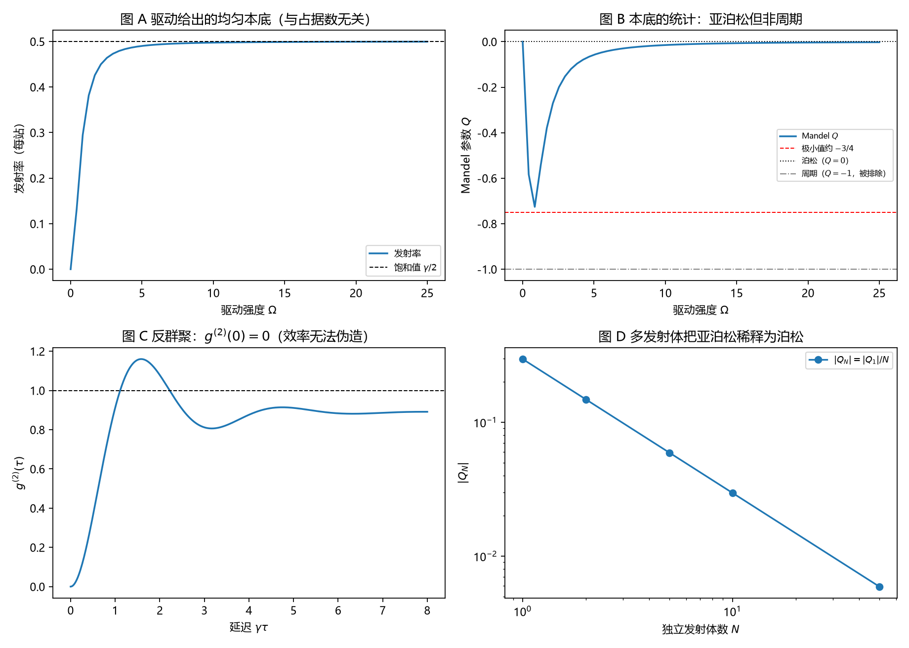

# 注记-声明式检查轮的最小验证：本底要什么算符，给出什么签名

- **日期**：2026-09-18
- **对应脚本**：`验证脚本/clock_operator_check.py`（判据 J1 至 J6，7/7 通过；确定性；运行约 0.4 秒；图存 `images/clock_operator_check.png`，见 §一 图 1）
- **依据**：[[验证脚本/注记-完全量子化轮的最小验证：谐振子格点在算符层面没有 +1 本底]]（上一轮：谐振子不给本底）；[[验证脚本/注记-自发项导出轮的最小验证：本底来自时钟折返，与真空涨落分家]]；[[验证脚本/注记-登记效率轮的最小验证：周期结构显形需强耦合]]；[[内部草稿/开放问题总览：元相子理论待解决问题清单]] P3-12；[[理论总纲/元相子理论的实验可检验预言清单]] C4
- **定位**：上一轮问"谐振子能不能给本底"，答不能。本轮做声明式检查：把本底写成算符，问它需要什么结构、给出什么统计、以及有什么签名。本注记不改动基准文件，C4 的处置建议见 §五。
- **状态**：判据 7/7 通过。核心读数：无驱动时发射率为零；驱动下发射率只由驱动与衰减定（饱和 $\gamma/2 = 0.500$，实测 $0.499$），与模式占据数无关；Mandel 参数在中间驱动出现极小 $Q = -0.7498$（$\Omega/\gamma = 0.72$，标准结果 $-3/4$），两端趋于泊松（$|Q| < 0.05$）；$g^{(2)}(0) = 0$；$N$ 个独立发射体给出 $Q_N = Q_1/N$。

---

## 一、判据与结果

| 判据 | 内容 | 通过条件 | 实测 |
|---|---|---|---|
| J1 | 无驱动零发射 | 率 $<10^{-9}$ | $0$ |
| J2 | 率只由驱动与衰减定 | 与占据数无关、饱和 | 饱和 $0.499$ 对 $\gamma/2 = 0.500$ |
| J3a | 中间驱动极小 $Q \approx -3/4$ | 偏差 $<10\%$ | $-0.7498$（$\Omega/\gamma = 0.72$） |
| J3b | 两端趋于泊松 | $\vert Q\vert < 0.05$ | $-0.0149$（弱）与 $-0.0037$（强） |
| J4 | 反群聚 | $g^{(2)}(0) = 0$ | $0.00$ |
| J5 | 多发射体稀释 | $Q_N = Q_1/N$ | $Q_1 = -0.2963$；$N = 50$ 时 $-0.0059$ |
| J6 | 结论登记 | 见 §三 | 见 §三 |

图注：左上为发射率随驱动强度升至饱和（与模式占据数无关）；右上为 Mandel 参数随驱动的变化（中间极小约 $-3/4$，两端趋于泊松，周期读法 $Q=-1$ 被排除）；左下为二阶关联 $g^{(2)}(\tau)$ 的反群聚与振荡；右下为多发射体把亚泊松按 $1/N$ 稀释。

## 二、模型设定

被驱动的二能级发射体（共振驱动，拉比频率 $\Omega$，衰减 $\gamma$ 给出记录通道的一次点击）。计数统计用倾斜刘维尔算符的支配本征值给出均值与方差（$Q = (\mathrm{Var}-\mathrm{Mean})/\mathrm{Mean}$）；二阶关联用量子回归定理给出。多发射体按独立发射体的累积量相加处理（$Q_N = Q_1/N$）。

## 三、读数的意义

**本底可以在算符层面立起来，代价写清楚了。** 要让每个站点在"没有模式激发"时也发声，站点必须是非谐振的（二能级），并且被驱动（驱动就是指针的旋转）。谐振子做不到（上一轮），二能级在基态也不发光（J1）：**发声要求"被驱动的非谐振结构"**。一旦如此，发射率由驱动与衰减定（饱和 $\gamma/2$），与模式占据数无关（J2），这正是本底要的"均匀且与份额无关"。

**它的统计是亚泊松，既非周期也非泊松。** Mandel 参数在中间驱动出现极小 $Q = -0.7498$（$\Omega/\gamma = 0.72$），与标准共振荧光结果 $-3/4$ 相符；两端趋于泊松（J3）。周期读法要求 $Q = -1$，被排除；散粒噪声水平对应 $Q = 0$，只在两端出现。

**签名是反群聚，效率伪造不了。** 单发射体给出 $g^{(2)}(0) = 0$（J4）。这一条最有价值：探测器效率与暗计数可以把任何泊松源变成"看起来亚泊松"（$Q < 0$），但它们**不能**造出反群聚（$g^{(2)}(0) = 0$ 要求"同一个发射体不会同时发两个光子"）。因此"本底是否来自单发射体"有一个效率无关的判据。

**多发射体把亚泊松稀释成泊松。** $N$ 个独立发射体给出 $Q_N = Q_1/N$（J5）：$N = 50$ 时 $|Q|$ 已到 $0.006$。这意味着若每站点或每分辨单元内有大量独立发射体，本底在统计上与泊松不可区分，与观测到的散粒噪声水平相容。

## 四、严格程度声明

本轮的 $Q_{\min} = -0.7498$ 与标准共振荧光结果 $-3/4$ 相符，属对实现的交叉验证；发射率的饱和值 $\gamma/2$ 属被驱动二能级的精确稳态结果；$g^{(2)}(0) = 0$ 是单发射体的精确结果；$Q_N = Q_1/N$ 是独立发射体的累积量性质。模型为最小模型（单个二能级加共振驱动），不涉及站点结构的来源。

## 五、对 C4 的处置建议（待作者裁定）

C4 原含两条：均匀本底与周期时间结构。本轮把两条分开处置。

- 周期结构（$Q = -1$）在本轮与上一轮都不成立，建议维持退役。
- 均匀本底可以保留，但必须写明代价与签名：站点须为被驱动的非谐振发射体；统计为亚泊松（单发射体 $Q_{\min} \approx -3/4$、$g^{(2)}(0) = 0$），多发射体按 $1/N$ 稀释为泊松。建议把 C4 改写为这一形式，判定条件相应改为"在本底上寻找反群聚或 $\vert Q\vert$ 随发射体数的 $1/N$ 稀释"。

## 六、边界与过程记录

未做：站点结构（非谐振性与驱动）从体系自身的导出；本底与模式场的具体耦合通道；多站点与空间份额的对照；实验可实现性评估。

过程记录：判据订正两处。其一，J3 原把 $Q \to -3/4$ 当作强驱动极限，实测强驱动趋于 $0$；改判为"中间驱动的极小值"，扫描后得 $-0.7498$（$\Omega/\gamma = 0.72$），与标准结果相符。其二，首版在 $\Omega = 0$ 处对 $Q$ 做了除法，补上零均值保护。

效率记录：脚本约 $0.4$ 秒，无字体问题。
