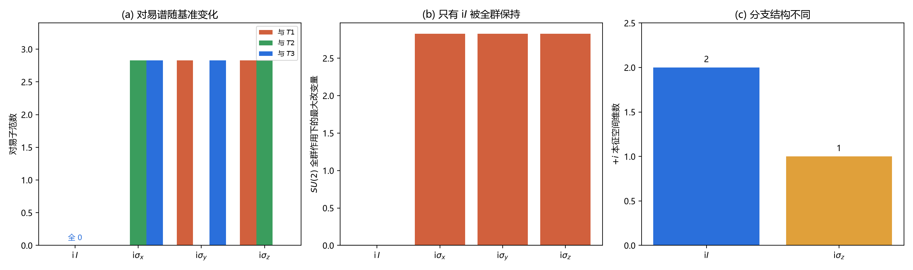

# 注记-复结构基准的选定：复结构族、全群保持与分支结构（判据第685号）

## 元数据

- **日期**：2026-10-18 22:29:11
- **类型**：验证注记（判据驱动，含两轮读数的和解）
- **脚本**：`验证脚本/minimal_verification_complex_structure_baseline.py`
- **图**：见 §四 图 1
- **可逆性等级**：判据稳健（解析构造与范数读数）
- **关联**：[[验证脚本/注记-三个生成元的单态化一致性：代数同态、升降结构与翻转支的分工（判据第680号）|第 680 号]]（本轮解其遗留问题）；[[验证脚本/注记-来源层判据化第一轮：模态空间复结构的定义域与左右作用三约定对表（判据第662号）|第 662 号]]（另一基准下的读数）；[[手征性的几何本质与宇称不守恒：模态复结构与宇称自发破缺]] §5.1（「模式混合保持 $J$」的主张）

## 摘要

第 662 号读出三个生成元与 $J_0$ 全对易，第 680 号读出只有 $T_3$ 与 $J_M$ 对易。两轮读数看似矛盾，本轮查明它们都对，只是用了不同的基准。

关键事实：$\mathbb{C}^2$ 上满足 $J^2=-I$ 的厄米复结构**不唯一**，$\{\mathrm{i}I,\ \mathrm{i}\sigma_x,\ \mathrm{i}\sigma_y,\ \mathrm{i}\sigma_z\}$ 全是合法复结构，而且一般族是连续的（Bloch 球面）。它们的对易谱随基准连续变化：$\mathrm{i}I$ 与三个生成元全对易，$\mathrm{i}\sigma_k$ 只与 $\sigma_k$ 对易。

基准由一条要求钉死：正稿 §5.1 说「模式混合保持 $J$」，而模式混合是 $SU(2)$ 矩阵左乘。检验下来，只有 $\mathrm{i}I$ 被 $SU(2)$ 全群保持（偏差 $1.6\times10^{-16}$），三个 $\mathrm{i}\sigma_k$ 在全群作用下改变 $2.828$。所以模式混合的基准唯一是 $\mathrm{i}I$，即第 662 号用的那个。

这意味着第 680 号的 $J_M=\mathrm{i}\sigma_z$ 不是模式混合的基准，它只被 $U(1)_z$ 子群保持。它的用处是标记「哪个方向被选为对角」，属于分支结构的语言，与模式混合的复结构是两件事。两支的本征空间维数也不同：$\mathrm{i}I$ 的 $+i$ 支是整二维，$\mathrm{i}\sigma_z$ 的 $+i$ 支是一维复直线。

## 一、背景与为什么是这一轮

680 号结尾留了一句：第 662 号用 $J_0=L_{\mathrm{i}}$ 读出三个全对易，680 号用 $J_M=\mathrm{i}\sigma_z$ 读出只有一个对易，「哪个才是模式混合真正用的那一个」没判。这个遗留问题不解决，正稿 §5.1 的「翻转支不参与模式混合」就无法精确表述：翻转是相对哪个基准翻的，说不清。

本轮先确认一件事：这个差别来自 $\mathbb{C}^2$ 上复结构本身不唯一，两轮都没有算错。这一步很关键，因为如果不唯一，那么「哪个 $J$」就是一个真问题；如果唯一，两轮必有一错。

## 二、模型设定

载体为 $\mathbb{C}^2$，三个生成元取 Pauli 矩阵 $T_k=\sigma_k$。候选复结构 $\{\mathrm{i}I,\mathrm{i}\sigma_x,\mathrm{i}\sigma_y,\mathrm{i}\sigma_z\}$，一般族取 $\mathrm{i}(\mathbf{n}\cdot\boldsymbol\sigma)$，$\mathbf{n}$ 为单位矢量。

模式混合定义为 $SU(2)$ 矩阵左乘 $U=\exp(\mathrm{i}\theta\sigma_k/2)$。基准的相容性判据是 $UJU^\dagger=J$ 对全群成立。

## 三、判据与结果

| 判据 | 内容 | 期望 | 实测 | 判定 |
| --- | --- | --- | --- | --- |
| M1 | 四个候选的 $J^2+I$ 与反厄米性 | 偏差 $0$ | $0.0$ | 通过 |
| M2 | 一般族 $\mathrm{i}(\mathbf{n}\cdot\boldsymbol\sigma)$（$200$ 个随机 $\mathbf n$） | $J^2=-I$ | 最大偏差 $6.3\times10^{-16}$ | 通过 |
| X1 | 对易谱分类 | $\mathrm{i}I$ 全对易；$\mathrm{i}\sigma_k$ 只与 $\sigma_k$ | 符合；$\mathrm{i}\sigma_x$ 对 $T_1$ 为 $0$、对 $T_2$ 为 $2.828$ | 通过 |
| X1 | 沿 Bloch 球连续转动 | 对易子连续变 | 由 $2.828$ 连续降到 $0.0$ | 通过 |
| X2 | $SU(2)$ 全群下 $J\to UJU^\dagger$ | 只有 $\mathrm{i}I$ 不变 | $\mathrm{i}I$ 为 $1.6\times10^{-16}$；三个 $\mathrm{i}\sigma_k$ 均为 $2.828$ | 通过 |
| X3 | 基准唯一性 | 只有 $\mathrm{i}I$ | 其余最小偏差 $2.828$ | 通过 |
| X4 | 两轮读数在同一框架下复现 | 都对 | $\mathrm{i}I$ 给 $[0,0,0]$；$\mathrm{i}\sigma_z$ 给 $[2.8,2.8,0]$ | 通过 |
| R1 | $\mathrm{i}\sigma_z$ 的子群保持 | 只 $U(1)_z$ | $U(1)_z$ 为 $0.0$、绕 $x$ 为 $1.356$ | 通过 |
| R2 | $+i$ 本征空间维数 | $2$ 对 $1$ | $2$ 对 $1$ | 通过 |

## 四、结果解读

**复结构不唯一，这是本轮的第一层结论。** 面板 (a) 的四组柱子显示四种基准给出四种不同的对易谱。$\mathrm{i}I$ 那一组全为零（图上已标注），$\mathrm{i}\sigma_x$ 只有与 $T_1$ 的那根柱为零，其余依此类推。M2 进一步说明这不是四个孤立点：一般族 $\mathrm{i}(\mathbf{n}\cdot\boldsymbol\sigma)$ 在 $200$ 个随机方向上都满足 $J^2=-I$，对易子随 $\mathbf n$ 连续变化（X1 第二项给出从 $2.828$ 连续降到 $0$ 的一条曲线）。

所以「$J$ 是什么」在 $\mathbb{C}^2$ 上不是一个有唯一答案的问题。这解释了为什么 662 号与 680 号能给出不同读数：它们各自选了一个合法但不同的基准。

**基准由「模式混合保持 $J$」这条要求钉死。** 面板 (b) 是决定性的。把 $J$ 在 $SU(2)$ 全群下共轭变换，只有 $\mathrm{i}I$ 保持不变（偏差 $1.6\times10^{-16}$），三个 $\mathrm{i}\sigma_k$ 都改变 $2.828$。既然正稿 §5.1 明确要求模式混合保持 $J$，那么模式混合的基准只能是 $\mathrm{i}I$。

反例 R1 补足另一面：$\mathrm{i}\sigma_z$ 在 $U(1)_z$ 子群下确实不变（$0.0$），但绕 $x$ 转就改变（$1.356$）。所以它是一个**部分**保持的基准，属于子群层面的结构，不是全群层面的。

**两支的分支结构不同。** 面板 (c) 给出 $+i$ 本征空间的维数：$\mathrm{i}I$ 是 $2$（整个 $\mathbb{C}^2$），$\mathrm{i}\sigma_z$ 是 $1$（一维复直线）。这意味着两种基准下的「手征分支」根本不是同一类对象：前者把整个空间当一支，后者把空间切成两条线。第 672 号关于「子空间须为 $J_0$ 本征子空间」的结论，用的正是后一种基准，因为只有那种基准下才存在两条不同的本征直线。

**两轮读数由此和解。** 面板 (a) 已经把答案画出来了：同一个 $T_3$，在 $\mathrm{i}I$ 基准下对易子为零，在 $\mathrm{i}\sigma_z$ 基准下也是零；但 $T_1$ 在前者下为零、在后者下是 $2.828$。两轮的读数各自都对，差别全在基准。

## 五、结论

其一，$\mathbb{C}^2$ 上的厄米复结构构成连续族（Bloch 球面），不唯一。这是 662 号与 680 号读数差异的根源，两轮都不错。

其二，模式混合的基准唯一是 $\mathrm{i}I$（即第 662 号的 $J_0=L_{\mathrm{i}}$）。判据是「被 $SU(2)$ 全群保持」，只有它满足。故正稿 §5.1「模式混合保持 $J$」中的 $J$ 应明确指 $\mathrm{i}I$。

其三，第 680 号的 $J_M=\mathrm{i}\sigma_z$ 不是模式混合基准，它只被 $U(1)_z$ 保持。它的正确地位是「选定一个对角方向的标记」，属分支结构语言。680 号「$T_1$、$T_2$ 属翻转支」的结论因此须改写：翻转是相对 $\mathrm{i}\sigma_z$ 这个方向基准而言的，不是相对模式混合的复结构。

其四，两支的本征空间维数不同（$2$ 对 $1$），故两种基准下的「手征分支」不是同类对象，跨轮引用时须标明基准。

## 六、严格程度声明与边界声明

**严格程度**：判据稳健。全部读数为解析构造与范数计算，无采样依赖（M2 的 $200$ 个随机方向只用于展示族性，结论由 $(\mathbf n\cdot\boldsymbol\sigma)^2=I$ 的解析恒等式保证）。容差 $10^{-12}$ 相对实测 $0.0$ 至 $1.6\times10^{-16}$ 留足余量。区分力对照：若某 $\mathrm{i}\sigma_k$ 也被全群保持，X3 失败；若一般族不满足 $J^2=-I$，M2 失败。

**验证什么**：$\mathbb{C}^2$ 上复结构是否唯一；哪个基准与模式混合相容；两轮读数能否在同一框架下复现。

**不验证什么**：不判体系在物理上「应该」用哪个基准（本轮只做数学相容性，$SU(2)$ 全群保持是正稿给定的要求，不是本轮导出的物理选择）；不涉及 $S^3$ 上的复结构问题（第 662 号已判其上无复结构）；不判 680 号单态化结论的有效性（那条只依赖投影，与基准无关，不受本轮影响）。

**协议伪影**：无采样伪影。

## 七、登记衔接

- [[验证脚本/README]] 第 685 号正式行
- [[内部草稿/开放问题档案/开放问题-P1-1-手征性]] 追加本轮登记
- [[内部草稿/开放问题总览：元相子理论待解决问题清单]] P1-1 卡状态行更新
- [[验证脚本/注记-三个生成元的单态化一致性：代数同态、升降结构与翻转支的分工（判据第680号）]] 结论三补更正注
- [[wiki/复结构]] 补「基准不唯一」一节

## 八、过程记录

**第一处自我更正：R2 的本征空间维数算法写错。** 初版用 `np.linalg.eigh(1j * J)` 把 $J$ 转成厄米再对角化，对 $J=\mathrm{i}I$ 得到 $1\mathrm{i}\cdot\mathrm{i}I=-I$，负定，$+i$ 支维数读成 $0$。正确做法是直接取 $J$ 的本征值（$J$ 本身已是对角的复矩阵，不必转厄米）。改正后读数为 $2$ 对 $1$。

**第二处：图的横轴标签渲染。** 初版用 `l.replace("i*", ...)` 动态生成标签，`i*I` 被转成 `iI` 且丢失数学格式。改为固定标签列表，并把 `iI` 写成 `\mathrm{i}\,I` 以分隔。

**方法论收获一条。** 本轮解决的是一类「两轮读数冲突」的纠纷。处理办法是先把两轮的**前提**摊开对比，而不是急着判谁错。摊开后发现前提不同（基准不同），于是问题从「谁错了」转成「哪个前提该用」。后一个问题的答案来自主张本身的要求（模式混合保持 $J$），不需要外部输入。这条与第 671 号「模板迁移须验前提」同型，但用在冲突调解上：**冲突的解法是先对齐前提，不是先比较读数**。

## 九、来源

- [[验证脚本/注记-三个生成元的单态化一致性：代数同态、升降结构与翻转支的分工（判据第680号）]]（遗留问题来源）
- [[验证脚本/注记-来源层判据化第一轮：模态空间复结构的定义域与左右作用三约定对表（判据第662号）]]（$J_0=L_{\mathrm{i}}$ 基准下的读数）
- [[手征性的几何本质与宇称不守恒：模态复结构与宇称自发破缺]] §5.1（「模式混合保持 $J$」的要求）

## 修订记录

- **2026-10-18 建档**（第 680 号的遗留问题）
    - 判据 9/9 通过，脚本与图落盘
    - 四项结论：复结构族不唯一、模式混合基准唯一为 $\mathrm{i}I$、$J_M$ 的地位改写、两支本征空间维数不同
