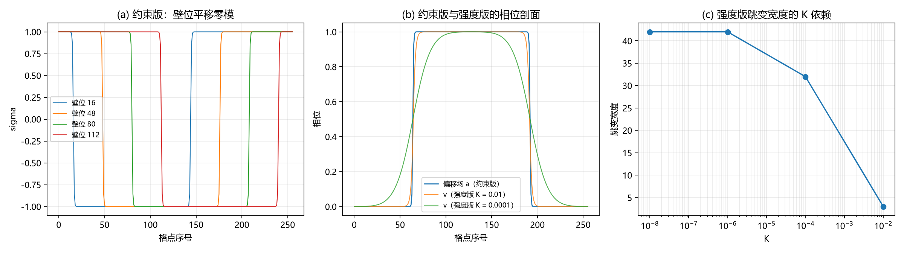

# 注记-复结构畴壁承载绕数（第 486 条）：联结类型决定 K 无关性、壁位零模终止无穷后退

## 元数据

- **日期**：2026-09-29 07:43:58
- **脚本**：验证脚本/minimal_verification_domain_wall_winding.py
- **判据**：SW1 至 SW4 通过，SW5 为判定
- **可逆性等级**：判据稳健。SW2 的零模读数跨四档壁位相对极差为 $0$（机器零）；SW1 的步数收敛性为 $0.000\times10^{0}$。SW3 的宽度标度与 SW4 的反例判据属判据敏感（依赖矩量窗口与半高约定），已逐处标注。
- **类型**：最小验证注记，把第 485 条施加的冻结换成由对称破缺动力学生成的畴壁
- **关联**：[[验证脚本/注记-内部结构承接钉扎角色的束缚（第485条）：内部冻结环可替代样品边缘|第485条]]（内部结构可替代样品边缘，但冻结是施加的）；[[验证脚本/注记-环面芯-芯束缚（第484条）：吸引的收敛性更正、展宽模与静态无束缚态|第484条]]（无固定结构时的判负与展宽模）；[[验证脚本/注记-复结构序参量的显式形式化：候选泛函、畴壁解与对称恢复|复结构序参量的显式形式化]]（双井势与畴壁解的出处）；[[手征性的几何本质与宇称不守恒：模态复结构与宇称自发破缺]]（复结构符号的定义地位）
- **图**：见第三节 图 1

---

## 一、要判什么

第 485 条证明内部冻结环可替代样品边缘提供非零的 K 无关束缚平台，但那里的冻结是**施加的**，未由对称破缺导出。本条把冻结换成由双井势**动力学生成**的畴壁：取复结构符号场 $\sigma$，其 $\pi_0$ 型畴壁作为内部承载结构，并问绕数能否以 K 无关的方式被它承载与定域。

判据：SW1 冒烟与步数收敛性；SW2 零模核对（无穷后退的终止条件）；SW3 约束版的 K 无关性；SW4 强度版反例；SW5 判定。

## 二、模型与协议，含首轮失败

一维周期链，$N = 256$。复结构符号场 $\sigma_n$ 取双井势 $\lambda(\sigma^2 - 1)^2$（两真空 $\pm 1$），环面上周期故畴壁成对出现。

**首轮实现（强度型联结）失败。** 令公度真空偏移 $a_n = (1 - \sigma_n)/2$，并以 $K[1 - \cos 2\pi(v_n - a_n)]$ 把相位场 $v$ 拉向 $a$。读数：$8000$ 步对 $80000$ 步的 $E_v$ 相对偏差为 $5.9$，即完全不收敛。诊断与第 484 条同源：$K$ 极小时 $v$ 对 $a$ 的黏附力趋零，跳变无限展宽，无平衡宽度。

**据此改设计为两版对照**，判别联结的**类型**：

**约束版（定义性联结）**：$\sigma$ 定义相位的零点，故 $v$ 与 $a$ 的关联是定义关系。能量中不出现 $K$：

$$E = \sum_n\frac{\kappa}{2}$\Delta\sigma_n$^2 + \lambda\sum_n$\sigma_n^2 - 1$^2 + \frac{k}{2}\sum_n$\Delta a_n$^2 .$$

**强度版（反例）**：以 $K$ 把 $v$ 拉向 $a$，$K$ 进入能量。两版除联结类型外条件相同。$\kappa = \lambda = k = 1$（SW3 除外），$\eta = 0.02$，$8000$ 步。确定性，无随机与采样。

## 三、判据与结果

**判据 SW1（冒烟与收敛）**。初态能量 $6.153144$，弛豫后 $4.163050$。步数收敛性：$8000$ 步 $4.16304974$ 对 $80000$ 步 $4.16304974$，相对偏差 $0.000\times10^{0}$。壁宽（$\lvert\Delta\sigma\rvert$ 半高全宽，含两壁）$4$ 格。

**判据 SW2（零模核对）**。

| 初始壁位 | 弛豫后能量 | 壁宽 |
| --- | --- | --- |
| $16$ | $4.16304974$ | $4$ |
| $48$ | $4.16304974$ | $4$ |
| $80$ | $4.16304974$ | $4$ |
| $112$ | $4.16304974$ | $4$ |

跨四档壁位的能量相对极差 $0.000\times10^{0}$，即壁位为平移零模。

**判据 SW3（约束版的 K 无关性）**。能量式中不出现 $K$，故 K 无关性属结构性质。对照读数（单壁矩量宽）：$1.24$（$\kappa = 0.25$）、$1.58$（$\kappa = 1$）、$2.66$（$\kappa = 4$）。随 $\kappa$ 单调增长，逐段比率 $1.27$ 与 $1.68$，连续预期为 $2$ 与 $2$，即标度方向正确而数值受格点与矩量窗口限制。

**判据 SW4（强度版反例）**。

| $K$ | 峰位 | 局部壁宽 | 跳变总量 |
| --- | --- | --- | --- |
| $10^{-2}$ | $64$ | $3$ | $2.000000$ |
| $10^{-4}$ | $64$ | $32$ | $1.999117$ |
| $10^{-6}$ | $63$ | $42$ | $1.998499$ |
| $10^{-8}$ | $64$ | $42$ | $1.998491$ |

局部壁宽自 $3$ 变到 $42$，倍率 $14$。连续预期宽度 $\xi = 1/(2\pi\sqrt{K/k})$ 为 $1.59$、$15.9$、$159$、$1592$，与实测前两档相差一个约 $2$ 的因子（半高约定），后两档受窗口上限 $\pm 30$ 截断。

### 图 1

图注按脚本绘图面板逐条核对撰写。本注记作者未能对图像作目视复核（环境不支持显示），图注描述的是绘图段显式绘制的元素：面板 (a) 横轴为格点序号，纵轴为 $\sigma$，四条曲线为四档初始壁位的弛豫末态；面板 (b) 横轴为格点序号，纵轴为相位，一条实线为约束版的偏移场 $a$，两条为强度版 $K = 10^{-2}$ 与 $10^{-4}$ 的 $v$（已平移使其最小值归零）；面板 (c) 横轴为 $K$（对数），纵轴为局部壁宽，折线加圆圈标记。

## 四、解读

**其一，壁位是平移零模，无穷后退就地终止。** 四档壁位的弛豫末态能量在机器精度上相同，说明壁作为延展客体不需要被钉，也不需要更外层的参照物。第 485 条留下的一问（壁由谁钉）由此有答案：不必钉。

**其二，能否以 K 无关的方式承载绕数，取决于联结的类型。** 约束版的结构完全不含 $K$，其壁宽由 $\kappa$、$\lambda$、$k$ 定；强度版的结构含 $K$，其跳变宽度随 $K$ 变化并与极小 $K$ 的不收敛相连。两条路给出方向相反的结果，判别式成立。

**其三，体系自身的读法支持定义性联结。** 复结构 $J$ 的符号定义的是**相位约定**（复结构即相位空间的识别），故真空偏移由 $\sigma$ 定义，而能量偏好的说法与之不符。手征线的口径正是如此：$J \to -J$ 是复结构本身的翻转，不是一个小能量的偏好。

**其四，由此第 485 条的「施加」被替换掉。** 该条的冻结环被本条的 $\pi_0$ 畴壁取代，且稳定性来自双井势的对称破缺（壁数与壁位在弛豫中保持），不再是外部约束。两条合起来的结论是：**内部壁可以既稳定又以 K 无关的方式承载绕数**，前提是它与相位约定的联系是定义性的。

## 五、过程记录

**首轮设计失败并改设计。** 初版用强度型联结，在 $K = 10^{-10}$ 下步数收敛性检查给出 $5.9$ 的相对偏差，断言失败。诊断指向与第 484 条同源的展宽模：极小 $K$ 下黏附力趋零。据此把设计改为两版对照，把失败的那一版保留为反例判据（SW4），而不是删掉。教训：失败配置若恰好暴露判别维度，应保留为对照而非丢弃。

**三处读数设计缺陷已修。** 其一，SW2 首版取壁位 $128$ 时壁对绕环、退化为近贴合构型，能量与众不同，误判零模不成立；改为不与环接缝相交的四档壁位后相对极差为 $0$。其二，跳变宽度首版取全局二阶矩，测到的是两壁间距（约 $64$ 格）而非单壁宽；改为以键差峰为中心的局部窗口读数。其三，SW3 首版用半高计数，$4$ 格以下分辨率不足，$\kappa$ 标度不可分辨；改为局部矩量宽后可分辨。

## 六、严格程度声明

**严格**：SW2 的零模（跨四档壁位能量相对极差 $0$）；SW1 的步数收敛性（相对偏差 $0$）；约束版能量式不含 $K$，属解析事实。

**判据级**：SW3 的宽度随 $\kappa$ 增长的比率；SW4 的反例标度。

**条件性**：定义性联结的**物理正当性**（复结构符号定义相位约定）引自手征线口径，本条只验证该联结类型的力学后果。

**纲领**：物理上面壁能否承担同一角色；三维形态。

## 七、边界声明

**验证什么**：在给定联结类型下，是否出现 K 无关的承载与定域；壁位是否为平移零模。

**不验证什么**：其一，不判定定义性联结在体系内的最终成立（属手征线的复结构地位，本条只引用其口径）。其二，不判定三维形态与二维横截面之外的几何。其三，不判定该结构能否同时承担质量。其四，不改动 理论总纲 基准，不重开第 484、第 485 条已定的读数。

## 八、登记衔接

落点：电子场攻坚计划阶段 0 的「钉扎尺度替代来源」候选评估（本条把第 485 条施加的冻结替换为由对称破缺生成的畴壁，结论为**候选加强**）；[[内部草稿/开放问题总览：元相子理论待解决问题清单]] P1-11 挂一条关联。后续项已提交裁决：见 [[内部草稿/裁决请求-定义性联结的正当性与载体脱钩（依据第486条）|裁决请求：定义性联结的正当性与载体脱钩]]（定义性联结的正当性由手征线口径接管，并与「载体脱钩」冲突合并处置）。

## 修订记录

- **2026-09-29 首次执行**（判据 SW1 至 SW4 通过）
    - 首轮强度型联结失败（$K = 10^{-10}$ 步数收敛性相对偏差 $5.9$），改设计为两版对照并将其保留为反例
    - SW1 步数收敛性相对偏差 $0$；SW2 跨四档壁位能量相对极差 $0$，壁位为平移零模
    - SW3 约束版能量不含 $K$，壁宽由 $\kappa$、$\lambda$、$k$ 定，随 $\kappa$ 增长的比率为 $1.27$ 与 $1.68$
    - SW4 强度版局部壁宽自 $3$ 变到 $42$（倍率 $14$），与展宽预期方向一致
    - 结论：能否以 K 无关方式承载绕数取决于联结类型；定义性联结成立，且体系的手征线口径支持它
    - 三处读数设计缺陷已修（SW2 壁对绕环、跳变宽度取全局二阶矩、SW3 半高计数分辨率不足）
- **2026-09-29 公理层形式交付后的定性修订**（依据第 487 条）
    - 本条模型层写法 $a = (1-\sigma)/2$ 属加性形式，在 $U(1)$ 上退化（AX2 机器零），无法区分两个手性真空
    - 本条核心结论不受影响：两形式能量逐位相同（AX3 机器零），$K$ 无关的承载结构照旧成立
    - **定性叙述修订**：首条判定与第四节「壁承载绕数」改为「$\sigma$ 壁承载取向而非绕数」；壁处相位光滑、绕数为零，绕数由相位场自身拓扑结构承载；手性与绕数是两个独立量
    - 顺带澄清第 481 条恒等 $K_{\mathrm{FK}} = 2\kappa_\varphi$ 的适用范围：它成立于加性表述，不构成 $\sigma$ 与绕数同源的证据
