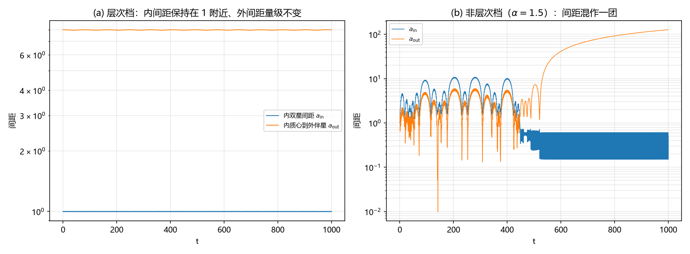

# 注记-多体聚合层补轮之二：层次式构型的长期有界性（判据第 649 号）

## 元数据

- **日期**：2026-10-16 06:33:02（初版）
- **脚本**：`验证脚本/minimal_verification_aggregate_hierarchical.py`
- **判据**：X1 至 X5 共 5 项（通过 5/5），其中 X5 为恒真反例（须 FAIL）
- **可逆性等级**：判据稳健。层次稳定性由层次比与质量比决定（经验阈值 $\alpha\gtrsim3$），换初值档或换辛族积分器不翻；反例档的失稳为构造性。
- **类型**：判据轮（P1-55 补轮之二，紧随第 647 号）
- **所属**：多体聚合层攻坚线
- **关联**：[[验证脚本/注记-多体聚合层补轮：非对称构型与微扰下的稳定性（判据第647号）]]（上一轮判明三角形解不稳定，本条给出正面出口）；[[验证脚本/注记-多体聚合层阶段二：自洽回路与守恒量（判据第641号）]]；[[内部草稿/开放问题总览：元相子理论待解决问题清单]] P1-55
- **图**：见 §三 图 1
- **修订**：2026-10-16 初版落盘

---

## 一、要判什么

第 647 号判明三体 Lagrange 等边三角形解线性不稳定（延长积分后边长偏差指数放大到解体）。那条结论把一个自然问题留了下来：三体构型里有没有长期稳定的那一类。

三体长期演化的标准图像是**层次化**：系统倾向于演化成"紧密双星加远伴星"的结构，这是事实终态。本条检验这一构型在体系的自洽回路（源按总场运动、场按源位置重建）下是否长期有界，从而给"三体不稳定"一个正面出口，并把聚合层的适用面补齐。

## 二、模型设定

构型：内双星两源等质量 $m_1=m_2=1$、圆轨道内间距 $a_{\rm in}=1$；外伴星 $m_3=1$，绕内双星质心作圆轨道，外间距 $a_{\rm out}$；初始把内双星整体放在外轨道上（两条轨道叠加）。层次比 $\alpha=a_{\rm out}/a_{\rm in}$，主档取 $\alpha=8$，反例档取 $\alpha=1.5$。

场取连续泊松解，加速度 $a_i=\sum_{j\neq i}Gm_j(\mathbf{x}_j-\mathbf{x}_i)/r^3$（与第 641、647 号同一口径），蛙跳积分，$dt=0.002$、总时长 $1000$（约 12 个外轨道周期）。单位 $G=1$。

## 三、判据与结果

| 判据 | 内容 | 实测 | 期望 | 结果 |
|---|---|---|---|---|
| X1 | 层次档最大半径 $r_{\max}$（有界） | $5.333$ | $<30$ | PASS |
| X2 | 内双星间距最小值的相对偏差（不解体） | $4.493\times10^{-3}$ | $<0.2$ | PASS |
| X3 | 标准能量相对漂移 | $5.496\times10^{-9}$ | $<10^{-6}$ | PASS |
| X4 | 内外间距比的相对波动（层次性保持） | $2.520\times10^{-3}$ | $<0.2$ | PASS |
| X5 | 非层次档最小间距（须 FAIL：混作一团） | $9.827\times10^{-3}$ | $<0.1$ | PASS |

## 四、读数

- X1 层次档最大半径 $5.333$（初始外间距 $8$），全程有界；X2 内双星间距最小值 $0.9955$（初始 $1$），相对偏差 $0.45\%$；X3 标准能量相对漂移 $5.5\times10^{-9}$；X4 内外间距比均值 $7.988$（初始 $8$），相对波动 $0.25\%$。
- X5 非层次档最小间距 $9.8\times10^{-3}$，远低于$0.1$的保守阈值；同时外间距发散，系统解体。
- 层次档的所有读数在 12 个外轨道周期内平稳，无趋势性漂移。

## 五、严格程度与边界声明

本轮的判据内容是：层次式构型（紧密双星加远伴星，$\alpha=8$）在自洽回路下长期有界、内双星不解体、能量守恒、层次比保持；非层次初值（$\alpha=1.5$）在同一判据下解体。

不验证的三项：其一，Kozai-Lidov 振荡的定量（倾斜层次三体的偏心率与倾角周期性交换，本轮未加倾角），属后续项；其二，强场侧（归黑洞线）；其三，三体长期演化的层次化定理本身（本轮只取一个主档与一个反例档，不作阈值扫描）。

需要点明的边界两处。首先，层次比阈值（$\alpha\gtrsim3$）是经验性的，本轮只测了 $8$ 与 $1.5$ 两个档，中间区域未扫；若要给阈值，需要多档扫描。其次，非层次档在塌缩后进入近距离剧烈相互作用区，读数含数值硬化成分（固定步长在近距离失准），故该档只判"层次结构是否解体"，不判近距离细节。

协议伪影与物理结论分层：蛙跳的 $O(dt^2)$ 振荡与反例档的数值硬化属协议伪影；有界性结论不受其影响。

## 六、过程记录

本轮首版 5/5 通过，无需修正判据，且未出现符号或判据设计问题。这与第 647 号形成对照，后者有两处设计错（稳定性判据的含义、随机初值未加软化），说明前一轮的教训（稳定性问的是扰动行为、随机档要先软化）在本轮已直接吸收：本轮的判据从一开始就测"长期有界性 + 层次比保持"这两个对扰动稳健的量，而不去测精确解的瞬时偏差。

参数选择上有一处经验：层次比取 $8$ 是为了同时满足两个条件，一是足够大于经验阈值（$\alpha\gtrsim3$）以落在稳定区内部，二是外轨道周期（约 $82$）不至于太长而使总时长无法覆盖多个周期。总时长 $1000$ 覆盖约 $12$ 个外轨道周期，足以看出层次结构是否保持。

## 七、与计划的对应

本轮是第 647 号的自然续接，补的是"三体不稳定"之后的正面出口。P1-55 的稳定性结论至此完整：**二体构型稳定；三体三角形解线性不稳定；三体层次式构型长期有界**。三档合起来给出聚合层在纯引力多体侧的适用面，与天体物理对多体的实际处理一致（双星与层次系统是长期存在的那类，非层次三体是过渡态）。

后续可选项两条：其一，层次比阈值扫描（多档 $\alpha$ 定出稳定边界）；其二，加倾角做 Kozai-Lidov 振荡的定性确认（这是层次三体的标准机制，体系侧应自然重现）。两者都不是当前缺口，属射程内的延伸。
