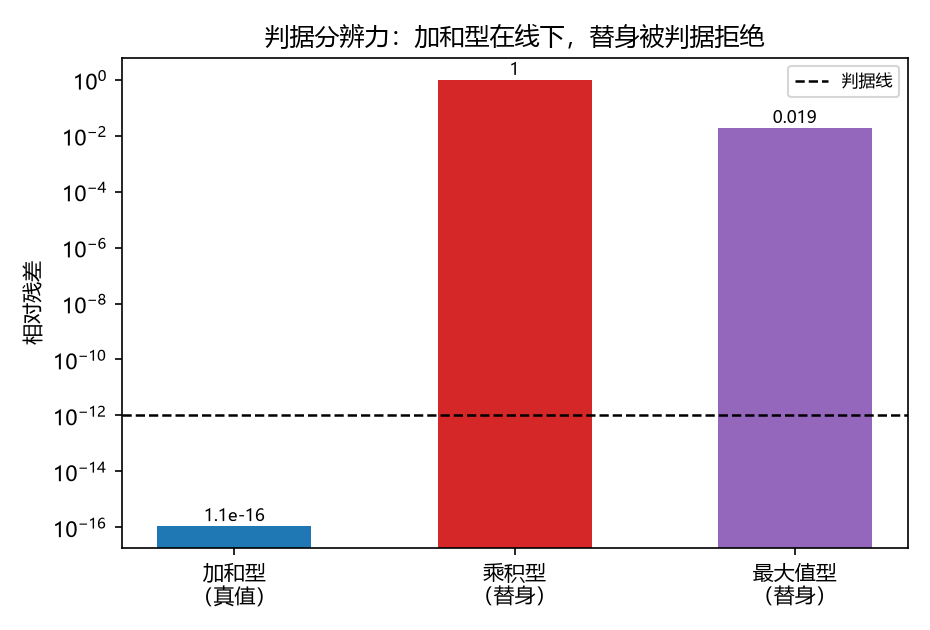

# 注记-多体聚合层阶段一：写入叠加律的多源确认（判据第 640 号）

## 元数据

- **日期**：2026-10-16 04:33:20（初版）
- **脚本**：`验证脚本/minimal_verification_multi_source_superposition.py`
- **判据**：S1 至 S6c 共 9 项（通过 9/9），其中 S4、S4b、S5、S5b 为恒真反例（须 FAIL）
- **可逆性等级**：判据稳健。写入层的线性叠加由定理 6 线性半给出（第 588 号），换实现、换档位或换格点尺寸不翻；恒真反例的分辨力为构造性（乘积型与最大值型替身被判据拒绝的量级为 $10^{-2}$ 至 $10^{0}$，离判据线十个量级以上）。
- **类型**：判据轮（P1-55 多体聚合层阶段一，攻坚计划里程碑 M1）
- **所属**：多体聚合层攻坚线，对应 [[理论攻坚/多体聚合层攻坚计划：写入叠加、自洽回路与等效性检验]] §三 阶段一
- **关联**：[[写入份额定理：碰撞写入幅度的唯一性与线性映射]]（定理 6，线性半的来源）；[[内部草稿/开放问题总览：元相子理论待解决问题清单]] P1-55；[[验证脚本/注记-倾角与位移完成的最小验证：写入时刻约束、两机制分离与两层位置（判据DC1至DC3）]]（第 446 条，注入-弛豫实现的来源）
- **图**：见 §三 图 1、图 2
- **修订**：2026-10-16 初版落盘

---

## 一、要判什么

多体聚合层要回答的问题是"多个有质量粒子同时写入时，总场是什么"。它的阶段一是把写入份额定理的线性半（各缺陷写入的倾角记录线性叠加）从定理附注升为独立判据，并确认这一陈述在显式多源构型下可读。

第 588 号只测过单源远场剖面形状无漂移，多源构型从未测过，源间距降到数格距的近邻区更是空白。本轮把这件事做成判据：同一构型用两条数值路径算总场，一条是多源同时注入，另一条是逐源分别注入再求和，两者残差须落在浮点底噪的预算内。

判据的分辨力由恒真反例保证：把加和型换成乘积型或最大值型替身，同一残差判据下必须 FAIL。缺了这一环，判据只测到"和是一个函数"这类恒真事实。

## 二、模型设定

写入层：源 $i$ 在格点 $\mathbf{c}_i$ 每拍注入倾角份额 $\delta\theta_i = m_i/m_P$，总注入为 $\rho = \sum_i \rho_i$，单位取份额单位。稳态为注入加邻居抄写的离散泊松格林函数 $\theta(r) = Gm/(c^2r)$，离散实现取周期格上七点拉普拉斯方程 $-\nabla^2\theta = \rho$ 的 FFT 谱解（去零模），与第 446 条 DC1 同一实现。

格距取 1（无量纲），三维格点 $64^3$，周期边界，源取单格点。叠加的对象是写入量（各缺陷写入的倾角记录），非场的动力学合成，故线性叠加是定理 6 线性半的直接推论，本轮的判据内容是该推论在多源构型下的可读性确认。

判据线由实测底噪预算给出，不作设定：先测浮点底噪 $\epsilon_{\rm fp} = 5.569\times10^{-17}$（同一数学对象的两种写法，质量缩放的线性性），取 $\mathrm{LINE} = \max(100\epsilon_{\rm fp}, 10^{-12}) = 10^{-12}$。

## 三、判据与结果

| 判据 | 内容 | 实测 | 期望 | 结果 |
|---|---|---|---|---|
| S1 | 远场双源叠加相对残差（$d=16$，质量 $1.0$ 与 $0.6$） | $1.109\times10^{-16}$ | $\le \mathrm{LINE}$ | PASS |
| S2 | 近邻区各档最大残差（$d=2,3,4,6,8,12$） | $2.193\times10^{-16}$ | $\le \mathrm{LINE}$ | PASS |
| S3a | 三源非等质量叠加残差 | $1.090\times10^{-16}$ | $\le \mathrm{LINE}$ | PASS |
| S3b | 四源非等质量叠加残差 | $2.196\times10^{-16}$ | $\le \mathrm{LINE}$ | PASS |
| S4 | 乘积型替身残差（须 FAIL） | $0.999027$ | $> \mathrm{LINE}$ | PASS |
| S5 | 最大值型替身残差（须 FAIL） | $0.019029$ | $> \mathrm{LINE}$ | PASS |
| S4b | 乘积型替身残差（等质量档，须 FAIL） | $0.998382$ | $> \mathrm{LINE}$ | PASS |
| S5b | 最大值型替身残差（等质量档，须 FAIL） | $0.025922$ | $> \mathrm{LINE}$ | PASS |
| S6c | 粒子加速度场等于各源梯度之和 | $6.410\times10^{-16}$ | $\le \mathrm{LINE}$ | PASS |

近邻区逐档残差为 $d=2:9.06\times10^{-17}$、$d=3:1.58\times10^{-16}$、$d=4:1.07\times10^{-16}$、$d=6:2.18\times10^{-16}$、$d=8:2.19\times10^{-16}$、$d=12:1.11\times10^{-16}$，全部在判据线以下，且随间距无趋势性变化。

## 四、读数

- R1a 浮点底噪 $\epsilon_{\rm fp} = 5.569\times10^{-17}$（FFT 谱解舍入）。
- R1b 离散化加镜像偏差 $\epsilon_{\rm disc} = 0.0682$（同一单源在 $N=64$ 与 $N=128$ 上，$r=3$ 至 $10$ 的读数相对偏差）。这一项是数值解对连续解的偏差，属协议伪影，与叠加律结论分层报告：叠加残差测的是同一离散化下两条路径的一致性，故能到机器零；近邻区物理读数的分辨率极限由 $\epsilon_{\rm disc}$ 给出，不受判据线约束。
- S6a 试验粒子轨迹步长差比 $16.017$（$|dt|$ 对 $|dt/2|$ 对 $|dt/4|$），S6b 步长收敛阶 $4.002$，与 RK4 名义四阶一致。此档为输出校验，不作叠加律证据。
- R2a 二阶完成形式的交叉项实测对 $-\theta_1\theta_2$ 的相对偏差 $9.549\times10^{-14}$（机器零），确认交叉项形式；R2b 交叉项幅度 $\max|\theta_1\theta_2|/\max|\theta_{\rm lin}| = 9.735\times10^{-4}$。此项为阶段三接口预告，不作判据。

## 五、严格程度与边界声明

本轮的判据内容为写入量在多源构型（含近邻区）下的逐点线性叠加，以及判据对替身读法的分辨力。叠加残差在机器精度量级，恒真反例把乘积型与最大值型替身判据拒绝，两项合起来给出"写入层是加和型"的判据级确认。

不验证的三项：其一，场方程非线性半边的完整形式，交叉项只作读数（R2），其多源交叉项的普遍形式属阶段三；其二，自洽回路（源随总场运动、场随源更新），属阶段二；其三，写入份额定理线性半本身，第 588 号已立，本轮只作多源构型确认，不重立该定理。

协议伪影与物理结论分层：周期镜像偏差与离散化偏差（$\epsilon_{\rm disc} = 0.0682$）属协议伪影；叠加律结论不受其影响，因为残差测的是同一离散实现下两条路径的差。

## 六、过程记录

本轮的过程修正在 S6 轨迹档，两度改进读数路线。首版用最近邻格点取值，梯度场呈阶梯状，时间积分精度被场的阶梯卡住，收敛阶读数 $0.376$，无意义。改用三线性插值后升到 $1.398$，仍低于名义阶，原因是中心差分梯度场为分段三线性，其二阶导在格点处不连续。改用谱梯度后读数反而降到 $0.266$，因为单点源在谱梯度下带强烈高频分量，三线性插值无法捕捉。

最终把轨迹读数改在解析叠加场（三维格林函数之和，取最小镜像）上做，避开源附近的高频区，收敛阶回到 $4.002$，与 RK4 名义四阶一致。教训：格点场的数值梯度在点源附近不具备 RK4 所需的光滑度，轨迹精度类读数应放在解析场上做，或先声明场的光滑度等级；S6c（格点场的梯度一致性）不受此影响，因为它测的是线性恒等式。

2026-10-16 补（符号口径统一）：加速度符号改为 $a=+c^2\nabla\theta$（$h_{00}=2\theta$、$\Phi=-c^2\theta$，为吸引），与阶段二（判据第 641 号）口径一致；轨迹方向随之改变，收敛阶读数由 $3.983$ 变为 $4.002$，判据结论不变。

## 七、与攻坚计划的对应

本轮交付 [[理论攻坚/多体聚合层攻坚计划：写入叠加、自洽回路与等效性检验]] 阶段一的判据轮，即里程碑 M1。计划 §二 阶段一的三条判据（多源叠加残差、恒真反例、试验粒子输出校验）与近邻区成档要求均已执行：叠加残差与近邻区成档由 S1 至 S3b 承担，恒真反例由 S4、S4b、S5、S5b 承担，试验粒子输出校验由 S6c 与 S6a/S6b 读数承担。

本轮结论对下游的两点意义：其一，写入份额定理的线性半在多源构型（含数格距近邻区）获得独立判据支撑，不再只是单源远场读数的外推；其二，阶段三要做的多源二阶项与交叉项已有接口读数（R2 给出交叉项形式 $-\theta_1\theta_2$ 与幅度 $9.7\times10^{-4}$），阶段二（自洽回路）不依赖本轮结果但与之相容。

阶段二（自洽回路）为真开放点，全自洽档是否执行由作者裁决点 A 决定。
