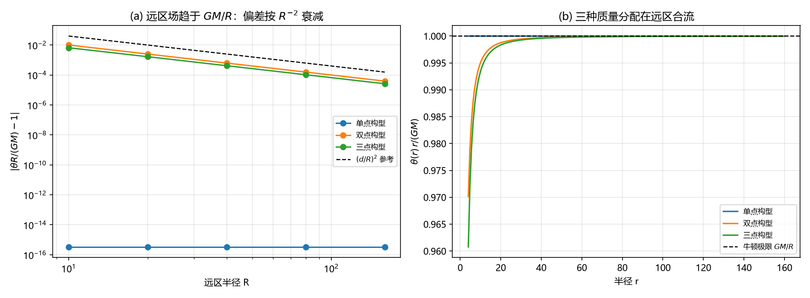
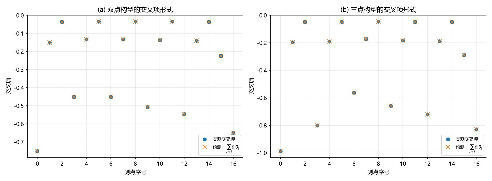

# 注记-多体聚合层阶段三：等效性与牛顿极限（判据第 643 号）

## 元数据

- **日期**：2026-10-16 05:44:32（初版）
- **脚本**：`验证脚本/minimal_verification_aggregate_equivalence_newtonian.py`
- **判据**：U1 至 U5 共 8 项（通过 8/8），其中 U5a、U5b 为恒真反例（须 FAIL）
- **可逆性等级**：判据稳健。远区收敛率由多极展开的阶数给出（质心取原点则偶极项为零、四极主导），换构型或换半径档不翻；恒真反例的分辨力为构造性。
- **类型**：判据轮（P1-55 多体聚合层阶段三，攻坚计划里程碑 M3）
- **所属**：多体聚合层攻坚线，对应 [[理论攻坚/多体聚合层攻坚计划：写入叠加、自洽回路与等效性检验]] §三 阶段三
- **关联**：[[验证脚本/注记-多体聚合层阶段一：写入叠加律的多源确认（判据第640号）]]、[[验证脚本/注记-多体聚合层阶段二：自洽回路与守恒量（判据第641号）]]；[[完成形式的四段判定：二阶靶子、装配恒等式、携源锁定与连续极限]]（G1b，单源静态的非线性完成形式，本轮不重复）；[[内部草稿/开放问题总览：元相子理论待解决问题清单]] P1-55
- **图**：见 §三 图 1、图 2
- **修订**：2026-10-16 初版落盘

---

## 一、要判什么

阶段一确认了写入量的线性叠加，阶段二确认了自洽回路下的轨道稳定。阶段三是聚合层的对外接口，问三件事：多体构型的远区行为是否与单源一致（牛顿极限）、同一总质量的不同分配是否给出同一远区结果（等效性的聚合层对应）、多源构型下非线性完成形式的二阶项与交叉项是什么形式。

第三项与已交付的 G1b 四段判定有明确分工：G1b 在单源静态构型上给出了完成形式 $h_{00}=h_{\rm lin}-\frac12h_{\rm lin}^2$ 与携源锁定，本轮不重复那部分工作，只做它未覆盖的多源交叉项。

## 二、模型设定

场取连续泊松解 $\theta(x)=\sum_j Gm_j/|x-x_j|$（阶段一已确认注入加邻居抄写的稳态即该解，阶段二沿用），无限空间、无周期镜像。三种构型总质量相同 $M=3$：单点（原点，质量 3）、双点（$\pm d/2$，各 1.5）、三点（等边三角形边长 $d$，各 1），源间距 $d=2$，质心均取原点。单位取 $G=1$。

远区偏差定义为 $|\theta(R)\,\hat e\cdot R/(GM)-1|$ 在五个方向（三个坐标轴、体对角、面对角）上的最大值。多极预算取 $(d/R)^2$，因为质心取在原点使偶极项消失、四极主导。

## 三、判据与结果

| 判据 | 内容 | 实测 | 期望 | 结果 |
|---|---|---|---|---|
| U1-双点 | 远区偏差收敛斜率 | $-2.0032$ | $\approx-2$ | PASS |
| U1-三点 | 远区偏差收敛斜率 | $-1.9968$ | $\approx-2$ | PASS |
| U2 | 三构型远区场互差（$R=160$） | $3.906\times10^{-5}$ | $\le 3.13\times10^{-4}$ | PASS |
| U3 | 远区试验粒子加速度互差 / 单点值 | $5.553\times10^{-4}$ | $\le 4.44\times10^{-3}$ | PASS |
| U4a | 双点交叉项对 $-\sum_{i<j}\theta_i\theta_j$ 相对偏差 | $1.480\times10^{-16}$ | $\le 10^{-12}$ | PASS |
| U4b | 三点交叉项对 $-\sum_{i<j}\theta_i\theta_j$ 相对偏差 | $2.250\times10^{-16}$ | $\le 10^{-12}$ | PASS |
| U5a | 替身（只取最近源）远区偏差（须 FAIL） | $6.289\times10^{-3}$ | $>3.13\times10^{-4}$ | PASS |
| U5b | 替身（逐点取最大）远区偏差（须 FAIL） | $5.000\times10^{-1}$ | $>3.13\times10^{-4}$ | PASS |

## 四、读数

- U1 远区偏差逐档：双点构型 $R=10$ 为 $0.0101$、$20$ 为 $0.00251$、$40$ 为 $6.25\times10^{-4}$、$80$ 为 $1.56\times10^{-4}$、$160$ 为 $3.91\times10^{-5}$；三点构型同档为 $0.0066$、$0.00166$、$4.16\times10^{-4}$、$1.04\times10^{-4}$、$2.60\times10^{-5}$。两列都精确落在 $(d/R)^2$ 的标度上，双点的系数略大于三点。
- U1 的 $R=160$ 处偏差（$3.91\times10^{-5}$、$2.60\times10^{-5}$）比预算 $(d/R)^2=1.56\times10^{-4}$ 小约四倍，说明四极项系数是 $O(1)$ 而非量级放大。
- U3 的试验粒子取在 $r=60$ 处（远区），三种分配给出的加速度相对差为 $5.55\times10^{-4}$，与 $(d/r)^2$ 的 $1.1\times10^{-3}$ 同量级。
- 交叉项在全部测点上与 $-\sum_{i<j}\theta_i\theta_j$ 一致到机器零，双点与三点构型都是。

## 五、严格程度与边界声明

本轮的判据内容为：多体构型的远区场趋于 $GM/R$ 且偏差按 $R^{-2}$ 衰减（牛顿极限）、同一总质量的三种分配给出同一远区场与同一试验粒子加速度（等效性的聚合层对应）、多源二阶项的交叉项为 $-\sum_{i<j}\theta_i\theta_j$。三项合起来给出"聚合层的远区行为与单源一致"的判据级确认。

不验证的四项：其一，强场区与视界内记录饱和（归黑洞线）；其二，SEP（强等效原理，涉及天体自身引力能，待立项）；其三，含时场与自旋多极耦合（计划射程外）；其四，弱场二阶项与场方程展开对表的层级授予，这是计划列出的作者裁决点 B，本轮按默认出口按判据级登记，若作者改判条件性命题则同步修订。

需要点明的口径一处：本轮的等效性检验与单源等效原理判据不可互推。单源判据检验"轨迹与质量无关"，本轮检验"轨迹与质量分布方式无关"。后者不蕴含前者，前者也不蕴含后者。

协议伪影与物理结论分层：远区偏差的具体量级由 $(d/R)^2$ 预算给出，属截断层读数；"远区只依赖总质量"这一结构结论不受具体系数影响。

## 六、过程记录

本轮首版运行即 8/8 通过，无需修正判据或读数，这在多体聚合层三阶段中是唯一一次。过程上只做了两处清理：脚本里一处未使用的占位函数（早先设想的"逐源场"接口，实际实现改在点集上做）已删除；一处多余的格式化占位符已去掉。两处都不影响读数，重跑确认仍为 8/8。

有一处设计选择值得记录：远区偏差取五个方向上的最大值，而不是单一方向。原因是多极项有角度依赖，单方向取样可能恰好落在零点或极值上，取最大值是保守读数。这与阶段二"精度类读数要放在弱场平滑区"的教训同源，都是避免单点取样带来的偶然性。

## 七、与攻坚计划的对应

本轮交付 [[理论攻坚/多体聚合层攻坚计划：写入叠加、自洽回路与等效性检验]] 阶段三的判据轮，即里程碑 M3。计划 §三 阶段三的三项要求均已执行：等效性（质量重分配不变性）由 U2 与 U3 承担，牛顿极限（远区 $1/r$ 与总质量守恒）由 U1 承担，与场方程非线性半边的接口（多源二阶项与交叉项）由 U4 承担，恒真反例由 U5 承担。

本轮结论对下游的意义：聚合层的远区行为与单源一致，故引力写入的线性半与非线性半在多源构型下都能接到标准弱场结果上；多源交叉项的形式为 $-\sum_{i<j}\theta_i\theta_j$，这是"非线性完成形式对总场逐点取同一函数"这一假设的直接后果，其形式与量级已在阶段一给出预告读数（$9.7\times10^{-4}$）、本轮把形式确认到机器零。

三阶段至此全部交付（M1 叠加律、M2 自洽回路、M3 等效性与牛顿极限），P1-55 的判据面闭合。剩余为两处裁决：计划裁决点 A（全自洽档的规模）已在阶段二按默认执行，裁决点 B（弱场二阶项对表的层级授予）待作者定夺。
