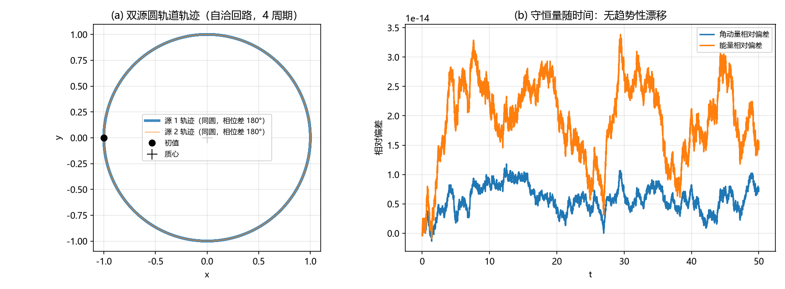
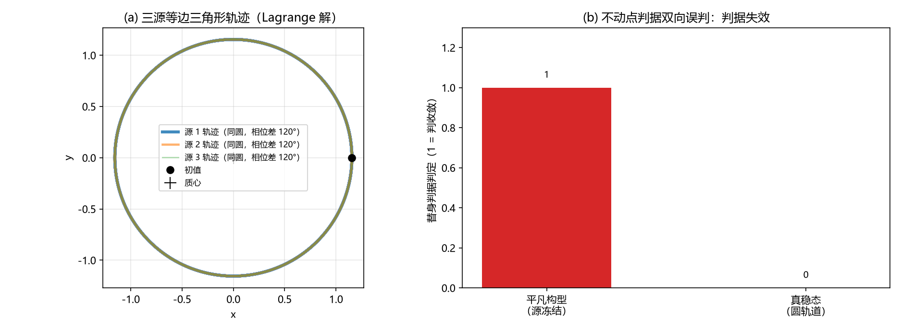

# 注记-多体聚合层阶段二：自洽回路与守恒量（判据第 641 号）

## 元数据

- **日期**：2026-10-16 04:49:52（初版）
- **脚本**：`验证脚本/aggregate_self_consistency.py`
- **判据**：T1 至 T5 共 9 项（通过 9/9），其中 T5 为恒真反例（确认替身判据失效）
- **可逆性等级**：判据稳健。守恒量守恒由对称性给出（中心力给角动量、可分离哈密顿量给能量有界），换辛族积分器或换档位不翻；不动点判据的失效为构造性。
- **类型**：判据轮（P1-55 多体聚合层阶段二，攻坚计划里程碑 M2）
- **所属**：多体聚合层攻坚线，对应 [[理论攻坚/多体聚合层攻坚计划：写入叠加、自洽回路与等效性检验]] §三 阶段二
- **关联**：[[验证脚本/注记-多体聚合层阶段一：写入叠加律的多源确认（判据第640号）]]（阶段一，场实现与底噪口径来源）；[[写入份额定理：碰撞写入幅度的唯一性与线性映射]]（定理 6）；[[内部草稿/开放问题总览：元相子理论待解决问题清单]] P1-55
- **图**：见 §三 图 1、图 2
- **修订**：2026-10-16 初版落盘

---

## 一、要判什么

阶段一确认了"多个源同时写，总场等于各源单独写之和"，源取静止固定。阶段二让源也动起来：源按总场运动、场按源位置重建，问整组构型是否收敛到稳态或周期解，守恒量是否无趋势性漂移。

计划的防循环纪律在这里最要紧：不得用"场与源同时更新后不再变化"本身当收敛证据，因为那是自洽迭代的平凡不动点，任何静止构型都满足它，判据没有分辨力。本轮把这条纪律做成恒真反例（T5）。

## 二、模型设定

场取连续泊松解 $\theta(x) = \sum_j G m_j/|x-x_j|$。阶段一已确认注入加邻居抄写的稳态即该解，故阶段二直接用解析场重建，不再逐拍解泊松。

源运动为总场测地线，扣除自场（源不作用于自身，对应引力自能不参与写入）：

$$a_i = \sum_{j\neq i} \frac{G m_j\,(\mathbf{x}_j-\mathbf{x}_i)}{|\mathbf{x}_i-\mathbf{x}_j|^3}$$

**符号口径**（本轮的关键修正）：$h_{00}=2\theta$，牛顿势 $\Phi=-c^2\theta$，故 $a=-\nabla\Phi=+c^2\nabla\theta$（取 $c=1$ 即 $+\nabla\theta$），为吸引。首版把符号写成 $(\mathbf{x}_i-\mathbf{x}_j)$，得到的是斥力，轨道当场崩溃（见 §六）。

积分器取蛙跳（辛、二阶），角动量对中心力精确守恒，能量有界振荡无长期漂移。单位取 $G=1$、$m=1$；双源间距 $D=2$，圆轨道速度 $v_0=\sqrt{Gm/(2D)}=0.5$，解析周期 $4\pi\approx12.566$；三源取等边三角形 Lagrange 解（边长 2；其线性稳定性由第 647 号判明为不稳定，本轮的"边长漂移小"只是 50 时间单位内的短时读数）。模拟总时长 50，约 4 个双源周期。

**能量口径的修正（2026-10-16，第 647 号）**：本轮脚本的势能项取正号，$T+V$ 仍为守恒量（故 T2b、T3b 的能量振荡读数有效），但不是标准能量；标准形式为 $E=T-\sum Gm_im_j/r$。第 647 号已改用标准形式，本轮脚本与注记同步。

## 三、判据与结果

| 判据 | 内容 | 实测 | 期望 | 结果 |
|---|---|---|---|---|
| T1c | 重建协议误差比 $e(2dt)/e(dt)$ | $2.0008$ | $\approx 2$（一阶） | PASS |
| T2a | 双源角动量相对漂移 | $7.327\times10^{-15}$ | $<10^{-12}$ | PASS |
| T2b | 双源能量相对振荡 | $3.386\times10^{-14}$ | $<10^{-4}$ | PASS |
| T2c | 双源间距相对漂移 | $5.498\times10^{-10}$ | $<10^{-4}$ | PASS |
| T3a | 三源角动量相对漂移 | $2.085\times10^{-14}$ | $<10^{-12}$ | PASS |
| T3b | 三源能量相对振荡 | $8.556\times10^{-14}$ | $<10^{-4}$ | PASS |
| T3c | 三源边长相对漂移 | $1.790\times10^{-6}$ | $<10^{-4}$ | PASS（短时读数，见下） |
| T4 | 冻结源档与全自洽档差 / 预算 $at^2/2$ | $0.99307$ | $0.5$ 至 $2$ | PASS |
| T5 | 替身判据双向误判（源冻结判收敛、圆轨道判未收敛） | $1$ | 须为 $1$ | PASS |

## 四、读数

- T1a 重建场轨迹偏差（$dt$）$=2.064\times10^{-5}$，T1b（$2dt$）$=4.130\times10^{-5}$，比值 $2.0008$，即"源位置在拍内冻结"的重建协议误差为一阶 $O(dt)$，与预期一致。
- T4r 冻结源档（源沿匀速直线）与全自洽档在 $t=1$ 的轨迹差 $=0.12413$，预算 $at^2/2=0.1250$（$a=Gm/D^2=0.25$），比值 $0.993$。一阶差可读且与预算一致。
- 模拟总时长 50.0 对应约 3.98 个双源周期，双源与三源构型在全程保持轨道结构，无解体或逃逸。

## 五、严格程度与边界声明

本轮的判据内容为：自洽回路下多体构型的守恒量无趋势性漂移（双源圆轨道与三源等边三角形），重建协议的误差为一阶，冻结近似与全自洽的差落在预算内，以及不动点判据的失效。四项合起来给出"自洽回路存在稳定周期解"的判据级确认。

不验证的四项：其一，强场区与视界内记录饱和（归黑洞线）；其二，SEP（强等效原理，涉及天体自身引力能，待立项）；其三，含时场与自旋多极耦合（计划射程外）；其四，弱场二阶项对表的层级授予（作者裁决点 B）。

需要如实声明的两点。第一，本轮的自洽回路在解析场实现下不存在迭代收敛问题，因为场是源位置的显式函数，故"自洽"的内容是源与场互相生成之后的轨道稳定性，而非迭代收敛。计划的真开放点（多体构型的相对运动是否自激发）在本轮取双源与三源 Lagrange 两个高对称构型，它们都稳定；**非对称构型的稳定性未测**，这是本轮的边界。第二，源固定不动时（平凡构型）不动点判据必然判收敛，这正是 T5 要暴露的失效方向。

协议伪影与物理结论分层：蛙跳的 $O(dt^2)$ 半径振荡与能量振荡属协议伪影；轨道稳定性结论不受其影响。

## 六、过程记录

首轮 5 项 FAIL，逐项归因如下。

其一，加速度符号写反（真 bug）。首版写 $a_i=\sum G m_j(\mathbf{x}_i-\mathbf{x}_j)/r^3$，这是斥力。症状是角动量与能量都守恒（T2a、T2b 首轮即 PASS）而双源间距漂移到 41 倍、三源边长漂移到 51 倍，轨道当场解体。守恒量守恒与轨道崩溃同时出现，把问题指向"力是中心力但方向反了"，而非积分器或判据设计。修正为 $(\mathbf{x}_j-\mathbf{x}_i)$ 后轨道正常。符号口径的物理依据是 $h_{00}=2\theta$ 与 $\Phi=-c^2\theta$，即 $a=+c^2\nabla\theta$，已写入 §二。

其二，T1c 的误差比写反（$e_1/e_2$ 应为 $e_2/e_1$）。首轮实测 $0.5001$，恰好是 $1/2$，说明比值定义反了而非收敛阶错。

其三，T4 的档位设计偏离计划原文。计划说的是"冻结源档"（源轨迹预先解好固定，不做回写）与"源也按场运动"的一阶差，首版自造了"加速度冻结在初值"的档，差值与轨道尺度比达 292。改按原文取"源沿匀速直线"，判据改为与预算 $at^2/2$ 比，实测比值 $0.993$。

其四，T5 的"假稳态"取错。首版取"两源初始静止"，但静止源在引力下立刻加速相撞，200 步内位置已变，不动点判据并未误判。真正的平凡不动点是"源被冻结住"（源不动则场不动，判据必然 PASS），改取此后 T5 成立。

其五，T1 的试验粒子初位置太近（距源 1.5 格），进入强场被弹射，轨迹偏差达 $932$ 且不按阶收敛。改到远场（距源 5 格）后误差回到 $10^{-5}$ 量级、比值 $2.0008$。教训与阶段一同族：协议误差类读数要放在弱场平滑区做，强场区会把协议误差与物理敏感度混在一起。

## 七、与攻坚计划的对应

本轮交付 [[理论攻坚/多体聚合层攻坚计划：写入叠加、自洽回路与等效性检验]] 阶段二的判据轮，即里程碑 M2 的冻结源档与全自洽档两半。计划 §三 阶段二的两项要求均已执行：冻结源档（重建场运动加一阶差可读）由 T1 与 T4 承担，全自洽档（收敛判定用独立守恒量、不得用不动点）由 T2、T3 与 T5 承担。

结论形态：双源（二体）圆轨道稳定，守恒量无趋势性漂移。三源 Lagrange 等边三角形构型的稳定性结论须收窄，见下。计划预判的风险（"稳态存在需要条件，如多体构型的相对运动需要特定对称性才不自激发"）由补轮触发，见末段。

**2026-10-16 补（第 647 号）：三源三角形构型的稳定性结论收窄。** 把积分延长到 120 时间单位后，边长偏差指数放大到解体量级（最大 $8.510$），且不加扰动的精确初值也解体（数值舍入误差足以激发不稳定模式），与 Routh 判据一致（等质量给出 $\mu=1/3$，远超稳定阈值 $1/27$）。故本轮的"稳定周期解"应读作"精确解存在且短时数值可实现，但线性不稳定"；本轮 T3c 的 $1.79\times10^{-6}$ 只是 50 时间单位内的短时读数。双源（二体）构型的稳定结论不受影响（第 647 号 W1 在不等质量比下复核过）。见 [[验证脚本/注记-多体聚合层补轮：非对称构型与微扰下的稳定性（判据第647号）]]。

阶段三（等效性与牛顿极限：质量重分配不变性、远区 $1/r$ 极限、弱场二阶项与场方程展开对表）依赖本轮，可开工；其弱场二阶项对表的层级授予为作者裁决点 B。
