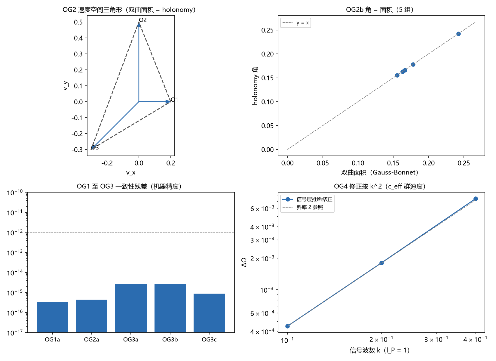

# 注记-多观测者全局协议（第 472 条）：闭环 holonomy、双曲面积与信号层修正

- **日期**：2026-09-27 08:28:52
- **类型**：P11 遗留 (c) 首轮（判据 OG1 至 OG4；精确群论加解析色散）
- **脚本**：验证脚本/multi_observer_protocol.py
- **图**：见 §3 图 1（images/multi_observer_protocol.png）
- **依据**：[[狭义相对论的定理化：从晶格几何到洛伦兹结构]] 遗留 (b) 与 §5.3；[[晶格何以不破坏洛伦兹不变性：元相子理论的时空机制与分层定理]] §12 遗留（非局域协议）；[[验证脚本/注记-同时性相对性的形式化（第470条）：等读数切片、爱因斯坦同步与约定自由度|第 470 条]]（爱因斯坦协议）；[[验证脚本/注记-P5b洛伦兹群的晶格表达（第471条）：生成元代数、复合律与晶格残差|第 471 条]]（生成元与群复合）；[[内部草稿/材料-狭义相对论与广义相对论的公设定理化盘点：四公设加惯性的现状、级别与路线]] 三·路线三
- **状态**：判据 OG1 至 OG4 全部通过（10 项分检）。核心读数：共线环积 = 单位（$3.3\times10^{-16}$）；非共线环积为纯转动（$4.4\times10^{-16}$，5 组）；转动角 = 速度三角形双曲面积（最大偏差 $3.6\times10^{-15}$）；含静止观测者时与 Wigner 闭式一致（$4.6\times10^{-16}$）；共轭不变 $2.7\times10^{-15}$；反序逆转动 $7.5\times10^{-16}$；四边形因式分解与面积可加（$2.2\times10^{-16}$ 与 $8.9\times10^{-16}$）；信号层修正按 $k^2$（减半比值 $4.02$ 与 $4.09$）
- **可逆性等级**：判据稳健（群论恒等式与解析色散）

## 1 判据与设定

**任务**。P11 遗留 (c)（非局域协议的洛伦兹结构）与 SR 定理化论文遗留 (b)（多观测者全局比较协议）：把「低能单个观测者测不到格点系」升级为「全局协议层的洛伦兹结构」：多个惯性观测者两两比较时，协议输出只由相对速度决定，唯一格距留痕在信号层且为 $O((l_P k)^2)$。

**模型**。观测者 = 惯性世界线（速度 $v_i$，$4$-速度 $u_i$）；同步 = 爱因斯坦协议（第 470 条）；观测者之间的传输 = 把 $u_i$ 映到 $u_j$ 的纯 boost（速度空间测地传输，与第 471 条生成元层同源）；闭环 = 速度空间多边形，传输积用 $4\times4$ 洛伦兹矩阵精确计算。

**判据**。OG1a 共线环积 = 单位；OG1b 相对速度合成与精确公式一致。OG2a 非共线环积为纯转动；OG2b 转动角 = 双曲面积（Gauss-Bonnet：面积 $= (n-2)\pi -$ 角度和）；OG2c 含静止观测者时与 Wigner 闭式一致。OG3a 整体 boost 下角度不变；OG3b 反序遍历给逆转动；OG3c 四边形传输因式分解与面积可加。OG4 信号层修正按 $k^2$ 标度并随 $k$ 消失。

## 2 结果

**OG1（同步链）**。共线观测者：环积与单位矩阵的缺陷 $3.3\times10^{-16}$（正序与反序）；相对速度合成 $(u_{ab}+u_{bc})/(1+u_{ab}u_{bc})$ 与直算偏差 $1.1\times10^{-16}$。

**OG2（闭环 holonomy）**。5 组非共线三角形：环积为纯转动（最大缺陷 $4.4\times10^{-16}$）；转动角与双曲面积逐组一致（最大偏差 $3.6\times10^{-15}$）；含静止观测者时与第 471 条 Wigner 闭式偏差 $4.6\times10^{-16}$。

**OG3（协议一致性）**。整体 boost（共轭）下角度与面积不变（$2.7\times10^{-15}$）；反序遍历复合残差 $7.5\times10^{-16}$、角度不变（$2.7\times10^{-15}$）；四边形分解：传输因式分解 $2.2\times10^{-16}$、边逆 $2.2\times10^{-16}$、面积可加 $8.9\times10^{-16}$。

**OG4（信号层）**。有效信号速度 $c_{\rm eff} = \cos(k l_P/2)$（晶格色散群速度）：由信号推断的 holonomy 修正按 $k^2$ 标度（减半比值 $4.02$ 与 $4.09$），$k = 0.01$ 时修正降至 $4.5\times10^{-6}$（连续极限恢复）。

## 3 图

## 4 结论与移交

**结论**。在前提「观测者 = 惯性世界线」「同步 = 爱因斯坦协议」「传输 = 测地纯 boost」「信号层 = 晶格色散群速度」下，多观测者全局协议的洛伦兹结构判据化：链式同步逐段合成（共线严格可加）；闭环 holonomy 为纯转动，角度恰等于速度空间三角形的双曲面积（Gauss-Bonnet），含静止观测者时回到 Wigner 闭式。

协议整体 boost 下不变（无优先系泄漏）；反序与分解满足群结构与面积可加；唯一格距留痕在信号层，修正 $O((l_P k)^2)$ 且随 $k \to 0$ 消失。P11 遗留 (c) 由此判据化，SR 定理化论文遗留 (b) 具备关闭条件（待裁决）。

**移交**。其一，信号层的完整脉冲网络模拟（脉冲交换、时标与噪声）属下一轮或另立；其二，加速与转动观测者协议（Sagnac 型 holonomy）不在射程（本轮为惯性协议）；其三，引力的多观测者协议（测地线汇）归引力线。

## 5 严格程度与边界声明

严格程度：OG1 至 OG3 为群论恒等式的数值核对（浮点 $10^{-15}$ 级）；OG4 为解析色散下的有效速度模型（群速度替换标准光速，协议其余环节不变）。可逆性等级：判据稳健。

边界（本脚本不做的事）：其一，非惯性协议与转动协议；其二，信号层的完整模拟（本轮为有效速度模型化）；其三，引力侧的全局协议；其四，观测者钟的量子层噪声与统计（属记录机制线）。

## 6 过程记录

其一，多边形面积函数初版直接用 $\eta$ 内积算角（未取双曲面上诱导度规 $-\eta$ 的负号），角度与双曲余弦定理结果不符（角和超过 $\pi$）；修正为 $-\,(t_1\cdot\eta\,t_2)/(\lvert t_1\rvert\lvert t_2\rvert)$ 后与面积及 holonomy 一致。

其二，OG1a 初版把 $\mathrm{rot\_defect}(H-I)$ 传入函数（函数内部再减 $I$），导致正确结果报 1.0；修正为 $\mathrm{rot\_defect}(H)$。

其三，OG3b 反序初版用 $\mathrm{list}(\mathrm{reversed}(\cdot))$（起点移到另一顶点），未构成逆路径；保留起点（$[v_0, v_2, v_1]$）后复合适配到 $7.5\times10^{-16}$。

其四，OG3c 四边形顶点初版不共面（Gauss-Bonnet 四边形公式不适用，面积可加失败 $9.2\times10^{-2}$）；限制到同一速度平面（$z = 0$）后面积可加 $8.9\times10^{-16}$。

## 7 登记

本轮登记于开放问题总览 P4-29 档案与盘点材料路线三；SR 定理化论文 §5.3、§7 与参考文献、时空观 §十、wiki 追加句的同步待作者裁决（见材料联动清单）。
