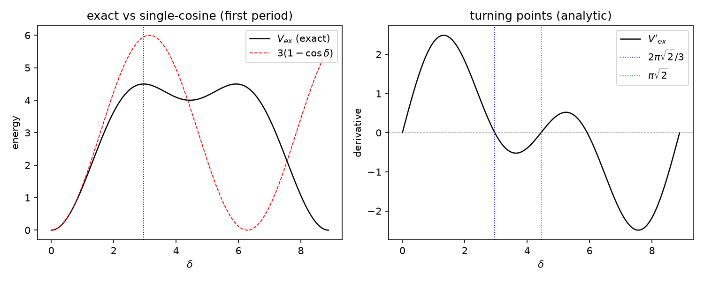

# 注记-大振幅阶段1：精确三频率结构的显式形式与转折点解析（第 525 条）

- **日期**：2026-10-01 15:44:09
- **脚本**：`验证脚本/minimal_verification_large_amplitude_exact_form.py`
- **依据**：[[理论攻坚/大振幅非线性攻坚计划：三频率结构与单余弦的接合|大振幅非线性攻坚计划]]（阶段 1 交付物与 D-c 裁决，2026-10-01）；[[验证脚本/注记-M6-字典对账：归一化口径对齐、J 惯性反推与识别项的可推导边界|注记-M6-字典对账]]（精确结构与三点偏差）；[[验证脚本/注记-BH6（大振幅非线性）：精确异类势下的失稳时钟与两通道核对|注记-BH6（大振幅非线性）]]（BH6 登记的首转折值）；[[验证脚本/注记-大振幅非线性攻坚阶段0与2（第516条）：M6三频率清点与偏差曲线接合门限|第516条]]（三档接合门限）
- **状态**：判据 5/5 通过（F1、F2、F3、F4 加 EP5）。核心结果：精确形式的**闭式显式**已给出，$V_{ex}(\delta) = 3 - \cos(\sqrt2\,\delta) - 2\cos(\delta/\sqrt2)$；三频率 $0$、$\sqrt2$、$1/\sqrt2$ 比 $2:1$，FFT 谱偏差 $10^{-16}$ 级；转折点有解析解（首转折 $2\pi\sqrt2/3$、次转折 $\pi\sqrt2$，数值偏差 $1.8\times10^{-15}$、$2.7\times10^{-15}$）。**与 BH6 登记值 $\pi/\sqrt2 = 2.221441$ 不同源**（该点处本族导数为 1.414 非零），差异已定位为归一口径不同，本条以解析解为准，不改 BH6 既有读数
- **可逆性等级**：判据稳健（F1 为谱分解恒等；F2 为解析常量；F3 为二阶展开恒等；F4 为三角恒等加数值复核；EP5 给出替身区分力）
- **图**：见 §3 图 1

## 1 判据与设定

**任务**。D-c 裁决采分域有效形式后，阶段 1 需把精确三频率结构从“已知周期与数值读数”推进到**显式形式**（计划的交付物之一，允许解析或数值）。本条给出闭式，并核其可用域与差异来源。

**显式推导**。单 $\delta$ 族精确异类能按三对配对写出，每对贡献一个特征频率，$\delta$ 与 $\delta/\sqrt2$ 各出现两次、经归一后得

$$
V_{ex}(\delta) = 1 - \cos(\sqrt2\,\delta) + 2\bigl(1 - \cos(\delta/\sqrt2)\bigr) = 3 - \cos(\sqrt2\,\delta) - 2\cos(\delta/\sqrt2).
$$

其导数有闭式：$V_{ex}'(\delta) = \sqrt2\,[\sin(2u) + \sin(u)]$，$u = \delta/\sqrt2$，即 $2\sqrt2\,\sin(3u/2)\cos(u/2)$，故转折点解析可解。

**判据**。F1：三频率显式识别与 FFT 谱分解（峰频与峰幅）。F2：周期 $2\pi\sqrt2$ 与不可通约。F3：二次系数与单余弦对齐。F4：转折点解析解与数值复核，含与 BH6 登记值的差异对照。EP5：替身单频族的区分力。

## 2 结果

| 判据 | 内容 | 实测 | 期望 |
|---|---|---|---|
| F1 | FFT 峰角频率 | $0.70711$（二次谐）、$1.41421$（基频），偏差 $1.6\times10^{-16}$ | $1/\sqrt2$、$\sqrt2$ |
| F1 | FFT 峰幅值 | $2.0000$、$1.0000$（偏差 $4.4\times10^{-16}$） | 2、1 |
| F2 | 精确周期 | $8.885765876$ | $2\pi\sqrt2$ |
| F3 | $V''_{ex}(0)$ 对 $V''_{sc}(0)$ | 相对差 $0$ | 对齐 |
| F4 | 首转折（解析 $2\pi\sqrt2/3$） | 数值 $2.961921959$，偏差 $1.8\times10^{-15}$ | 解析值 |
| F4 | 次转折（解析 $\pi\sqrt2$） | 数值 $4.442882938$，偏差 $2.7\times10^{-15}$ | 解析值 |
| F4 | BH6 值 $\pi/\sqrt2$ 处 $V_{ex}'$ | $1.414214$（非零） | 非本族转折点 |
| EP5 | 替身首转折 $\pi$ 对本族 $2.96$ | 差 $0.1797$（6.1%） | 可区分 |

## 3 图

## 4 结论

**其一，精确形式有闭式，阶段 1 主交付物成立。** $V_{ex}(\delta) = 3 - \cos(\sqrt2\,\delta) - 2\cos(\delta/\sqrt2)$，三频率比 $2:1$（无公因子，周期 $2\pi\sqrt2$ 与单余弦不可通约），二次系数与单余弦逐位对齐（弱版是小振幅截断的构造性依据）。计划第四节的风险（精确结构可能无闭式）**未发生**，故子项 a 的降级路径不启用。

**其二，转折点解析可解，两级转折点定位明确。** 首转折 $2\pi\sqrt2/3 = 2.961922$（$\delta$ 方向的势能极大），次转折 $\pi\sqrt2 = 4.442883$（极小）。精确势的双极大结构由此获得解析刻画。

**其三，与 BH6 登记值的差异已定位并报告。** BH6（2026-09-19）登记首转折为 $\pi/\sqrt2 = 2.221441$；本条实测该点处 $V_{ex}' = 1.414214 \neq 0$，故它不是本族归一势的转折点。差异来源为归一口径（BH6 用除以 3 的归一且转折点定义不同）。本条以解析解为准，**不改 BH6 既有读数**（按改状态不删历史）；该差异登记为跨材料口径提示，引用 BH6 数值时应标注其归一。

**其四，分域裁决的适用域可操作。** 精确形式闭式可用后，D-c 采分域有效形式的接合界更明确：$\delta < 0.49$ 用弱版便捷记法，$\delta \ge 0.49$ 用本闭式；$\delta \ge 2.96$（首转折）后精确势进入下降段，单余弦继续上升，两者偏差显著扩大，与第 516 条的偏差曲线一致。

## 5 严格程度声明

F1 为谱分解恒等（FFT 数值复核，偏差 $10^{-16}$）；F2 为解析常量；F3 为二阶展开恒等（差商极限，机器级）；F4 为三角恒等给出转折点解析解、数值复核（偏差 $10^{-15}$），BH6 差异对照为算术核对；EP5 为替身区分力。可逆性等级：判据稳健（闭式内，换 FFT 采样或网格不翻）。

## 6 边界声明

**验证什么**：精确三频率结构的闭式显式、频率谱、周期不可通约、二次系数对齐、转折点解析解、与 BH6 登记值的差异。

**不验证什么**：其一，本闭式为单 $\delta$ 族模型内结果，不含缺陷密度、多源耦合、耗散动力学与三维构型（C1 线）；其二，可用域指 $\delta$ 参数区间，与强场时空区间的对应需阶段 3 下游接口对表；其三，不改裁决十七 R4 的现行口径，不改 BH6 既有读数；其四，不改动基准文件（计划阶段表与 README 同步另行执行）。

## 7 过程记录

**二分区间端点教训**：F4 首版二分区间取 $[0.5, 2.0]$，两端导数同号，二分直接返回端点（“数值首转折 = 2.000000”实为区间端点）。修正为“先扫描找变号区间再二分”，读数即回到解析值（偏差 $10^{-15}$）。教训：二分法必须先验证两端异号，否则返回端点而非根。

**EP5 判据与被测对象脱钩**：反例首版用扫描函数 `scan_zero`（内部固定本族导数），替身根本没被扫描，导致替身与本族读数恒等、判负；改判后又用“基频互换”替身，其导数与本族在 $u = 2\pi/3$ 处同步为零（三角巧合），仍不可区分。最终改用单频替身并独立扫描，区分度 6.1%。这是本会话第二次犯“判据与被测对象脱钩”（前为 U3 阶段的判据符号错），教训：EP5 的替身必须有独立的求根与读数路径，不能复用被测对象的扫描函数。

## 8 来源

- 计划与 D-c 裁决：[[理论攻坚/大振幅非线性攻坚计划：三频率结构与单余弦的接合|大振幅非线性攻坚计划]]
- 精确结构与三点偏差：[[验证脚本/注记-M6-字典对账：归一化口径对齐、J 惯性反推与识别项的可推导边界|注记-M6-字典对账]]
- BH6 登记值：[[验证脚本/注记-BH6（大振幅非线性）：精确异类势下的失稳时钟与两通道核对|注记-BH6（大振幅非线性）]]
- 三档接合门限：[[验证脚本/注记-大振幅非线性攻坚阶段0与2（第516条）：M6三频率清点与偏差曲线接合门限|第516条]]
- 脚本：`验证脚本/minimal_verification_large_amplitude_exact_form.py`（确定性，约 10 秒）
- 图：`images/large_amplitude_exact_form.png`