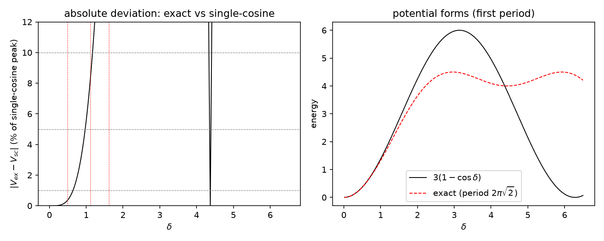

# 注记-大振幅非线性攻坚阶段 0 与阶段 2（第 516 条）：M6 三频率清点与偏差曲线接合门限

- **日期**：2026-09-30 23:14:35
- **脚本**：`验证脚本/minimal_verification_large_amplitude_deviation.py`
- **依据**：[[验证脚本/注记-M6-字典对账：归一化口径对齐、J 惯性反推与识别项的可推导边界|注记-M6-字典对账]]（三点偏差 4.0%、9.4%、14.3%，精确周期 $2\pi\sqrt2$）；[[验证脚本/注记-BH6（大振幅非线性）：精确异类势下的失稳时钟与两通道核对|注记-BH6（大振幅非线性）]]（BH6 首轮，$V_{ex}$ 归一形式与失稳时钟）；[[理论攻坚/大振幅非线性攻坚计划：三频率结构与单余弦的接合|大振幅非线性攻坚计划]]（阶段 0、2 交付物定义）
- **状态**：判据 5/5 通过（N1、N2、N3、N4 加 EP5）。核心读数：三点偏差逐位复现（4.03%、9.41%、14.33%，与登记 4.0%、9.4%、14.3% 一致）；周期比 $P_{ex}/P_{sc} = \sqrt2$ 精确（偏差 0），不可通约确认；接合门限：偏差达 1% 起于 $\delta = 0.493$、5% 起于 $1.120$、10% 起于 $1.625$；二次系数对齐相对差 0（弱版是精确形式的小振幅截断，构造性）
- **可逆性等级**：判据稳健（N1、N2、N4 为解析恒等与复现；N3 为阈值档扫描；EP5 给出替身区分力）
- **图**：见 §3 图 1

## 1 判据与设定

**任务**。大振幅非线性攻坚计划登记于 2026-09-27，阶段 0 为材料清点、阶段 2 为接合条件与偏差对照表。开工侦察发现 BH6 线（大振幅）已于 2026-09-19 至 09-20 执行三轮（README 第 162、169、185、188 条），覆盖失稳时钟、口径重设、超满偏稳定性与严格驻态族；缺口落在计划的两个文档级交付物：阶段 0 清点注记与阶段 2 偏差曲线表（登记只有三点，未成曲线）。

**设定**。单 $\delta$ 族精确异类能与单余弦弱版势：$V_{sc} = 3(1 - \cos\delta)$，$V_{ex} = [1 - \cos(\sqrt2\,\delta) + 2(1 - \cos(\delta/\sqrt2))]$（归一化使二次系数与 $3(1-\cos)$ 对齐，即 M6 与 BH6 共用形式），周期分别为 $2\pi$ 与 $2\pi\sqrt2$。

**判据**。N1：M6 三点偏差复现。N2：周期不格确认（$P_{ex}/P_{sc} = \sqrt2$ 无理）。N3：偏差曲线与接合门限（阈值档扫描 1%、5%、10% 的起算 $\delta$，单调性检查）。N4：二次系数对齐（弱版起点的构造性）。EP5：替身区分力（周期可通约的替身 $V_{alt} = 3(1-\cos 2\delta)$ 的偏差曲线与精确形式不同）。

## 2 结果

| 判据 | 内容 | 实测 | 期望 |
|---|---|---|---|
| N1 | 三点偏差 | 4.03%、9.41%、14.33% | 登记 4.0%、9.4%、14.3% |
| N2 | $P_{ex}/P_{sc}$ | 偏差 $0$（$\sqrt2$） | $\sqrt2$ |
| N3 | 偏差 1% 门限 | $\delta \ge 0.4932$ | 单调 |
| N3 | 偏差 5% / 10% 门限 | $\delta \ge 1.1198$ / $1.6254$ | 递增 |
| N4 | 二次系数相对差 | $0.000e+00$ | $\le 10^{-6}$ |
| EP5 | 替身偏差（$\delta = 1.625$） | 0.891 对精确 0.100 | 可区分 |

## 3 图

## 4 结论

**其一，阶段 0 清点闭合。** M6 三频率读数逐项复现：三点偏差、二次系数 $3/2$、精确周期 $2\pi\sqrt2$、$K/J = 6\pi\kappa_\phi t_P$ 字典链（引自 M6 注记，本条不复算）。清点确认：二次型层面可推导且已核，非线性层面不格，弱版是精确形式的小振幅截断（N4 给出构造性依据）。

**其二，阶段 2 的接合门限。** 偏差曲线给出三档门限：1% 起于 $\delta = 0.49$、5% 起于 $1.12$、10% 起于 $1.63$。按 1% 门限，弱版适用域为 $\delta < 0.49$；$1 \le \delta$ 档（M6 登记的 4% 至 14% 区间）已越出弱版 5% 以内，需用精确三频率形式。接合条件读法：$\delta$ 小于门限用弱版，超出用精确形式，中间档按用途的精度要求选。

**其三，计划状态更新。** 阶段 0 与阶段 2 的可做部分交付（本注记）。阶段 1（精确形式的显式化）与阶段 3（下游接口对表）需先定 D-c 形式选择（精确形式或分域有效形式）与认领方，裁决点 D-a、D-b、D-c 均属作者事项，本轮未动。三处裁决点呈报作者。

## 5 严格程度声明

N1 为登记值复现（解析比较）；N2 为解析恒等（无理数判定）；N3 为阈值档扫描（数值）；N4 为二阶展开恒等（差商极限，机器级）；EP5 为替身区分力检验。可逆性等级：判据稳健（换扫描密度或门限档不翻）。

## 6 边界声明

**验证什么**：M6 三点偏差的复现、周期不格、接合门限的三档阈值、弱版起点的构造性。

**不验证什么**：其一，不改裁决十七 R4 的现行口径（沿计划边界）；其二，阶段 1 的精确形式显式化与阶段 3 的下游接口对表未做；其三，不构造完整三维复合位错的非线性模型（C1 线）；其四，偏差曲线为模型内比较（单 $\delta$ 族归一形式），不含缺陷密度、多源耦合与耗散动力学；其五，不改动基准文件（计划状态同步另行执行）。

## 7 来源

- 三点偏差与周期：[[验证脚本/注记-M6-字典对账：归一化口径对齐、J 惯性反推与识别项的可推导边界|注记-M6-字典对账]]
- 精确势归一形式与失稳时钟：[[验证脚本/注记-BH6（大振幅非线性）：精确异类势下的失稳时钟与两通道核对|注记-BH6（大振幅非线性）]]
- 计划与阶段定义：[[理论攻坚/大振幅非线性攻坚计划：三频率结构与单余弦的接合|大振幅非线性攻坚计划]]
- 后续（2026-10-01）：阶段 1 显式化已交付闭式与转折点解析，见 [[验证脚本/注记-大振幅阶段1：精确三频率结构的显式形式与转折点解析（第525条）|第525条]]；D-c 分域有效形式裁决后适用域可操作
- 脚本：`验证脚本/minimal_verification_large_amplitude_deviation.py`（确定性，约 3 秒）
- 图：`images/large_amplitude_deviation_curve.png`
