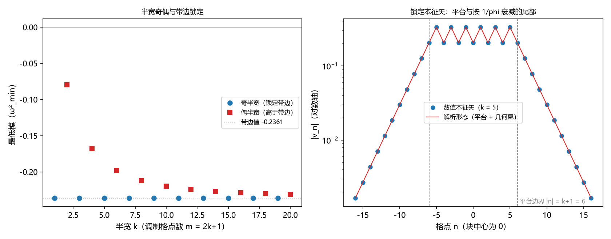

# 注记-奇偶分档的精确形态：带边锁定、显式本征矢与非锁定的匹配条件

- **日期**：2026-09-17 04:33:22
- **层级**：验证脚本/（理论验证材料，未确认）
- **脚本**：`验证脚本/minimal_verification_parity_banding.py`（系统 Python 3.13 + numpy 2.4.1 + matplotlib 3.11.0，确定性、无随机数，运行约 2 秒）
- **定位**：弱版方向一遗留项「耦合失稳奇偶分档的精确形态（一维）」的收口。把块族最低模对块宽的奇偶分档推成精确形态：奇半宽锁定在均匀带边值并给出显式本征矢；偶半宽由一条匹配条件刻画，$k = 2$ 档化为塑料常数的代数方程。判据 6 项全过。
- **关联**：[[验证脚本/注记-弱版方向一的最小验证：真实记录构型下的失稳量级与驻波门槛]]（问题来源与同源模型）；[[弱失稳与驻波门槛：记录与摆程耦合在真实记录构型下的量级]]（§3.2、§4.2 的「精确形态待分析」标注）；[[内部草稿/总结报告-黑洞线阶段总结：先行批次收官与裁决点全景：2026-09-16]] §2.4；开放问题总览 P1-34a
- **状态**：第一轮执行完成，判据 6 项全过。未提交作者裁决。
- **图**：`images/parity_banding.png`（两面板：半宽扫描与带边锁定、锁定本征矢的平台与几何尾；见 §三 图 1）
- **修订记录**：
  - **2026-09-17 初版**（作者指示：做奇偶分档小判据，收口弱版方向一的待分析项）
    - 六项判据（参数化澄清、带边锁定、显式本征矢、非锁定匹配条件、塑料常数特例、偏离报告）与图

---

## 一、验证目标与判据

弱版方向一的块族扫描发现：最低模对块宽非单调，且「奇半宽」档锁定在与均匀相同的值。论文与注记把该结构标为「精确形态待分析」，评审报告把「是否单列小判据」列为开放问题。本材料的任务是把该现象推成精确形态。判据（先立期望，再算）：

PB1 参数化澄清：旧材料的「块宽 $w$」中，$w$ 与 $w+1$ 生成同一构型（轮廓条件 $d \le (w-1)/2$ 的整数截断）；有效参数为调制格点数 $m = 2k+1$ 的半宽 $k$。期望：$w$ 取奇数时两个轮廓逐位相等。

PB2 带边锁定：$k$ 为奇数时，最低模精确等于均匀带边值 $2 - \sqrt{5}$（偏差 $\le 10^{-12}$）。

PB3 显式本征矢：锁定时本征矢为「平台加几何尾」的精确形态（见 §3.2）；期望：$Hv = \mu v$（相对残差 $\le 10^{-10}$），且与数值本征矢重叠 $\ge 1 - 10^{-12}$。

PB4 非锁定档：$k$ 为偶数时最低模严格高于带边值，且满足匹配条件（见 §3.3），残差 $\le 10^{-10}$。

PB5 代数特例：$k = 2$ 档的参数 $c$ 满足 $8c^3 - 2c - 1 = 0$（塑料常数的一半，残差 $\le 10^{-12}$）。

PB6 偏离报告：偶半宽偏离随 $k$ 的衰减（报告项，不设判据）。

## 二、模型设定

模型与弱版方向一同源：一维交错链、周期边界、$J = \lambda = 1$，$H_{nn} = 2J + \lambda(-1)^n h_n$、$H_{n,n\pm1} = J$，最低模取 $\omega^2_{\min}$。块构型 $h_n = 1$（$|n| \le k$）、其余为零，环上以 $n = 0$ 为中心对称；格距 $N = 256$。

均匀带边值：均匀构型的最低模为 $2 - \sqrt{5} \approx -0.236067977$，本征矢为交错模式，相邻两类格点的幅度比为 $-\phi$（$\phi = (1+\sqrt{5})/2$）。

分析用参数：记 $s = 2 - \mu$；块外衰减根 $\rho$ 满足 $\rho + 1/\rho = s$；块内 Bloch 参数 $q$ 满足 $\cos q = (s^2 - 3)/2$。

## 三、结果

### 3.1 参数化澄清（PB1）

轮廓条件 $d \le (w-1)/2$ 的整数截断使 $w$ 与 $w+1$ 落在同一格点集合上：$w = 1, 2$ 给 $1$ 格，$w = 3, 4$ 给 $3$ 格，依此类推（脚本读数：$w = 1$ 至 $12$ 的格点数为 $1, 1, 3, 3, 5, 5, \ldots$）。旧材料的「$w$ 与 $w+1$ 同值」由此澄清为参数化伪影；分档的真正参数是半宽 $k$。

### 3.2 带边锁定与显式本征矢（PB2、PB3）

定理：$k$ 为奇数时，块族最低模精确等于带边值 $2 - \sqrt{5}$，本征矢为

$$v_n = P\ (n\ \text{偶}),\quad v_n = -\phi P\ (n\ \text{奇}),\quad |n| \le k+1;$$

$$v_n = (-1)^{|n|-(k+1)}\, P\, \phi^{-(|n|-(k+1))},\quad |n| \ge k+1.$$

两式在 $|n| = k+1$ 处一致（$k$ 为奇数时该点为偶格点）。平台覆盖到块外一格，其外按每格 $-1/\phi$ 衰减。

推导四步。其一，块内方程：把偶格点序列记作 $a_{n'}$、奇格点序列记作 $b_{n'}$，块内两条方程给 $a$ 的线性解与 $b$ 由 $a$ 的表示，带边值处退化为常数解 $a = P$、$b = -\phi P$。

其二，中心条件：中心方程 $(3 - \mu)v_0 + 2v_1 = 0$ 排除线性项，把常数解固定为 $v_1/v_0 = -\phi$。

其三，界面条件：外侧首格方程给 $v_{k+1} = -v_k/\phi$；块内末格方程给 $v_{k-1} = v_k(-\phi - (-1)^k)$。把常数解代入，$k$ 为奇数时两式成为恒等式（用到 $\phi - 1 = 1/\phi$），$k$ 为偶数时要求 $-\phi = -\phi - 1$，矛盾。

其四，尾部延拓：外侧以 $\rho = 1/\phi$ 衰减，逐点代入即得尾部表达式。

数值验证：$k = 1, 3, \ldots, 15$ 的最低模与带边值最大偏差 $1.58\times10^{-15}$；解析矢相对残差最大 $2.76\times10^{-16}$、与数值本征矢重叠 $1 - 10^{-15}$；平台相邻幅度比 $1.61803398874989$ 对 $\phi$ 逐位一致。

### 3.3 非锁定档（PB4、PB5）

$k$ 为偶数时带边解不成立，最低模上移。匹配条件：以 $K = k/2$、$c = \cos q = (s^2-3)/2$、$\rho$ 为外侧衰减根、$T$ 为第一类切比雪夫多项式，

$$T_{K+1}(c) / T_K(c) = \rho^2 - \rho.$$

等价形式为 $a_{K+1}/a_K = \cos(q(K+1))/\cos(qK)$；其来源是中心条件（解为纯余弦，无正弦分量）与界面方程的联立。

数值验证：$k = 2$ 至 $16$ 的偶半宽档，偏离全为正（最小 $7.10\times10^{-3}$），匹配条件最大残差 $9.99\times10^{-13}$。

特例：$k = 2$ 时 $c = 0.662358978622$，$8c^3 - 2c - 1 = 6.7\times10^{-15}$，即 $c$ 为塑料常数的一半（塑料常数 $1.324717957$ 满足 $p^3 = p + 1$）。这是偶半宽档里唯一的低次代数情形。

### 3.4 偏离报告与图（PB6、图 1）

偶半宽偏离随 $k$ 单调减小，近似按 $1/k^2$：$k = 2$ 给 $0.156$、$k = 10$ 给 $0.0163$、$k = 40$ 给 $1.27\times10^{-3}$（乘积「偏离乘 $(k+1)^2$」从 $1.41$ 缓慢升到 $2.14$，未见精确常数）。

## 四、解读

其一，分档的机制是界面匹配的奇偶：块的两侧界面在 $k$ 为奇数时恰好把带边模式「接住」，斜率与衰减率自动匹配；$k$ 为偶数时该匹配缺一环，模式只能上移。评审中已证伪的「节点落在中心」一类归属叙述与此无关。

其二，锁定值是精确值而非近似值，这解释了旧读数中「与均匀同值」在四位小数以上的严格性；「非单调锯齿」的观感来自半宽奇偶与块宽配对的叠加。

其三，偶半宽档的偏离按 $1/k^2$ 型衰减，说明宽块在最低模意义上趋近均匀；带边值是一维块族的严格下确界（由锁定档取到）。

其四，与弱版方向一的衔接：块族的最小失稳宽 $w^* = 3$ 是存在性门槛，分档属同一族的结构细节；$1/r$ 漏斗的弱失稳读数（均匀幅度的 $1.40\%$）不受本材料影响。论文与注记中的「精确形态待分析」标注按本材料更新。

其五，一维限定：定理依赖链上模式的界面匹配，球对称三维下是否保留同型分档未知，属强场工具范围。

## 五、严格程度声明

本材料给出一条精确定理（奇半宽锁定，含显式本征矢）、一条匹配条件（偶半宽）与一项代数特例，全部经数值验证（容差见判据）。定理部分可由逐点代入直接证明。匹配条件未展开为封闭代数方程（$k = 2$ 档除外）。

## 六、诚实边界

其一，模型为一维交错链、$J = \lambda = 1$、周期边界、格距 $N = 256$；精确性陈述以「两端尾部不重叠」为前提（报告的 $k \le 40$ 档中，尾部在环对侧的贡献低于机器精度）。

其二，本材料不改变最小失稳宽、弱失稳量级等既有读数，只收口分档的精确形态。

其三，锁定档的「精确」指模型内的精确（带边值与显式本征矢），不构成黑洞语境的可观测量；三维含义待强场工具。

## 七、过程记录

其一，首轮探路发现带边锁定与「平台加几何尾」结构；随后用两分量（偶奇格点）形式推导出界面匹配的奇偶条件，得到上述定理与匹配条件；$k = 2$ 档的塑料常数关系由高精度求根与整数关系搜索（PSLQ）确认。

其二，早期把「$w$ 与 $w+1$ 同值」当作物理配对，实为轮廓定义的整数截断（PB1）。教训：参数化命名要先核对实际的格点集合。

其三，图注按绘图代码逐面板核对。

## 八、登记衔接

- `验证脚本/README.md` 第 85 条（本注记落盘时同步）。
- [[内部草稿/开放问题总览：元相子理论待解决问题清单]] P1-34a：待分析项更新为已完成并指向本材料。
- 论文《[[弱失稳与驻波门槛：记录与摆程耦合在真实记录构型下的量级]]》§3.2、§4.2 与验证注记《[[验证脚本/注记-弱版方向一的最小验证：真实记录构型下的失稳量级与驻波门槛]]》的「精确形态待分析」标注同步更新。