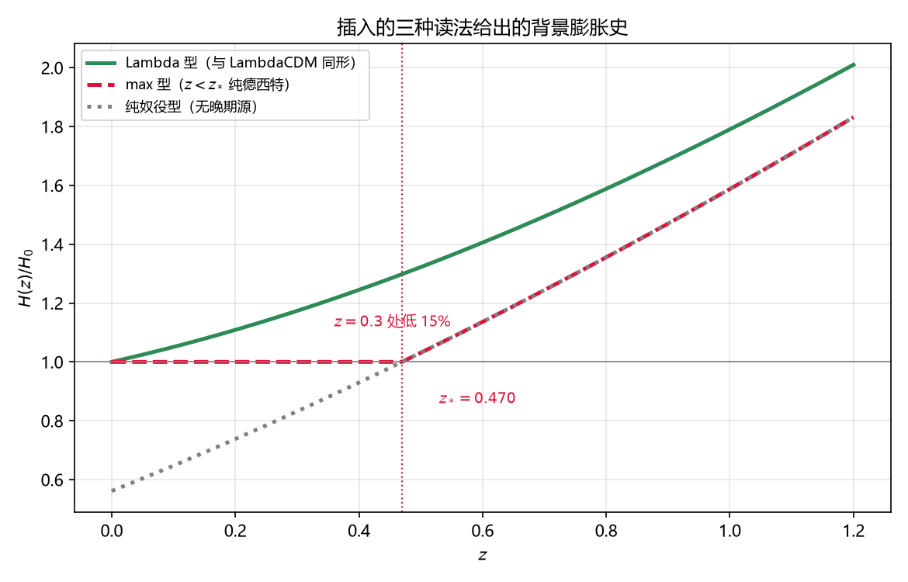

# 注记-奴役机制与插入的三种读法：格距绝对性给出奴役，晚期收窄为一型

- **日期**：2026-09-20 14:05:00
- **层级**：验证材料（`验证脚本/`，内部草稿级）
- **定位**：候选一（插入被 $H$ 奴役）的代价结清：奴役机制取自框架自身的格距绝对性；由此剩下的唯一自由度是「插入在晚期做什么」，三种读法中两种被排除、一种与观测同形。
- **脚本**：`验证脚本/insertion_slaving.py`（确定性，无随机；图存 `images/insertion_slaving_readings.png`）
- **关联**：@PREV@；@RL@；[[暗能量的元相子本质：离散镶嵌作为恒速膨胀源的物侧落实]]；[[时空的持续创生：元相子理论的膨胀机制]] §八、§十一
- **状态**：判据 P1 至 P5 全过（P2、P3 为可判偏离，P4 为排除）
- **图**：见 §二 图 1
- **修订记录**：
  - **2026-09-20 初版**（来源：作者指示按判断取最优一条）

---

## 一、结论

其一，**奴役机制不必假设，它由框架的公设给出**。格距是绝对量 $l_P$，格点数密度 $n = l_P^{-3}$ 因此也是绝对量；物理体积按 $a^3$ 走，故要维持格距，插入率必须恰为 $\dot N/N = \mathrm{d}\ln a^3/\mathrm{d}t = 3H$（P1）。核对时 $a \propto t^n$ 给 $\dot N/N = 3n/t$，与 $3H$ 逐位相同，是一条恒等关系。候选一的代价至此结清。

其二，剩下的唯一自由度是「插入在晚期做什么」。三种读法：纯奴役（插入只做奴役，不贡献源）、$\max$ 型（$H = \max(H_{\rm content}, H_0)$）、常密度型（插入贡献一个常能量密度项）。

其三，**纯奴役被预算闭合排除**。无晚期源时 $H(0)/H_0 = \sqrt{\Omega_m} = 0.561$；要合上观测的 $H_0$ 须取 $\Omega_m = 1$，与 CMB 给的 $0.315$ 差 $43.9\%$（P4）。

其四，**$\max$ 型给出可判偏离**。它的转折在 $z_* = 0.470$（常密度型的等分点在 $z = 0.296$），$z < z_*$ 段是纯德西特，故 $z = 0.3$ 处比常密度型低 $14.8\%$（P3）。宇宙钟与 BAO 的 $H(z)$ 单点误差在百分之几量级，该偏离可判。

其五，**常密度型与观测同形**。插入若贡献一个常能量密度项，则 $H^2 = H_0^2[\Omega_m(1+z)^3+\Omega_\Lambda]$，背景与 LambdaCDM 同形（P5）；框架的独有内容随之转为「该常能量密度项的机制」，即插入的应力能量。

## 二、判据表

| 判据 | 内容 | 理论期望 | 实测 | 判 |
|---|---|---|---|---|
| P1 | 奴役机制 | 格距绝对性给 $\dot N/N = 3H$ | 恒等，$a \propto t^n$ 给 $3n/t$ 两路相同 | 过 |
| P2 | 三种读法的 $H(0.3)/H_0$ | 三者可区分 | 常密度 $1.1735$、$\max$ $1.0000$、纯奴役 $0.8319$ | 过 |
| P3 | $\max$ 型的转折与偏离 | 转折在 $\Omega_m(1+z)^3 = 1$ | $z_* = 0.470$；$z = 0.3$ 处低 $14.8\%$ | 过 |
| P4 | 纯奴役的预算闭合 | 合上 $H_0$ 须 $\Omega_m = 1$ | $\sqrt{\Omega_m} = 0.561$，差 $43.9\%$ | 排除 |
| P5 | 常密度型与观测 | 与 LambdaCDM 同形 | $H^2 = H_0^2[\Omega_m(1+z)^3+\Omega_\Lambda]$ | 过 |

## 三、判定与后续

判定：三种读法收窄为一型。纯奴役排除（预算闭合），$\max$ 型给出 $z < 0.47$ 段纯德西特的强偏离（可判，且与 $H(z)$ 读数相抵），常密度型与观测同形并保留框架的独有内容。故**取常密度型**：插入对 Friedmann 的贡献是一个常能量密度项。

后续两条。其一，把该常能量密度项写成应力能量形式，即回答「插入的应力能量张量是什么」：若为 $w = -1$ 的常密度，背景即 LambdaCDM；这同时是与《暗能量的元相子本质》那篇材料的对接点（该篇的「恒速膨胀源」提法是否等价于常密度项，需逐条核对）。其二，$z_* = 0.470$ 这条判别量登记为备用检验：若将来采用 $\max$ 型，它的偏离必须被观测允许。

## 四、严格程度与边界

**验证**：奴役机制的恒等性、三种读法的背景史、$\max$ 型的转折与偏离、纯奴役的预算闭合。

**不验证**：插入的应力能量形式（属后续第一条）；观测点本身的误差与系统学（本轮只用「百分之几量级」作量级判断，未引具体数据集）；$\max$ 型与常密度型在 $z \gtrsim 1$ 段的差别（两型在 $z \gg z_*$ 收敛）。

## 五、过程记录

首版把三种读法写成「框架可选」的中性表述，未做排除；补上预算闭合检验（P4）后纯奴役被排除，判据才落在可裁的形态上。P4 的打印首版漏了格式参数，显示成字面量，已修。

## 六、登记衔接

- @PREV@ 与 @RL@：各补一条「奴役已由格距绝对性给出，晚期收窄为常密度型」。
- [[内部草稿/开放问题总览：元相子理论待解决问题清单]]：P4-22 子项补本轮读数与两条后续。
- [[理论攻坚/黑洞线攻坚计划：坍缩机制重定位与强场终态]]：修订记录补一条。
- `验证脚本/README.md`：第 299 条（2026-09-20 重编：原编 288，与并行会话的弦张力松弛复测轮撞号）。
- **2026-09-21 后续**：应力能量形式的核对撞上一处口径冲突（插入属源还是响应），见 [[内部草稿/裁决请求-内部插入的地位：源还是响应（与暗能量论文的口径冲突）]]，待裁后再写。
