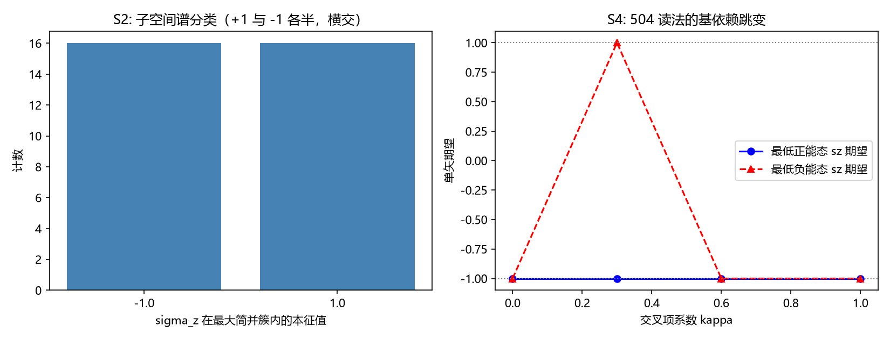

# 注记-子空间谱分类判据（第 506 条）：简并读数的三类合法判定与 504、505 更正清单

## 元数据

- **日期**：2026-09-30 08:01:38（取系统当前时刻）
- **脚本**：`验证脚本/minimal_verification_subspace_label.py`
- **判据**：S1 至 S4（6/6 通过）
- **可逆性等级**：S1、S3 判据稳健（对易结构与函数算符决定，与数值容差无关）；S2 判据稳健（子空间谱由简并簇的代数结构决定，跨乙、丙两口径复现）；S4 判据敏感（单矢读数依赖数值库基选取，本条正是要显示其不稳定）
- **类型**：方法判据轮（简并子空间读数的合法性判定），不含新物理断言
- **关联**：第 504 条（丙口径 J1 执行）、第 505 条（乙口径）、第 498 条（提取程序检验器）、第 502 条（J1 判据设计）、AGENTS.md《数值验证脚本规范》第 5 条
- **图**：见 §二 图 1

---

## 摘要

简并能量子空间内，单个本征矢上的算符期望是基依赖的污染量（EP3）。第 504 条据「最低正能态的 $\sigma_z$ 期望」判 J1 负，该读数落在 16 重以上的简并簇内，取值由数值库的基选取决定。据此判负不合法。

本注记给出替代判据：把待测算符投影到简并能量子空间，按投影算符的谱做三类判定，读数与基选取无关。判据在乙、丙两口径执行，6/6 通过。同时给出第 504、505 两条注记的更正清单，更正本身待作者裁决后由各线执行。

三项关键读数：乙、丙两口径的 $[\sigma_z,D]$ 残差为 $0.000\text{e}+00$，$\sigma_z$ 与 $D$ 对易（守恒）；$\sigma_z$ 在最大简并簇内的谱为 $+1$ 与 $-1$ 各半（丙口径 16 与 16，乙口径 32 与 32），判为横交类；正对照 $\operatorname{sign}(D)$ 在同一簇内谱单值，判为常数类。

## 一、模型设定

模型沿用第 504 条与第 505 条的算符约定。模态 2 分量乘时空 Dirac 4 分量乘格点 $N^2$（$N=20$），全矩阵 $8N^2 = 3200$ 维。

丙口径取

$$D_{\text{丙}} = \mathrm{blockdiag}(D_4,D_4) + \kappa\,(\sigma_z\otimes\Gamma_5), \qquad \kappa = 0.6,$$

乙口径取

$$D_{\text{乙}} = \sigma_z\otimes D_4, \qquad D_4 = \alpha_\theta c_\theta K_\theta + \alpha_h c_h K_h + \beta m_0,$$

其中 $K_\theta$ 反周期（$\pi$ 扭转口径）、$K_h$ 周期，$c_\theta = c_h = 1$，$m_0 = 0.5$。待测标签算符为 $\sigma_z$ 的 8 分量提升 $S_z = \sigma_z\otimes I_4\otimes I_{N^2}$。

## 二、判据与结果

### 判据规格

设 $D$ 的一个简并簇（重数 $m$）张成子空间 $\mathcal{V}$，$\Pi$ 为其正交投影，$A$ 为待测标签算符，记投影后的限制算符

$$M = \Pi\,A\,\Pi.$$

三类判定按下列顺序执行。先做对易检验：$\max|[A,D]|$ 非零则判 C 类。再做谱检验：$M$ 的本征值集合为单值判 A 类，含两个值判 B 类。再做非对角检验：$M$ 的非对角残余非零判 C 类。

| 类别 | 条件 | 含义 |
| --- | --- | --- |
| A 常数 | $[A,D]=0$ 且 $M$ 谱单值 | $A$ 在该子空间内固定。需再跨簇比较：跨簇取值不同才是真标签，取值相同则是解耦 |
| B 横交 | $[A,D]=0$ 且 $M$ 谱含两个值 | $A$ 在该子空间内不定，与能量符号横交，不能标记该能量支 |
| C 非守恒 | $[A,D]\ne 0$ 或 $M$ 非对角 | $A$ 与 $D$ 不对易，单矢期望无意义 |

A 类的两个子情形由跨簇取值区分：$\operatorname{sign}(D)$ 在正能簇取 $+1$、负能簇取 $-1$，属真标签；恒等算符的倍数在一切簇取同一值，属解耦。

### 读数

| 判据 | 对象 | 实测 | 结果 |
| --- | --- | --- | --- |
| S1-a | 丙口径 $[\sigma_z,D]$ | $0.000\text{e}+00$ | 对易，PASS |
| S1-b | 乙口径 $[\sigma_z,D]$ | $0.000\text{e}+00$ | 对易，PASS |
| S2-a | 丙口径 $\sigma_z$，最大簇 $E=-2.0336$ 重数 32 | 分类 B 横交，谱 $\{-1{:}16,\ +1{:}16\}$ | PASS |
| S2-b | 乙口径 $\sigma_z$，最大簇 $E=-1.4595$ 重数 64 | 分类 B 横交，谱 $\{-1{:}32,\ +1{:}32\}$ | PASS |
| S3 | 丙口径 $\operatorname{sign}(D)$，同一簇 | 分类 A 常数，谱 $\{-1{:}32\}$，跨簇取 $+1$ 与 $-1$ | PASS（真标签正对照） |
| S4 | 504 读法跨 $\kappa$ 档 | 最低负能态读数集合 $\{-1,\ +1\}$，最低正能态集合 $\{-1\}$ | PASS（污染演示） |

S2 给出判负的正确形式：$\sigma_z$ 与 $D$ 对易，它是守恒量，但在每个简并簇内取 $+1$ 与 $-1$ 各半，与能量符号横交。判负的理由是对易加横交，与反对易无关。

### 图 1

图注按脚本绘图面板逐条核对撰写，两面板经目视复核。

## 三、第 504、505 条更正清单

以下为逐条更正建议，不含正文改写。更正待作者裁决后由各线执行。

| 落点 | 现表述 | 更正为 | 依据 |
| --- | --- | --- | --- |
| 504 §一 预检 EP2 标签 | 交叉项对 $\sigma_z$ 与 $\Gamma_5$ 各自对易（$\kappa\ne 0$ 时二者非守恒） | 交叉项与 $\sigma_z$ 对易；$\sigma_z$ 与 $D$ 整体对易（守恒）。标签与结论自相矛盾 | 本注记 S1-a |
| 504 §二 J1-2 判据实现 | 读最低正能态与最低负能态的单矢期望，判「非守恒、期望被抹平」 | 改为子空间谱分类：$\sigma_z$ 在简并簇内谱取 $\pm1$ 各半，判横交类 | 本注记 S2-a |
| 504 §二 J1-4 判据 | 两档反对易子之差非零，判 $\sigma_z$ 被非守恒化 | 改用对易子判据；反对易子非零是对易算符的必然结构（$\{\sigma_z,D\}=2\sigma_zD$） | 本注记 S1-a、第 505 条预检 |
| 504 §三 判负后果 | 判负：$\sigma$ 场不供给手性来源 | 结论保留，性质改为「判否」：判据实现失效，重设判据后重跑 | 第 502 条判否与判负的分工 |
| 504 图 1 标题 | $\kappa>0$ 抹平 | 改为「单矢读数的基依赖」，并注明两组读数同为污染 | 本注记 S4 |
| 505 §一 预检 | $\{\sigma_z,D\}=1.00$（$\sigma$ 与 $D$ 反对易，乙口径的特征） | $[\sigma_z,D]=0$，$\sigma$ 与 $D$ 对易（守恒）；反对易子 $1.00$ 等于 $2\max\vert D_4\vert = 2m_0$ | 本注记 S1-b |
| 505 §三 对照表 | 乙：$\sigma$ 与 $D$ 反对易但两支同块 | 乙：$\sigma$ 与 $D$ 对易（守恒），两支同块（横交） | 本注记 S1-b、S2-b |
| 505 §三 机理段 | $\sigma$ 换手时 $D$ 变号 | $\sigma_z$ 与 $D$ 对易，$\sigma_z D\sigma_z = D$；「变号」指两块谱互为相反 | 本注记 S1-b |

第 505 条 Y1 的读数（$\sigma_z$ 守恒、谱上仅 $\pm1$ 各 1600、两支同块）本身合法，可保留；需改的是它的机理解释与预检表述。

并行线那份解释中「$\sigma$ 与 $D$ 反对易恰是不能标记的同义词」一段整体撤回。正确的二分法按对易性分两种情形，两种都不标记能量支：对易时 $\sigma_z$ 守恒但在簇内与能量符号横交；真正反对易时 $\sigma_z$ 在能量本征态上期望恒零。第 504、505 两口径都属前一种。

## 四、解数口径对齐（J1-1 与 J1-2）

第 504 条报 J1-1「去重 8 解」，本条核验报「32 组」，两个数不矛盾，属同一次穷举的两种计数口径。三种口径的计数如下。

| 计数口径 | 组数 | 说明 |
| --- | --- | --- |
| 不去重 | 32 | 16 个厄米 Dirac 单项式乘两个模态反对易元件（$\sigma_x$、$\sigma_y$） |
| 按 $\vert A\vert$ 去重（第 504 条口径） | 8 | $A$ 与 $-A$、$\pm iA$ 折叠为同一类 |
| 按单项式名去重 | 32 | 16 个厄米单项式每个只出现一次，此口径不去重 |

J1-1 的筛选力有限：$\{M_2,\sigma_z\}=0$ 对 $M_2=\sigma_x,\sigma_y$ 无条件成立，与 Dirac 因子 $A$ 无关，故 J1-1 实际只筛「$A$ 厄米」一条。32 组全部对合。

J1-2 按设计定义（存在对合 $A$ 使 $A D A^{-1} = -D$）的解数为 2，按 $\vert A\vert$ 去重后仍为 2，两类不合并。

| 判据口径 | 组数 | 解 |
| --- | --- | --- |
| 对合且 $A D A^{-1} = -D$ | 2 | $\sigma_x\otimes(\gamma^0\gamma^3)$、$\sigma_y\otimes(\gamma^0\gamma^3)$，残差 $0.000\text{e}+00$，对 $\kappa=0,0.3,0.6,1.0$ 四档全部成立 |

第 504 条记 J1-2 判负（零解），与本表差 2。差异来源是判据实现：504 未检验 $A D A^{-1} = -D$，而以单矢期望代替（见 §三更正清单第二条）。

须与 §二的横交读数并列理解。J1-2 成立只说明存在一个对合把 $\sigma_z$ 与 $D$ 的谱同时翻号，它不推出「$\sigma_z$ 标记能量支」。$\sigma_z$ 在每个能量子空间内仍取 $\pm1$ 各半，故 S2 判横交。J1-2 的形式化与「选支」的原题不等价，这本身是第 502 条判据设计的一处缺陷，须并入 §三更正清单第四条一起处置。

## 四、严格程度声明与边界声明

**严格层**：三类判定的定义与判定顺序；$\max|[\sigma_z,D]| = 0$（乙、丙两口径）；子空间谱 $\pm1$ 各半；$\operatorname{sign}(D)$ 在同一簇内谱单值且跨簇取两值；$\{\sigma_z,D\}$ 在乙口径等于 $2\max|D_4|$。

**判据级**：三类判定在乙、丙两口径的执行读数；S4 的跨档跳变。

**模型层输入**：乙、丙两口径的算符构造与 $N = 20$ 格点设定，沿用第 504、505 条，本条不改动。

**边界声明**：本条只判读数的合法性，不判 $\sigma$ 场是否有其他用途（第 505 条已给 $2\kappa$ 接口的宇称型角色），不判第 504 条的物理结论对错（结论方向保留，理由须替换），不改动 [[理论总纲]] 基准，不代改第 504、505 条正文。三类判定对「算符与 $D$ 对易或反对易」的两分覆盖完整；$\sigma$ 与动能项耦合（对易性依赖动量）的构造不在本条射程，属第 505 条登记的开放项。

## 五、登记衔接

本注记登记入 [[验证脚本/README]] 第 506 条。更正清单的落点在第 504、505 两条注记与 README 对应行，更正执行后各线在其修订记录补记。本条不占用第 504、505 的编号，不改动其判据编号。

## 修订记录

- **2026-09-30 初版**（子空间谱分类判据轮，判据 S1 至 S4，6/6）
    - 三类判定规格：对易检验、谱检验、非对角检验；A 类再分真标签与解耦两子情形
    - 读数：乙、丙两口径 $[\sigma_z,D]=0$；$\sigma_z$ 在最大简并簇内谱 $\pm1$ 各半，判横交类；$\operatorname{sign}(D)$ 正对照判常数类
    - 第 504、505 条更正清单八条，含「反对易」表述撤回与判否/判负分流
- **2026-09-30 解数口径对齐**（触发：作者指示对齐 J1-2 的解数差异）
    - 新增 §四：J1-1 三种计数口径为 32（不去重）、8（按 $\vert A\vert$ 去重，即第 504 条口径）、32（按单项式名）
    - J1-2 按设计定义解数为 2（$\sigma_x\otimes(\gamma^0\gamma^3)$ 与 $\sigma_y\otimes(\gamma^0\gamma^3)$），第 504 条记零解的差异归因于判据实现未检验 $A D A^{-1} = -D$
    - 更正清单补第 502 条 J1-2 形式化一条，说明其与「选支」不等价
| 502 §二 J1-2 定义 | 以「存在 $A$ 使 $A D A^{-1} = -D$」形式化「选支」 | 该形式化与「$\sigma_z$ 标记能量支」不等价，此条件下 $\sigma_z$ 仍可横交；选支的正确形式化为子空间谱分类 | 本注记 §二、§四 |
