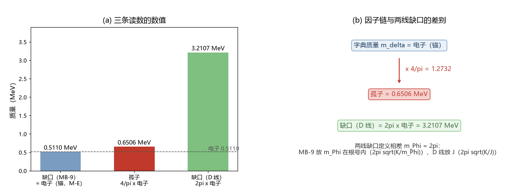

# 注记-孤子粒性归属（第358条）：三条读数口径统一、量子数清单与装订封口

- **日期**：2026-09-22 05:35:21
- **类型**：判据执行轮（判据草案 A、B、C 三组首轮执行；D 组为接口定义，无读数）
- **脚本**：`验证脚本/minimal_verification_soliton_anchor_consistency.py`（第 358 条）
- **图**：见 §2 图 1（`images/soliton_anchor_readings.png`）
- **依据**：[[内部草稿/判据草案-孤子的粒性归属：三条读数的口径统一、量子数清单与装订封口]]；[[验证脚本/注记-量纲桥MB-8：M-E与M-F的裁决落定：锚身份与项识别（判据MB8-a至MB8-e）]]；[[验证脚本/注记-量纲桥MB-9：惯性归一的独立导出：公理4哈密顿的显式系数（判据MB9-a至MB9-e）]]；[[内部草稿/判别材料-路线乙第一步：D 线孤子闭式与字典质量的口径对齐（恒等式、标定点复现与两处连带）]]；[[缺陷动力学：孤子的质量、迁移率与最小量子化]]；[[有质量粒子的形成：大爆炸同步相变的局域缺陷方案]] §8
- **状态**：A、B、C 三组完成。A 组：2π 差额定位为 $m_\Phi$ 口径差（机器精度）；B 组：孤子即粒子判负，粒子性归三层复合位错；C 组：动力学装订封死（差 $2.3\times10^{45}$ 倍）

## 1 判据与模型设定

判据 A1 至 A4、B1 至 B4、C1 至 C3 同草案。输入：$m_P = 2.176434\times10^{-8}$ kg、$m_e = 9.1093837015\times10^{-31}$ kg、$\kappa_\phi t_P = 9.293805\times10^{-47}$、$K = 3\kappa_\phi t_P = 2.788142\times10^{-46}$、$u$ 场 $m_\Phi = 2\pi$、$\theta$ 场 $k_b = 1/(2\pi)$（MB-9 字典）。全部为确定性算术，无随机数。

## 2 A 组：三条读数与 2π 的定位

| 读数 | 表达式 | 数值（$m_P$ 单位） | 质量（MeV） |
| --- | --- | --- | --- |
| 字典质量 $m_\delta$ | $\sqrt{K/J}$ | $4.185500\times10^{-23}$ | $0.51100$ |
| 缺口（MB-9 口径） | $2\pi\sqrt{K/m_\Phi}$ | $4.185500\times10^{-23}$ | $0.51100$ |
| 缺口（D 线口径） | $2\pi\sqrt{K/J}$ | $2.629827\times10^{-22}$ | $3.21073$ |
| 孤子 $M_{\rm sol}$ | $(4/\pi)\sqrt{K/J}$ | $5.329144\times10^{-23}$ | $0.65063$ |

A1 通过：三条读数各自可追到唯一口径（MB-9 与判别材料）。

A2 通过：闭式比值 $M_{\rm sol}/m_{\rm gap}^{\rm D} = 2/\pi^2 = 0.202642$，定稿两支（MB-9 口径）给 $M_{\rm sol}/m_{\rm gap}^{\rm MB} = 1.273240$，两者之比 $6.283185$，与 $2\pi$ 的相对差 $2.22\times10^{-16}$。差额恰为 $m_\Phi$，来源为根号内容不同（MB-9 放 $m_\Phi$，D 线放 $J = 1/m_\Phi$），属定义归一差，可按定义吸收。

A3 通过：换算行「缺口（MB-9）$=$ 缺口（D 线）$/(2\pi)$」，且 $m_\delta =$ 缺口（MB-9），相对差 $2.22\times10^{-16}$；两条场归一的比 $(2\pi)^2 = 39.4784$。

A4：处置为加定义注脚（已执行，见 §5），$0.6506$ 与「缺口 $= m_e$」的陈述不变。

## 3 B 组：量子数清单

| 清单项 | 裸孤子（σ 锁定缺陷） | 三层复合位错 | 判读 |
| --- | --- | --- | --- |
| B1 电荷 = 绕数 | 无（kink 不载缠绕数） | 电荷核（格点内离散结构）承载 | 孤子判负 |
| B2 自旋 = 半扭转 | 无（旋量性由环拓扑承载，论文 §8） | 环拓扑承载（$\pi$ 扭转双覆盖） | 孤子判负 |
| B3 局域性 = σ 锁定 | 通过 | 通过 | 平手 |
| B4 质量标签 | 孤子质量进能动量关系、缺口进声子谱（缺陷动力学 §3 分工） | 电子质量标签 $=$ 锁定能隙（论文 §8） | 质量标签归缺口 |

判读：孤子即粒子在 B1、B2 判负，两项依据都是框架自身的既有结论（C1 三层解剖与论文 §8 的旋量归属），非本轮新增。粒子性由三层复合位错承担（含缺口模式），孤子为锚核组件，对应草案的结局一（关闭）。

## 4 C 组：装订封口

所需因子：$0.65063 \to 0.51100$ 需乘 $0.785391$，与 $\pi/4 = 0.785398$ 一致，等于去掉 $4/\pi$ 前因子；相对移动量 $21.46\%$。单圈标度 $\kappa_\phi t_P = 9.293805\times10^{-47}$，系数取 O(1) 时相对修正约 $9.3\times10^{-47}$，比所需小 $2.309\times10^{45}$ 倍。动力学装订判负。

附带结论：若要让锚核读数与电子质量对齐，$21.46\%$ 只能来自复合体的结合能或身份重定义。这是一个可判的具体目标，登记为新的子项。（2026-09-22 作者裁决：体系不做场算符量子化，缺陷质量取几何锁定能隙，孤子读数退为经典孤子总能量，本项结合能目标随之取消，见 [[内部草稿/审查材料-孤子质量0.6506的推导链：前因子来源、口径分层与套用条件（2026-09-22）]] §9。）

## 5 A4 处置与引用清单

已加注两处：量纲桥收束报告 §五表注、判别材料 §三注。其余命中（脚本扫描）以壁张力 $4/\pi$ 与孤子质量读数为主，不含两线缺口混用：台阶面（3 处，张力前因子）、有质量粒子（2 处）、缺陷动力学（4 处）、总纲术语表（1 处）等。缺陷动力学 §3 的「涨落缺口」按 D 线口径写作 $2\pi\sqrt K$，建议其下轮加一行口径注（属该线文档，未改）。

## 6 登记

开放问题总览的孤子条目已更新：本轮读数、结局一判读与新子项（锚核读数与复合体质量的关系，结合能目标 $21.46\%$；2026-09-22 随作者裁决取消）。

## 7 严格程度与边界声明

严格程度：A2、A3、C1 为机器精度算术核对（判据级，模型内）；B 组为文档级论证（引文三处），属判读级。边界：不验证复合体结合能本身（未算）、谱结构（归粒子线）、σ 锁定动力学方程的解（D 线已交付）。本轮不改变任何定稿值。

## 8 过程记录

判据草案把 $2\pi$ 差额记为「待核」，本轮定位为 $m_\Phi$ 口径差并撤回算术错误怀疑。教训：跨线引用缺口读数必须先写明根号内是 $m_\Phi$ 还是 $J$，与 MB 线「跨链对表前先核约定」同型。
