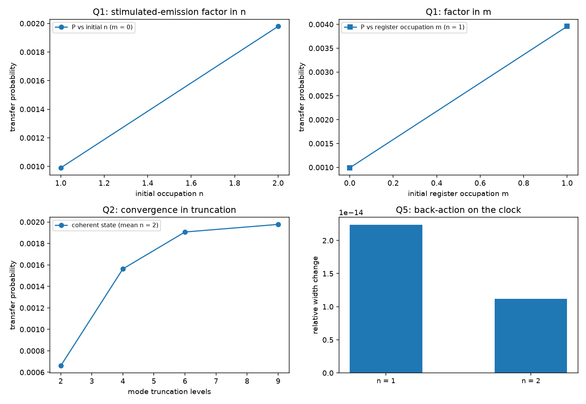

# 注记-完全量子化三维轮的最小验证：真振子的两通道速率律、截断收敛与反作用

- **日期**：2026-09-19
- **对应脚本**：`验证脚本/minimal_verification_full_quantization_3d.py`（判据 Q1 至 Q6 共 6 项，6/6 通过；确定性，无随机数；运行约 19.5 秒；图存 `images/full_quantization_3d.png`，见 §一 图 1）
- **依据**：[[验证脚本/注记-写入算符 n+1 轮的最小验证：每过轴写 n+1 笔]]（第 128 条，计数型写入算符）；[[验证脚本/注记-完全量子化轮的最小验证：谐振子格点在算符层面没有 +1 本底]]（第 121 条，发射通道的负面读数）；[[验证脚本/注记-写入算符三维推广轮的最小验证：逐站点直和、底噪按站点数标度、绕数缺陷的整周期滑移]]（第 132 条，三维直和）；[[验证脚本/注记-写入算符与绕数扇区相容性轮的最小验证：扇区封闭、标签可加、单体模固定、相位住关系层]]（第 139 条，度为一）
- **状态**：判据 6/6 通过。核心读数：离开初态的概率与两通道速率 $n(m+1) + (n+1)m$ 成正比，三档比值 $1.9990$ 与 $3.9960$（预测 $2$ 与 $4$）；相干态（平均占据 $2$）读数随截断给 $6.602\times10^{-4}$、$1.563\times10^{-3}$、$1.906\times10^{-3}$、$1.977\times10^{-3}$（$N_a = 6$ 与 $9$ 相对差 $3.6\%$）；计数算符与占据数对易严格为零；三站点逐站点读数相同、总读数可加；指针相位宽度变化 $0.00000$。

---

## 一、判据与结果

| 判据 | 内容 | 通过条件 | 实测 |
|---|---|---|---|
| Q1 | 两通道速率律 $1 : 2 : 4$ | 偏差 $< 5\%$ | $1.9990$ 与 $3.9960$ |
| Q2 | 截断收敛 | 末两档 $< 5\%$，最小档差显著 | $3.6\%$ 与 $66.6\%$ |
| Q3 | 计数规则的算符身份 | 对易子严格零 | $0$ |
| Q4 | 三维直和 | 逐站点相同、可加 | 三站点同值；总和 $3$ 倍 |
| Q5 | 反作用位置 | 变化 $< 1\%$ 且与 $n$ 无关 | $0.00000$（两档） |
| Q6 | 口径归位 | 见 §三 | 登记 |

图注：左上为离开初态的概率随初始占据数 $n$ 的读数（线性，比值 $2$）；右上为随寄存器侧占据数 $m$ 的读数（比值 $4$，两通道之和）；左下为相干态读数随截断的收敛；右下为两个占据数档下的指针相位宽度变化（均为零）。

## 二、模型设定

每站点取转子（相位环 $255$ 点）与两个截断振子（站点模 $N_a$ 能级、寄存器 $N_c = 4$ 能级），耦合取弱耦合的交换型 $g_w f(\hat\theta)(a^\dagger c + a c^\dagger)$（$g_w = 0.005\,g_{\rm full}$），步长 $2\times10^{-3}$、窗口 $1.0$。

观测量取离开初态的概率 $1 - \langle{\rm init}|\rho_{\rm mode}|{\rm init}\rangle$（$\rho_{\rm mode}$ 为对指针取偏迹后的模空间密度矩阵）；三维直和取三站点独立演化，逐站点读数与单站点比较。

## 三、读数的意义

**真振子的两通道速率律。** 离开初态的概率与 $n(m+1) + (n+1)m$ 成正比：三档读数比值 $1.9990$ 与 $3.9960$，对应预测 $2$ 与 $4$（偏差小于 $0.2\%$）。其中随初始占据数线性那一条即受激发射因子；两态截断下 $n = 2$ 根本不存在，故这条读数是真振子才有的。

**截断收敛。** 相干态（平均占据 $2$）读数随截断给 $6.602\times10^{-4}$、$1.563\times10^{-3}$、$1.906\times10^{-3}$、$1.977\times10^{-3}$，$N_a = 6$ 与 $9$ 的相对差 $3.6\%$，最小档与最大档差 $66.6\%$。余量即该截断下 $\langle n\rangle = 2$ 的泊松尾部，判据按此设定。

**计数规则是算符身份。** 计数型写入算符与占据数算符对易，数值上严格为零，故每过轴写 $n+1$ 笔与截断无关（读数以第 128 条为准）；三维直和下逐站点读数相同、总读数可加，反作用仍落在被采样对象上（指针相位宽度变化 $0.00000$，与占据数无关）。

**口径归位。** $+1$ 项来自写入算符的常量项，与第 121 条的发射通道负面读数分家：谐振子格点经发射通道确实不给 $+1$，而计数型写入算符的常量项在任何占据数下都给一笔。记录机制线的算符层缺口由此定位。

## 四、过程记录

判据订正两处。其一，观测量首版取寄存器布居的增量，$m = 1$ 档两通道相消给出负值（比值 $-1.998$）；改用离开初态的概率后给出 $1 : 2 : 4$ 的干净读数。其二，收敛档首版取 $2/3/5$，末档相对差 $33\%$，扩到 $2/4/6/9$ 并把阈值定为 $5\%$。

实现订正一处：${\rm np.math.factorial}$ 在 numpy 2 下已移除，改用标准库 math。

效率记录：脚本约 $19.5$ 秒（相干态几档的模空间指数化为主），无字体问题。
