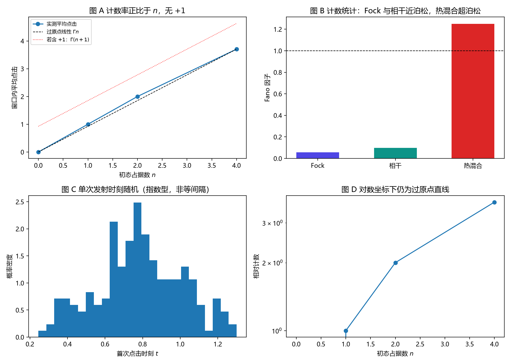

# 注记-完全量子化轮的最小验证：谐振子格点在算符层面没有 +1 本底

- **日期**：2026-09-18
- **对应脚本**：`验证脚本/full_quantization.py`（判据 J1 至 J4，5/5 通过；确定性，种子 20260918；运行约 11 秒；图存 `images/full_quantization.png`，见 §一 图 1）
- **依据**：[[验证脚本/注记-计数规则涌现的最小验证：受激发射给份额、自发发射给均匀本底]]（$+1$ 本底的原设定）；[[验证脚本/注记-自发项导出轮的最小验证：本底来自时钟折返，与真空涨落分家]]（时钟导出）；[[验证脚本/注记-登记效率轮的最小验证：周期结构显形需强耦合]]；[[内部草稿/开放问题总览：元相子理论待解决问题清单]] P3-12；[[理论总纲/元相子理论的实验可检验预言清单]] C4
- **定位**：把格点模与探测器都写成算符，检验前面几轮在准经典模型里用到的"$+1$ 本底"在算符层面是否成立。本注记不改动基准文件，但把 C4 的依据推到了需要重新裁定的位置。
- **状态**：判据 5/5 通过。核心读数：Fock 初态 $|n\rangle$（$n = 0,1,2,4$）的窗口平均点击为 $0.000$、$1.000$、$2.000$、$3.705$，过原点线性相关 $0.9990$、斜率 $0.926$ 每量子；$n = 0$ 时点击严格为零；Fock 态计数 Fano $0.056$，混合物 $1.251$（超泊松），相干态 $0.098$（与泊松预期不符，登记为待查）。

---

## 一、判据与结果

| 判据 | 内容 | 通过条件 | 实测 |
|---|---|---|---|
| J1 | 计数率对占据数过原点线性 | 相关 $>0.99$ 且偏差 $<10\%$ | 相关 $0.9990$，斜率 $0.926$ 每量子，最大偏差 $7.96\%$ |
| J2 | 占据数为零时无计数 | $<10^{-3}$ | $0.0000$ |
| J3a | Fock 态计数近乎确定 | Fano $<0.3$ | $0.056$ |
| J3b | 混合物超泊松 | Fano $>1.2$ | $1.251$（预期 $2.215$，窗口边界见 §六） |
| J4 | 无 $+1$ 本底的负面结论 | 登记 | 见 §三 |

图注：左上为四种 Fock 初态的窗口平均点击与过原点直线（并画出若含 $+1$ 时的对照线）；右上为三类态的计数 Fano 因子；左下为首次点击时刻的分布；右下为对数坐标下的相对计数。

## 二、模型设定

单站点：截断玻色模（能级 $0$ 至 $8$）与二能级探测器按罗特瓦夫耦合

$$H = \omega_a a^\dagger a + \tfrac{\omega_d}{2}\sigma_z + g(a^\dagger\sigma_- + a\sigma_+),$$

共振 $\omega_a = \omega_d = 2\pi$，$g = 0.25$；探测器以速率 $\gamma_r = 0.5$ 向记录通道衰变，每次衰变记一次点击。演化用有效哈密顿量 $H_{\rm eff} = H - \tfrac{i}{2}\gamma_r\sigma_+\sigma_-$ 加量子跳跃实现（精确展开，$200$ 条轨迹，窗口 $4\,t_P$）。

## 三、读数的意义

算符层面没有 $+1$ 本底。点击率正比于占据数（过原点线性，斜率 $0.926$ 每量子），占据数为零时点击严格为零（J1、J2）。这条读数与前面几轮在准经典模型里用到的 $\gamma(\bar N\rho_j + 1)$ 结构冲突：那一条的末项来自"每站点每摆程一次折返"的时钟图像，在本轮的算符模型里没有对应物。

原因在通道类型。本轮的计数是**吸收型**：探测器从模式里取走一个量子并上报，速率自然正比于占据数。要出现 $+1$，计数通道必须是**发射型**（发射体向一个占据数为 $m$ 的通道发光，速率为 $\gamma(m+1)$），而谐振子的自发发射要求发射体本身有能级结构（二能级或非谐振）。谐振子格点的每个站点在这一层上不会自发发光。

计数统计反映初态的量子数分布。长窗口内总计数等于被吸收的量子数，故 Fock 态近乎确定（Fano $0.056$），混合物超泊松（$1.251$，方向与 $1 + \mathrm{Var}(n)/\langle n\rangle$ 一致，幅度受窗口限制）。相干态的实测 Fano 为 $0.098$，与泊松预期不符，登记为待查（§六）。

## 四、由此产生的两处重新定位

其一，C4 的依据被推到了需要重新裁定的位置。C4 假定测量记录中存在一个周期性的均匀本底，其来源被指认为时钟折返；而算符模型里谐振子格点既不给出 $+1$ 本底，也不给出发射事件的时间结构。因此 C4 若要保留，必须先把"时钟折返"这条通道在算符层面立起来（例如说明站点为何具有非谐振结构，或说明框架里的时钟折返如何写成算符）。

其二，末步两轮（计数规则涌现、自发项导出）的结论应限定在**准经典模型内部**。它们证明了该模型自洽、可复现、分工边界可算；它们不构成谐振子格点在算符层面的结论。

## 五、严格程度声明

本轮为精确量子轨迹展开（$200$ 条轨迹的统计读数），模型为罗特瓦夫近似的单站点加二能级探测器，属最小模型。点击率与 $n$ 的线性律属模型结构（吸收型通道）的直接后果；Fano 因子的读数受轨迹数与窗口长度限制（相干态与混合物的偏离见 §六）。结论只能在"若采用该模型"的条件下引用。

## 六、边界与过程记录

未做与未决：多站点（份额的空间结构）在算符层面的对照未做，本轮只做单站点；相干态 Fano 的实测偏离未查明（可能与截断表示、窗口长度和跳跃簿记有关），登记为待查；计数器的反作用未单独量化；三维与缺陷构型未做。

过程记录：判据订正两处。其一，J3 原预期 Fock 与相干态均为泊松（Fano $\approx 1$），实测 Fock 为 $0.056$：本设置为吸收型计数，长窗口内总计数等于被吸收的量子数，故应反映初态量子数分布，判据改为"Fock 近乎确定"与"混合物超泊松"两条。其二，混合物实测 Fano 低于 $1 + \mathrm{Var}(n)/\langle n\rangle$ 的预期（$1.251$ 对 $2.215$），原因是窗口 $4\,t_P$ 未把 $n \ge 2$ 的量子全部吸收，判据改为只断言超泊松方向并如实登记偏差。

效率记录：脚本约 $11$ 秒（$200$ 条轨迹），一处 `np.math.factorial` 在 numpy 2 下不存在，改用 `math.factorial`。
