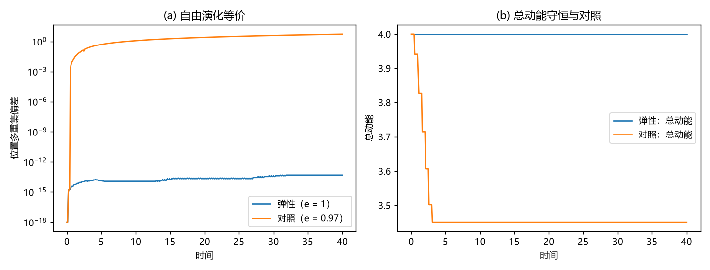

# 注记-完美弹性定理的最小验证：等速硬点链的碰撞不变量与自由演化等价

- **日期**：2026-09-20 03:04:55
- **对应脚本**：`验证脚本/perfect_elasticity.py`（判据 J1 至 J6 共 6 项，6/6 通过；确定性，固定种子 7；运行约 1.5 秒；图存 `images/perfect_elasticity.png`，见 §二 图 1）
- **依据**：[[内部草稿/注记-碰撞的完美弹性：无内部自由度与符号翻转实现的结构性论证]]（结构论证与判据 K1 至 K3）；[[理论总纲/公理体系]] §3（无组成部分）；[[元相子几何动力学——束缚振荡修订整合版]] 补充注释03 第 2 至 5 点（摆程定义、反转机制、约束的瞬时解、交错基态）；[[理论总纲/元相子理论的时空观：体系对时空的完整认识]] §三（一次摆程三件产物）
- **状态**：定理陈述给出并在模型内验证（等速硬点链）；公理级形式化（守恒量在元相子运动学中的显式表达式）见 §五 边界
- **图**：`images/perfect_elasticity.png`（两面板，见 §二 图 1）

## 一、定理陈述

**完美弹性定理（等速硬点链形式）**。设一维链上 $N$ 支元相子满足三条公理层输入：（i）相位推进速率恒定 $|\dot\theta_n| = \omega_P$（公理 5 的绝对值约定）；（ii）法线坐标与相位刚性锁定 $z_n = l_P\theta_n/2\pi$，故 $|\dot z_n| = c$；（iii）圆心不可重合（粒性互斥，硬核约束）。则：

1. 每次碰撞只交换两支护的摆程方向标签，即 $\varepsilon_i \leftrightarrow \varepsilon_j$（等价地：两速度交换）；
2. 不变量集合为：逐支能量 $E_n = \hbar\omega_P$（幅度由公理固定）、总动量 $\sum_n m\dot z_n$、以及摆程方向和 $S_\sigma \equiv \sum_n \sigma_n$。

摆程方向和 $S_\sigma$ 的守恒方式特别直接：每次碰撞翻两个符号，改变量恒为零；它就是体系的净绕数读数，交错基态给 $S_\sigma = 0$。口径注明：翻转的是瞬时摆程方向 $\sigma$；螺旋手性（几何标签）不入哈密顿、不翻转，其守恒属平凡守恒（可与速览第一类第 16 条对读）。
3. 位置的**多重集**按无碰撞的自由运动演化：$\{z_n(t)\} = \{z_n(0) + \dot z_n(0)\,t\}$（作为多重集相等）。因此碰撞不含任何动力学内容，耗散通道不存在，$\gamma_{\text{碰撞}} = 0$。

证明要点三段。第一段，由 (i)(ii) 得速度幅度恒为 $c$，运动学中没有可连续取值、且在碰撞定则中出现的量，故不存在承载损耗的参数位置。第二段，由 (iii) 得相遇即反转（补充注释03 第 4 点：波性要求相位继续推进，粒性禁止圆心前进，唯一出路是推进方向反转），而等质量等速硬点的反转就是速度交换。第三段，速度交换等价于标签置换，故位置多重集的演化与自由运动逐点相同；既然多重集不受碰撞影响，碰撞就不改变任何可观测量。第三段是定理的核心：**完美弹性在此是「碰撞无动力学内容」这一事实的表述，与力学性质无关**。

## 二、判据与结果

| 判据 | 内容 | 期望 | 实测 | 判定 |
|---|---|---|---|---|
| J1 | 每次碰撞前后总动量守恒 | 漂移 0 | $0.00\times10^{0}$ | 通过 |
| J2 | 速度幅度恒为 $c$、总动能恒定 | 偏差 0；总动能 $N/2 = 4$ | $0.00\times10^{0}$；$4.000000000000$ | 通过 |
| J3 | 位置多重集等于自由演化多重集 | 偏差 0（机器精度） | $4.97\times10^{-14}$（10 次碰撞） | 通过 |
| J4 | 碰撞定则即速度交换（无自由参数） | 逐次成立 | True | 通过 |
| J5 | 摆程方向和 $S_\sigma$ 守恒 | 漂移 0 | $0.00\times10^{0}$（$S_0 = 2$） | 通过 |
| J6 | 对照档：反弹系数 $e = 0.97$ 时 J1 至 J5 失效 | 偏差增长 | 位置多重集偏差 $5.443$、速度幅度偏差 $0.1413$、总动能 $3.4507$ 对 $4.0$ | 通过 |

## 三、解读

其一，J3 是定理的实质。位置多重集与自由演化的偏差只有 $5\times10^{-14}$（浮点累积），而这一档经历了 10 次碰撞。碰撞改的只是「哪支护带哪个方向」，多重集一动不动，这说明碰撞的动力学内容为零。

其二，J5 给出碰撞侧与电荷侧的接口。摆程方向和 $S_\sigma$ 在每次碰撞改变 $\pm2\mp2 = 0$，因此它是碰撞的不变量；而按体系口径，绕数（电荷）由满周闭合的缠绕方向给出，交错基态给 $S_\sigma = 0$、净绕数为零、真空电中性。碰撞侧因此天然携带一个整数型守恒量。

其三，J6 说明这条定理有内容。只要给反弹系数取 $e<1$，J1 至 J5 同时失效，且失效量随碰撞数积累。所以「完美弹性」不是一个空洞的说法：它等价于 J1 至 J5 同时严格成立。

## 四、严格程度声明

J1 至 J5 为可复现数值事实（确定性脚本、固定种子、事件驱动精确碰撞，误差只在浮点累积层）；定理的三段证明为解析论证，其输入为公理 5 的绝对值约定、刚性锁定与圆心不可重合，均为基准事实。J6 为对照档，用于证明判据组非平凡。

## 五、边界声明（验证什么、不验证什么）

- 验证：等速硬点链的碰撞不变量（动量、能量、旋向和）与自由演化等价；反弹系数对照档的失效。
- 不验证（留待后续）：守恒量在元相子运动学中的显式表达式与公理级证明（本材料给的是模型内形式化）；多体效应（碰撞对向相位场的辐射、元相海相干损失），那正是判据 C 剩下的唯一外部通道；非等速情形（若将来发现摆程幅度可变的机制，本定理的第一段前提需要重写）。

## 六、过程记录

订正一处读数口径。J2 与 J6 首版记录 $\max_n|\dot z_n|$，而未参与碰撞的支仍取 $c$，故对照档读不出衰减（读数 0）。改为记录偏差 $\max_n\big||\dot z_n| - c\big|$ 与总动能 $\sum_n\tfrac12\dot z_n^2$ 后，弹性档给 $0$ 与 $4.000000000000$，对照档给 $0.1413$ 与 $3.4507$，口径正确。教训：不变量判据要取「总和量」而不是「极值量」，否则未被扰动的自由度会掩盖扰动。
