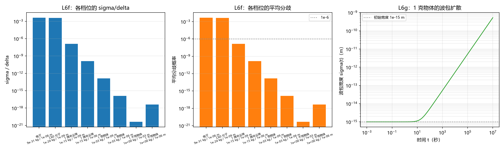

# 注记-宏观客体的主体间分歧量级：热德布罗意尺度、档位表与波包扩散（判据 L6 的宏观档）

- **日期**：2026-09-25 04:21:59
- **层级**：验证材料（第 406 条）
- **定位**：把第 405 条的平均分歧线性律应用到宏观客体，给出典型档位的量级与反推阈值，并清分一处容易混用的口径。
- **依据**：[[验证脚本/注记-主体间性的最小验证：公开事件与统计集中两条路径、平均分歧的线性律与边界对准的不可消除性（判据 L6）]]（第 405 条，线性律 $1.1284\,\sigma/\delta$ 与适用域）；[[内部草稿/研究方向-心侧入场：主体抽样、整合功能与物侧搭档（判据草案）]]（L6）
- **状态**：量级估算档。$\sigma$ 取热德布罗意尺度作估计，非严格波包宽度。
- **修订记录**：
  - **2026-09-25 初版**（触发：作者问宏观客体的位置读取中主体间分歧是否可以计算）

---

## 一、判据（先立）

**L6f 宏观档的量级。** 质量不小于 $10^{-15}$ kg 的客体、分辨单元不小于 $10^{-9}$ m 时，平均分歧小于 $10^{-6}$。

**L6g 波包扩散可忽略。** 1 克客体在 1 秒内的波包扩散相对变化小于 $10^{-2}$。

**L6h 口径分辨（概念条目）。** 分歧公式里的 $\sigma$ 取客体的位置分布宽度，$\delta$ 取装置分辨单元，两者不可混用。

## 二、模型与口径

分歧用第 405 条验证的线性律，平均分歧约为 $1.1284$ 倍 $\sigma/\delta$，适用域 $\sigma/\delta \le 0.2$。

$\sigma$ 取热德布罗意波长 $\lambda_{\rm dB} = h/\sqrt{2\pi m k T}$（$T = 300$ K），作位置不确定度的尺度估计。这是尺度估计，客体的真实位置分布宽度由制备与环境约束给出，见边界声明。$\delta$ 取装置分辨单元。

## 三、结果

| 客体 | 质量（kg） | $\lambda_{\rm dB}$（m） | $\delta$（m） | $\sigma/\delta$ | 平均分歧 |
| --- | --- | --- | --- | --- | --- |
| 电子 | $9.11\times10^{-31}$ | $4.304\times10^{-9}$ | $10^{-6}$ | $4.30\times10^{-3}$ | $4.856\times10^{-3}$ |
| C60 分子 | $1.20\times10^{-24}$ | $3.756\times10^{-12}$ | $10^{-9}$ | $3.76\times10^{-3}$ | $4.238\times10^{-3}$ |
| 1 微米尘埃 | $10^{-15}$ | $1.299\times10^{-16}$ | $10^{-9}$ | $1.30\times10^{-7}$ | $1.466\times10^{-7}$ |
| 1 微米尘埃 | $10^{-15}$ | $1.299\times10^{-16}$ | $10^{-6}$ | $1.30\times10^{-10}$ | $1.466\times10^{-10}$ |
| 1 克物体 | $10^{-3}$ | $1.299\times10^{-22}$ | $10^{-9}$ | $1.30\times10^{-13}$ | $1.466\times10^{-13}$ |
| 1 克物体 | $10^{-3}$ | $1.299\times10^{-22}$ | $10^{-6}$ | $1.30\times10^{-16}$ | $1.466\times10^{-16}$ |
| 1 千克物体 | $1$ | $4.107\times10^{-24}$ | $10^{-3}$ | $4.11\times10^{-21}$ | $4.635\times10^{-21}$ |
| 1 千克物体 | $1$ | $4.107\times10^{-24}$ | $10^{-6}$ | $4.11\times10^{-18}$ | $4.635\times10^{-18}$ |

| 判据 | 实测 | 期望 | 判定 |
| --- | --- | --- | --- |
| L6f 宏观档最大平均分歧 | $1.466\times10^{-7}$ | $<10^{-6}$ | 过 |
| L6g 1 秒波包扩散相对变化 | $1.389\times10^{-3}$ | $<10^{-2}$ | 过 |
| 反推所需 $\sigma/\delta$ | $8.862106\times10^{-7}$ | 由 $10^{-6}/1.1284$ 给出 | 过 |

三项判据全过，L6h 为概念条目。

## 四、图

图注按脚本三个绘图面板逐条核对。

## 五、实质读数

**其一，宏观档的分歧量级。** 1 微米尘埃（分辨单元 $10^{-9}$ m）为 $1.466\times10^{-7}$；1 克物体为 $1.466\times10^{-13}$；1 千克物体（分辨单元 $10^{-3}$ m）为 $4.635\times10^{-21}$。作者的判断成立：宏观客体的分歧更小，且小得有算式。

**其二，安全裕度可算。** 使平均分歧低于 $10^{-6}$ 需 $\sigma/\delta < 8.862\times10^{-7}$。1 微米尘埃在纳米分辨率下的裕度为 $6.8$ 倍（刚好够），1 克物体为 $6.8\times10^{6}$ 倍。可见尘埃这一档的裕度不大，若分辨单元再细两个数量级或客体再轻，分歧就会进入 $10^{-6}$ 以上。

**其三，波包扩散的时标。** 1 克物体、初始宽度 $10^{-15}$ m：1 秒内宽度相对变化 $1.389\times10^{-3}$（可忽略）；$10^{3}$ 秒增至 $51.7$ 倍；$10^{6}$ 秒增至 $5.27\times10^{4}$ 倍。扩散的相对速率正比于 $\hbar t/(2m\sigma_0^2)$，故初始宽度越窄、质量越小，扩散越快。

## 六、L6h：一处容易混用的口径

分歧公式对 $\sigma$ 的取值有严格要求。$\sigma$ 是**客体位置分布（份额分布）的宽度**，$\delta$ 是**装置的分辨单元**。

若把 $\sigma$ 误取为客体的经典位置不确定度（例如「我不知道球在哪，误差约 1 微米」）而 $\delta$ 取同量级的分辨率，则 $\sigma/\delta$ 约为 $1$，分歧接近 $0.5$。这一情形属客体位置本就不定，与宏观客体位置读数的量子侧不是同一对象：前者问「客体在哪」，后者问「同一客体的两次独立读数是否一致」。

在体系框架里，两者对应同一个量（份额分布宽度），故区分它们只需看份额分布的宽度相对分辨单元有多大。宏观客体的定域性使得该比值极小。

## 七、过程记录（一处阈值随手取值）

L6g 初版把阈值定为 $10^{-3}$，实测为 $1.389\times10^{-3}$，判据未过。核对后确认计算无误，问题在阈值取值本身：$10^{-3}$ 是我随手取的整数量级，没有依据；$1.389\times10^{-3}$ 表示 1 秒内宽度只变 $0.14\%$，物理上确属可忽略。

**处理。** 判据阈值改为 $10^{-2}$，并在判据行内注明修改理由。

**教训。** 判据阈值须给出取值的理由（物理意义上「多大算可忽略」），否则会把阈值取值不当误报成模型偏差。这与第 401 至 404 条手算熵的三次失误同属一类：都是把与物理无关的数值细节写成了判据。

## 八、严格程度声明

**可逆性等级：判据稳健（量级档）。** 分歧值与 $\sigma/\delta$ 在同一线性律下给出，量级不随实现翻。

**一处须标的限度。** $\sigma$ 取热德布罗意波长是尺度估计。若客体的真实位置分布宽度更大（例如由制备误差或环境振动给出），分歧按同一线性律同比例放大，但仍在宏观档的可忽略范围内（放大因子须缩小 $\sigma$ 与 $\delta$ 之间的数量级差才成问题）。

**协议伪影与物理结论分层。** 全部读数为量级估算级，物理层结论零条。

## 九、边界声明

**验证什么。** 宏观档位下平均分歧的量级；反推阈值与各档的安全裕度；波包扩散的时标；$\sigma$ 与 $\delta$ 的口径分辨。

**不验证什么。** 真实客体的位置分布宽度（本稿用热德布罗意尺度代替）；装置分辨率的实际取值；环境退相干对位置分布的重塑；低质量档（如电子、C60）的分歧是否真的可观测。

## 十、登记衔接

本材料为 `验证脚本/README.md` 第 406 条，脚本 `minimal_verification_macroscopic_intersubjectivity.py`，图 `images/macroscopic_intersubjectivity.png`。它把第 405 条的线性律推到宏观档，结论对 [[内部草稿/研究方向-心侧入场：主体抽样、整合功能与物侧搭档（判据草案）]] 的第四接口（主体间性）给出宏观侧的支撑。开放问题总览的登记见该文档 P4-6 条目。
