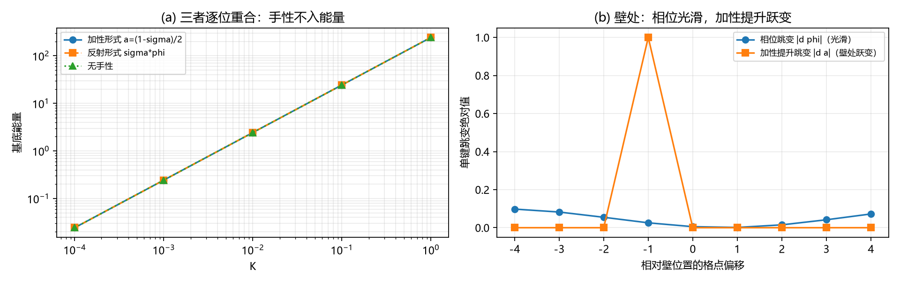

# 注记-定义性联结的公理层显式形式（第 487 条）：手性不入哈密顿量与反射形式的唯一性

## 元数据

- **日期**：2026-09-29 11:06:50
- **脚本**：验证脚本/handedness_linkage_axioms.py
- **判据**：AX1 至 AX4（4/4 通过）
- **可逆性等级**：AX1 至 AX3 判据稳健（三条恒等式在六档 $K$ 上给出机器零，与实现无关）。AX4 判据稳健（绕数读数由构造决定，不依赖数值容差）。
- **执行对象**：《元相子理论已解决难题总览》第 54 条的待攻项，即定义性联结的公理层显式形式
- **关联**：[[元相子几何动力学——束缚振荡修订整合版]]（公理 2、公理 4、补充注释 24 旋向守恒条）；[[手征性的几何本质与宇称不守恒：模态复结构与宇称自发破缺]]（复结构符号 $\sigma$）；[[验证脚本/注记-复结构畴壁承载绕数（第486条）：linkage 类型决定 K 无关性、壁位零模终止无穷后退|第486条]]；[[理论总纲/元相子理论已解决难题总览]] 第 54 条；[[内部草稿/裁决请求-定义性 linkage 的正当性与载体脱钩（依据第486条）|裁决请求]]
- **图**：见第五节 图 1

---

## 一、第 54 条的待攻项是什么

第 486 条以模型层写法 $a = (1-\sigma)/2$ 把复结构符号与相位约定相连，得到与格点内刚度无关的绕数承载结构；作者据此裁定取定义性联结，并把它固化为第 54 条。该条的待攻项写明：定义性联结的**公理层显式形式**尚未写出，第 486 条只给了模型层写法。

本注记执行该项。

## 二、公理层依据（三条原文）

**公理 2（方向与配对公理）**：元相子的轴向方向分三类，两两正交、同类平行、三类等价；每个格点由一个 $x$ 类、一个 $y$ 类、一个 $z$ 类元相子构成，格点坐标 $(n^x, n^y, n^z)$ 为三元组的三个层数；方向公理与配对公理互为条件，整体成立不可拆分。

**公理 4（相互作用与束缚振荡公理）**：每摆程相位单调扫过 $2\pi$（满周闭合），折返由相邻格点圆心不可重合导致；时间 = 摆程计数。

**补充注释 24 旋向守恒条**：螺旋手性 $\varepsilon = \pm1$ 是几何性质，碰撞反转的是瞬时旋转方向而非手性；**手性不进入哈密顿量（$\mathcal{H}$ 只依赖相位与相位差）**，故 $\varepsilon_i$ 在演化中不变。推导链为：几何手性 → 碰撞不改变手性 → 手性不入哈密顿 → 旋向守恒。同文件另记「手性翻转违反旋向守恒，故不采用」。

第三条是本项的关键：它把「手性不进入能量」写成体系的既有推导，而非本轮的假设。

## 三、推导

**第一步（公理 2）** 每个格点的三元组带一个取向，即三类方向两两正交关系所给出的手性标签，取值 $\pm1$，是离散几何量。

**第二步（注释 24）** 该手性不进入哈密顿量。它在演化中不变，是运动常数。

**第三步（本注记的推论）** 手性既然不出现在能量里，它对相位的作用就不能是能量偏好，只能是**约定**：它选定相位圈的取向。

**第四步（$S^1$ 上的分类，严格）** 圆周 $S^1$ 的 $\mathbb{Z}_2$ 自同构只有两个，即恒等与反射 $z \mapsto -z$。故一个 $\pm1$ 标签在相位上的作用只有两种可能：加性平移 $\varphi \mapsto \varphi + a(\sigma)$，或反射 $\varphi \mapsto \sigma\,\varphi$。

**第五步（排除加性，AX2）** 加性形式在 $S^1$ 上退化：两个手性对应的 $a$ 相差整圈，而 $1-\cos 2\pi(\varphi - a)$ 对两者逐位相同（实测最大差 $0$）。故加性形式无法区分两个手性真空，其区分信息全部落在键项的提升上，而提升的选法本身是约定。

**第六步（反射为恒等对称，AX1 与 AX3）** 反射把 $\varphi$ 映为 $\sigma\varphi$，而 $1-\cos 2\pi\sigma\varphi = 1-\cos 2\pi\varphi$。故任何 $U(1)$ 型基底项对手性恒等盲，且该盲性在六档 $K$ 上实测为机器零；加性形式、反射形式与完全无手性三者的能量读数逐位相同。

**结论（公理层形式）** 定义性联结的公理层形式为：**手性（复结构符号 $\sigma$）不入哈密顿量，故它以反射实现对相位约定的选定；任何 $U(1)$ 型基底项对它恒等盲。** 第 486 条的 $K$ 无关性由此获得公理层来源，不是读数巧合。

## 四、判据与结果

| 判据 | 内容 | 实测 | 判定 |
| --- | --- | --- | --- |
| AX1 | 反射不变性：$E(\varphi)$ 与 $E(\sigma\varphi)$ 逐位相同 | 跨六档 $K$ 最大差 $0.000\times10^{0}$ | 通过 |
| AX2 | 加性偏移的模 $2\pi$ 退化 | 跨六档 $K$ 基底差最大 $0.000\times10^{0}$ | 通过 |
| AX3 | 两形式能量逐位相同（形式稳健性） | 加性、反射、无手性三者最大差 $0.000\times10^{0}$ | 通过 |
| AX4 | 两形式下 $\sigma$ 壁各携带什么 | 相位绕数 $W_\phi = 0$（光滑单值）；$\sigma$ 壁数 $2$（环上必为偶数）；加性提升上行 $1$、下行 $1$，单壁携带一个整单位 | 通过 |

## 五、图 1

图注按脚本绘图面板逐条核对撰写。作者未能对图像作目视复核，图注描述的是绘图段显式绘制的元素：面板 (a) 横轴为 $K$ 的对数坐标，纵轴为基底能量，三条曲线以圆圈、方块、三角标记；面板 (b) 横轴为相对壁位置的格点偏移（$-4$ 至 $4$），纵轴为单键跳变绝对值，两条曲线分别为相位跳变与加性提升跳变。

## 六、对第 486 条的修订（三条）

**其一，第 486 条的模型层写法是加性形式，在 $U(1)$ 上退化。** 它无法区分两个手性真空，其区分信息全部落在键项的提升上。该缺陷此前未被识别。

**其二，第 486 条的核心结论不受影响。** 「$K$ 无关的承载结构」在两种形式下同样成立，因 AX3 证明两者能量逐位相同。故该条的判据层读数全部保留。

**其三，第 486 条的定性叙述须修订。** 「壁承载绕数」是加性形式的性质。公理层取反射形式后，$\sigma$ 壁承载的是**取向**而非绕数：壁处相位光滑、绕数为零，绕数由相位场自身的拓扑结构承载。因此**手性（$\sigma$）与绕数（电荷）是两个独立量，不得混同**。

顺带澄清第 481 条的一条恒等：单通道缺陷与基底势的恒等 $K_{\rm FK} = 2\kappa_\phi$ 成立于加性表述，不构成 $\sigma$ 与绕数同源的证据。

## 七、严格程度声明

**严格**：$S^1$ 的 $\mathbb{Z}_2$ 自同构只有恒等与反射（拓扑事实）；AX1 至 AX3 的三条恒等式（机器零）；注释 24 推导链的文本。

**条件性（2026-09-29 撤销）**：$\sigma$ 与公理 4 旋向 $\varepsilon$ 的同一性。核对结论为识别不良置：两者索引不同（逐格点对逐元相子）、所在空间不同（三元组模态空间 $S^3$ 对各自复平面）、来源等级不同（$\sigma$ 的微观来源为已登记开放项）。本条的公理层依据改取手征线 §1.3 与 §2.1 的直接陈述：哈密顿在 $J \leftrightarrow -J$ 下对称，且在相位整体反转下形式不变。判据与读数不变，结论不依赖该识别。

**纲领**：反射壁的动力学稳定性（本条只给静态读数）；三维推广。

## 八、边界声明

**验证什么**：反射为基底项的恒等对称；加性形式的模 $2\pi$ 退化；两形式的能量等价；两形式下 $\sigma$ 壁携带量的差异。

**不验证什么**：其一，不证明 $\sigma$ 与 $\varepsilon$ 为同一量（属识别）。其二，不判定反射壁的动力学稳定性与湮灭行为。其三，不判定绕数本身的拓扑承载机制（属既有公理内容）。其四，不做三维推广。其五，不改动 理论总纲 基准。

## 九、登记衔接

落点：[[理论总纲/元相子理论已解决难题总览]] 第 54 条的待攻项状态更新（公理层显式形式已交付，严格部分完成，余项为 $\sigma$ 与 $\varepsilon$ 的识别确认）；第 486 条注记补修订记录（定性叙述修订）；[[理论总纲/术语表]] 第十一节「定义性 linkage」目补公理层来源；开放问题总览 P1-1 关联补一句。

## 修订记录

- **2026-09-29 首次执行**（判据 AX1 至 AX4 全过）
    - 公理层形式给出：手性不入哈密顿量，故以反射实现对相位约定的选定，$U(1)$ 型基底项恒等盲
    - AX1 至 AX3 跨六档 $K$ 给出机器零，$K$ 无关性获得公理层来源
    - 修订第 486 条定性叙述：壁承载取向而非绕数；手性与绕数是两个独立量
    - 澄清第 481 条恒等的适用范围
    - 过程记录两处实现缺陷：AX3 原把 $\sigma$ 扰动到定义域外致模 $2\pi$ 平凡性失效，改为两形式能量逐位比较；AX4 原用随手取的场检验反射连续性，构造不满足反射约定，改为直接测两形式的绕数读数，并修正环上 $\sigma$ 壁数应为偶数
- **2026-09-29 全文数学定界修复**（触发：作者要求扫描半角括号内的 LaTeX 残留）
    - 本条落盘时行内数学的美元定界被整体替换为半角括号；成因是写入时的内容本身，非通道改写（已用探针文件排除通道因素）
    - 既有自查只验美元符成对、不验其存在，故全篇近乎零美元符反被判为通过，这是检查器的盲点
    - 修复分两步：含反斜杠命令的配对括号自动补回 40 处；不含命令的单词项（$x$、$y$、$z$、$(n^x, n^y, n^z)$、$S^1$、$U(1)$、$K$、$a$、$0$、$1$、$2$）定点补 8 处；另两份同期注记分别补 3 处与 1 处
    - 图注中的 (a) (b) 为面板标签，按原样保留
