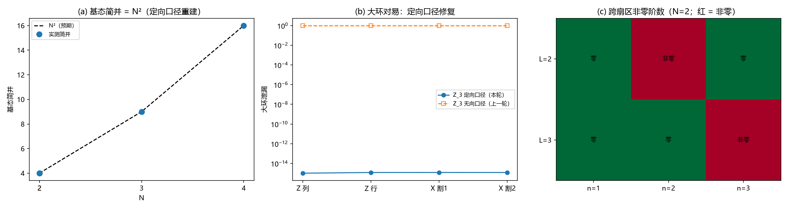

# 注记-定向口径下的Z_N扇区重建：绕数算符代数、简并N²与Q4复验

- **日期**：2026-09-16 07:08:43
- **对应脚本**：`验证脚本/zn_sectors.py`（判据 D1 至 D5、D7，确定性，无随机数，运行约 52 秒；图存 `images/zn_sectors.png`，见 §三 图 1）
- **依据**：[[注记-量子层Q4：绕数跨扇区泄漏的最小阶数与尺寸标度]]（Q4 首轮与 N > 2 口径更正）；[[注记-纠缠侧承载：绕数 = 非定域关系通量的量子保护探路]] §八（更正节与遗留）；[[注记-载体层裁决：纯相位的失败边界与振幅通道的实现路径]] §八（判据 Q4）
- **定位**：上一轮更正的修复执行。按标准定向约定（星项出边 +1、入边 -1；plaquette 逆时针环绕）重建 $Z_N$ toric code，取两族绕数算符（$Z$ 型原胞环、$X$ 型对偶割），验证代数、简并、扇区标注与 Q4 读数全部恢复；并把 $L = 2$ 档二阶幅值的 N 依赖做成闭合公式。本注记不改动基准文件。
- **状态**：判据 6/6 通过。核心读数：四类大环泄漏 $\le 10^{-14}$（对照：无向口径 $N = 3$ 的 $Z$ 型为 $1.00$）；基态简并 $= N^2$（$N = 2, 3, 4$）；扇区标签覆盖 $N^2$；$n_{\min}(L) = L$ 复验通过；$A(2) = 2L\cdot c_N^2/\Delta E_N$ 三点偏差 $0.00\%$。

---

## 一、判据与结果

| 判据 | 内容 | 通过条件 | 实测 |
|---|---|---|---|
| D1 | 代数：每对（顶点，plaquette）共享边 $\Sigma s\cdot t \equiv 0$（mod $N$） | 精确成立 | 最大非零余数 $0$ |
| D2 | 四类大环（$Z$ 列、$Z$ 行、$X$ 割 1、$X$ 割 2）基态空间外分量 | $\le 10^{-8}$ | $\le 9.6\times10^{-15}$（四档模型） |
| D3 | 基态简并 $= N^{2g} = N^2$；$E_0 = -2L^2$ | 相等 | $4/4/9/16$（$N = 2, 3, 4$）；$E_0$ 全中 |
| D4 | 扇区标签覆盖全部 $N^2$ 个 $(m_x, m_y)$ | 等于 $N^2$ | $4/4/9/16$ |
| D5 | Q4 复验：一阶为零；$n_{\min}(L) = L$ | 见条件 | $T_1 \le 5\times10^{-16}$；$L=2$ 二阶非零、$L=3$ 二阶零三阶非零 |
| D7 | $L = 2$ 档二阶幅值 $A(2) = 2L\cdot c_N^2/\Delta E_N$ | 相对偏差 $\le 1\%$ | $+0.00\%$（三点） |

读数（不计入判据）：探路口径二阶泄漏率 $2.000000$（$N=2$）、$1.333333$（$N=3$）；能隙 $4/3/2$（$N = 2, 3, 4$）。

## 二、模型与协议

边约定：$h(i,j)$ 连 $(i,j)$ 与 $(i,j+1)$，$v(i,j)$ 连 $(i,j)$ 与 $(i+1,j)$；键变量 $k_e \in Z_N$，$\omega = e^{2\pi i/N}$。

星项 $A_v = \Pi_e X_e^{s(v,e)}$（出边 $+1$、入边 $-1$），环项 $B_p = \omega^{\Sigma_e t(p,e)k_e}$（plaquette 逆时针环绕，$t = +1,+1,-1,-1$）；$H = -\Sigma_v(A_v + A_v^\dagger)/2 - \Sigma_p(B_p + B_p^\dagger)/2$（$\kappa = 1$）。$N = 2$ 时本口径与无向口径逐字相同。

绕数算符取四类：$Z$ 型原胞环（列 $\{v(i,0)\}$、行 $\{h(0,j)\}$）与 $X$ 型对偶割（$\{h(i,0)\}$、$\{v(0,j)\}$）。判据预测：定向约定使四类全部与 $H$ 对易（共享边的 $s\cdot t$ 相消），对偶割是 $X$ 型的正确边集（原胞环集合对 $X$ 型给模 $N$ 相位障碍）。

读数机器与首轮相同：跨扇区块 $T_n = P V (G V)^{n-1} P$，$G = Q(E_0 - H)^{-1}Q$；$L = 2$ 与 $N = 3$ 稠密、$N = 2$（$L = 3$）与 $N = 4$ 稀疏加 MINRES。扇区基 = 基态空间内联合对角化 $Z$ 列与 $Z$ 行。

## 三、主要读数

### 判定结论（D1 至 D4）

定向口径恢复了完整代数：共享边 $s\cdot t$ 之和逐对为零（D1），四类大环的基态空间外分量全部降到 $10^{-14}$ 以下（D2）；对照上一轮无向口径下 $N = 3$ 的 $Z$ 型为 $1.00$。

基态简并 $= N^2$（$N = 2, 3, 4$ 给 $4, 9, 16$），基态能量 $-2L^2$，扇区标签覆盖全部 $N^2$ 个 $(m_x, m_y)$（D3、D4）。探路 §七 的 $N^2$ 简并结论在两种口径下都成立，但其扇区标注在无向口径下无效（那一轮已更正），定向口径下完整恢复。

### Q4 复验（D5）

$N = 2$：$L = 2$ 档 $T_1 = 0$、$T_2 = 1.000$；$L = 3$ 档 $T_2 = 0$（$10^{-14}$ 以下）、$T_3 = 1.125$：与首轮逐位一致。$N = 3$（$L = 2$）：$T_1 = 0$、$T_2 = 0.333$。$N = 4$（$L = 2$）：$T_1 = 0$、$T_2 = 0.500$。

$n_{\min}(L) = L$ 在更正口径下成立；单路径幅值与强度标度（$\lambda^L$）的读法不变。

### N 依赖的闭合公式（D7）

$L = 2$ 档二阶幅值满足 $A(2) = 2L\cdot c_N^2/\Delta E_N$：$c_N$ 为单键幅值（$V = \Sigma(X + X^\dagger)/2$ 给 $c = 1$（$Z_2$）、$1/2$（$N > 2$）），$\Delta E_N$ 为能隙（$4, 3, 2$），最小环数 $2L$。

三点全部命中（$1.0000$ 对 $1.0000$、$0.3333$ 对 $0.3333$、$0.5000$ 对 $0.5000$，偏差 $0.00\%$）：泄漏幅值的 N 依赖被单键幅值平方、能隙倒数与环数三个因子完全解释。探路口径的二阶泄漏率（$2.000000$、$1.333333$）不依赖大环取法，作为装置互认保留。

## 四、严格程度声明

全部读数为格点最小模型的确定性数值（无随机数）：$L = 2$ 与 $N = 3$ 稠密精确，$N = 2$（$L = 3$）与 $N = 4$ 稀疏加 MINRES（$T_1$、$T_2$ 的"零"在 $10^{-14}$ 以下）。D7 为三点的公式核对（每点偏差打印到 $0.00\%$）。探路口径读数与首轮逐位一致。

## 五、边界声明

本注记验证定向口径下 $Z_N$ toric code（$L = 2$；$N = 2$ 另做 $L = 3$）的绕数算符代数、简并、扇区标注与 Q4 读数。

不验证：$N = 3$ 的 $L = 3$（态空间 $3^{18}$，超出稠密与本文稀疏装置）；更大 $L$ 的数值（首轮的结构外推仍适用）；三维推广；体系实体映射（实轴方向差 = 键变量的严格对应）；Q5（弦算符可形变完成）。

## 六、过程记录（两处修正与一处判据补入）

**其一，泄漏函数的形状错误。** 首版把 $X$ 型环的作用矩阵（$D\times\deg$）误喂给"对角型"接口，广播成 $(D, D, \deg)$：$D = 2^{18}$ 时爆内存（2 TiB 申请失败），$D = 256$ 时静默算出错误数组（打印出的 $5.1\times10^{-16}$ 是垃圾数组的巧合小量）。修正为统一的 $(D,\deg)$ 接口后，$X$ 型泄漏为 $7.7\times10^{-16}$（$L = 2$）。教训：脚本挂掉比静默更安全，形状断言要显式写；"看似机器精度"的读数也可能是错误数组的巧合，须与独立口径互证。

**其二，$X$ 型环的边集选择。** 首轮沿探路把 $X$ 型取在原胞环集合（列/行）上，两种取法都不与 $H$ 对易（模 $N$ 相位障碍）；正确的 $X$ 型边集是对偶割（$\{h(i,0)\}$、$\{v(0,j)\}$）。定向口径下 $Z$ 型原胞环与 $X$ 型对偶割各自对易，这是"两种拓扑两类算符"的最小示例，写入模型协议。

**其三，D7 判据补入。** $L = 2$ 档二阶幅值的 N 依赖公式是读数中发现后补为判据的（三点全中）；按先判据纪律，此条记为补入的读数型判据，预期已在脚本文档串写明。

## 七、登记衔接

本轮登记：`验证脚本/README.md` 第 61 条；[[开放问题总览：元相子理论待解决问题清单]] 超选择层条目（定向口径遗留关闭，剩余 Q5）；[[三维复合位错攻坚计划：形态、驻留与宽度窗口]] §八 执行状态追加；[[注记-纠缠侧承载：绕数 = 非定域关系通量的量子保护探路]] §八 更正节追加修复执行段。

注记、脚本、登记三者一致；本注记不改动 `理论总纲/` 基准，方案定案由作者裁决。