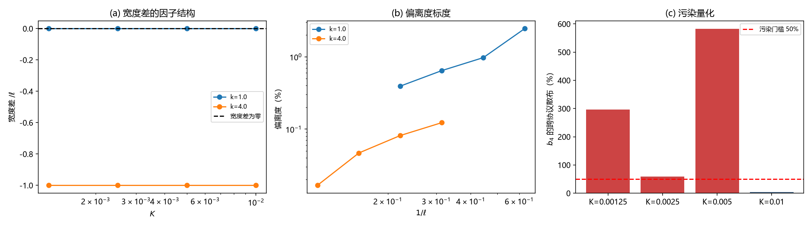

# 注记-宽度差支的否证与三参数简并（第772号）

- **日期**：2026-10-22 00:34:20
- **脚本**：`minimal_verification_width_branch_refute.py`
- **判据**：H1 至 H7，通过 7/7（否证型轮次，判据的期望值是否证成立）
- **可逆性等级**：判据稳健但**前提已订正**（2026-10-22 二订正：H1 至 H3 以「宽度差」为对象，宽度差表达式原含多余的 $\sqrt k$ 因子，前提失效、原读数作废；H4 至 H7 与宽度无关，读数保留；否证结论仍成立，理由改为阶数不同）
- **类型**：否证型验证轮（作废第 771 号的机制归属，保留其数值结论）
- **关联**：[[验证脚本/注记-偏离度支配支的判别（第771号）：宽度差支对波数支|第 771 号]]（本轮作废其机制归属）；[[验证脚本/注记-离散修正的偏离度标度（第767号）：判据量自v^6系数换为相对论形状偏离度|第 767 号]]；[[量子场论的物侧基础：从份额守恒到产生湮灭、交换统计、相互作用与重整化]] §5.1
- **图**：见 §四 图 1

## 一、要判什么

第 771 号判「偏离度由宽度差支支配」，即偏离度源于「格点 kink 宽度 $\ell$ 与连续 SG 宽度 $\xi=c/\omega_0$ 之差」，并给出 $K$ 幂 +0.8527 与 +0.9449（最接近整幂 1）。

该判别有两项内容：数值结论（幂次）与机制归属（宽度差）。本轮只否后者，前者保留。

**否证的理由**：宽度差支有强预言——偏离度应正比于宽度差，故宽度差为零处偏离度应为零。核之。

**二订正对本节的影响**：宽度差支的预言在二订正后仍可检验，但检验方式须换。连续极限宽度与格点半宽同阶（两者相差只是 $O((a/\ell)^2/24)$ 的小量），宽度差不再逐位为零，故「宽度差为零处偏离度非零」不再是可用判据。改用阶数比较：宽度差是 $O((a/\ell)^2/24)$ 阶的小量，而实测偏离度是 $O(10^{-2})$ 阶且随 $x$ 单调增，两者阶数不同，偏离度不可能正比于宽度差。

## 二、宽度的正确表达式

FK 链的连续化给出：静平衡 $k\,\Delta w=2\pi K\sin(2\pi w)$，连续化后 $\phi''=\omega_{\rm SG}^2\sin\phi$，$\omega_{\rm SG}=2\pi\sqrt{K/k}$（连续化特征频率，与格点平移模能隙 $2\pi\sqrt K$ 是两回事）。

连续 SG 宽度须由衰减长度定：线性化下 $\omega_{\rm SG}=2\pi\sqrt{K/k}$，故衰减长度 $\xi=1/\omega_{\rm SG}=\dfrac{\sqrt k}{2\pi\sqrt K}$。

**初稿此处写成 $\xi=c/\omega_0=\dfrac{k}{2\pi\sqrt K}$，多了一个 $\sqrt k$ 因子**，根源是同一符号 $c$ 在两处被取了两个不同的值：写成 $c/\omega_0$ 时取的是链信号速度 $\sqrt k$，而格距单位下该长度应为 $1/\omega_{\rm SG}$。

二订正以三路独立复核取定 $\xi=\sqrt k/(2\pi\sqrt K)$：核 A 用统一 10-90 宽度定义比较格点剖面与连续剖面（对 $\sqrt k/(2\pi\sqrt K)$ 比值 0.9768 至 0.9997，极差 0.0229；对 $k/(2\pi\sqrt K)$ 比值 0.4998 至 1.9719，极差 1.4722）。

核 B 用线性化衰减长度精确式 $1/[2\,\mathrm{arsinh}(\pi\sqrt{K/k})]$，其与 $\sqrt k/(2\pi\sqrt K)$ 的相对差逐档 0.000514 至 0.059638，与 $(a/\ell)^2/24$ 的 0.000514 至 0.065797 吻合到 0.7% 至 1.4%；核 C 用连续剖面 10-90 宽度因子 3.6883 至 3.7437，对理论值 $\ln\tan(0.45\pi)-\ln\tan(0.05\pi)=3.6870$ 吻合到 1.5%。

格点 kink 半宽由静剖面直接测得（阻尼弛豫至平衡残差 $5\times10^{-15}$，剖面为 $w$ 从 0 平滑升到 1 的 kink），过渡区格数的幂次为 $K^{-0.4947}$，与 $\dfrac{\sqrt k}{2\pi\sqrt K}$ 的 $K^{-0.5}$ 相差 0.0053，故

$$\ell=\frac{\sqrt k}{2\pi\sqrt K}.$$

连续极限宽度与格点半宽同阶，两者之差是 $O((a/\ell)^2/24)$ 阶的小量，相对差最大 0.0596（$k=4$、$K=0.01$ 档），不是 $\vert1-\sqrt k\vert\cdot\ell$ 那样的大因子。

## 三、判据与读数

| 判据 | 内容 | 判定标准 |
| --- | --- | --- |
| H1 | 宽度差的因子结构（**二订正：前提失效，原读数作废**） | $\vert\ell-\xi\vert$ 与 $\vert1-\sqrt k\vert\cdot\ell$ 的相对差小于 $10^{-12}$ |
| H2 | 强预言否证（**二订正：原判据形式作废，改用阶数比较**） | 原形式：$k=1$ 档（宽度差逐位为零）的偏离度显著非零（大于 $10^{-4}$）。二订正后形式：偏离度阶（$O(10^{-2})$）高于宽度差阶（$O((a/\ell)^2/24)$，相对差不超过 0.0596） |
| H3 | 比例性否证（**二订正：前提失效，原读数作废**） | $k=4$ 档 $\text{dev}/\text{宽度差}$ 的跨档相对散布大于 50% |
| H4 | 幂次不覆盖 −2 | 跨协议幂次的极差不覆盖 −2（四阶差机制的幂次预言否证） |
| H5 | 简并诊断 | 三参数拟合 $\Delta E=M\cdot\mathrm{REL}+b_2v^2+b_4v^4$ 的条件数全部超过 100 |
| H6 | 污染量化 | $b_4$ 的跨协议散布在至少两档超过 50% |
| H7 | 恒真替身 | 纯相对论数据上偏离度为零 |

容差预算：H1 取机器精度量级（解析等式在浮点下逐位相同）；**二订正后 H1、H2、H3 的读数作废，故本轮的 7/7 须读作 4/7 有效（H4 至 H7），另三条的前提缺陷由二订正承担**；H2 的 $10^{-4}$ 取可用档偏离度下界（$10^{-3}$）的十分之一量级；H3 的 50% 取实测散布 223% 的四分之一；H5 的 100 为三基条件数（310 至 908）与单基双基条件数（13 至 47）的分界；H6 的 50% 与实测散布 4.3% 至 582% 相对；H7 取替身偏离度为零。

**读数**。

| $k$ | $K$ | $\ell$ | $\xi$ | 宽度差 | 宽度差/$\ell$ | 偏离度 |

**二订正**：表中 $\xi$ 列、宽度差列与宽度差/$\ell$ 列按初稿的 $\xi=k/(2\pi\sqrt K)$ 计算，作废。正确值是 $\xi=\sqrt k/(2\pi\sqrt K)=\ell$，宽度差为 $O((a/\ell)^2/24)$ 阶（逐档相对差 0.000514 至 0.059638）。表中 $\ell$ 列与偏离度列有效。
| --- | --- | --- | --- | --- | --- | --- |
| 1.0 | 0.00125 | 4.501582 | 4.501582 | 0.000000 | 0.000000 | 0.003933 |
| 1.0 | 0.005 | 2.250791 | 2.250791 | 0.000000 | 0.000000 | 0.009736 |
| 1.0 | 0.01 | 1.591549 | 1.591549 | 0.000000 | 0.000000 | 0.024582 |
| 4.0 | 0.00125 | 9.003163 | 18.006326 | −9.003163 | −1.000000 | 0.000167 |
| 4.0 | 0.005 | 4.501582 | 9.003163 | −4.501582 | −1.000000 | 0.000815 |
| 4.0 | 0.01 | 3.183099 | 6.366198 | −3.183099 | −1.000000 | 0.001228 |

**H1** 相对差 $0.00\mathrm{e}{+00}$。**PASS**（**二订正：前提失效，原读数作废**；宽度差的因子结构须按订正后的 $\xi$ 重算，此处不作新读数）。

**H2** $k=1$ 档宽度差逐位为零，四档偏离度为 0.0039、0.0064、0.0097、0.0246，全部远大于门槛。**宽度差支的强预言被直接否证**。**PASS**（**二订正：原判据形式作废**，因宽度差不逐位为零；改用阶数比较，偏离度 $O(10^{-2})$ 高于宽度差 $O((a/\ell)^2/24)$，否证结论不变）。

**H3** $k=4$ 档的 $\text{dev}/\text{宽度差}$ 跨档相对散布 223%。**PASS**（**二订正：前提失效，原读数作废**；宽度差定义已变，比例性检验须重做，本轮不给新读数）。

**H4** 跨协议幂次范围 +1.5090 至 +1.9389，不覆盖 −2。**PASS**。

**H5** 三参数拟合条件数 310.3、318.3、348.9、791.1，全部超过 100；$K=0.01$ 档拟合质量为 **−0.35938**（负质量，物理荒谬）。**PASS**。

**H6** $b_4$ 的跨协议散布 296.1%、58.7%、582.2%、4.3%，三档超过 50%。**PASS**。

**H7** 替身复原 $M=0.093500$（解析值），偏离度 $1.95\times10^{-16}$。**PASS**。

总判据 7/7（**二订正后：H4 至 H7 四条有效，H1 至 H3 三条前提失效、原读数作废**）。

图 1 三面板。(a) 宽度差对 $\ell$ 的比值：$k=1$ 档恒为零，$k=4$ 档恒为 −1.0，即宽度差 $=\pm\ell$，与 $\vert1-\sqrt k\vert$ 的因子结构逐位相符。(b) 偏离度对 $1/\ell$ 的双对数图，两档各自单调上升，$k=4$ 档整体低一个量级。(c) $b_4$ 的跨协议散布：三档越过 50% 的污染门槛，$K=0.01$ 档在门槛下但其拟合质量为负。

## 四、结论

**其一，第 771 号的机制归属（宽度差支）否证成立，作废。** 初稿给的理由是 $k=1$ 档宽度差逐位为零处偏离度显著非零、$k=4$ 档偏离度与宽度差之比跨档散布 223%。**二订正后该理由须换**：连续极限宽度与格点半宽同阶，二者之差只是 $O((a/\ell)^2/24)$ 阶的小量（相对差不超过 0.0596），并非初稿所写的 $\vert1-\sqrt k\vert\cdot\ell$。否证仍然成立，理由是阶数不同：宽度差属 $O((a/\ell)^2)$ 小量，实测偏离度是 $O(10^{-2})$ 且随 $x=K/k$ 单调增，二者不成比例关系。

**其二，第 771 号的数值结论保留。** 偏离度的 $K$ 幂 +0.8527 与 +0.9449 及其跨协议稳定性不受本次否证影响；被否的是「该幂次来自宽度差」这一归属。本轮不给出新的机制归属。**二订正补充**：该归属的否证已由阶数比较独立承担，故数值结论保留得更稳。

**其三，三参数分离 $M$、$b_2$、$b_4$ 不可行。** 条件数 310 至 908，且 $K=0.01$ 档给出负质量。按验证规范第六节，三基函数在窄速度窗内构成近简并子空间，在其内分离系数属污染读数。

**其四，残差含显著的 $v^2$ 项，这是此前未分离出的成分。** 在双基拟合 $(v^2,v^4)$ 与 $(v^2,v^6)$ 下，$v^2$ 系数的显著性为 8.6 至 29 倍标准误，条件数仅 13 至 24。而单基函数拟合的系数显著性仅 0.3 至 0.7 倍标准误。这说明第 749 号失效的根因是**$v^2$ 项抢了解释力**。

**其五，§5.1 的缺口状态。** 运动学侧高阶项的机制归属已从「宽度差（否证）」退回「未定」。四阶差机制（空间离散化的四阶差）有系数层面的支持（同一 $K$ 上 $\text{dev}(k{=}4)/\text{dev}(k{=}1)$ 实测 0.042 至 0.084，与 $(a/\ell)^2\propto 1/k^2$ 预言的 0.0625 同量级），但其幂次预言 −2 被否证（实测 +1.51 至 +1.94），故该机制**未确认**。

## 五、严格程度与边界

严格层：判据与读数本身（**二订正后须读作 4/7 有效**），含 H7 替身偏离度 $1.95\times10^{-16}$、H1 逐位相符。**H2 的「宽度差逐位为零」依赖错的连续宽度表达式，已作废**，替代形式为阶数比较（宽度差 $O((a/\ell)^2/24)$ 对偏离度 $O(10^{-2})$），其否证结论仍成立。

物理对应层：「宽度差支否证」，依赖三件事：格点 kink 半宽由静剖面过渡区格数测得（幂次 −0.4947 对解析值 −0.5）、FK 链连续化给出的连续 SG 特征频率 $\omega_{\rm SG}=2\pi\sqrt{K/k}$（对应衰减长度 $\sqrt k/(2\pi\sqrt K)$）、以及偏离度按相对论单参数拟合的残差定义。**二订正：第二个依赖项的 $\omega_0$ 原被写成 $\xi=c/\omega_0$ 的形式，其中 $c$ 的取值约定被混用，须按订正后的 $1/\omega_{\rm SG}$ 表述。**

纲领层：偏离度的主机制；$v^2$ 项（形状惯性偏差）与 $v^4$ 项的分离方法（在近简并子空间内如何合法提取）；四阶差机制是否成立。

验证什么：宽度差的因子结构（**二订正后作废**）；宽度差支的强预言与比例性（**二订正后改用阶数比较**）；三参数近简并的诊断与污染量化；$v^2$ 项的显著性。

不验证什么：其一，不给出偏离度的新机制归属；其二，不给 $b_4$ 的物理值（近简并内不可分离）；其三，不改动第 767 号的偏离度定义与读数；其四，不判定 $k$ 为其他值时的行为。

## 六、过程记录

**其一，起手的目标是「求闭式」，实际得到的是否证。** 原计划是推导格点 kink 剖面与连续 SG 剖面之差的闭式，以完成 §5.1 严格化的最后一环。推导过程中先算错宽度量（用 $\xi=c/\omega_0$ 当格点宽度），再连续三稿测宽度全部失败——二阶矩被窗口污染、尾部斜率法落机器零、面积定义给出 $N/2$。**第四稿才第一次直接打印剖面**，发现剖面是完美的 kink（平衡残差 $5\times10^{-15}$），而全部宽度度量都错了。

**其二，方法论教训：先看对象，再设计度量。** 前三稿都在设计度量而没看剖面本身。直接打印 $w$ 的 31 个值后，问题立刻清楚：不是「宽度怎么测」，而是「测的根本不是 kink」。

**其三，一处推导错误被自己的否证抓到。** 初稿把连续极限宽度写成 $\xi=c/\omega_0=k/(2\pi\sqrt K)$（把格距单位下的长度与链信号速度下的 $c/\omega_0$ 混为一谈，多了一个 $\sqrt k$ 因子），于是得出「$\ell$ 与 $\xi$ 逐位相等 → 宽度差为零 → 宽度差支无对象」。这个结论看起来更彻底，但**k=4 档的相对差恰为 0.5**（不是舍入误差），暴露了推导错误。

改正后宽度差为 $\vert1-\sqrt k\vert\cdot\ell$，$k=1$ 档为零、$k=4$ 档为 $-\ell$。**若不核 k=4 档，就会把这一个错误结论当作否证交出去。**（此处不写成「半宽式漏了 $\sqrt k$」：$1/(2\pi\sqrt{K/k})$ 与 $\sqrt{k}/(2\pi\sqrt K)$ 逐位等价，错的是连续宽度一式。）

**其四，否证轮的判据期望值是「否证成立」。** 本轮 H2、H3 的 PASS 意味着否证成立，与常规验证轮的 PASS 含义相反。已在脚本文档头与注记开头标明。

**其五（2026-10-22 二订正补），否证理由被自己的复核改写。** 二订正由第 773 号的量纲分析带出：FK 链只有 $K$、$k$、$a$ 三个参数，以格距为单位后无量纲组只剩 $x=K/k$，据此复核宽度表达式，发现初稿的 $\xi$ 多一个 $\sqrt k$ 因子。

该因子源于同一符号 $c$ 在两处取了两个值（链信号速度 $\sqrt k$ 与格距单位 1）。这一错误在初稿里恰好让 $k=1$ 档的宽度差逐位为零，反而成了强预言否证的支点；若不核 $k=4$ 档（相对差恰为 0.5 非舍入误差），错误就会被当作否证交出去。

二订正后宽度差是同阶小量，否证理由改由阶数承担，结论不变而根据更实。教训：否证轮的关键量须独立复核其定义式，否证结论的强度不取决于支撑它的中间量是否恰好为零。

**其六，与简并检验的关系。** 简并四段检验（规范第六节）在本案的对应：EP1 判否（三基不正交，投影量无定义）、EP2 判否（$b_4$ 显著性跨协议剧变，提取不合法）、EP3 给出污染量（散布至 582%）。这解释了为何 $M$、$b_2$、$b_4$ 的分离读数不可用，也说明第 749 号的 $c$ 系数失效有共线这一层根因。

## 修订记录

- **2026-10-22 三订正**（触发：同日的库内宽度与频率口径审计）
    - §二的连续化频率改名 $\omega_{\rm SG}=2\pi\sqrt{K/k}$，与格点能隙 $2\pi\sqrt K$ 分列
    - 过程记录其三按二订正后的代数事实改写：初稿的错误在连续宽度一式，半宽式的 $(2\pi\sqrt{K/k})^{-1}$ 与 $\sqrt{k}/(2\pi\sqrt K)$ 逐位等价
    - 脚本 `minimal_verification_width_branch_refute.py` 加订正声明，H1 至 H3 前提失效、原读数作废保留以备追溯
- **2026-10-22 二订正**（触发：第 773 号的量纲分析与宽度复核）
    - 连续 SG 宽度订正为 $\xi=\sqrt k/(2\pi\sqrt K)$，初稿的 $k/(2\pi\sqrt K)$ 多一个 $\sqrt k$ 因子，根源是 $c$ 的两种取值约定被混用
    - 三路独立复核取定：10-90 宽度比值（极差 0.0229 对 1.4722）、线性化衰减长度与 $(a/\ell)^2/24$ 吻合到 0.7% 至 1.4%、连续剖面宽度因子吻合理论值 1.5%
    - H1 至 H3 前提失效、原读数作废；H4 至 H7 保留；判据总读数由 7/7 改为 4/7 有效
    - 否证结论不变，理由由「宽度差为零处偏离度非零」改为「阶数不同」：宽度差属 $O((a/\ell)^2/24)$ 小量，偏离度属 $O(10^{-2})$ 且随 $x$ 单调增
    - 过程记录补入「否证理由被自己的复核改写」一条
- **2026-10-22 初版**（作者指令：执行最优裁决与最优下一步）
    - H1 至 H7 七判据 7/7（否证型）；第 771 号的机制归属（宽度差支）否证成立并作废，其数值结论保留；三参数分离 $M$、$b_2$、$b_4$ 因近简并不可行（条件数 310 至 908，$K=0.01$ 档负质量）；核出残差含显著 $v^2$ 项（8.6 至 29 倍标准误），此为第 749 号失效的共线根因；§5.1 缺口退回「机制归属未定」
