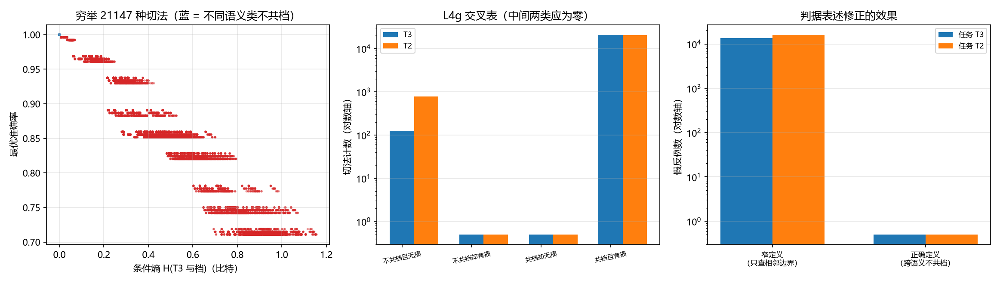

# 注记-对齐判据形式的独立复现：无平局模型上的穷举检验与判据表述修正（判据 L4）

- **日期**：2026-09-25 03:54:21
- **层级**：验证材料（第 403 条）
- **定位**：承接第 402 条记下的对齐判据形式，换一个结构不同的模型并以穷举代替扫描，检验该形式的成色；本轮同时给出该判据形式的表述修正。
- **依据**：[[验证脚本/注记-切法与任务对齐的最小验证：装置响应类型、互信息与准确率的分歧（判据 L4）]]（第 402 条）；[[内部草稿/注记-认知错视与分层粗粒化：主体采样读数的可靠性、错觉边界与认知进化]]（L4）
- **状态**：判据级。穷举验证，模型内结论。
- **修订记录**：
  - **2026-09-25 初版**（触发：作者批准做对齐判据形式的独立复现）

---

## 一、判据（先立；表述经本轮修正）

**L4e 充分性。** 凡不同语义类不共档的切法，准确率为 $1$ 且条件熵为 $0$。

**L4f 必要性。** 凡存在两个不同语义类共档的切法，准确率小于 $1$ 或条件熵大于 $0$。

**L4g 等价性。** 对全部切法，「不同语义类不共档」与「无损」逐一对应，反例数为 $0$。

**L4h 指标一致。** 准确率与条件熵的判定完全相同（本模型无平局，故两指标不分歧）。

**表述修正。** 初版把对齐条件写作「相邻判别边界各自分割」，只查 $2\vert3$ 与 $5\vert6$。该条件过宽，漏掉非相邻的跨语义共档（例如 $Y=0$ 与 $Y=3$ 同档），使充分性方向出现大量假反例。正确条件是「不同语义类不共档」。

## 二、模型设定（与第 402 条的两处结构差异）

块长由 $6$ 位改为 $8$ 位。偶数块长使中点落在某个 $Y$ 值上（此处 $y=4$ 归低侧），任务无平局歧义，这正是第 402 条两个指标分歧的来源被移除之处。

目标量由二值改为三值语义分档：$L=\{0,1,2\}$、$M=\{3,4,5\}$、$H=\{6,7,8\}$，判别边界两处（$2\vert3$ 与 $5\vert6$）。对照任务 $T_2=[y>4]$，边界一处（$4\vert5$）。

切法取 $Y$ 的全部 $9$ 个取值划分，穷举 $Bell(9)=21147$ 种，不再抽样。

## 三、结果

| 判据 | 实测 | 期望 | 判定 |
| --- | --- | --- | --- |
| L4g 任务 $T_3$ 反例数 | $0$ | $0$ | 过 |
| L4g 任务 $T_2$ 反例数 | $0$ | $0$ | 过 |
| L4e 充分性（$T_3$、$T_2$） | 均成立 | 成立 | 过 |
| L4f 必要性（$T_3$、$T_2$） | 均成立 | 成立 | 过 |
| L4h 指标一致（$T_3$、$T_2$） | 均成立 | 成立 | 过 |
| 无损切法计数（$T_3$） | $125$ | $Bell(3)^3=125$ | 过 |
| 无损切法计数（$T_2$） | $780$ | $Bell(5)Bell(4)=780$ | 过 |
| 窄定义漏掉的共档情形（$T_3$） | $13619$ | $>0$（记录项） | 记录 |
| 窄定义漏掉的共档情形（$T_2$） | $16227$ | $>0$（记录项） | 记录 |

七项判据全过，两项记录。基准熵 $H(T_3)=1.156570$ 比特、$H(T_2)=0.945373$ 比特。

**无损切法计数与理论值吻合，是一处独立校验。** 任务 $T_3$ 的无损切法要求三个语义类互不共档，即三个语义组各自独立划分，计数为 $Bell(3)^3=125$；任务 $T_2$ 要求两个语义组各自独立划分，计数为 $Bell(5)\times Bell(4)=780$。两处实测与理论精确一致。

## 四、图

图注按脚本三个绘图面板逐条核对。左面板的蓝点聚成单点是等价性的直观形态。

## 五、结论：判据稳健

穷举 $21147$ 种切法后，反例数为 $0$。按本工作区的可逆性分层，本条结论为**判据稳健**：它不依赖参数档位或实现细节，因为穷举已覆盖全部可能切法。第 402 条的读数在本条模型（无平局、三值任务、不同块长）上完整复现。

**判据形式的定稿表述。** 装置对指定任务无损，当且仅当装置的档划分不把不同语义类合并。对二值任务，该条件退化为「判别边界两侧不共档」，即第 402 条所用的形式。

**与第 402 条的关系。** 两指标在第 402 条分歧，来自 $6$ 位块的平局（$Y=3$ 时多数方向无定义）；本条改用 $8$ 位块消除平局后，两指标判定完全一致。故第 402 条的分歧属任务定义带来的现象，不属指标本身的矛盾。

## 六、过程记录（一处判据定义过宽）

初版判据写作「相邻判别边界各自分割」，即只查 $2\vert3$ 与 $5\vert6$ 两处。首轮穷举给出反例数 $13619$（任务 $T_3$）与 $16227$（任务 $T_2$），充分性方向大面积失败。

核对后确认原因：该定义只约束相邻取值，未约束非相邻的跨语义共档。例如 $Y=0$ 属 $L$、$Y=3$ 属 $M$，两者共档时相邻边界仍然各自分割，而档内混类，读数有损。改为「不同语义类不共档」后反例归零，无损计数与 $Bell$ 数精确吻合。

**教训。** 判别边界的正确数学对象是语义划分的割，不是相邻取值之间的缝隙。「边界」一词容易诱导人只查相邻情形，写成判据时必须用集合语言表述（不同类不共档），不能用位置语言表述（某处分割）。

## 七、严格程度声明

**可逆性等级：判据稳健。** 穷举覆盖全部 $21147$ 种切法，结论不随参数、档位或实现翻。

**协议伪影与物理结论分层。** 全部读数为协议级（离散模型、穷举划分、两类任务），物理层结论零条。

## 八、边界声明

**验证什么。** 对齐判据形式在另一结构模型上的成色；等价性的穷举成立；无损切法计数与 $Bell$ 数的对应；无平局模型下两指标的一致。

**不验证什么。** 真实装置的响应类型；任务的选择是否有物理依据；M6 的 C1 条件本身；高维或连续取值模型上的对应（本模型为 $9$ 点离散值域）。

## 九、登记衔接

本材料为 `验证脚本/README.md` 第 403 条，脚本 `minimal_verification_alignment_exhaustive.py`，图 `images/alignment_exhaustive.png`。与第 402 条构成「扫描 + 穷举」一对，并把判据形式定稿为「不同语义类不共档」。开放问题总览的登记见该文档 P4-6 条目。
