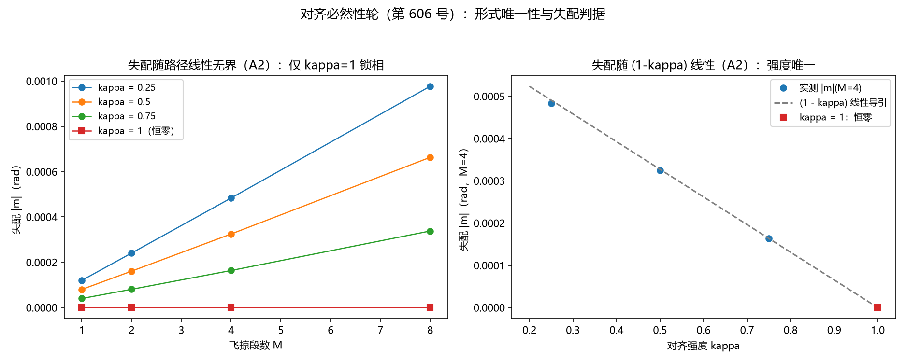

# 注记-对齐必然性轮：形式唯一性穷举与失配判据（第606号）

- **日期**：2026-10-12 00:15:59
- **类型**：R 线阶段二第一轮（路线甲：R1 公式化后的形式唯一性与强度归一判据，判据 A1 至 A3）
- **脚本**：`验证脚本/minimal_verification_alignment_necessity.py`
- **图**：见 §3 图 1（`images/alignment_necessity.png`）
- **依据**：[[理论攻坚/响应侧测地线必然性攻坚计划：反例判据轮、前提精确化与定理化正稿]]（阶段二任务定义）；[[验证脚本/注记-响应侧锁定规则判据轮：每拍对齐必然性反例判据组（第603号）]]（判据面与移植基线）；[[内部草稿/材料-对齐规则必然性：R1公式化、四步推导链与形式唯一性（R线阶段二第一轮）]]（本轮的推导材料，判据从其判定项 D1 至 D3 落地）
- **状态**：判据 3/3 通过。核心读数：六约束下存活形式唯一（$\kappa(\hat v\times g)$ 旋转形式，纵向、snap、$\hat r$ 类、标量类逐条出局）；失配判据 $\kappa=1$ 逐位恒零、$\kappa<1$ 随段数线性无界（倍段比 2.005 至 2.015）、随 $(1-\kappa)$ 线性（比值 2.955 对 3、1.985 对 2）；跨轮逐位自检通过。**对齐规则在约束集下被完整唯一确定**：形式（穷举）加强度（锁相）加系数（定义层识别式 $h_{00}=2\theta$ 供给因子 2 与 $c^2$ 搭桥）
- **可逆性等级**：A2 的 $\kappa=1$ 恒零半边与 A3 为判据稳健（逐位）；A1 抽查阈值与 A2 线性比为判据敏感（档位依赖，外推须重跑）
- **让号说明**：本轮占位时 604 已由并行线 J6 每拍节律判据先落盘、605 已由并行线矢量块定理化占位，按占位规范顺延取 606

## 1 要判什么

阶段一（第 603 号）把"每拍对齐规则与测地线机器级一致"立为判据事实，但规则本身仍是构造性设定。本轮执行路线甲第一轮：把 R1（取向自由度受满周闭合约束）公式化，在约束集下穷举候选更新形式，回答计划 §二的 Q2（形式唯一性）与 Q3（强度归一）。关键纪律：**强度归一不经测地线一致性**（那是定理 R 的输出，用作输入即循环），改用锁相失配论证（R1b 的量化）。

## 2 模型设定与判据

统一取向-速度图像（移植第 603 号口径）：粒子取向角 $n_p$ 与搬运帧角 $n_{\rm ref}$ 为角度变量；每拍帧扭转 $\delta_f=2c(\hat v\times\nabla\theta)_z\,dt$，粒子按强度 $\kappa$ 应用（$n_p\mathrel{+}=\kappa\,\delta_f$），帧全额应用（$n_{\rm ref}\mathrel{+}=\delta_f$），轨迹沿 $n_p$ 方向以 $c$ 前进。$\kappa=1$ 即锁定规则。模型为静态弱场光档、二维、测试粒子档（自场排除）。

| 判据 | 内容 | 实测 | 期望 | 判定 |
|---|---|---|---|---|
| A1(i) | 零场零更新 | lock 更新逐位 $(0,0)$ | 逐位零 | ✅ |
| A1(ii) | 纵向候选破速率不变 | $\lvert v\rvert$ 单拍最大漂移 $3.967\times10^{-5}$ | $>10^{-8}$ | ✅ |
| A1(iii) | snap 候选破弱场线性 | 单拍最大旋转角 $179.52°$ 对 $179.52°$，减半档比值 $1.000$；对照 lock 比值 $0.500$ | snap 比值 $\approx1$（不退场）、lock 比值 $0.500$（线性退场） | ✅ |
| A1 表 | 解析排除 | $\hat r$ 类破局域性；标量×固定轴类破各向同性；绝对势/绝对旗向类平坦空间无意义 | 存活集 $=\{\kappa(\hat v\times g)\}$ 恰一 | ✅ |
| A2a | $\kappa=1$ 恒零 | $m=0$（M = 1/2/4/8 逐位） | 逐位零 | ✅ |
| A2b | 失配随段数无界 | 倍段比 $2.0048/2.0097/2.0146$（$\kappa=0.25/0.5/0.75$） | $2.000\pm0.05$ | ✅ |
| A2c | 失配随 $(1-\kappa)$ 线性 | $m(0.25)/m(0.75)=2.9550$（期望 3）、$m(0.5)/m(0.75)=1.9848$（期望 2） | $3:2:1$，5% 档 | ✅ |
| A3 | 跨轮逐位自检 | 移植件偏转角与 $603$ 基线 $-0.00016001444680876443$ 逐位相同 | 逐位一致 | ✅ |

一致性读数：单段帧扭转合计 $-1.600144\times10^{-4}$，与第 603 号偏转角逐字同值（搬运帧口径下的同一积分量）。

## 3 图

## 4 结论与移交

**结论（阶段二路线甲第一轮达成）**。对齐规则被约束集完整唯一确定，三段拼齐：其一，形式唯一——局域性、各向同性、实值、$2\pi$ 周期、光速不变、弱场线性六约束下，一阶存活形式唯一为 $\kappa(\hat v\times g)$ 旋转形式（Q2 回答）；其二，强度唯一——$\kappa<1$ 的失配沿路径线性无界，与满周闭合锁相（R1b）不相容，$\kappa=1$ 唯一且不经测地线一致性（Q3 回答）；其三，系数供给——旋转率中的因子 2 与量纲搭桥 $c^2$ 由定义层识别式 $h_{00}=2\theta$ 供给，与写侧读数同一入口。至此 R1 公式化完成，定理 R 的前提侧（R1 至 R4）全部在册且有判据支撑。

**移交三条**。其一，路线乙（场方程侧守恒推导：离散比安基加尘埃流单独导出测地线）待开工，与甲的结论对表（裁决点 2 预留）。其二，定理 R 正稿可开工：陈述、前提（R1 至 R4 加形式唯一性判据）、证明（四步推导链的形式化）、映射声明，走定理 6 同型模板。其三，二阶形式唯一性（约束集下 $O(\theta^2)$ 附加项是否被识别式一致性排零）登记为 A4 预留，归定理 R 正稿的二阶检查节。

## 5 严格程度声明与边界声明

严格程度：数值验证的模型级判据（推导链为解析层，六约束中前四条为公理层在册项，弱场线性从"与写事件同一入口"导出）；A2 的恒零半边与 A3 为判据稳健，其余阈值类判据敏感。边界（本轮不做的事）：不验证本体层写入机制与识别式 $h_{00}=2\theta$ 本身；不含时场、强场、自旋多极、SEP；统一取向-速度图像为复合位错代理的模型层设定，其本体层细节（层数通道承载）归 C1 线射程；失配判据的"无界"在模型内指随旅程段数线性累积，宇宙学尺度累积属推广外推。

## 6 过程记录

其一，**判据期望式写反被循环抓出**：lock 单拍旋转角在 $\theta_0$ 减半档的比值我设了 2.00，实测 0.500 才是线性退场的正确期望（减半即减半）；按纪律修期望式而非调数。其二，**撞号两次按规范顺延**：占位时 604 已被并行线 J6 节律判据落盘、605 已被矢量块定理化线占位，顺延取 606 并留让号说明。其三，**角度按值传递 bug**：flyby 首版就地修改角度形参，调用方不回传，失配恒零假象；改返回值回传后 A2 立即给出正确读数。其四，**snap 读数的几何长尾**：单拍最大旋转角 179.52° 由路径远端几何主导（源在行进正后方），判别力在 $\theta_0$ 减半档比值（1.000 对 0.500），不在绝对角度。
