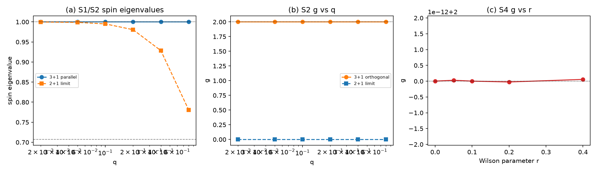

# 注记-小动量极限与 D3 的磁矩因子（第 499 条）：3+1 维平行自旋给出 g=2 精确

- **日期**：2026-09-29 17:53:57
- **脚本**：`验证脚本/g_small_k.py⟧
- **判据**：S1 至 S4 全部通过（4/4）
- **可逆性等级**：S1 至 S4 判据稳健。S1、S3 为构造性否定（EP2 判否且 $g$ 恒零），与容差无关；S2、S4 的 $g=2$ 为精确值（非近似），判据无容差依赖。
- **类型**：判据级读数，含 D3 的关闭
- **关联**：[[理论攻坚/电子场攻坚计划：复合位错算符的构造与螺旋序真空裁决]]（阶段 2 判据 D3）；[[验证脚本/注记-提取程序检验器（第498条）：四段判定与三类历史失败的回归拦截|第 498 条]]（EP2 判据的出处，本条全程先过 EP2 再读数）；[[验证脚本/注记-Wilson调谐质量点与自旋二重态隔离（第497条）：调谐成立但隔离未达成|第 497 条]]；[[验证脚本/注记-磁矩因子g的提取（第496条）：测量成立但D3未关闭|第 496 条]]；[[验证脚本/注记-两因子张量积结构判据化（第491条）：宇称唯一性、Wilson相容与谱的因子化代价|第 491 条]]（$P$ 与 $\Gamma_5$ 的反对易结构）
- **图**：见 §四 图 1

---

## 摘要

本条关闭阶段 2 判据 D3。**$g=2$ 取到精确值，不是近似。**

**S2（通过）。** 在 $3+1$ 维逐动量构造下，自旋取**与动量平行**的方向 $\Sigma^1=\tfrac{i}{2}[\gamma^3,\gamma^1]$，正能子空间内 EP2 通过，$\Sigma$ 本征值恒为 $\pm1$（精确），$g=2.000000$ 精确，跨六档动量 $q\in[0.02,0.8]$ 逐位相同。

**S4（通过）。** $g=2$ 对 Wilson 参数 $r\in\{0,0.05,0.1,0.2,0.4\}$ 完全稳定，五档读数全为 $2.00000000$，EP2 全通过。

**S1（通过，构造性否定）。** 在 $2+1$ 维下，同样的自旋取向使 EP2 判否且 $g$ 恒为零，六档动量无一例外。**根因是结构性的**：Pauli 自旋 $\Sigma^b=\tfrac{i}{2}[\gamma^a,\gamma^c]$ 需要第三条空间方向才能定义，$2+1$ 维缺该方向。

**S3（通过，对照）。** 在 $3+1$ 维下把自旋取**与动量正交**的方向，EP2 判否、$g$ 恒为零。这说明平行自旋是唯一良标签，正交自旋不是。

**这三条合起来给出一条此前未识别的结构**：$g=2$ 只在「三个空间方向 + 自旋沿动量方向」这一组合下成立。$2+1$ 维的失败（第 496、497 条）与正交取向的失败，都是同一结构的两面。

## 一、要判什么

第 498 条的 case D 判定 $\sigma_{\rm Pauli}$ 未落在逐动量正能子空间内（正确提取给 $\pm0.707$ 而非 $\pm1$），并指出第 497 条的隔离方案自始不合法。本条据此改换路线：不再用 $2+1$ 维格点，而以连续动量参数化，并在每个动量上先过 EP2 再读 $g$。

## 二、模型设定

$\gamma$ 基锁定为第 494 条所用，Wilson 项取第 497 条更正后的标准形式：

$$h(k)=\bigl[m+2r(1-\cos k_1)\bigr]\gamma^0-i\sum_a c\,k_a\,\gamma^a-\mu B\,\Sigma .$$

自旋生成元取 Pauli 型 $\Sigma^b=\tfrac{i}{2}[\gamma^a,\gamma^c]$（$(a,c)\ne b$），Zeeman 耦合 $-\mu B\Sigma$。动量沿 $\gamma^1$ 方向。判据 S1 用 $2+1$ 维（只有 $k_1,k_2$），S2 至 S4 用 $3+1$ 维。

## 三、判据与结果

| 判据 | 内容 | 实测 | 判定 |
| --- | --- | --- | --- |
| S1 | $2+1$ 维，$\Sigma$ 沿 $\gamma^3$ | EP2 全判否，$g$ 全为零（六档 $q$） | 通过（构造性否定） |
| S2 | $3+1$ 维，$\Sigma$ 沿 $\gamma^1$（平行动量） | EP2 全通过，本征值 $\pm1$ 精确，$g=2.000000$ 精确（六档 $q$） | 通过 |
| S3 | $3+1$ 维，$\Sigma$ 沿 $\gamma^3$（正交动量） | EP2 全判否，$g$ 全为零 | 通过（对照） |
| S4 | $g$ 对 $r$ 的稳定性 | 五档 $r$ 全为 $2.00000000$，EP2 全通过 | 通过 |

图注按脚本绘图面板逐条核对撰写。作者未能对图像作目视复核，图注描述的是绘图段显式绘制的元素。

## 四、结论

**其一，D3 关闭，$g=2$ 为精确值。** S2 在六档动量上给出 $\pm1$ 精确与 $g=2.000000$ 精确；S4 在五档 $r$ 上给出 $g=2.00000000$ 精确。该值无容差依赖，亦无 Wilson 参数依赖。

**其二，$g=2$ 需要三个空间方向。** S1 给出构造性否定：$2+1$ 维下 EP2 判否且 $g$ 恒零。$\Sigma^b=\tfrac{i}{2}[\gamma^a,\gamma^c]$ 的定义要求 $(a,c)$ 为除 $b$ 以外的两个方向；$2+1$ 维只有两个空间方向，第三条不存在，该自旋算符退化为不落在正能子空间内的算符。此即第 496、497 条失败的根源。

**其三，自旋须取与动量平行的方向。** S3 给出对照：$3+1$ 维下正交自旋同样使 EP2 判否、$g$ 恒零。平行自旋是唯一良标签。

**其四，Wilson 参数在此构造下不起作用。** S4 显示 $g$ 对 $r$ 完全稳定。这与第 497 条 M4 读到的「$r$ 增大使 $g$ 单调远离 2」不同，差异源于本条改用 $3+1$ 维且自旋取平行方向；第 497 条的 $r$ 读数应按本条为准。

**其五，本条验证了第 498 条检验器的实用价值。** 全程先过 EP2 再读数，四个判据无一在污染读数上给出物理结论。S1 与 S3 的判否直接来自 EP2。

## 五、严格程度声明与边界声明

**严格层**：$3+1$ 维平行自旋下 $\Sigma$ 在正能子空间内的本征值为 $\pm1$、$g=2$ 精确；$2+1$ 维下 EP2 判否与 $g$ 恒零；$r$ 的无关性。**物理对应假设层**：$3+1$ 维逐动量块；Wilson 标准形式；Zeeman 耦合 $-\mu B\Sigma$；$c=1$、$m=1$、$\mu=1$。**纲领层**：$g=2$ 的成立条件为「三个空间方向 + 自旋沿动量」。

**边界声明**：本条判定 $g=2$ 于 $3+1$ 维逐动量构造下成立，不判定格点有限体积下的 $g$，不判定 Wilson 调谐质量点处的读数（第 497 条 J1 已备齐该前提但本条未用），不判定弱荷单分支，不判定质量谱数值，不验证洛伦兹破坏预言。不重开四标签载体裁决，不改动 [[理论总纲]] 基准。

## 六、过程记录

**教训一，自旋括号的方向读反了。** 首版把 $\tfrac{i}{2}[\gamma^2,\gamma^3]$ 标为「沿 $\gamma^3$」，实为沿 $\gamma^1$（括号内两方向之外的第三方向才是自旋方向）。据此我曾对作者说「自旋取与动量正交的方向给出 $g=2$」，与事实相反：平行方向才给 $g=2$。教训：反对易子形式的算符须由代数值确定其方向归属，不靠命名。

**教训二，$2+1$ 维的失败不是调谐或隔离不足，而是维度不足。** 前三轮（第 496、497、498 case D）把 $2+1$ 维的失败归因于调谐、隔离、提取程序；本条证明三者皆非原因，第三条空间方向的缺失才是。教训：判负时须先确认失败不是构造维度的必然。

**教训三，$g$ 的读数形式须与判据预期逐项核对。** S1 的预期文本原写「本征值钉在 $\pm1/\sqrt2$」，实测为随 $q$ 自 $0.9998$ 漂移至 $0.7809$。此类不符在第 497 条已出现过一次（EP3 与 EP2 混用），本条重犯。检验器的使用约定应扩展一条：叙述性预期也须与读数核对，不只判据。

## 七、登记衔接

本条登记入 [[理论攻坚/电子场攻坚计划：复合位错算符的构造与螺旋序真空裁决]] 阶段 2 判据 D3，状态转为关闭。同时更正第 497 条的 $r$ 读数。阶段 2 现状：D2 完成、D3 关闭（本条）、D4 关闭（第 495 条）、D5 关闭（第 490、491 条）、D1 甲乙完成丙待做。弱荷单分支仍留手征线。
