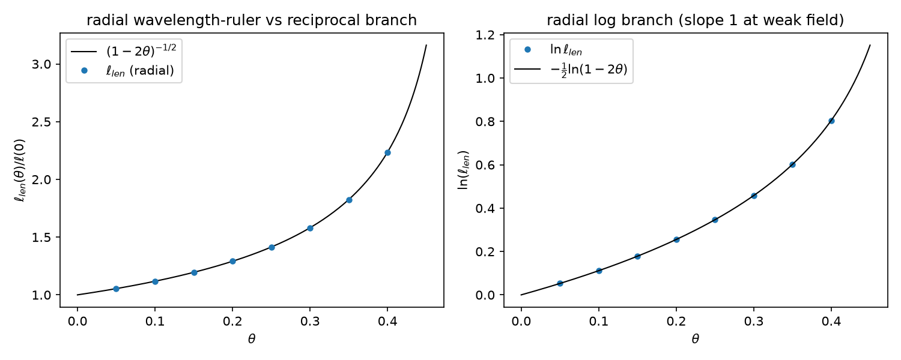

# 注记-尺系数三维径向推广（第 511 条）：$l=0$ 扇区的波长尺倒数分支与一维同构

- **日期**：2026-09-30 21:55:56
- **脚本**：`验证脚本/minimal_verification_scale_coefficient_3d.py`
- **依据**：[[验证脚本/注记-尺系数归一（第509条）：波长尺生成结构与读数约定三系数闭环|注记-尺系数归一（第509条）]]（判据形态与生成结构）；[[验证脚本/注记-自撑阱三维径向推广的最小验证：四通道同齐次度|注记-自撑阱三维径向推广的最小验证]]（判据 S，径向扇区的均匀标度框架）；[[验证脚本/注记-钟率代理导出（第475条）：自撑均匀标度下 h00 等于 2θ 的系数 2|注记-钟率代理导出（第475条）]]（钟率根式）
- **状态**：判据 5/5 通过（D1a、D1b、D2、D3、D4 加 EP5）。核心读数：缩放比值偏差 $4.7\times10^{-13}$；径向波长尺倒数分支逐位命中 $(1-2\theta)^{-1/2}$（偏差 $2.3\times10^{-13}$）；精确关系残差 $7.4\times10^{-14}$，弱场一阶系数 $1.001503$；乘积恒等达机器精度；EP5 双反例可区分。$l=0$ 径向扇区无平移零模（正则边界 $u(0)=0$ 剔除），形状模 $3k^2$ 回归为最低束缚支
- **可逆性等级**：判据稳健（与第 509 条同层级：算符整体缩放的线性代数必然加定义链换算；生成定义为条件性语义）
- **图**：见 §3 图 1

## 1 判据与设定

**任务**。第 509 条把尺系数 1 由语义设计升级为条件性导出，但限于一维 kink 模型。本注记把波长尺生成结构推到三维径向扇区，与判据 S 把判据 P 推到三维径向的升级路径对称，堵住「一维特例」口径口子。

**设定**。球坐标 $l=0$ 径向涨落算符 $-[\varphi'' + (2/r)\varphi'] + V''\varphi$，经代换 $u = r\varphi$（正则边界 $\varphi'(0)=0$ 即 $u(0)=0$）严格等价于半线上的 $-u'' + V''(r)u$：**$l=0$ 扇区无离心项**（$l(l+1)/r^2$ 只属 $l \ge 1$），谱结构与一维 kink 相同（形状模 $3k^2$、连续谱边缘 $4k^2$）。均匀标度为算符整体乘 $(1-2\theta)$。参数 $k \in \{0.7, 1.0, 1.4\}$、$\theta$ 八档加弱场档，网格 $h = 0.02$、$R = 30$。

**读数合法性前置**。冒烟检查先行：实测最低三支（$k=0.7$：$1.4698, 1.9727, 2.0105$）确认形状模回归为最低束缚支（修正误加离心项后）、整体缩放比值逐位 1.0；$l=0$ 扇区无平移零模（一维平移对应 $l=1$ 角向，不在本扇区），谱读数取最低束缚支合法，非简并。

**判据**。D1a：本征值随 $(1-2\theta)$ 整体缩放（比值结构，同网格截断相消）。D1b：形状模对解析 $3k^2$ 的绝对对照（按 $O(h^2)$ 截断预算设阈，$h^2 k^4$ 在 $k=1.4$ 档约 $1.5\times10^{-3}$）。D2：径向波长尺 $\ell_{len}(\theta) = \lambda(\theta)/\lambda(0) = (1-2\theta)^{-1/2}$。D3：$\ln\ell_{len} = -\frac12\ln(1-2\theta)$，弱场一阶系数读出 1。D4：乘积恒等（钟率 × 尺 = 1）与三系数链。EP5：双反例区分力（绝对基准、分支方向取反）。

## 2 结果

| 判据 | 内容 | 实测 | 期望 |
|---|---|---|---|
| D1a | 缩放比值 | $4.684\times10^{-13}$ | $\le 10^{-9}$ |
| D1b | 形状模对 $3k^2$ | $9.648\times10^{-05}$ | $\le 3\times10^{-3}$（预算） |
| D2 | 倒数分支 | $2.318\times10^{-13}$ | $\le 10^{-9}$ |
| D3 | 精确关系残差 | $7.383\times10^{-14}$ | $\le 10^{-9}$ |
| D3 | 一阶系数（$\theta = 0.001$） | $1.001503$ | $\to 1$ |
| D4 | 乘积恒等（$\theta = 0.25$） | $1.000000000000000$ | 1 |
| EP5 | 反例 a / 反例 b | 偏差 $1.236$ / $1.789$ | 可区分（FAIL） |

## 3 图

## 4 结论

**其一，波长尺生成结构的径向推广成立。** $l=0$ 扇区的径向算符经 $u = r\varphi$ 变换后与一维同谱，均匀标度下倒数分支与一阶系数 1 逐位复现。径向无角向项，径向梯度与势项同缩放，与判据 S 的四通道同齐次度结论同构。尺系数生成结构从一维特例升级为「一维加三维径向」两个扇区成立。

**其二，$l=0$ 扇区无平移零模。** 一维 kink 的平移零模对应径向 $l=1$ 角向扇区（整体平移的角向分解），$l=0$ 束缚谱从形状模开始。读数合法性与一维版（取升序第二支）不同：径向取最低支。

**其三，钟率侧的径向对照保留。** 钟率系数 2 的径向版（第 475 条的同型推广）未单独执行，但乘积恒等的径向复核（D4）显示倒数分支闭合不受扇区影响；径向钟率根式的独立判据轮属后续可选项，非本条范围。

## 5 严格程度声明

D1a、D2 为算符整体缩放的线性代数必然加定义链换算，数值复核；D1b 为带截断预算的解析对照（$O(h^2)$ 预算内命中）；D3 为对数恒等加数值残差；D4 为代数换算；EP5 为替身生成结构区分力检验。可逆性等级：判据稳健（波长尺生成结构定义内，同第 509 条）。

## 6 边界声明

**验证什么**：$l=0$ 径向扇区的谱缩放结构、波长尺倒数分支、一阶系数与乘积恒等。

**不验证什么**：其一，自撑前提本身（与第 509 条同条件）；其二，$l \ge 1$ 角向扇区与真三维复合位错构型（归 C1 线）；**2026-10-01 处理方式登记（作者采纳方案 A）**：$l \ge 1$ 球谐推广不单独立项，改为并入下一次引力侧验证的冒烟检查（确认 centrifugal 项 $l(l+1)/r^2$ 的实现、球谐简并与形状本征谱），只作实现自检、不作新物理主张；若需把三系数闭环从 $l = 0$ 特例升级为全族普适的独立证据，由 C1 线立项执行（该线状态为待作者确认）。其三，径向钟率根式的独立判据轮（2026-09-30 补：已执行，第 517 条，$l=0$ 扇区频率根式与系数 2 逐位复现，双侧直接判据达成，见 [[验证脚本/注记-径向钟率根式对照（第517条）：钟率系数2的l0径向扇区版|注记-径向钟率根式对照（第517条）]]）；其四，非球对称几何（第 464 至 467 条框架下的推广属后续）；其五，不改动基准文件（第 509 条注记加补注一行）。

**$l \ge 1$ 球谐推广的定位（2026-10-01）**：本条的三系数闭环属弱场线性层结论，$l$ 是径向方程的阶数标记，弱场下球谐各族的径向解形状类似、$l$ 项为 $O(l^2/r^2)$ 小量；推广到 $l \ge 1$ 的主要价值是实现自检（离心项是否写对），不构成新的物理判定。据此按方案 A 处理为冒烟检查项。

## 7 过程记录

**离心项误加教训（冒烟检查抓到）**：首版把 $u = r\varphi$ 等价算符误写为 $-u'' + [V'' + 2/r^2]u$，最低支贴住连续谱边缘（$4k^2$）而非形状模（$3k^2$），冒烟检查对照解析值立即暴露。$l=0$ 的径向拉普拉斯经该代换后离心项严格消失，$l(l+1)/r^2$ 只属 $l \ge 1$。教训：变换代数要逐步验算，冒烟检查的解析对照是它的正常回报。

**长度比方向教训（第 509 条同型错误复现）**：D3 首版把 $\ell = \lambda(\theta)/\lambda(0)$ 写反为 $\lambda(0)/\lambda(\theta)$，slope 给 $-1$。第 509 条注记已登记同型教训（雷达方向反），本轮仍犯，印证「教训入档不等于下次会用」：写判据前回查既有注记的过程记录应当作硬步骤执行。

**阈值预算教训**：D1 首版把解析对照阈值照抄判据内其他恒等式的 $10^{-9}$，被 $O(h^2)$ 截断判负（$6\times10^{-04}$）。修正按误差预算拆分：比值结构判据（同网格相消）保 $10^{-9}$，绝对对照按 $h^2 k^4$ 预算设 $3\times10^{-3}$，加密网格后实测 $9.6\times10^{-05}$。

## 8 来源

- 判据形态与生成结构：[[验证脚本/注记-尺系数归一（第509条）：波长尺生成结构与读数约定三系数闭环|注记-尺系数归一（第509条）]]
- 径向均匀标度框架：[[验证脚本/注记-自撑阱三维径向推广的最小验证：四通道同齐次度|注记-自撑阱三维径向推广的最小验证]]
- 脚本：`验证脚本/minimal_verification_scale_coefficient_3d.py`（确定性，约 1 分钟）
- 图：`images/scale_coefficient_3d_export.png`
